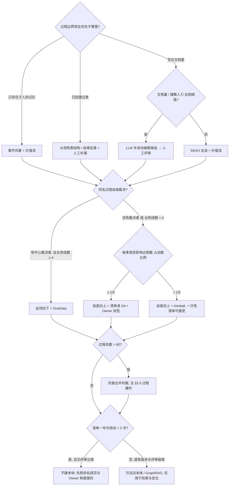

# 业务过程建模（Business Process Modeling）

> **一句话定位**：业务架构→数据架构的桥梁，把"业务怎么干活"翻译成"数据怎么落表"。

> 本文是 data-travel 项目 [Ch1 · 建模方法论](../../README.md) 的子章节（01-business-process-modeling），覆盖 **R3 数据建模** 能力领域中「数仓建模」的入口环节——把业务架构映射为可建模的数据架构。

---

## 1. 概念与定位

### 1.1 是什么

**业务过程建模（Business Process Modeling, BPM）** 在数据架构语境下，特指**用结构化方法识别企业核心业务过程，并将之映射为数据资产（事件、事实、维度）的方法论**。它不等同于纯 BPMN 流程图建模，而是要回答三个核心问题：

- **学术定义**：源自工作流管理联盟（WfMC）与 OMG 的 BPM 体系，关注"业务活动 + 触发条件 + 输入输出 + 角色责任"的四元组结构。
- **工程定义**：在 Kimball 维度建模体系中，**业务过程 = 数据仓库的"原子颗粒"**——一个业务过程对应一组业务过程度量（process metric），进而对应一张事实表（fact table）。
- **核心问题**：在企业数百个业务动作中，识别出"哪些动作会产生分析价值"，并把它们抽象为稳定的、可复用的数据模型。

### 1.2 为什么需要

- **业务驱动力**：当企业从"靠 Excel 决策"走向"靠数据中台决策"时，必须有一套方法把业务动作翻译成数据模型，否则每个业务团队都会"自建模型"，最终形成数据沼泽（data swamp）。
- **痛点**：缺少业务过程建模时，常见的失败模式包括——指标同名不同义（"GMV" 在 5 个部门 5 个定义）、事实表大爆炸（每出一个新报表就建一张宽表）、维度混乱（同一用户在不同表里 7 个 ID）。
- **AI 时代新诉求**：LLM 消费的是"语义化的业务过程"——`customer.churned.after_30_days_idle` 比 `user_status=3 AND last_login<today-30` 对 Agent 更友好。Agent 平台要求业务过程具备**可推理（reasoning）、可检索（retrieval）、可解释（traceability）** 三性。

### 1.3 在 AI 时代数据架构中的位置

业务过程建模是建模方法论的**入口**，处于"业务架构 → 数据架构"的金字塔顶：

```
       业务架构层（业务能力地图 / 价值流）
                ↓ 业务过程建模（本文）
       数据架构层（事件 → 事实 → 维度）
                ↓ 建模方法选型
       物理模型层（ER / 维度 / Data Vault / 本体）
                ↓ 工程实现
       物理存储层（Lakehouse / 图库 / 向量库）
```

与其他建模方法的关系：

| 方法 | 与业务过程建模的关系 |
| --- | --- |
| ER 建模 | 业务过程建模的"上游"——ER 描述静态实体关系，业务过程建模描述动态事件 |
| 维度建模（Kimball） | 业务过程建模的**直接下游**——一个业务过程 = 一张事实表 |
| Data Vault | 业务过程建模的**敏捷版本**——Hub 承载业务实体，Satellite 承载业务过程历史 |
| Anchor Modeling | 业务过程建模的**时序版本**——把过程建模成锚点（anchor）+ 属性的时间序列 |
| 本体建模（Ontology） | 业务过程建模的**语义升级**——把过程抽象为可推理的语义关系 |

**一句话判断**：本章是"建表 / 建模型 / 建体系"中的**建表的前置**——不识别业务过程，建表就是无源之水。

### 1.4 演进历程

- **传统阶段（1990s–2010s）**：以 Inmon 3NF 范式为代表，强调"自顶向下"从企业数据模型（EDW）出发；过程建模被弱化为 ER 图中的"关联关系"。
- **大数据阶段（2010s–2020）**：Kimball 维度建模占据数据仓库 70% 市场份额，业务过程识别（Bill of Process）成为数仓项目第 7 步标准动作；阿里 OneData 在此基础上提出"业务过程→指标体系→数据模型"三段式映射。
- **AI 原生阶段（2020+，LLM + Agent 驱动）**：业务过程建模从"人工梳理"走向"半自动抽取"——LLM 阅读 PRD / 用户故事 / 埋点文档，自动生成候选业务过程清单；Agent 平台要求过程模型支持**自然语言查询**与**多模态语义对齐**。
- **每阶段的核心矛盾**：传统阶段是"模型 vs 性能"、大数据阶段是"敏捷 vs 一致"、AI 原生阶段是"语义 vs 结构"。

---

## 2. 核心原理

### 2.1 关键概念定义

| 概念 | 定义 | 一句话解释 |
| --- | --- | --- |
| **业务过程（Business Process）** | 企业为产生价值而执行的一系列活动 | "用户注册 → 下单 → 支付 → 履约"是一个过程 |
| **业务事件（Business Event）** | 业务过程中发生的、可观测的离散动作 | "用户点击支付按钮"是一个事件 |
| **事实（Fact）** | 业务事件的量化度量结果 | 支付金额、支付时间、支付渠道 |
| **维度（Dimension）** | 描述业务事件"何时 / 何地 / 何人 / 何物"的上下文 | 用户维、商品维、时间维、地理维 |
| **业务能力（Business Capability）** | 企业能稳定提供的、与组织结构解耦的能力单元 | "营销能力"、"风控能力"、"履约能力" |
| **价值流（Value Stream）** | 从客户需求到价值交付的端到端业务流 | "线索 → 商机 → 订单 → 回款" |
| **5W1H** | 业务过程识别的经典框架 | Who/What/When/Where/Why/How |
| **事件风暴（Event Storming）** | Alberto Brandolini 提出的工作坊方法 | 通过"领域事件"贴纸识别业务过程 |
| **过程度量（Process Metric）** | 业务过程产生的可量化指标 | "下单转化率"、"履约时效"、"退款率" |
| **业务过程地图（Process Map）** | 业务过程的可视化资产，连接业务与数据 | 一张图说清"业务怎么干 → 数据怎么落" |

### 2.2 数学/形式化基础

业务过程可被形式化为**偏序事件序列**：

```
P = ⟨E, ≺, C, M⟩

P       = 业务过程
E       = 事件集合 {e1, e2, ..., en}
≺       = 事件间的时序偏序关系（e1 ≺ e2 表示 e1 先于 e2 发生）
C       = 上下文映射（事件 → 维度属性）
M       = 度量函数（事件 → 事实度量）
```

示例：

```
订单过程 P_order = ⟨{下单, 支付, 履约, 收货, 退款}, ≺, C, M⟩

M(下单)   = {订单金额, 下单时间}
C(下单)   = {用户维, 商品维, 渠道维}
≺         = {下单 ≺ 支付 ≺ 履约 ≺ 收货, 收货 ≺ 退款(可选)}
```

业务过程建模的核心目标，就是为每个业务过程 P 生成稳定的 `(E, ≺, C, M)` 四元组，进而映射为事实表 + 维度表。

### 2.3 关键算法/方法

| 方法 | 原理 | 适用边界 |
| --- | --- | --- |
| **5W1H 访谈法** | 通过结构化问题识别业务过程 | 业务访谈、需求调研 |
| **事件风暴（Event Storming）** | 跨角色工作坊，用橙黄贴纸识别领域事件 | 新业务 0→1、跨团队对齐 |
| **价值流图（Value Stream Mapping, VSM）** | 从客户视角识别端到端价值流 | 精益运营、流程优化 |
| **业务能力地图（Business Capability Map）** | 自顶向下分解企业能力 | 战略对齐、组织变革 |
| **BPMN 流程建模** | OMG 标准，用图形化符号建模流程 | 复杂流程编排、SOP 文档化 |
| **LLM 辅助抽取（2024+）** | 用 GPT/Claude 阅读 PRD 自动生成候选事件 | 海量文档、敏捷迭代 |

### 2.4 与相邻概念的关系

业务过程建模 vs 业务流程建模（BPMN）：前者关注"过程→数据"的映射，后者关注"过程本身的执行"。数据架构师关心前者，业务分析师关心后者。

业务过程建模 vs 数据建模：业务过程建模是数据建模的**前置环节**。如果跳过过程建模直接做 ER / 维度建模，会出现"模型能落表，但表说不清业务含义"的尴尬。

什么时候该用业务过程建模：永远要先做一遍；什么时候可以简化：业务稳定、过程清晰、团队已对齐时，可以把过程建模沉淀为模板复用。

---

## 3. 设计模式与范式

### 3.1 先看约束：模式不是选择题，是约束的产物

模式表最容易给人一个错觉：设计就是"按场景挑一个"。真实的过程建模不是这样——**是被约束推着走的**。同一句需求"给电商做业务过程建模"，在"单业务线、报表驱动、团队三个人"和"六条业务线、要跨线可比、有一个中心团队"两种处境下，正确答案不同，而且**两个答案都是对的**。所以本节先立约束，再谈模式。

本主题的约束可以压成一句话：**"一个业务过程"的边界由谁定，以及过程清单是一次性的协商产物还是可增量维护的资产**。其余约束（文档多不多、业务快不快、组织大不大）都是这句话的参数。§4.1 的 8 步流程里，第 1、2、3、5、6 步（战略对齐、价值流识别、过程切片、维度识别、过程地图评审）本质是**协商**，第 4、7 步（事件与度量抽取、物理模型映射）才是**表达**——§5.1 的表已经按这条线拆过一次。协商成本决定了哪些模式在你这儿真的可执行。

把约束摆开之后会发现：**模式之间的差别不在"哪个更好"，而在"把成本放在哪一段"**。自顶向下把成本前置到协商，自底向上把成本后移给未来的对齐，事件风暴把成本压在人的时间上，LLM 抽取把成本从生成端挪到评审端——没有一种模式把成本消灭掉，只是换了付款时间。

还有一件事要提前说清：**约束不是"现状"，而是"愿意承受的代价"**。同一家公司在业务早期用自底向上、规模化之后换成自顶向下，不是前一个选择错了，而是当时愿意付的代价变了。所以读下面每一个模式时，先问它把成本放在哪一段，再问这一段你付不付得起。

| 约束 | 它决定了什么 | 本主题下最容易被它推翻的直觉 |
| --- | --- | --- |
| 数据形态 / 写入模式（事件流 vs 状态快照） | 过程能不能落到可观测事件上 | 直觉"过程 = 流程图"。**被推翻**：只有流程描述、没有事件的过程建不出事实表，它连一行数据都没有 |
| 访问模式（点查 / 扫描 / 聚合） | 过程切多细、事实表建几张 | 直觉"切得越细越精确"。**被推翻**：细到没有独立分析需求时只剩维护成本（§4.1 第 3 步给出的 30–80 个即这一档【经验：随业务线数量与切片粒度变，业务线越多、粒度越细，条数越多】） |
| 变更频率与历史要求 | 清单是"一次性产物"还是"可维护资产" | 直觉"改一次就重画一版"。**被推翻**：变更频率高时，重画成本直接决定清单会不会过期（即 3.5 的"过程漂移"） |
| 一致性要求 | 切片权归中心还是归业务线 | 直觉"一致性靠规范文档"。**被推翻**：一致性只能靠"谁能裁决同名过程"，文档管不住分歧 |
| 规模与成本约束 | 要不要一个长期存在的中心团队 | 直觉"大厂做法直接抄"。**被推翻**：评审带宽是硬约束，抄方法论不增加带宽 |
| 团队技能与运维能力 | 用工作坊还是用生成式工具 | 直觉"有 LLM 就不需要工作坊"。**被推翻**：抽取只能产出候选，认定仍要业务方签字 |

### 3.2 模式逐个拆解（核心节）

7 个模式，每个按「被什么约束逼出来 → 结构 → 为什么有效 → 代价 → 失效点 → 真实使用」六件事写。**失效点是最该看的一项**：它说清这个模式在什么条件下会从资产变成负债。

| 条目 | 位置 | 一句话说明它的机制 |
| --- | --- | --- |
| **自顶向下（Top-Down）** | 3.2.1 | 切片权收归中心，登记在建表之前 |
| **自底向上（Bottom-Up）** | 3.2.2 | 切片权留在做表的人手里，交付周期 = 报表周期 |
| **事件风暴（Event Storming）** | 3.2.3 | 过程边界当场协商，而不是从文档里读出来 |
| **OneData 业务过程切片（阿里）** | 3.2.4 | 派生指标只能由原子指标组合，口径因此可追溯 |
| **价值流驱动（VSM）** | 3.2.5 | 从客户触点反向枚举，把遗漏变成可检出的断点 |
| **LLM 半自动抽取（2024+）** | 3.2.6 | 生成候选的边际成本趋近一次推理调用，仅止于候选 |
| **模板复用** | 3.2.7 | 骨架 + 参数，接入从"设计"降级为"填空" |
| **Kimball / BPMN** | 3.2.1、3.3 | Kimball 是自顶向下的方法出处；BPMN 补的是"过程怎么执行"的可审计记录 |

#### 3.2.1 自顶向下（Top-Down）

- **被什么约束逼出来**：多业务线必须共用同一套过程与指标定义，且组织愿意用前期时间换后期一致。
- **结构**：

```text
业务能力地图（稳定，与组织解耦）
   └─ 价值流（客户视角的端到端链路）
        └─ 业务过程（切片单位，动宾短语：创建订单）
             └─ 业务事件（过去时：订单已创建）
                  └─ 事实表（一个过程 = 一张事实表，粒度声明写在一行上）

约束：下层只能引用上层已登记的过程；
     新过程必须登记之后才允许建表。
```

- **为什么这样设计有效**：因为切片的裁决权在中心且**登记在前**，同一个原子活动只会被登记一次，同名过程不可能存在两套定义——一致性不靠自觉，靠"没登记就建不出表"这条流程约束。
- **代价**：前期没有可交付物。第 1–3 步全是协商，团队要等第一批事实表落地才有产出；协商成本随**业务线数量**上升，每条业务线都要与中心对齐一次【经验：随业务线数与组织集中度变，越分散越贵】。BPMN 一类流程图工具能表达过程内部执行，但表达不了"这个过程的度量归谁"。
- **失效点**：当业务变化速度快于一次完整切片协商的周期时，「全局一致」会反转成「全局过期」，因为清单的更新走的是**同一条高成本协商路径**——业务等不及，就绕过中心自建宽表，中心清单逐渐只覆盖存量业务，一致性的分母悄悄变小。本仓库 §6 案例 1.1 记录的"新业务接入 6 个月"正是这一形态【经验：建设方自述，非第三方材料】。
- **真实使用**：Kimball 的维度建模生命周期在《The Data Warehouse Toolkit》（1996）里就是自顶向下走"业务过程 → 事实表"【公开】；阿里数据中台 2014 年起的 OneData 是自顶向下切片加指标体系的方法论线（本仓库 §6 案例 1.1 为**建设方自述**）【经验】。

#### 3.2.2 自底向上（Bottom-Up）

- **被什么约束逼出来**：只有单业务线、需求由报表驱动、组织来不及（也不愿）先做全企业对齐。
- **结构**：从报表需求单反推事件，直接落表：

```sql
-- 从"昨日下单明细"这个报表需求反推出来的模型
CREATE TABLE fact_order_created (      -- 粒度：一行 = 一次订单创建
    order_key       BIGINT PRIMARY KEY,
    user_key        BIGINT,            -- 维度键直接引用现有维表
    channel_key     BIGINT,
    order_date_key  INT,
    order_amount    DECIMAL(18,2),
    created_at      TIMESTAMP,
    source_report   VARCHAR(64)        -- 反推痕迹：它当初是为哪张报表建的
);
-- 这里没有"过程登记表"这一层：过程边界 = 当时那张报表的边界
```

- **为什么这样设计有效**：因为每个过程都能对应一个已存在的报表需求，交付周期等于一个报表开发周期，不需要先说服任何人——**切片权留在做表的人手里**。
- **代价**：过程边界由"当时的报表"决定。同一个原子活动在不同报表里被切成不同的过程，而模型里没有一层能裁决谁对。后期做跨线分析时，要把按不同口径算出的历史数据重算一次，重算成本随数据保留期与下游消费方数量上升【经验：随保留期与消费方数量变】。
- **失效点**：当第二条业务线接入时，「交付快」会反转成「对齐贵」，因为两套自底向上清单里同名过程各有定义，跨线分析必须先做一次人工口径对齐——这正是自顶向下当初想避免的成本，只是被推迟到了规模更大、存量更多的时候支付。本仓库 §6 案例 1.3 中"5 个业务 5 套『下单』定义"就是这一形态【经验：建设方自述】。
- **真实使用**：单业务线数仓的默认路径；本书 §7.6 选型矩阵在「单业务线数仓、报表驱动、要快」一行给出的正是**自底向上 + Kimball**。

#### 3.2.3 事件风暴（Event Storming）

- **被什么约束逼出来**：过程边界不存在于文档里，只存在于跨角色的人的记忆里——文档能写清流程，写不出"我们实际上都做了哪些事"。
- **结构**：

```text
时间线（从左到右 = 时间顺序，按贴纸颜色分区）
  [命令/触发] ──► [领域事件] ──► [策略/自动规则] ──► [领域事件]
     (蓝)            (橙)             (紫)              (橙)
                       │
                       ├─ 热点（红）：当场吵起来的地方 = 真正的边界争议点
                       └─ 聚合（黄）：事件归属于哪个聚合 = 过程归属的雏形

产出：一墙贴纸的照片 + 一份领域事件清单（不是可 diff 的清单）
```

- **为什么这样设计有效**：因为边界是**当场协商**出来的，所以那些"自动完成、没有人工节点"的过程（自动分单、超时关单）会在贴纸墙上被当场认出来——它们平时不在任何 SOP 里，只在某个人的记忆里。
- **代价**：成本是人时成本，不是工具成本。要把跨角色的人同时约齐（一场通常半天到两天【经验：随参与角色数与过程数量变，角色越多越难约齐】）；主持人水平直接决定产出质量，跑题的场次会得到一墙没有归属的贴纸。
- **失效点**：当参与角色多到一个会约不齐、或者业务在几个月内大改时，「全员对齐」会反转成「一次性共识」，因为工作坊的产出是照片与贴纸，**不是能 diff、能带版本、能追责的资产**——会后没有人负责把它保持新，它在下一个季度就变成一份过期文档。
- **真实使用**：Alberto Brandolini 提出的工作坊方法，2013 年前后成形【公开】；本仓库 §6 的落地路径把「事件风暴工作坊」列为 0→1 阶段的首选做法【经验：建设方自述】；本书 §7.5 决策树在「过程边界只存在于人的记忆」一支给出的是**事件风暴 + 价值流**（§7.6 选型矩阵「0→1 新业务、过程还说不清」一行同）。

#### 3.2.4 OneData 业务过程切片（阿里）

- **被什么约束逼出来**：过程与指标都已失控（多业务线各建一套指标，报表要新指标就直接建新表），且组织里存在一个有裁决权的中心团队。
- **结构**：三层映射 + 分层落地：

```text
业务过程            原子指标         派生指标（只能由原子指标组合）
  交易.下单   →     order_cnt    →    支付率 = 支付单数 / 下单数
  交易.支付   →     pay_cnt      →    客单价 = 支付金额 / 支付单数
  交易.退款   →     refund_cnt   →    退款率 = 退款单数 / 支付单数
        │
        └─► ODS ─► DWD ─► DWS ─► ADS

约束：派生指标不得直接引用明细表字段；
     一个原子指标的归属过程必须唯一。
```

- **为什么这样设计有效**：因为派生指标只能由原子指标组合，所以报表上任何一个数字都能回溯到**唯一一个**过程；同一个"成交"不可能有两套定义，而"口径统一率"因此成为一个可测量的量，而不是一句口号。
- **代价**：治理重。每个过程要有业务 Owner + 数据 Owner，每次变更要评审，于是**中心团队的评审带宽成为全公司的吞吐上限**；切片还必须与组织解耦（按过程切、不按部门切），这在组织频繁调整时是持续的政治成本。本仓库 §6 案例 1.1 记录的"按部门切第一版"的返工就是这条代价的形态【经验：建设方自述】。
- **失效点**：当过程变更的评审带宽小于业务变更速度时，「口径统一」会反转成「口径滞后」，因为新需求等不起评审就绕过指标体系自建宽表——**统一率的分母（被纳管的过程）不再增长**，分子（新增且合规的过程）增速下降，指标好看，覆盖却在缩水。
- **真实使用**：本仓库 §1.4 已把 OneData 列为"业务过程 → 指标体系 → 数据模型"的三段式映射；其工程形态在阿里云 DataWorks 的公开文档线里可核验其存在【公开：以官方文档当前版本为准】；建设方自述见 §6 案例 1.1【经验】。

#### 3.2.5 价值流驱动（VSM）

- **被什么约束逼出来**：清单缺的不是"定义准不准"，而是"全不全"——低频、异常、后台路径的过程长期没人建模，而它们恰恰消耗成本。
- **结构**：

```text
从客户可感知的触点出发，反向枚举到交付为止
  [触达] → [浏览] → [下单] → [支付] → [收货] → [售后]
              │                    │            │
              │                    │            └─ 退款 / 换货 / 补发（低频，最常被漏）
              │                    └─ 超时关单 / 缺货取消（异常路径）
              └─ 加购 / 收藏（弱意图，是否算独立过程要裁决）

枚举规则：客户能感知到的每一次状态变化，都必须能回指到一个过程；
        找不到归属的触点 = 清单里的一个洞。
```

- **为什么这样设计有效**：因为枚举起点是**客户可感知的触点**而不是系统边界，所以"客户能感知到、系统里却没人建模"的过程（补发、改址、部分退款）会以断点形式暴露出来——它把遗漏变成一个可检出的填空题。
- **代价**：只覆盖能映射到客户触点的过程。财务结账、资金对账、风控拒单、运营补数这类后台过程没有客户触点，用 VSM 无论如何都枚举不到，必须另配方法补。枚举本身也有成本：触点数量随渠道数增长【经验：随渠道数、端形态与市场数变，多端多市场时触点数上升更快】。
- **失效点**：当业务重心从获客转到后台效率（履约成本、资金成本、合规成本）时，「客户视角」会反转成「视角盲区」，因为枚举起点天然不含无客户触点的过程——**越是把 VSM 做扎实的团队，越容易对自己缺的那一整类后台过程没有感觉**。
- **真实使用**：价值流图出自精益生产（Lean）方法线，1990 年代成形【公开：具体来源以精益管理权威文献为准】；本仓库 §6 案例 1.3 用"从客户触点反推、穷举全部过程"压低过程遗漏率【经验：建设方自述】。

#### 3.2.6 LLM 半自动抽取（2024+）

- **被什么约束逼出来**：文档量远大于建模人力，且文档每改一版清单就该复核一遍——复核这件事没有人会做，于是清单慢慢过期。
- **结构**：

```text
输入层：PRD / 用户故事 / 埋点文档 / 报表需求单（都不是结构化数据）
   │
   ▼  [LLM]  约束：只能产出候选，不能发布
候选过程清单（结构化，每条必须带原文出处）
   │        {"process":"创建订单","events":["订单已创建"],"owner":null,"src":"PRD §3.2"}
   ▼
人工评审（§4.1 第 6 步：过程地图评审）
   │        ├─ 合并：两个候选其实是同一个过程（模型最常见的错误）
   │        ├─ 拆分：一个候选其实是两个过程（其次常见）
   │        └─ 否决：候选对应的活动不产生度量
   ▼
过程清单（进版本库，带 Owner 与版本）
```

- **为什么这样设计有效**：因为"读文档 → 出候选"的边际成本被压到接近一次推理调用，"先把所有文档过一遍、再人工筛"第一次在成本上划算——旧做法下不会发生，因为没有人愿意把建模师的时间花在读完全部埋点文档上（§5.2.1）。
- **代价**：三项。①确定性下降：同一份 PRD 两次抽取不会得到同一份清单，评审输入从"一份稿子"变成"候选 + 差异"。②错误形态没有工具能拦：模型常见的错误不是编造字段，而是把子步骤拔成独立过程、或把两个过程合并成一个，只在评审或下游报表对不上时暴露。③多了一份要版本化的中间产物：候选清单、提示词、判定标准都要进版本库。
- **失效点**：当上游文档质量下降时（新功能先上线、埋点文档滞后补），「覆盖全」会反转成「漏检被掩盖」，因为模型**被要求"给出完整清单"时的倾向是合并而不是留空**——产出的清单看上去是完整的，缺的那条过程要等下游某张报表长期缺数才被发现。§5.5 已把这条写作"抽取场景里最贵的错误不是编造，而是漏掉与合并"。
- **真实使用**：产品侧能力说明见 Databricks Assistant / Unity Catalog 的 AI 生成能力、Snowflake Cortex 的公开文档（2024 年前后）【公开：能力名称、覆盖范围与 GA 状态以各自 release note 为准】；**第三方（非厂商）公开生产案例核不到**，本仓库 §5.1 表按三条判据把它判为 **L2（可试点，不做核心依赖）**；字节 DataFinder 的 LLM 抽取见 §6 案例 1.2【经验：建设方自述】。

#### 3.2.7 模板复用

- **被什么约束逼出来**：已有稳定的过程骨架与命名规范，新业务要快速接入，同时不允许新业务另起一套口径。
- **结构**：骨架 + 参数，而不是每业务一套模型：

```text
骨架（已登记，不随业务变）          新业务接入 = 填空
  [下单] → [支付] → [履约] → [完成]   只允许加参数，不允许加节点
              │
           [退款]（旁路，可选）
                                      外卖：骑手接单 → 送达
                                      酒店：酒店确认 → 入住
                                      出行：司机接单 → 到达

适用前提（§2.4）：业务稳定、过程清晰、团队已对齐，才可把过程建模沉淀为模板复用
```

- **为什么这样设计有效**：因为新业务的过程形态被约束在**已登记的骨架上**，接入工作从"设计"降级为"填空"，接入时间不再随存量过程数增长；跨业务对比也在结构上天然成立——同一节点、不同参数。
- **代价**：骨架本身要有人维护，而且它一旦登记就比任何单个业务活得久；每加一个可选节点，所有使用方的评审与测试面都跟着扩大。差异大的业务会被强行塞进骨架，得到"像但不准"的过程。
- **失效点**：当新业务的过程形态与骨架差到需要加第二个旁路时，「填空」会反转成「打补丁」，因为**骨架的每个可选分支都要在所有使用方那里被验证一次**——接入成本重新随使用方数量增长，而这次增长发生在骨架已被多个业务依赖之后，改不动的代价更高。
- **真实使用**：本仓库 §6 案例 1.3 采用"新业务必须统一 + 老业务逐步迁移"的双轨策略【经验：建设方自述】；本书 §2.4 把"业务稳定、过程清晰、团队已对齐"列为可简化为模板复用的条件（与本章 §7.6 选型矩阵「已有稳定骨架、新业务要快速接入」一行一致）。

### 3.3 模式选择决策表

| 约束组合 | 推荐模式 | 为什么不选另一个 | 关键判据 |
| --- | --- | --- | --- |
| 0→1 创业公司 / 新业务，过程还说不清 | 事件风暴 + 自底向上 | 自顶向下要先有稳定的业务能力地图，而此刻业务能力本身还没定型，做出来的地图几个月就作废 | 一次工作坊能不能把跨角色的关键人都约齐——约不齐，先别做 |
| 单业务线数仓（如电商交易线），报表驱动 | 自底向上 + Kimball | 上 OneData 要先有中心团队与评审制度，单业务线养不起这套治理 | 同一原子指标是否已被两条以上业务线引用——没有就别上中心 |
| 企业级数据中台，多业务线要跨线可比 | 自顶向下 + OneData | 自底向上省下的对齐成本不会消失，只会在第二条业务线接入时以更高价格支付 | 有没有一个能对同名过程做最终裁决的中心角色——没有先建角色，别选模式 |
| 跨组织复杂业务（金融、制造），角色多 | 事件风暴 + 价值流 | 自顶向下在这里会退化成"文档对齐会"——真正的分歧在角色之间，不在文档之间 | 是否存在"客户能感知却没有系统归属"的触点——有则必须先做价值流 |
| 文档丰富、迭代极快（互联网） | LLM 半自动抽取 | 人工走全流程跟不上迭代；但抽取只出候选，替代不了评审 | 用 20 份真实 PRD 跑一遍【经验：随文档总量与脏乱程度变，文档越乱越要加样本】，能否算出人工评审通过率——算不出就别接进生产线 |
| 已有中台，做新业务扩展 | 模板复用 + OneData | 新业务重做一遍过程建模会造出第二套口径，而它还要和存量做对比 | 新业务的过程形态能否落在已有骨架上——需要加第二个旁路，就先改骨架 |
| 监管严格行业（金融、医疗），要可审计 | 自顶向下 + BPMN | 只做自顶向下缺"过程怎么执行"的可审计记录；只做 BPMN 又缺"过程 → 度量"的映射 | 审计要的是过程执行记录，还是指标口径——两者都要时，两条线分别建 |

这张表里最常被误选的一对是**自顶向下与自底向上**。误选几乎总是同一个方向：单业务线团队看见"大厂做了 OneData"，就按自顶向下起步。后果不是"做得慢"这么轻——半年内没有事实表上线，业务方会绕开团队自建宽表，而这些宽表既不在过程清单里、也没有口径归属；等中心清单终于落地时，它要治理的存量比出发时更多。反向误选（该收权时继续自底向上）的后果同样具体：第二条业务线接入时才发现两套"下单"各有定义，跨线分析要么人工对齐、要么重跑历史。判据其实只有一条：**同名过程由谁裁决**——这一问答不上来，任何模式都选不对。

还有一处容易选错的地方：**"跨组织复杂业务"那一行给的是事件风暴 + 价值流，而不是自顶向下**。跨部门的分歧是角色之间的分歧，不是文档之间的分歧；用自顶向下处理它，往往得到一份所有人都"没意见"、但没有人执行的过程地图。那一行的判据（是否存在"客户能感知却无系统归属"的触点）就是为了把这类分歧在评审之前先找出来。

### 3.4 组合模式：真实系统不会只用一种

真实系统很少只用一种模式。下面三条组合，每条写清"各自承担什么职责、合起来的运维代价、适合的规模"；与其它建模方法的组合见 §7.6。

- **组合 1：事件风暴 + 自底向上（0→1 阶段）**
  - **组合构成**：工作坊产出领域事件清单 → 按报表需求切出第一批过程 → 直接落事实表。
  - **职责边界**：工作坊负责"有哪些过程"（发现），自底向上负责"先建哪几张表"（优先级）；两者都不负责口径裁决。
  - **运维代价**：贴纸墙的照片必须转成可 diff 的清单，否则一个季度后失效；每建一张表都要回填它的过程归属，这个动作是纯人力，成本随建表节奏线性增长【经验：随建表节奏与 Owner 制度是否真的在跑变】。
  - **适合规模**：过程数落在 5–15 个这一档【经验：随业务线数与切片粒度变，业务线越多、粒度越细，条数越多】。
- **组合 2：自顶向下 + OneData（企业级中台）**
  - **组合构成**：中心先走完能力地图 → 价值流 → 过程切片，再由 OneData 把过程映射到原子指标与派生指标，最后落到 ODS / DWD / DWS / ADS。
  - **职责边界**：自顶向下负责切片权与登记，OneData 负责"过程 → 原子指标 → 派生指标"的三层映射与分层落地；两者共用同一份过程清单，谁都不许另存一份。
  - **运维代价**：评审带宽是唯一瓶颈——中心要同时承接"新过程登记"与"派生指标新增"两类请求；带宽不够时，最先被牺牲的往往是变更评审，而不是新增审批【经验：随中心团队人数与业务线数变】。
  - **适合规模**：多业务线，且组织接受一个中心团队长期存在【经验：随组织集中度变，越分散越难维持】。本仓库 §6 案例 1.1、1.3 都是这一形态的建设方自述。
- **组合 3：LLM 半自动抽取 + 事件风暴 + 模板复用（增长期）**
  - **组合构成**：LLM 把散落文档读成候选清单 → 工作坊只用来裁决候选里的分歧（不再从白纸开始贴）→ 新业务按骨架模板复用接入。
  - **职责边界**：LLM 负责覆盖（把文档过一遍），工作坊负责裁决（哪个候选算一个过程），模板负责复用（新业务不重起炉灶）。
  - **运维代价**：多出两份要维护的中间产物（提示词与候选清单）和一份骨架的版本记录；评审动作从"讨论一份稿子"变成"讨论候选差异"，评审时间随候选数增长【经验：随候选数与粒度争议程度变，涉及口径归属的候选增长更快，因此候选数量要设上限】。
  - **适合规模**：文档量大、迭代快，且**已有一份稳定清单作对照**【经验：没有存量清单时，抽取结果无从判断对错】。

### 3.5 反模式与失效分析

| 反模式 | 症状（怎么发现它） | 后果（机制层面的后果） | 成因（为什么团队会写成这样） | 修法 |
| --- | --- | --- | --- | --- |
| **过程爆炸** | 一个业务被拆成 200 个以上业务过程【经验：量级而非阈值；本仓库 §6 案例 1.1 记录的过程膨胀量级为 300+，同属建设方自述】，清单条数涨得比事实表还快 | 每个过程都要有度量、Owner 与粒度声明，维护成本随过程数线性增长；下游 ETL 任务数与 JOIN 数跟着涨，跑批窗口被吃掉 | 拆分是"教科书上可判定正确"的动作（更细 = 更规范），而"够用"没有标准，多做不会当场被追责 | 用「业务过程粒度四问」过滤（是否产生度量、是否跨部门、是否稳定、是否有独立分析需求），答不出就不建 |
| **过程遗漏** | 有人问"这个数从哪来"，链路上断在某个没有对应过程的环节 | 报表缺数据的根源不可见：下游只看到"数不对"，看不到"这个过程从来没被建模"，缺失会长期留在系统里 | 过程识别靠开会回忆，而自动完成、跨系统、无人工节点的过程（自动分单、超时关单）不在任何 SOP 里，也不在任何人的回忆里 | 用价值流图从客户触点反向校验：客户能感知却找不到归属的触点，就是清单里的洞 |
| **过程混淆** | 同一件事在两个过程里都被算了一次，两张报表的合计数加起来大于总数 | 双计数无法在下游修：事实表各自都是"对的"，错在事件归属，而归属没有任何工具能校验 | 一个事件天然会被两个部门的流程同时覆盖（"支付成功"既是交易过程也是财务过程），谁都不认为自己该让 | 强制「事件归属唯一」：一个事件只能属于一个过程，冲突提交建模评审裁决并留痕 |
| **过程漂移** | 业务已改成新流程，过程清单还是上一版；下游报表与业务说法对不上 | 模型与业务的偏离不报错，只让所有以清单为前提的分析系统性偏一点；偏得越久，重建成本越高 | 变更流程里没有"改业务 → 改模型"的触发点：需求变更走产品流程，模型变更走数据流程，两条线不相交 | 把"业务变更触发模型评审"写成硬规则，纳入需求变更的 Definition of Done |
| **跳过过程建模直接建表** | 数据团队直接画 ER 图；问"为什么要有这张表"答不上来 | 表建得出来，但说不清它回答什么业务问题；口径没有归属，新需求来了只能再加一张表 | 建表是可立即交付的动作，过程建模是前置的协商；在交付压力下，先做能交付的那一半是理性选择 | 建模评审前必须有过程地图；评审材料里必须写明这张表对应哪个业务过程与它的粒度 |
| **过程命名不统一** | 同义不同名（"下单"/"创建订单"）、同名不同义（"成交"在多个部门各有定义） | 消费方的认知负担转成取数错误：人和 Agent 都要猜名字，猜错就拿到不同口径的答案，而两条路径都"有据可查" | 各业务线各自命名是最省事的做法；统一命名要先有裁决者，而裁决权往往不明确 | 建企业级词根词典（Glossary）+ 命名规范（过程用动宾短语、事件用过去时，§4.2），并纳入评审检查 |

三条最危险的反模式值得单独说。

**过程混淆是最安静的一类。** 每张事实表单独看都是对的，粒度声明也都清楚，错在同一个事件被写进两个过程。所以任何"表级"的校验都拦不住它：行数对、金额对、血缘对。它只在把两张报表的数字放在一起时暴露——而"把两张报表放一起"通常发生在给高层的汇报里。这也是为什么 §5.2.2 的校验表把"事件归属"列为只能靠人的四项之一。

**过程漂移的暴露方式是"数据与业务说法不一致"，而不是报错。** 漂移持续多久，模型与业务的差距就积多少：几个月后新来的分析师会以为清单就是业务本身。防它的成本极低（把"业务变更触发模型评审"写进需求变更的 Definition of Done），发现它的成本极高。§5.1 把"自进化的过程模型"判为 L3 的理由，正是变更的**决策权**没有可委派的形态——漂移的反面不是一个更聪明的工具，而是一条有人执行的规则。

**跳过过程建模直接建表是前两条的成因。** 跳过之后，"这张表代表哪个过程"没有记录，于是既无法判断事件归属是否重复（过程混淆），也无法判断业务变更后该改哪张表（过程漂移）。它的危险不在于建错表，而在于把两个**本可检出**的问题变成了不可检出。

这六条有一个共同点：**它们都不是"做错了什么"，而是"少做了一步"**。过程爆炸是多做了拆分却少做了合并判据，过程遗漏是少做了反向校验，过程混淆是少做了一次归属裁决，过程漂移是少接了一个变更触发点，跳过过程建模是少做了前置协商，命名不统一是少设了一个裁决者。所以修法都不是"重做一遍"，而是补上缺的那一步，并让它有一个负责人。

### 3.6 规模跃迁时模式何时该换

模式不是一劳永逸的：规模或访问模式跨过某个阈值时，原来正确的模式会变成错的。下表给出五条常见的跃迁与其代价。

| 跃迁 | 原模式 | 为什么开始疼 | 换成 | 迁移的代价 |
| --- | --- | --- | --- | --- |
| 过程数从 5–15 涨到 30–80【经验：随业务线数与切片粒度变】 | 事件风暴 + 自底向上 | 一场工作坊能裁决的边界数有限，每次新增都要重开一场会；贴纸清单没有版本，回答不了"上个月谁改过" | 过程清单进版本库 + Owner 双签（自顶向下的登记机制） | 要给存量过程补 Owner 与粒度声明，补录工作量正比于存量过程数；补录期间新旧两套并存 |
| 单业务线 → 多业务线 | 自底向上 | 第二条业务线的"下单"与第一条不同义，跨线分析要人工对齐，而对齐没有裁决者 | 自顶向下 + OneData（切片权收归中心） | 历史数据要按统一口径重算，重算成本随保留期与消费方数量增长；中心评审带宽要先建起来，否则瓶颈立刻出现 |
| 低频变更 → 持续高频变更 | 一次性清单（工作坊产出） | 清单的更新走的是高成本协商路径，改一次要重开一场会；业务等不及就绕开 | 可增量维护的资产：清单进 Git、变更走评审、抽取只出候选 | 要先把命名规范与 Owner 制度建起来（§4.2），这是迁移的前置条件而不是可选步骤 |
| 文档量远超建模人力 | 人工全流程 | 复核跟不上文档改版，清单慢慢过期；而过期是无声的 | LLM 半自动抽取（只出候选）+ 人工评审 | 多出提示词与候选清单两份中间产物；评审输入从"一份稿子"变成"候选 + 差异"，评审时间上升 |
| 获客导向 → 后台效率导向 | 价值流驱动（VSM） | VSM 的枚举起点是客户触点，无客户触点的过程（对账、结账、风控拒单）系统性缺失 | VSM + 从事件日志反推（过程挖掘方向）+ 后台过程专项盘点 | 日志与事件流要先规范化（事件信封、事件命名，§4.2），否则反推不出可用候选 |
| 出现跨市场 / 跨时区业务 | 单一过程定义 + 各市场自行处理本地口径 | "当天"的定义各地不同，日报会周期性缺一段，而这种缺口看起来像数据延迟，不像口径问题 | 全局过程定义 + 本地时区作参数 | 要回到每个市场重新确认"当天"的业务含义，确认成本随市场数增长【经验：随市场数与本地化差异程度变；本仓库 §6 案例 1.4 是建设方自述的同类形态】 |

判断该不该迁，不必等到"疼得受不了"，有一个足够便宜的信号：**同类问题是否在最近几轮变更里重复出现**——同一个过程被两个部门重复登记、同一张表被两次要求补口径、同一个触点找不到归属。同类问题反复出现，说明当前模式的结构已经撑不住约束，而不是执行不到位。

表里每一条跃迁都有一个共同形状：**原模式解决的是"当时那条约束"，跃迁之后那条约束不再是主要矛盾，原模式省下的成本就变成了新的成本来源**。自底向上省下的是协商成本，规模上去后协商成本又以对齐成本的形式回来了；工作坊省下的是文档成本，变更变快后文档成本又以重开会的形式回来了。所以迁移的判据不是"新模式好不好"，而是**你现在的主要矛盾是不是换了**。

### 3.7 自检清单

以下每条都是**可验证的问题**，答不上来就说明对应模式还没真正成立：

1. 清单里每一个过程都能回答"它产生什么度量"吗？答不出的过程，是否应该合并回它所属的过程（过程爆炸的早期信号）？
2. 事实表里是否出现过任何描述性文本列？出现即违反粒度纪律——粒度声明写的是"一行代表什么"，不是"这一行顺带还带了什么"。
3. 随机抽几个高频事件问"它属于哪个过程"【经验：随事件总数与跨部门程度变，跨部门越多要抽越多】，答案是否唯一？不唯一即过程混淆。
4. 过程清单有没有版本？能不能回答"上一次评审通过时，这个过程的定义是什么"？答不出，说明漂移无处可查。
5. 每个过程是否都有业务 Owner + 数据 Owner 双签？只有数据 Owner 的过程，会在业务变更时第一个过期。
6. 本季度有没有发生过"业务改了、模型没改"？如果有，是怎么发现的——若靠报表对不上才发现，说明变更触发点没有接上。
7. 新接入一条业务线时，是"填空"还是"重新设计"？是重新设计，说明模板复用还没成立。
8. 最近一次过程变更评审，评审的是"差异"还是"一份稿子"？只看稿子，说明候选生成还没有接进流程。
9. 有没有一类过程是你用当前方法**结构性**枚举不到的？（VSM 枚举不到后台过程，自底向上枚举不到没有报表的过程）能说出是哪一类，说明方法边界是清楚的。
10. 过程清单条数与事实表条数的比值，是否稳定在可解释的区间？比值突然跳变，通常是切片粒度被某个人改过。
11. 过程名与事件名是否遵守同一套命名规范（过程动宾短语、事件过去时）？如果只靠人自觉、没有检查规则，这条规范已经在漂移【经验：随评审制度是否在跑变，没有静态检查时漂移更快】。
12. 如果明天要换掉当前方法，有多少存量是"只能重建、不能迁移"的？答不出这一问，说明清单里没有留下可迁移的结构。

### 3.8 小结

| 你的约束 | 建议模式 | 关键理由（机制层面） |
| --- | --- | --- |
| 过程边界只存在于人的记忆里 | 事件风暴 | 边界要当场协商；文档与 SOP 里没有"自动完成的过程" |
| 单业务线、报表驱动、要快 | 自底向上 | 切片权留在做表的人手里，交付周期 = 一个报表周期 |
| 多业务线、要跨线可比 | 自顶向下 + OneData | 一致性只能靠"登记在前"与"派生指标只能由原子指标组合"这两条结构约束 |
| 清单缺的是"全不全" | 价值流驱动 | 枚举起点是客户触点，可把遗漏变成可检出的断点 |
| 文档量远大于人力 | LLM 半自动抽取 | 把"读文档 → 出候选"的边际成本压到接近一次推理调用，但仅止于候选 |
| 已有稳定骨架、新业务要快速接入 | 模板复用 | 接入从"设计"降级为"填空"，成本不随存量过程数增长 |
| 监管要求过程执行可审计 | 自顶向下 + BPMN | BPMN 提供过程执行的可审计记录，自顶向下提供过程到度量的映射 |

这张表能覆盖多数场景，但它有一个前提：**你已经知道自己能不能收回切片权**。收不回来的团队（业务线强势、数据团队没有评审权）不必从表里挑一个"更好的模式"，而应当先按当前能动用的权力选一个能落地的模式，同时把命名规范与 Owner 制度这两件不需要授权的事做掉——它们是后面任何模式迁移的前置条件（§4.2）。

> 本节小结：本主题下决定模式选择的**唯一那条约束**是**切片权归谁**——"一个过程"的边界由谁定、同名过程由谁裁决、清单由谁维护。其余约束（文档多不多、业务快不快、团队大不大）都只是这条约束的参数：它决定的是切片权能不能收得回来（自顶向下 / OneData），还是只能留在做事的人手里（自底向上 / 事件风暴）。所有模式的代价与失效点，最终都在这条约束上结算。
>
> 配合 [§ 2 核心原理](#2-核心原理)、[§ 6 落地实践](01-business-process-modeling-section-6-sec6.md) 与 [§ 7 与其他方法对比](#7-与其他方法对比) 阅读。

---

## 4. 工程实现

本节讲怎么把 [§ 3](#3-设计模式与范式) 里选定的做法装进一个真实组织：顺序、判据、产物、谁负责、以及存量怎么迁。**§4.1–§4.3 面向从零搭建的团队**（八步流程、关键技术点、工具选型）；**§4.4 面向已经在跑的存量系统**（历史表怎么分类、双轨维持多久、什么信号能退出）；§4.5 给可直接抄走的模板，§4.6 给实施期能当场跑的检查。本节不给案例——四个深度案例在 [§ 6 落地实践](01-business-process-modeling-section-6-sec6.md)。

与 §3 的分工说清楚：§3 回答"有哪几种做法、各自被什么约束逼出来、代价与失效点在哪"；本节回答"选完之后，谁在哪一步做什么、做完怎么算成了、坏了谁先知道"。所以本节每一格都尽量落到**只在实施期才存在的东西**上——CI 门禁、评审工单、埋点检索、值班告警、双轨期的账单、回滚动作、审批人签名。凡是坐着想一想就能回答的判断（粒度合不合理、模式选得对不对），本节一律指向 §3，不重写一遍。

### 4.1 落地步骤

八步流程本身没有变，变的是每一步要交代齐三件事：**产物**（手上多出什么可检查的东西）、**判据**（用哪个动作验证它对不对）、**谁做**（出问题时找谁）。

**Step 1：业务战略对齐（2–6 周【经验：随业务线数量与组织集中度变，业务线越多、决策链越长越慢】）**

- 按 5W1H（§2.3）与每条业务线负责人做一轮结构化访谈，产出候选业务能力清单；
- 把候选收敛成能力地图——稳定、与组织结构解耦的那一层；
- 明确这张图的**裁决人**：两条业务线对同一能力命名不一致时，谁拍板。

- **产物**：业务能力地图（Capability Map），每项含负责人、覆盖的业务线、与现有系统的对应关系。
- **谁做**：业务架构师主导，建模 Owner 记录，各业务线负责人确认。
- **判据**：抽 3 项能力，分别请两条不同业务线的人说出它的边界，两人的描述能否落回地图上的同一批节点？对不上的那几项就是还没定的地方。另两条机械判据：地图里出现部门名即说明尚未与组织解耦；每项能力是否都能指向至少一个未来要建的模型。
- **为什么必须这一步 / 为什么在这个位置**：它是整条链上唯一一次把"切片权交给谁"显式化的动作。跳过它直接进第 3 步，切片时遇到同名过程（两条线都叫"成交"）就没有裁决依据，只能靠谁嗓门大——这些争议会在第 6 步评审时集中爆发，而那时清单已成型，改一条要动一串。

**Step 2：价值流识别（2–4 周【经验：随渠道数与端形态变，多端多市场的触点数上升更快】）**

- 从客户可感知的触点出发反向枚举到交付为止，收敛成 1–5 条主线【经验：随业务模式数量变，模式越多主线越多，单业务线通常 1–2 条】；
- 每条主线标注触发条件、涉及系统、产出物；
- 把"客户能感知、系统里却找不到归属"的触点单独列成断点表。

- **产物**：端到端价值流图（1–5 条主线）+ 断点表。
- **谁做**：业务架构师与产品经理共同画，建模 Owner 记断点并指派确认对象。
- **判据**：取最近一个季度用得最多的 3 张报表，每张上的数字能否回指到某条主线上的某个环节？回指不到的环节，就是主线画得不全的地方。断点表里每条是否已指派"下一步找谁确认"。
- **为什么必须这一步 / 为什么在这个位置**：第 1 步画的是能力的静态边界，这一层画的是价值的流动方向。它必须在切片之前，因为切片需要一个枚举起点——先有"从哪开始数"，才有"数到哪为止"。跳过它，第 3 步会退化成按现有报表倒推，而后台过程（对账、结账、风控拒单）系统性地进不了清单（枚举盲区见 [§ 3.2.5](#325-价值流驱动vsm)）。

**Step 3：业务过程切片（3–8 周【经验：随业务线数量、争议条数与评审带宽变，涉及口径归属的条目耗时最长】）**

- 按"一个过程 = 一个可度量的原子活动"切片，动宾短语命名（"创建订单"）；
- 每条过一遍粒度四问（合并判据见 [§ 3.5](#35-反模式与失效分析)），答不出的合并回父过程；
- 冲突条目（同一活动被两条线都认作自己的）提交裁决人当场定，并留下决议记录。

- **产物**：业务过程清单（通常 30–80 个【经验：随业务线数量与切片粒度变，业务线越多、粒度越细，条数越多】），每条带 process_id、名称、粒度声明、所属价值流。
- **谁做**：建模 Owner 起草，业务 Owner 逐条确认，裁决人裁冲突。
- **判据**：清单里每一条能否回答"它产生什么度量"（答不出的应当已合并）；把清单按价值流分组，某条主线只挂 1 个过程，通常是没切完。第三条是成本判据：从提交到最后一条确认的平均时长【经验：随争议条数变】，超过两个评审周期就说明裁决人缺位。
- **为什么必须这一步 / 为什么在这个位置**：这是全链唯一一次"边界协商"。它必须在事件抽取之前——先定"有哪些过程"，再问"每个过程有哪些事件"；反过来做，抽出来的事件会按文档结构而非业务结构聚类，第 6 步就得用评审会重做一次切片。

**Step 4：事件与度量抽取（2–6 周【经验：随过程条数与来源系统数量变，系统越多、埋点越乱越慢】）**

- 为每条过程列出触发事件（过去时命名）、状态迁移与度量；
- 每个事件补齐事件信封：事件 ID、发生时间（**含时区**）、来源系统、主体 ID、所属过程；
- 与埋点侧对齐事件名，并要求"清单里的事件名在埋点平台/日志里可检索到"。

- **产物**：业务事件 + 过程度量清单（事件带过去时名、所属 process_id、来源系统、时区）。
- **谁做**：建模 Owner 与埋点/数据开发共同完成，业务 Owner 确认度量口径。
- **判据**：把清单里的事件名拿到埋点平台逐条检索，命中比例是多少？未命中的条目要么补埋点、要么改清单——两条都不走的记一张工单并指派。度量侧判据：每条度量能否说出它的分子、分母各来自哪个事件。
- **为什么必须这一步 / 为什么在这个位置**：这一层是"业务过程"落到"可观测的一行数据"的接口。它必须在维度识别之前：切片决定了要问哪些事件，而维度要问的是"这些事件共享哪些上下文"——没有事件清单，第 5 步就变成猜。

**Step 5：维度识别（2–4 周【经验：随过程条数与主体类型数量变】）**

- 对每个事件问 5W1H：谁（用户/员工/组织）、何物（商品/合约/设备）、何时、何地、如何；
- 汇总去重得到维度清单，标注每个维度的更新方式（是否 SCD Type 2）、来源系统、更新频率；
- 把跨过程共享的维度单独标出——它们是最需要裁决的那几个。

- **产物**：维度清单 + 维度属性（含来源系统、更新频率、历史保留策略）。
- **谁做**：数据架构师主导，源系统负责人确认字段可得性。
- **判据**：抽 3 个维度，能否在源系统里找到对应字段并说出它的更新频率？说不出的就是"纸面维度"。另：每个属性是否写明"是否可空、有无枚举值表"——第 7 步的 DDL 要直接用它，缺了这一列，DDL 评审只能讨论字段类型。
- **为什么必须这一步 / 为什么在这个位置**：维度是跨过程共享的部分，共享就必须有人裁决归属。它必须紧跟事件清单：晚做，事实表的字段顺序已经被开发写死，改一个维度要重写 ETL 并重跑一批任务。

**Step 6：过程地图评审（1–2 周【经验：随参与部门数与争议条目数变，争议越多要开的轮次越多】）**

- 评审材料 = 过程清单 + 事件与度量清单 + 维度清单 + 每条的粒度声明；
- 签字对象是**粒度声明与事件归属**，不是流程图的美观程度；
- 反对意见当场记录处置结论，未处置的不许进入第 7 步。

- **产物**：跨部门签字的过程地图（评审工单里带签字人与日期）。
- **谁做**：建模 Owner 组织，业务 Owner + 数据 Owner 双签，裁决人主持争议。
- **判据**：取 3 条评审通过的过程，能否在工单里看到反对意见及其处置记录？只有"通过"两个字、没有讨论痕迹的，视为没评审。另：签字人是否为业务侧与数据侧各一人，是否有人代签。
- **为什么必须这一步 / 为什么在这个位置**：它是唯一一次让业务认下"粒度"这个承诺的场合，而粒度一旦落表就不能事后补签——第 7 步之后每改一次粒度都要重算历史并通知全部下游。放在 DDL 之前，是因为此时评审改的是清单（改一行成本近乎零）；放在 DDL 之后，评审改的是数据。

**Step 7：物理模型映射（2–6 周【经验：随事实表条数与源系统数量变】）**

- 一条过程 → 一张事实表，类型（事务/周期快照/累积快照）按 §3 选定的方法定；
- 表注释里写死粒度声明，字段里保留 source_event_id 与 process_id；
- DDL 进版本库并接进 CI：命名 lint、粒度声明必填、下游引用检查。

- **产物**：事实表/维度表 DDL（含粒度声明注释与 process_id 列）。
- **谁做**：数据开发实现，建模 Owner 审阅，DBA / 数据平台负责上线。
- **判据**：跑一次对账脚本——清单里 status=verified 的过程条数与事实表条数是否相等？差的那条要么补表、要么把清单状态改回未实现。抽 3 张表看注释里有没有粒度声明，且它与分区键的语义没有打架（按天分区而粒度是"一次订单创建"时，必须说清分区键是事件时间的截断，不是粒度）。上线前用一小批真实事件回放，验证行数与源事件数对得上。
- **为什么必须这一步 / 为什么在这个位置**：这是清单第一次接触真实数据，也是"纸面模型"与"可运行模型"的分界点。前面任何一步的错误都会在这里以对账差异的形式暴露——而此时还没有下游消费方，是最便宜的一次暴露机会。

**Step 8：持续演进与治理（转入常态；按季度节奏走【经验：随过程条数与变更频率变，变更越频繁越应上调频次】）**

- 清单进版本库，变更走 PR + changelog（哪条过程、改了哪一列、为什么）；
- 每条过程落实业务 Owner + 数据 Owner 双签，并登记到数据目录的**可查询字段**上；
- 每次业务变更触发一次过程模型影响评估；每季度做一次清单与事实表的对账。

- **产物**：过程模型版本管理 + Owner 制度（可查询的清单与元数据）。
- **谁做**：建模 Owner 维护，数据治理/平台提供工具与门禁，业务 Owner 承担签字。
- **判据**：随机挑一条过程，在数据目录上用 5 分钟回答三个问题——谁负责、上一版定义是什么、最近一次变更是谁提的？三个都答得出才算成立。另一条落在工单上：本季度因口径问题开出的工单，有多少条能追到一条已登记的过程？追不到的那些，说明变更的触发点还没接上。
- **为什么必须这一步 / 为什么在这个位置**：第 1–7 步的产出是一次性的，这一步决定它会不会变成一份过期文档。门禁要与第 7 步同时建立，而不是等模型上线半年后再补——门禁的效力取决于存量：等问题积累起来再补，历史条目要一笔一笔补签，补签队列比新建还长。

**八步里最常被跳过的是第 6 步（过程地图评审）**，因为它的产物是一份签字记录而不是代码，在任何进度表上都不好看。跳过它的第一个症状不在当天，而在第一批事实表上线后的 1–2 个季度出现【经验：随报表消费方数量变，消费方越多暴露越快】：两张报表对同一个指标给出不同数字，排查后发现两条链路各自都"对"——错的是同一个事件被两个过程都算过（形态见 [§ 3.5](#35-反模式与失效分析) 的过程混淆）。此时可用的补救只有重算历史或加一层人工口径映射表，两条路都比当场签一次字贵得多。第二常被跳过的是第 1 步：团队直接从第 3 步的清单开始做，等第二条业务线接入才发现没有裁决人，症状是同一个过程被两条线重复登记、清单里出现两条同义条目。

### 4.2 关键技术点

以下 8 条会在八步里反复用到。每条写四件事：**做法**（可执行到能接进工具链）、**机制**（为什么它在运行期有效）、**失效条件**（在谁的值班上、以什么形态被发现）、**档位**。第三条是本节与 §3 的分界：§3 写的是"越写越慢"这类技术症状，这里写的是"谁在什么时候发现它坏了"。

**命名规范**

- **做法**：把规范落成可执行规则——过程名 = 动词 + 名词（"创建订单"）、事件名 = 过去时（"订单已创建"）、度量名 = 业务术语（"订单金额"）；规则写成正则与词根表，接进清单仓库的 CI（提交时校验）与埋点 SDK（上报时校验）。
- **机制**：因为名字是清单、埋点、事实表、指标、BI 数据集之间**唯一的共享键**；当它可以被 lint 时，句式与拼写错误在提交那一刻暴露，而不是拖到两张报表对不上、由值班的人去猜哪个名字才算主名。
- **失效条件**：当词根表由中心维护、而新业务线每月带来一批新动词时，规范会退化成事后改名。**症状先出现在埋点平台上：同名事件两套拼写并存**（`order_created` 与 `order_create`），值班取数按 A 名查为空、按 B 名查有数，而两个名字在清单里都能找到出处。观测信号：埋点平台同义事件名重复条数、"改名工单"的月增量【经验：随业务线数量与埋点是否强制走平台变，强制走平台时重复率显著低】。
- **档位**：初版词根表 30–80 条【经验：随业务线数量与过程条数变，业务线越多、需要的名词词根越多】；lint 误报压到可容忍后就不宜再收紧，否则会被绕过。

**版本管理**

- **做法**：过程清单以纯文本（YAML / CSV）进版本库（Git，或 DataOps 平台自带的版本库能力），一条过程一条记录；变更走 PR，changelog 记录"哪条过程、哪一列、为什么"；生效版本打 tag。
- **机制**：因为粒度声明是历史数据的解读契约，版本库把"这批历史行该按哪一版语义读"变成一次 `git log` 能回答的问题；更重要的是它给出**回滚能力**——清单改错时退回上一版，而不是靠回忆重建。
- **失效条件**：当变更频率超过评审带宽时，PR 会被攒到周末批量合并，changelog 退化成一行 update。**症状出现在复盘或审计现场**：要回答"6 月这批订单按哪版粒度解释"，git log 里只有合并记录没有理由，只能去问当事人，而当事人可能已经换岗。观测信号：描述为空的 PR 占比、PR 从打开到合并的时长中位数【经验：随业务变化速度与评审带宽变】。
- **档位**：清单变更条数与过程总数的季度比值【经验：随业务变化速度与切片粒度变，粒度越细、同一变更波及的条数越多】；比值持续上升，说明粒度太细或评审在走过场。

**血缘追踪**

- **做法**：给每张事实表、每个指标、每个数据集打上 process_id 标签（DDL 注释、建模框架的 meta、指标定义文件的字段都算落点）；血缘由元数据采集**解析**出来，而不是由人画在文档里。
- **机制**：因为"这个数从哪来"只有在**每一跳都可机读**时才便宜；把 process_id 做成贯穿链路的键之后，一次元数据查询就能把报表数字回指到过程与 Owner，值班的人不需要找人问、也不会问错人。
- **失效条件**：当血缘靠文档维护时，它会随重构悄悄过期。**症状是下游报"这张报表空了"，而血缘图上那条边还在**——排查方向因此被带偏到上游任务，而不是那张已下线的表。观测信号：血缘图里指向已下线表的边数（长期应为 0）、"按血缘找不到责任方"的工单占比【经验：随技术栈层数与重构频率变】。
- **档位**：一条链路常见 3–6 跳【经验：随技术栈层数变，层数越多跳数越多】；跳数越多，人工维护的血缘过期越快。

**Owner 制度**

- **做法**：每条过程登记 **1 名业务 Owner + 1 名数据 Owner**，写进清单与元数据（不是写在文档附页）；两人都在变更评审里签字；Owner 转岗或离职走交接工单，交接完成前清单里的 Owner 字段不允许为空。
- **机制**：因为双签把"定义对不对"（业务）与"实现对不对"（数据）拆成两份可追的责任；单人 Owner 一旦休假或转岗，变更只有两种结局——卡住，或者被提需求的人自己改掉。
- **失效条件**：当 Owner 字段填的是团队名而不是人名时，双签退化为无人签。**症状在审批流上可见**：所有变更的审批人都显示同一个"数据平台组"，而实际决定者是提需求的人；出了口径事故时，追责追到一个没有决策权的组。观测信号：Owner 字段为空或为团队名的过程占比、审批时长中位数【经验：随团队规模与是否有交接工单变】。
- **档位**：单个 Owner 名下 20–30 条过程【经验：随团队人数与过程变更频率变，变更越频繁越应下压】；超过就该分拆或增设副 Owner，否则签字会变成盖章。

**变更控制**

- **做法**：把"是否影响已登记过程"做成需求单与数据 PR 的必填项；影响评估的产出是两句话——要改哪几条过程、要不要重算历史。门禁落进 CI：改事实表 DDL 却不带 process_id 或粒度声明的提交直接失败。
- **机制**：因为变更的触发点在产品流程、模型的更新在数据流程，两条线天然不相交；把评估写进 CI 而不是写进制度，意味着绕过它需要一次**有记录的显式操作**（改配置、加例外白名单），而不是顺手漏填。
- **失效条件**：当需求量大到模板被批量勾选时，"不影响"成为默认值，门禁退化成免责声明。**症状在复盘时出现**：能找到变更单，却找不到评估结论；同期清单零变更，而下游对账差异在涨。观测信号："无影响"勾选比例与同期模型变更条数的背离【经验：随需求单量与是否定期抽查变，抽查是唯一能拦住它的动作】。
- **档位**：单条过程的影响评估 0.5–2 人日【经验：随跨部门数与是否已有粒度声明变，跨部门越多越慢】；把它算进需求工期，而不是算成数据团队的额外负担。

**统一术语**

- **做法**：建企业级业务术语词典（Glossary）：每条含术语、定义、同义词、归属过程、生效版本；同义词只作为检索别名，不作为建模可用名；跨过程的同名术语强制加过程前缀（"订单.成交" / "线索.成交"）。
- **机制**：因为"同名不同义"不可能靠约定消除，只能在**入口处**做一次归一——词典的位置决定了归一发生在取数请求提出时，而不是发生在两张报表各自上线之后。
- **失效条件**：当词典只能新增、不能改也不能下线时，新业务会绕开它直接造新词。**症状就是取数请求本身**：出现"帮我查一下那个数"这类没有术语归属的需求，取数的人只能反问你指哪个口径。观测信号：词典里被引用次数为 0 的条目占比（长期不降说明没人从词典进）、口径类问题的重复提问次数【经验：随业务线数量与是否有检索入口变】。
- **档位**：初版词根与术语的条数【经验：随业务线数量与既有命名的混乱程度变，先从被复用最多的那批词开始，不要一次收全】；词典条数不是指标，被引用率才是。

**过程粒度校验**

- **做法**：把粒度四问变成清单的必填列，答不出的条目不进入评审；同时盯三个数——过程条数、事实表条数、被两条以上指标引用的过程占比。
- **机制**：因为"过细/过粗"没有绝对阈值，只有在**比值发生跳变**时才有信号；把四问前置成必填字段之后，最贵的那类错误（把子步骤拔成独立过程）在评审之前就被拦掉，而不是等下游 JOIN 数与任务数暴涨时才被发现。
- **失效条件**：当业务线从 1 条涨到 5 条时，30–80 这个口径自己会先失效——分母变了，同一批活动可以合法地拆出更多过程。**症状是讨论跑偏**：团队开始争论"到底该多少条"，而不是"这一条该不该建"。观测信号：清单条数季度增量与事实表条数季度增量的比值、评审会上被合并掉的条目数【经验：随业务线数量与切片粒度变】。
- **档位**：过程条数 30–80 个【经验：随业务线数量与切片粒度变，业务线越多、粒度越细，条数越多】；这个区间是告警线，不是裁决线。

**文档化资产**

- **做法**：过程地图从清单**生成**（而不是手画）：可视化页面含过程名、粒度声明、Owner、上下游事件、最近一次变更；检索入口放在分析师日常用的取数平台上，而不是单独开一个门户。
- **机制**：因为手画的图没有更新触发点，生成的图在每次清单合并后自动刷新；把入口放进取数平台，等于把"查过程"塞进分析师本来就要走的路径——地图被用起来的原因不是好看，是它在必经之路上。
- **失效条件**：当生成的图没有订阅者、也没人从取数平台链过去时，它会变成一张数据已旧的页面。**症状是自助分析的人仍然在群里问人**，而不是去查地图。观测信号：地图访问量与同期取数提问量的比值、页面生成时间戳与清单最新版本的时间差【经验：随清单变更频率与检索入口位置变，入口越远使用率越低】。
- **档位**：地图刷新跟随清单合并（每次合并触发一次）【经验：随清单变更频率变】；手动批处理生成的图通常在一个季度内过期。

### 4.3 工具链与平台

选型判据比"推荐组合"重要：下表的每一行都给出**在什么约束下选哪个**，以及选错之后钱和时间花在哪。

| 类别 | 候选 | 选型判据（在什么约束下选哪个） | 不选它的代价 |
| --- | --- | --- | --- |
| **流程建模** | BPMN.io、bpmn-js、Camunda Modeler、Enterprise Architect | 判据是"这张图会不会被下游执行或审计引用"——只用于沟通，选开源画板（BPMN.io / bpmn-js）；要落执行与审计留痕，选带引擎的（Camunda Modeler + 引擎）；已有架构团队维护统一建模规范，才上 Enterprise Architect | 用重型工具画一张只为沟通的图：许可与培训成本沉在流程里，而过程清单这一层仍然要另建一份 |
| **事件风暴** | Miro、FigJam、Whimsical、Excalidraw | 判据是"参与的人是否分散在多地、以及产出要不要能导出成结构化清单"——远程分散选 Miro / FigJam；只有同地现场贴纸、导出靠照片，Excalidraw 这类轻量白板足够 | 选了导不出结构化数据的白板：一墙贴纸留在照片里，一个季度后无法 diff、无法带版本，评审时只能看照片回忆 |
| **数据建模** | ER/Studio、PowerDesigner、dbdiagram.io、draw.io、dbt | 判据是"模型要不要随 DDL 变化自动更新"——云原生、DDL 进版本库，选 dbt 一类代码化建模（轻量绘图配 draw.io）；只要画图沟通，draw.io / dbdiagram.io；重资产企业、要与既有 ER 资产库对接，才用 ER/Studio 或 PowerDesigner | 用绘图工具当模型源：图与 DDL 各存一份，改表不改图，半年后图作废，而下游仍在按图找表 |
| **数据资产目录** | DataHub、Apache Atlas、阿里 DataWorks、DataHub Cloud | 判据是"能不能把 process_id 与 Owner 做成**可查询字段**、血缘靠解析还是靠人填"——自建、要改 schema，选 DataHub（开源元数据）/ Atlas；已在阿里云上，DataWorks 与既有调度、血缘打通；不想运维、接受托管，选托管型目录 | 选了只能挂文档链接的目录：Owner 与粒度声明停在文档里，值班时仍然要靠问人，且问不到时没有兜底 |
| **AI 辅助** | Cursor、Claude、GPT-4o、Qwen、Codia | 判据是"输入是代码还是文档"——从代码与 DDL 入手，选 Cursor 一类 IDE 工具；从 PRD / 埋点文档抽候选，选对话式模型（Claude / GPT-4o / Qwen）；硬条件：输出必须能回查原文出处，否则评审无法回退 | 把生成结果直接写进清单：条目没有出处，评审只能凭印象，半年后没人知道某条过程是怎么进来的 |
| **AI 原生数据建模（2024+）** | Unity Catalog + AI Generate、Databricks Assistant、Snowflake Cortex | 判据是"你的数据与权限是不是已经在它所在的那个平台上"——这类能力绑定各自平台，跨平台组合不成立；能力名称、覆盖范围与 GA 状态按各家 release note 当期核验 | 为了用某个能力把数据搬到平台上：迁移成本远大于生成省下的时间，而生成只覆盖第 7 步 |
| **企业架构** | ARIS、BiZZdesign、LeanIX、Mega Hopex | 判据是"这张能力地图的消费者是企业架构组还是数据团队"——要与企业架构治理共用一套资产，才选这一类（ARIS 重型、LeanIX 云原生）；只服务数据团队的过程清单，不需要它 | 让 EA 套件成为过程清单的第二个源：两份资产各自维护、互相不一致，对账只能靠人 |

这一类里最容易被误选的是「**流程建模**」：团队以为装上一个 BPMN 工具就有了过程清单。BPMN 表达的是过程怎么执行，覆盖不到"过程 → 度量"的那一层（见 [§ 3.2.1](#321-自顶向下top-down)）。误选的后果不是图不好看，而是**评审会拿流程图替代粒度声明来签字**：第 6 步签的是拓扑，到第 7 步落 DDL 时才发现粒度从来没定过，于是要么回头重开评审、要么在下游报表对不上时补一次。第二容易被误选的是企业架构套件——它解决的是企业架构组的资产治理，不解决数据团队的过程登记，代价是清单从此多了一个来源。

### 4.4 存量迁移

前面三节默认你从零开始。已经有数仓的团队大多推翻不了重来：表在跑、报表有人用、调度每天在触发。这一节讲怎么在存量上加这层结构，分四问：先做什么能立刻见效且可回退、历史资产怎么分类、双轨维持多久、什么信号说明能退出。

**① 第一天就能做、且能一键回退的两件事**

- 建过程登记表，但**只登记、不返工**：先按现有事实表"一行代表什么"反推成候选过程，状态标 unverified；
- 把命名 lint 挂上 CI，**只对新提交的文件生效**，存量文件一个不动；
- 两件事都挂在配置开关后面。这就是"可回退"的具体含义：出问题时不需要回滚数据，只需要关掉检查。

判据：把开关关掉跑一次全量调度，产出与开着时完全一致（差异为 0）；登记表在最初两周内是否覆盖了大部分活跃事实表【经验：随存量表数量、是否有自动扫描与表命名规范程度变，命名越乱越慢】。第二周没覆盖到的那批，就是第②步要分类的对象。

**② 历史资产分三类处理**

| 类别 | 怎么分（判据） | 处理方式 | 成本落在哪 |
| --- | --- | --- | --- |
| **有归属、且仍在被消费** | 能说清它对应哪个业务过程，且最近一个月有下游引用 | 补粒度声明 + Owner，走一次补签评审 | 人力：补签工作量随存量表数与跨部门数线性增长【经验：随存量表数量与跨部门数变】 |
| **有消费、但归属说不清** | 有人用，但没人能说清它代表哪个过程 | **打标挂账**：元数据标 `process_id: unassigned` 并设到期时间，不阻塞使用 | 治理债：挂账条目数与到期提醒的维护 |
| **低消费或已停止引用** | 最近一个季度没有下游引用 | 冻结：保留但禁止新增下游引用，等自然消亡 | 存储与调度账单：冻结不等于删除，双轨期账单先涨后落 |

"有没有消费"要落到可查的东西上：调度系统的下游依赖、BI 上的数据集引用数、查询日志。三者对不上时**按"有消费"处理**——误判为低消费而冻结了一张活跃表，代价远大于多留一张表。

**③ 双轨怎么维持、维持多久**

双轨的定义是：老链路继续跑且继续可查，新链路（按新清单建的）并行产出，同一指标两处都有。维持双轨的前提是**有一个门禁**——任何新增需求不允许再引用老链路。没有这条门禁，双轨不会自然结束，只会越铺越宽。

- 成本形态：先涨的是存储与调度账单（同一份数据两份），随后是值班面上的任务数（多一套跑批要盯着）；
- 时长【经验：随存量表数量、下游消费方数量与是否设了"禁止新增引用"门禁变，常见 1–3 个季度】；
- 双轨期必须做的动作：每周按指标比对两条链路的结果，差异逐条归因到某条过程或某段代码。

**④ 什么信号说明可以退出双轨**

- 连续两个季度，新需求 100% 落在新链路上——这一条从需求单与 PR 的门禁记录里查得到，不靠感觉；
- 老链路的查询量降到尾部，且值班告警里不再出现老链路的任务名；
- 对账连续若干轮差异为 0【经验：随指标口径复杂度变，口径越复杂需要的轮次越多】；
- 退出动作本身也要可回退：**先停调度、观察一个周期，再删表**，不要在同一次变更里既停又删。

### 4.5 模板 / 示例

**模板 1：过程登记表（YAML，进版本库，一条过程一条记录）**

```yaml
# processes/order_created.yaml
process_id: order.created          # 稳定标识，落表后不再改
name: 创建订单                      # 动宾短语
granularity: 一行 = 一次订单创建      # 写死；改它 = 重算历史
value_stream: 交易主线
events:
  - name: 订单已创建                 # 过去时
    source_system: trade-api
    event_id_field: event_id
    occurred_at_field: created_at
    timezone: Asia/Shanghai         # 事件时间必须带时区
metrics:
  - name: 订单金额
    numerator: 来自 订单已创建
    denominator: 无
owners:
  business: "{业务负责人}"            # 人名，不是团队名
  data: "{数据负责人}"
status: verified                    # verified / unverified / frozen
version: 3
last_review: 2026-01-15
```

**怎么用**：`process_id`、`granularity`、`owners`、`status` 四格必须填满，其余可先留空。`granularity` 一格不要照抄示例——它是这张表的重算边界，写错比写空更贵。`{业务负责人}` 这类花括号是给你填人名的位置。存量表先用 `status: unverified` 登记，不要为了让统计好看而跳过补签直接填 verified。

**模板 2：事实表 DDL 片段（粒度声明 + 事件溯源 + 过程标签）**

```sql
-- 维度表：历史由维表承担（SCD Type 2）
CREATE TABLE dim_user (
    user_key        BIGINT PRIMARY KEY,   -- 代理键：每次属性变更产生新行
    user_id         VARCHAR(64),          -- 业务键
    user_name       VARCHAR(128),
    register_date   DATE,
    -- SCD Type 2 三件套
    effective_date  DATE NOT NULL,
    expiry_date     DATE NOT NULL DEFAULT DATE '9999-12-31',
    is_current      BOOLEAN NOT NULL
);

-- 事实表（事务事实：订单创建过程）
-- 粒度：一行 = 一次订单创建
CREATE TABLE fact_order_created (
    order_key        BIGINT PRIMARY KEY,
    user_key         BIGINT REFERENCES dim_user(user_key),
    product_key      BIGINT REFERENCES dim_product(product_key),
    channel_key      BIGINT REFERENCES dim_channel(channel_key),
    order_date_key   INT,                    -- 退化维度：日期
    -- 度量
    order_amount     DECIMAL(18,2),
    item_count       INT,
    -- 事实表不留历史：粒度改了要重算，SCD Type 2 只保护维表
    created_at       TIMESTAMP,
    source_event_id  VARCHAR(64),            -- 业务事件 ID（血缘的第一跳）
    process_id       VARCHAR(64)             -- 回指过程登记表的 process_id
);

COMMENT ON TABLE fact_order_created IS
  '粒度：一行 = 一次订单创建；process_id=order.created；分区键=created_at 按天截断';
```

**怎么用**：`process_id` 与 COMMENT 里的粒度声明两格，必须与该过程的登记记录逐字一致——这是第 7 步对账脚本唯一的抓手。示例里的 `dim_product` / `dim_channel` 不展开，按你们的维度清单补。分区键与 granularity 的关系不要照抄：示例按天分区，若你们按小时分区，要在 COMMENT 里改说清截断方式。

**模板 3：命名规范检查表（可直接变成 CI 规则）**

| 对象 | 规则 | 判据（示例） | 反例（拿来验收 lint 是否生效） |
| --- | --- | --- | --- |
| 业务过程 | 动宾短语，不带部门前缀 | 词根表驱动的动词白名单 | `交易_下单流程` |
| 业务事件 | 过去时，且唯一归属一个过程 | `created` / `paid` / `shipped` / `received` / `refunded` / `canceled` 结句 | `下单按钮点击` |
| 过程度量 | 业务术语，不写计算方式 | 名词短语 + 单位 | `sum_amt_daily` |
| 事实表 | `fact_<过程英文名>`，与 process_id 对应 | `^fact_[a-z_]+$` | `dwd_trade_order_new` |
| 维度属性 | 名词，不缩写 | 词根表驱动 | `usr_flg` |
| 事件信封 | 五个必填字段齐备 | event_id / occurred_at / source_system / subject_id / process_id | 缺 timezone |

**怎么用**：把"规则"一列原样抄进清单仓库的 lint；"判据"一列按你们已有词根改写——**词根表不要照抄示例里的动词**，它必须来自你们实际的过程清单。第三列是验收手段：拿反例跑一遍，应当全部被拦下；漏过任何一条，说明 lint 还没生效。

**模板 4：过程地图评审工单 checklist**

```text
评审对象：process_id = order.created  v3
[ ] 粒度声明已写死，且与事实表 COMMENT 逐字一致
[ ] 事件归属唯一（没有第二张事实表消费同一事件）
[ ] 业务 Owner / 数据 Owner 均为具体人名，两人都已在工单里签字
[ ] 反对意见逐条有处置结论（同意 / 驳回 + 理由），无未决项
[ ] 影响评估结论已填：本次是否涉及历史重算？重算范围与工期
[ ] 下游影响面已列：受影响的指标 / 数据集 / 报表各几条
[ ] 回退方式已写：要撤回本次变更时，退回的清单版本号
```

**怎么用**：前四条是签字前提，缺任何一条评审无效；后三条是给实施与值班的人看的——没有回退版本号这一条，出问题时第一个人只能去猜。把这张表做成**工单模板**而不是会议纪要，是为了让"谁批的、什么时候批的"可查。

### 4.6 自检清单

以下每条都要**动到系统**才答得出（跑一次脚本、查一次工单、抽一次样本、走一次回滚）。坐着想就能回答的项——粒度合不合理、模式选得对不对——不在这里，见 [§ 3.7](#37-自检清单)。

1. 从清单里随机抽 3 条过程【经验：随过程总数与跨部门程度变，跨部门越多要抽越多】，用数据目录 API 查它们的 owners 字段：返回的是两个具体人名，还是团队名或空值？
2. 取最近一次清单 PR，看 changelog 是否写清"哪条过程、哪一列、为什么"。描述为空的 PR 占多少？
3. 在埋点平台按清单里的事件名逐条检索：命中率是多少？未命中的条目有没有对应的补埋点工单？
4. 抽 3 张事实表，看表注释里的粒度声明是否存在、是否与登记表的 granularity 逐字一致；再把 process_id 反查一次，返回的 Owner 是不是当前在职的人？
5. 跑一次对账脚本：清单里 `status: verified` 的过程条数与事实表条数是否相等？差的那几条，工单在哪？
6. 走一次回滚演练：把清单退回上一版，看下游构建在第几跳失败、报错能不能指出是哪条过程。演练记录有没有留痕？
7. 取最近一次变更评审的工单：签字人是不是业务侧与数据侧各一个、且不是同一人代签？审批时长中位数是多少？
8. 取本季度新老链路的对账结果：差异条目是否为 0？不为 0 的有没有归因到具体过程？
9. 用普通分析师的账号走一遍"这个指标属于哪个过程、谁负责"：30 分钟内能否查到？查不到时他会去问谁——这决定地图该挂在哪个入口。
10. 看最近一个月值班台的告警：有多少条能直接指向一条已登记的过程？指向不到的那几条，是不是清单里的洞？
11. 把命名 lint 的配置开关关掉再跑一次全量调度：产出与开着时是否完全一致？开关有没有被谁长期置为关闭？
12. 看 `status: frozen` 的条目：有没有出现新的下游引用？有，说明冻结门禁没生效。

### 4.7 小结

> 本节小结：八步里唯一不能省、也不能推后的是**第 6 步过程地图评审**——它是唯一一次让业务对"粒度"这个承诺签字的场合，而粒度一旦落表，改它的成本就从"改一行清单"跳到"重算历史 + 通知全部下游"。其余七步都可以分批做、可以做错再退回来，只有这一笔签字是一次性的。
>
> 配合 [§ 2 核心原理](#2-核心原理)、[§ 3 设计模式与范式](#3-设计模式与范式) 与 [§ 6 落地实践](01-business-process-modeling-section-6-sec6.md) 阅读。

---

## 5. 前沿演进（AI 时代）

### 5.1 先分清三类「前沿」

趋势清单最根本的问题不是"哪一条列错了"，而是**没有时间维度**。同一张清单里，"已经有产品在卖、有人在用"和"论文里演示过一次"被并列成同一行；读者据此排路线图，就会把一个不受自己控制的时间表排进关键路径。本章 §1.4 把业务过程建模划成三段（传统 / 大数据 / AI 原生），但"AI 原生"这一段内部不是一块整体，必须先拆开。

本主题还有一个特殊性：**它的卡点主要不在技术里，而在组织里**。§1.2 列的三类失败模式——指标同名不同义、事实表大爆炸、维度混乱——没有一个是模型能力问题。再看 §4.1 那 8 步：第 1 到第 3 步（业务战略对齐、价值流识别、业务过程切片）本质是跨部门协商，第 4 到第 7 步（事件与度量抽取、维度识别、过程地图评审、物理模型映射）才是表达工作。所以本节要判的不是"LLM 能不能读懂 PRD"，而是**它改变的那一段，究竟是协商还是表达**。把 §4.1 的 8 步按这个标准摆开，答案一目了然：

| §4.1 的步骤 | 工作性质 | AI 改变了什么 | 本节对应方向 |
| --- | --- | --- | --- |
| 1. 业务战略对齐 | 协商 | 没有改变——这是一组人的共识 | — |
| 2. 价值流识别 | 协商 | 没有改变——同上 | — |
| 3. 业务过程切片 | 协商 + 表达 | 改变了**表达**的成本（候选清单）；切片标准仍要人定 | 5.2.1 |
| 4. 事件与度量抽取 | 表达（半结构化） | 改变了成本函数：可以生成候选 | 5.2.1 / 5.2.2 |
| 5. 维度识别 | 决策 | 没有改变——维度归属要跨过程协商 | — |
| 6. 过程地图评审 | 协商 | 没有改变——这是签字环节 | — |
| 7. 物理模型映射 | 表达 | 改变了成本函数：DDL 可以生成 | 5.2.2 |
| 8. 持续演进与治理 | 工程 + 协商 | 只改变了"发现漂移"这一半；"怎么改"没变 | 5.2.3 |

这张表是本节后面所有评级的底座：**8 步里被 AI 实质性改变成本的只有第 3、4、7 步；第 1、2、5、6 步一步没动；第 8 步里被改变的只有"发现漂移"那一半。** 于是评价标准也就定了：**凡是只把"生成"变便宜的，最多到 L2；凡是试图生成一个"由谁负责"的权威的，一律 L3。**

要判断一个方向能不能现在就规划，只有三条**可核验**的判据：有没有正式 release note、有没有**第三方（非厂商）**公开的生产案例、接口是否稳定。三条全中才算 L1。这三条各自挡住一类误判：release note 挡住"把路线图当既成事实"；第三方生产案例挡住"把厂商自述当行业现状"——本主题的公开材料恰恰以厂商产品页、客户故事与演示为主，这一条挡掉的误判最多；接口稳定性挡住"把一次演示当工程能力"。

判据必须是可核验的，而不是"感觉成熟"。"厂商博客说已被广泛采用"不算——博客是厂商自己的产出；"GitHub star 多"不算——star 是关注度，不是部署量。可核验的意思是：你能在对方文档里指出一页 release note 或一条时间线，并且能说出一个**不是该厂商自己**的公司正在生产环境里用它。

本节使用 L1 / L2 / L3 三级区分：

| 级别 | 判据（三条全中才算 L1） | 读者该怎么做 |
| --- | --- | --- |
| **L1 生产可用** | ① 已 GA 且有正式 release note；② 有**第三方（非厂商）**公开生产案例；③ 接口稳定 | 可以排进路线图 |
| **L2 可试点** | 已可用但接口 / 生态未稳，或**仅有厂商与建设方自有案例**，或只在小规模被验证 | 可以做 PoC，不要做核心依赖 |
| **L3 观望** | 仅路线图 / 论文 / 厂商演示 / 预览特性 | 记录，不要在架构里预留假设 |

**本节不对 L1 判据做任何修正，也不缩小它的适用范围。** 本主题最容易踩的坑不是"找不到材料"，而是"找到的材料看起来都像第三方案例"：厂商客户故事、分析师报告，以及本书 §6 的四个案例。按判据读，前两类是厂商自述，第三类是建设方自述，**都落在 L2 的定义里**。要把某一行的级别升到 L1，只能找到一份不是该厂商写的、能指名到公司、场景与时间的材料。

还有三件容易混的事，先在这里分开：

- **能力名 vs 产品名**："从文档抽取业务过程""自然语言生成模型"是**能力名**，不是某个产品的专属功能。同一能力在各家产品里的入口位置、支持的输入格式与生效范围都不同（§4.3 的两行 AI 工具用的是各家自己的措辞），所以本节讨论的是**能力**；落到具体产品时，判定方法是按**产品全名 + 该能力的输入与输出**核对它官方文档的当前版本，两者都对上，这条归属宣称才算成立。
- **GA 与预览**：路线图上的条目不能当既成事实。核验入口是各产品的 release note / changelog 页，不是首页宣传语；同时要区分**区域可用性**与**版本可用性**——同一个能力在不同区域、不同版本上可能状态不同。
- **论文原型 vs 产品实现**：论文演示的是方法可行性。判定方法：看该实现有没有显式暴露"生成物是否经过人审、是否带来源指针"。本主题的产出（过程清单、事件、度量）出错时不会报编译错误，只会让下游报表对不上，所以"有没有人认领"比"跑没跑通"更能说明成熟度。

碰到②核不到的情况，不要用"行业里肯定有人在用"来补——那正是 L2 的定义所描述的状态。可核验的补法是两步：先按**产品全名 + 能力名**去该产品的官方文档里找正式条目（找不到就记 L3）；再找一份**不是该厂商写的**部署记录，看它有没有写清公司、时间与规模。两步都做完仍没有，就把这一行写成 L2 并保留，因为**它随时可能因为一份新材料而升格**——评级不是判决，它是一条可复核的推理。

按这三条判据，本主题的分级如下。

| 演进方向 | 级别 | 判据（可核验） | 现在该做什么 |
| --- | :---: | --- | --- |
| **LLM 自动业务过程抽取**：读 PRD / 用户故事 / 埋点文档，产出候选过程清单 | **L2** | ①核不到（无面向"业务过程清单"这一产物的正式发布条目，产品侧只有厂商材料）；②核不到；③不满足——**已可用、生态未稳** | 可做：把它当**访谈的加速器**——先生成候选清单，再按 §4.1 第 3 步人工切片；验收看人工通过率，不看生成速度 |
| **NL2Model**：自然语言 → ER / 维度模型（Databricks Assistant / AI Generate、Snowflake Cortex） | **L2** | ①核不到（厂商能力说明见 Databricks、Snowflake 官方文档，2024 年前后【公开】；GA 状态与区域可用性以各自 release note 为准）；②核不到；③不满足——**已可用、生态未稳** | 可做：限定在"模型已经想清楚、只差落 DDL"的环节；不要在粒度声明之前用它 |
| **建模代码与文档的生成**（dbt + LLM 集成） | **L2** | ①核不到（入口是 dbt 生态的代码生成包与其 changelog【公开】，覆盖的是样板代码）；②核不到；③不满足——**已可用、生态未稳** | 可做：先拿它把已有表反向产出建模文档（粒度与字段含义），风险低、收益真实 |
| **目录侧的 AI 元数据补全**（Atlan Data Context Platform） | **L2** | ①核不到（目录产品普遍在推 AI 补全，Atlan 一类；具体能力以各产品文档为准）；②核不到；③不满足——**已可用、生态未稳** | 做"补全建议 + 人工确认"，不要做无人值守的自动写回 |
| **Agent 驱动的过程发现**：观察日志 / 事件流反向发现过程 | **L3** | ①无（仅论文 / 演示 / 愿景，无正式发布条目）；②核不到；③不满足——**仅是可行性，不是可用性** | 记录；先把事件信封与事件命名规范化（5.3 第一行），这一步的收益远大于引入 Agent |
| **自进化的过程模型**：agent-driven schema evolution | **L3** | ①无（仅论文 / 演示 / 愿景，无正式发布条目）；②核不到；③不满足——变更的**决策权**没有可委派的形态（§3.5 的"过程漂移"正是它的反面） | 记录；先把"业务变更触发模型评审"做成硬规则（§4.2 变更控制） |
| **语义化业务过程**：`order.canceled.within_24h` 一类标签 | **L3** | ①无（仅论文 / 演示 / 愿景，无正式发布条目）；②核不到；③不满足——命名风格今天就能定（§4.2），但"机器能消费的语义"没有契约 | 现在就能做的那一半是**命名**：过程名用动宾短语、事件名用过去时（§4.2）；不要等某个产品来提供语义 |
| **业务过程作为 RAG 索引维度** | **L3** | ①无（仅论文 / 演示 / 愿景，无正式发布条目）；②核不到；③不满足——检索层不产生口径，它只消费过程清单与度量定义 | 记录；先解决过程清单与度量定义本身的质量，再谈向量化 |
| **GraphRAG 与过程本体化**（Microsoft GraphRAG） | **L3** | ①无（仅论文 / 演示 / 愿景，无正式发布条目；公开材料是微软研究院的论文与开源实现，2024【公开】）；②核不到；③不满足——本体与图谱的维护责任无公开约定 | 记录：做概念验证可以，**不要在本体或图上预留架构假设** |

> 表里**没有任何一行达到 L1**。原因不在技术，而在公开材料的构成：本主题能核到的只有**厂商产品文档**、**论文与开源实现**、以及**本书内部的机制定义**三类，其中没有一条可指认的第三方（非厂商）公开生产案例。§6 的四个案例虽然是真实的建设经验，但出处是建设方自述，按同一判据同样是 L2。**L2 不等于"不好"，只等于"公开证据到不了 L1"**；要警惕的是把 L2 当 L1，于是把"可以先试"读成"可以依赖"。
>
> 与之相对，本主题里真正稳的那些东西**不是 AI 带来的方向，而是 AI 之前的基线能力**：§2.2 的四元组 `(E, ≺, C, M)`、§4.1 的八步流程、§4.2 的命名规范与 Owner 制度。它们有长期的、跨行业的第三方实践与稳定的接口形态，但它们是本章的地基，不是"前沿"；本节不把它们当演进方向评级，后面每一次"现在该做什么"都以它们为前提。

**5.1 表与 5.2 的逐项评估是同一份结论的两种呈现**，两处的级别与"①②③哪几条满足"逐字一致：§5.2.1 对应第 1、4 行（均 L2）；§5.2.2 对应第 2、3 行（均 L2）；§5.2.3 对应第 5、6 行（均 L3）；§5.2.4 对应第 7、8、9 行（均 L3）。将来若要改判，两处一起改。

### 5.2 演进方向逐条拆解（核心节）

5.2 的每一组都按同一个结构写：旧做法卡在哪、AI 改变了哪个机制、由此得到什么、由此付出什么、证据与来源、成熟度。重点在**"由此付出的"那一行不能空**——一个方向若写不出代价，多半是因为还没有人在规模上真正用过它；写不出代价的方向，也就不该被排进路线图。

#### 5.2.1 从文档与目录里读出候选过程

- **旧做法与它的卡点**：旧做法是 §2.3 的 5W1H 访谈法与事件风暴——建模师约齐业务方，问出来、贴出来，再人工切片。卡点不在"问得慢"，而在**输入是散落的文档，产出是一次性的人力**：一个中大型企业的过程清单通常落在 §4.1 第 3 步给出的 30–80 个这一档【经验：随业务线数量与切片粒度变，业务线越多、粒度越细，条数越多】，而这份清单背后要读完的 PRD、用户故事与埋点文档，远多于清单本身的条数。文档每改一版，清单就该复核一遍；复核这件事通常没有人做，于是清单慢慢过期——这正是 §3.5 里的"过程漂移"。
- **AI 改变了什么机制**：LLM 把"读文档 → 出候选清单"这一段（自然语言 → 结构化候选）的边际成本压到接近一次推理调用。它**改变的是成本函数，不是决策方式**。
- **由此得到的**：因为产出候选的边际成本被压到接近零，所以"先把所有文档过一遍、再人工筛"第一次在成本上成立——旧做法下不会发生，因为没有人愿意把建模师的时间花在读完全部埋点文档上。它同时让**文档与代码（埋点定义、事件表结构）之间的对账**第一次可以例行化。
- **由此付出的**：三项真实代价。一是**确定性下降**：同一份 PRD 两次抽取不会得到同一份清单，评审的输入从"一份稿子"变成"候选 + 差异"。二是**错误形态变了**：这里没有语法错误可暴露，模型常见的问题不是编造一个不存在的字段，而是**把一段看起来合理、实则与业务不符的结构写出来**（把子步骤拔成独立过程、把两个过程合成一个）——它只在按 §4.1 第 6 步评审、或下游报表对不上时才暴露。三是**多了一份需要维护的中间产物**：候选清单、提示词、判定标准都要版本化，否则半年后没人知道某条过程是怎么进来的。幻觉导致过程漂移，具体形态就是这三条。
- **证据与来源**：无面向"业务过程清单"这一产物的第三方公开生产案例。可核验的是三类间接材料——厂商产品文档（Databricks、Snowflake、阿里云 DataWorks，2024 年前后）【公开】；Text2SQL 的公开评测基准 Spider（EMNLP 2018）【公开】与 BIRD（NeurIPS 2023）【公开】，它们说明"自然语言 → 结构化"这件事有可比口径，但**基准测的是查询，不是过程识别**；以及 §6 的建设方自述案例。**具体产品的 GA 状态与限定条件以各自 release note 为准，本节不作断言。**
- **成熟度**：**L2**。判据与 5.1 表第 1、4 行逐字一致：①核不到、②核不到、③不满足——**已可用、生态未稳**。

判定方法：拿自己最脏的一个业务域的 20 份真实 PRD 跑一遍【经验：随文档总量与脏乱程度变，文档越乱、越要加大样本】，统计生成的候选里**通过评审**（不是"看着合理"）的比例，以及漏掉了几个业务方认为必须有的过程。这两个数拿不出来，它就还停在 L2，与选哪家产品无关。

不同文档能支撑的抽取程度差别很大，先分清再谈准确率：

| 文档类型 | 抽取能拿到 | 抽取拿不到 |
| --- | --- | --- |
| PRD / 用户故事 | 过程名、参与角色、触发条件（文字描述形态） | 事件的真实字段、过程之间的时序偏序 |
| 埋点文档 / 事件表结构 | 事件名、字段与归属关系 | 业务含义——这一步为什么存在 |
| 报表需求单 | 度量名与口径的自然语言表述 | 度量该归属哪个过程（同一指标常被多个过程引用） |
| 流程 SOP / 工单系统 | 人工节点的步骤顺序 | 自动完成的跨系统过程（SOP 里往往根本不写） |
| 代码 / 调度配置 | 实际执行顺序与真实事件流 | 业务上认不认可这个过程是"一个业务过程" |

这张表也解释了为什么"抽取准确率"这个数字在本主题里很难横向比较：**分母取决于你喂进去哪几类文档**，而公开演示用的通常都是文档齐全、命名规范的理想语料。所以本节不引用任何准确率数字——不是不相信，而是没有可比口径。

保留下来的代表性提示词如下（本节唯一的提示词样例，读者可改写后拿去做上面那个判定）：

```text
你是一名资深数据架构师。请阅读以下 PRD，识别其中描述的所有业务过程，
每个过程给出：过程 ID、过程名称、关键事件、过程度量、相关维度。
```

要让这段提示词真的可用，后面至少要补三件事：**切片规则**（什么算一个过程，对应 §4.1 第 3 步）、**命名规范**（动宾短语，对应 §4.2）、以及**输出必须带原文出处**（否则评审无法回查，抽出来的清单就成了一份无法追责的文档）。这三件事没有一件是模型能力问题，它们是 §4.2 治理要求的延伸。

目录侧的 AI 元数据补全（5.1 表第 4 行）是同一机制的另一条输入通道：它不读 PRD，而是读**你已经采集到的元数据**——表注释、血缘、查询日志——据此推断业务过程与业务含义。风险形态一样（推断结果看着合理、但不一定对），区别在覆盖更窄：**元数据里没有的过程，它无论如何也推不出来**。判定方法也只有一条：看它的输出进的是**建议队列**，还是直接写回元数据表。

#### 5.2.2 从自然语言到模型：NL2Model 与生成式建模代码

- **旧做法与它的卡点**：旧做法是需求评审会 → 建模师手画星型图 → 手写 DDL。卡点不在"写得慢"：§4.1 的第 5 步（维度识别）是**决策**，第 7 步（物理模型映射）才是**表达**；旧做法把决策和表达捆在同一个人身上，每来一次需求变化都要重走一遍决策。dbt-codegen 一类工具解决的是最外层的一小段——它生成的是基于已有表的样板代码（base model、source / model 的 YAML 一类），**不理解业务，也不决定建哪些模型**。
- **AI 改变了什么机制**：LLM 把"自然语言 → DDL"这段表达工作的边际成本压到接近一次推理调用，并且第一次能覆盖"这句话该落成事实表还是维度表"这类**半结构化**判断。它改变的是成本函数，不是决策方式。
- **由此得到的**：因为生成的边际成本接近零，所以"先出三版候选模型再挑"在成本上成立；因为候选变多，评审的对照物第一次从"一份稿子"变成"一组差异"，评审可以更具体地问"这几版在粒度上有什么不同"。
- **由此付出的**：第一，同一需求两次生成结果不同，评审要处理不确定性。第二，**语义错误不会被任何工具拦住**——DDL 语法错会被解析器拦下，但粒度选错、把退化维度抽成维度表、维度归属定错都不会，只在下游报表对不上时暴露。第三，**成本前移的错觉**：生成很快，但它只覆盖 §4.1 的第 7 步；把生成速度当立项指标，会得到"产出很多表、没人敢用"的结果。
- **证据与来源**：厂商侧能力说明见 Databricks Assistant / Unity Catalog 的 AI 生成能力、Snowflake Cortex 的官方文档（2024 年前后）【公开】——**具体名称、覆盖范围与 GA 状态以各产品 release note 为准，本节不写成"某产品已支持某特性"**。可比的公开评测口径：Spider（EMNLP 2018）【公开】、BIRD（NeurIPS 2023）【公开】、Spider 2.0（arXiv 预印本，2024，把评测推向多库多步的企业级真实工作流）【公开】。dbt 生态的代码生成包（dbt-codegen 一类）的公开文档与 changelog【公开】。第三方（非厂商）公开生产案例：核不到。
- **成熟度**：**L2**。判据与 5.1 表第 2、3 行逐字一致：①核不到、②核不到、③不满足——**已可用、生态未稳**。可以试点，不要把它设成建表流程的关键路径。

判断某产品的自然语言建模能力值不值得试点，问三个问题就够了：**它生成的粒度声明能不能被追溯到一个业务过程？它对"这句话该建事实表还是维度表"给不给理由？它生成的结果能不能带着原文出处进评审？** 三个都答不上的，本质是一个更快的 DDL 编辑器——这是接口改良，不是架构变化。

还有一条常被忽略的成本转移：**候选变多会把成本从生成端挪到评审端**。旧流程下一个需求评审一份稿子；新流程下要评审 N 份候选加差异说明，评审时间近似随候选数增长【经验：随候选数与粒度争议程度变，涉及口径归属的需求增长更快】。所以在评审带宽没有同步增加之前，候选数量应当设上限，而不是能生成多少就生成多少。

这里有一件容易倒置的次序：**生成得快，不等于建模快**。§4.1 的 8 步里，NL2Model 只覆盖第 7 步；第 1、2、5、6 步（战略对齐、价值流识别、维度识别、过程地图评审）一步都没省，第 3、4 步（业务过程切片、事件与度量抽取）由 5.2.1 那条方向分担，同样要人筛。把某一步的加速当整体提速，最常见的结果是"候选 DDL 攒了一堆，但没人敢把它们发布出去"。

| 生成物 | 谁来校验 | 校验不了会怎样 |
| --- | --- | --- |
| DDL 语法 / 字段类型 | SQL 解析器、建表时的引擎校验 | 建表失败，问题立刻暴露，代价最低 |
| 命名规范（§4.2 动宾短语、过去时） | 静态检查规则（lint） | 规范漂移，靠评审补，属于治理债 |
| 粒度声明（一行代表什么） | **只能靠人**：业务过程 + 建模评审 | 事实表混粒度，同一指标两种结果 |
| 事件归属（一个事件只能属于一个过程） | **只能靠人**：建模评审（§3.5"过程混淆"） | 双计数、口径冲突 |
| 过程与度量的对应（§2.2 的 `M` 映射） | **只能靠人**：业务 Owner 双签（§4.2） | 表能建出来，但说不清它回答什么业务问题 |
| 维度归属与一致性维度划分 | **只能靠人**：跨业务过程协商 | 维度共享不当，口径冲突 |

这张表里"只能靠人"的那四行，恰好是 §3.5 反模式表里最贵的四类后果的来源。换句话说，**AI 在这条链路上压缩的是第 7 步，而风险集中在第 4 到第 6 步**；用错地方的效率提升，只会让错误更早进入下游。

另一个常见的用法错位是把 NL2Model 当成"需求 → 上线"的一站式通道。实际可用的形态是**在建模评审内部生成候选**：评审前先让模型出 2–3 版候选 DDL【经验：随模型复杂度与评审带宽变，候选越多评审越慢，超过 5 版通常就没人认真看了】与对应的粒度说明，评审时讨论差异而不是讨论一份稿子——这恰好把 §3.5"跳过过程建模直接建表"那条反模式挡在门外，因为候选里必须写明它对应哪个业务过程。

```text
生成式建模的真实分工（生成便宜了，评审没变便宜）
  业务描述 ──► [LLM] ──► 候选 DDL × N
                            │
        ┌───────────────────┴────────────────────┐
        │ 机器能负责：语法、命名规范、字段是否齐全  │
        │ 机器不负责：粒度声明、事件归属、          │
        │            维度划分、口径归属             │
        └────────────────────────────────────────┘
  → 评审输入从「一份稿子」变成「N 份候选 + 差异」
  → 粒度若没在生成之前定死：生成越快，返工越早
```

右边那一栏里的四项，正好对应 5.1 表里所有 L2 / L3 方向的共同短板：**它们都落在"需要有人负责"的那一侧**——这也是下一节（5.2.3、5.2.4）要处理的问题。

#### 5.2.3 Agent 过程发现与自进化：把决策外包出去的那一半

- **旧做法与它的卡点**：旧做法是"事件风暴 + 埋点文档 + 事后补录"。卡点在于**过程清单只反映开会时大家记得的事**：真实跑在系统里的过程，往往比会议桌上说出来的多，尤其是那些跨系统自动完成、没有人工节点的过程（自动分单、风控拒单、超时关单）。这一段的缺口靠人补，补得全不全，取决于某个人恰好想起来。
- **AI 改变了什么机制**：Agent 可以持续观察日志与事件流，把"人回忆过程"换成"从数据里反推过程"。机制上是**把人工判断换成统计判断**——注意，换成的是"哪些行为序列构成一个过程"这件事，而不是"这个过程该不该存在"。
- **由此得到的**：因为观察是持续的而不是一次性的，过程清单第一次有了**自动发现增量的可能**（新上线一个自动流程，不必等下一次评审才发现它没被建模）；同一套信号还可以反过来做**漂移检测**——实际事件流的形态与清单不符时报出来。
- **由此付出的**：三项。一是**反推出来的过程没有业务含义**：从日志里聚类出的模式，要经业务方认定之后才算"业务过程"，这段人工环节不能省。二是**误报的成本落在人身上**：每一条候选都要有人看，而 §4.2 的 Owner 双签意味着每条候选要两个人，候选越多，评审带宽越紧张。三是**自动化会把不该做的变更做得更快**：如果反推出的结构被直接写回模型，而 §3.5 的"过程漂移"又没有门禁拦住，事故会在比人工更短的时间内放大。
- **证据与来源**：**无可核验的第三方公开生产案例，属 L3。** 公开材料以论文与演示为主——"静态模型 → 自进化模型"属这一类。判定方法：找一份第三方公开材料，说明"反推出的过程如何与业务方对齐、对齐结果有没有进模型评审"；本节找不到这样的材料，因此不把它写成事实。
- **成熟度**：**L3**。判据与 5.1 表第 5、6 行逐字一致：①无（仅论文 / 演示 / 愿景，无正式发布条目）、②核不到、③不满足。先做 §4.2 要求的那几件事（命名规范、版本管理、Owner 制度、变更控制），收益远大于引入 Agent。

这一组的责任边界可以画成一张图——**能自动化的每一环，终点都落回人**：

```text
Agent 过程发现的责任边界（分隔线以上可自动化，以下必须有人签字）
  日志 / 事件流 ──► 候选过程（聚类出的模式）        ← 可自动化
  ────────────────────────────────────────────────
  候选过程 ──► 与业务方对齐、命名、认定             ← 不可自动化
  已认定的过程变更 ──► 写回过程地图与模型            ← 不可自动化（§4.2 变更控制）
  ────────────────────────────────────────────────
  常见误读：把"能反推出候选"当成"能维护过程模型"
  真实代价：候选越多，需要签字的人时越多
```

把这一组的责任写清楚，可以避免把"能反推"误当成"能负责"：

| 环节 | 谁做 | 做砸了谁负责 |
| --- | --- | --- |
| 采集日志 / 事件流 | 埋点方与数据平台 | 埋点方与平台 Owner |
| 聚出候选过程 | Agent（自动） | **工具不担责**——候选采纳与否由下一步决定，所以这一步的错误成本被推迟了 |
| 认定候选是不是业务过程 | 业务方 + 建模 Owner | 认定人，这一步没有替代品 |
| 给过程命名、定粒度 | 建模 Owner | 建模 Owner（§4.2 命名规范） |
| 写回过程地图与模型 | 变更提交人 | 变更提交人，且必须过 §4.2 的变更控制 |
| 漂移告警与复盘 | 平台（告警）+ 业务方（复盘） | 告警阈值的定义者；复盘结论归业务方 |

这张表也说明了一件事：**"自动发现"的收益主要落在采集侧，而不是认定侧**。日志与事件流一旦规范化，反推候选是便宜的；而认定、命名、定粒度、写回四步的成本与过程数量近似线性相关，且每条都要两个人签字（§4.2 的 Owner 双签）。所以决定要不要上这套能力的不是模型效果，而是**你的评审带宽能吞下多少条候选**。

还有一个更根本的追问：**"自进化"的难点从来不是生成脚本，而是版本管理**。同一张事实表在三个月里可能经历多次粒度调整，每次调整都会让一批历史行的语义发生变化。生成脚本解决的是"怎么写"，而"那批历史行按哪一版过程语义解读"没有任何生成式工具能替你决定——这件事只能靠过程地图的版本记录与评审留痕，也就是 §4.2 里那条最不"智能"的要求。

#### 5.2.4 语义化过程：本体、RAG 索引与 GraphRAG

- **旧做法与它的卡点**：旧做法里业务过程是**给人看的清单**（表格、过程地图）。卡点在于机器消费不了它：一个 Agent 拿到"取消订单"，既不知道它的边界条件（24 小时内？已支付？），也无法沿着过程之间的关系走到下一个过程。§1.2 已经把这件事说成"语义化"的需求——`customer.churned.after_30_days_idle` 比 `user_status=3 AND last_login<today-30` 对 Agent 更友好。
- **AI 改变了什么机制**：把过程清单从**文档**变成**可推理的图 / 可检索的索引**（过程作 class 或节点、事件作 property、过程间关系作 objectProperty 或边），消费方从"人读图"扩展为"Agent 多跳检索"。机制上这是**接口边界的变化**：新增了一层给机器消费的过程语义。
- **由此得到的**：因为过程之间的关系被显式建模，所以"找出与流失客户相似的支付链路"这类多跳问题第一次有了结构可走；因为过程可以被检索，所以自然语言问题可以先定位过程、再定位该过程的度量，而不必猜表名。
- **由此付出的**：三项。一是**多出一层必须与过程清单同步的状态**——本体 / 图里的过程与 §4.1 第 3 步产出的清单之间没有数据库级约束，漂移时不报错，只让检索与推理悄悄偏离。二是**维护成本不随查询量下降、只随过程数上升**，而过程清单本身还在变。三是**错误形态**：图里少一条边或多一条边，多跳推理会给出一个自信但错误的答案，而这个错误通常在拿它做决策时才暴露。本体建模的复杂度让中小团队望而却步，说的正是这条代价。
- **证据与来源**：Microsoft Research 关于 GraphRAG 的公开论文与博客（2024）【公开】——这是本节唯一可以点名的、可核验的方法出处；其开源实现可公开获取【公开】。但**论文里的是方法可行性，不是产品契约**：没有公开材料能说明"业务过程本体的维护责任归谁"。第三方生产案例：核不到。
- **成熟度**：**L3**。判据与 5.1 表第 7、8、9 行逐字一致：①无（仅论文 / 演示 / 愿景，无正式发布条目）、②核不到、③不满足。记录即可，**不要在本体或图上预留架构假设**。

需要分清"现在就能做的语义化"和"还在观望的语义化"：

| 层次 | 现在就能做的 | 还在观望的 |
| --- | --- | --- |
| 命名 | 过程名用动宾短语、事件名用过去时（§4.2）——这是语义化的第一层，今天就能定死 | — |
| 清单 | §4.1 第 3 步的过程清单进 Git，带 Owner 与版本（§4.2） | 自动反推清单并自动写回（§5.2.3） |
| 标签 | 在过程清单里显式写出边界条件（"取消订单"的时限与前提），供人和机器共同阅读 | 产品级的语义标签契约（`order.canceled.within_24h` 这类写法目前只是一种**风格约定**） |
| 图谱 | — | 本体化与 GraphRAG 式多跳检索（本小节前半部分） |

第一行的意思是：**语义化的起点不是某个产品，而是一份能被脚本读的命名规范**。这件事不需要任何 AI 组件，但它决定了后面所有 AI 组件能拿到什么——反过来，如果命名规范还没定，先建本体就是把不确定的东西固化两次。

本体化还有一个容易忽略的次序问题：**先有稳定的过程清单，再有本体**。反过来做，会把一份还在变的清单固化进图谱，之后每改一次过程都要改图谱的两处（节点与边），而图谱的修改成本远高于改清单本身。判断一个团队适不适合现在建本体，看一个信号就够了：**过去一年里他们的过程清单改过几次、每次改动有没有评审记录**。改得频繁又没有评审记录的，建本体只是把混乱换了个地方存放。

GraphRAG 那一路的适用边界同样可以用一句话界定：**它解决的是"从哪找"，不是"算得对不对"**。多跳检索擅长把散落在多个过程里的线索串起来（"与流失客户相似的支付链路"），但它串起来的每一条线索本身可不可信，取决于过程清单与度量定义的质量——也就是本节反复提到的那两样与 AI 无关的资产。

还有一层常被混同的区别：**过程本体与 §2.2 的四元组不是一回事**。`(E, ≺, C, M)` 描述的是**一个过程内部**的结构；本体 / 图谱描述的是**过程之间**的关系。前者是建模的标准产物，后者是新增的一层。把两者混同，会导致一个典型误判——以为"四元组已经有了"就等于"本体只差一个实现"，而实际上过程之间的关系从来没有被显式建模过。

### 5.3 与本主题既有栈的接口在哪

本节不写"与 X 结合"。接口要看三件事：谁调用谁、数据以什么形态穿过边界、失败时谁负责。业务过程建模这一侧有个特殊性——**它的产出（过程清单、事件、度量）是下游一切建模的地基**，接口一旦定错，错误会沿着建模 → 开发 → 治理 → 消费一路传下去，而不会在边界上停住。

| 结合点 | 接口形态 | 谁负责失败 | 现状 |
| --- | --- | --- | --- |
| 埋点 / 日志 ↔ 过程清单 | 事件信封与事件名（§4.2 命名规范）；过程清单是消费方 | 埋点方与建模 Owner 共同负责——事件名与过程名对不上时，两边都容易说自己没错 | L2：约定今天就能定死，AI 不参与 |
| PRD / 用户故事 ↔ 候选过程 | 文档进、候选清单出，**产出是建议不是契约** | 提出候选的工具不担责，签字的是 §4.1 第 6 步的评审人 | L2：可用，但没有第三方复盘的准确率口径 |
| 过程清单 ↔ 事实表 DDL | §2.2 的四元组 `(E, ≺, C, M)` 逐项落到表结构 | 建模 Owner | L2：形态清晰，但"过程改了、表没改"只能靠人发现 |
| 过程 ↔ 度量定义 | 过程是度量的归属（§3.2.4 的 OneData 三段式：业务过程 → 原子指标 → 派生指标） | 业务 Owner + 数据 Owner 双签（§4.2） | L2：机制清楚，落地取决于双签制度是否真的在跑 |
| 过程本体 / 图谱 ↔ 过程清单 | 图谱里的过程节点引用清单条目，**无约束、无同步机制** | **无人负责**（现状下没有 Owner 约定） | L3：正因为找不到责任人，才不该现在落地 |
| Agent ↔ 过程清单 / 度量 | 检索或工具调用，返回过程名与口径 | **调用方（Agent 的使用团队）**——清单只保证"记了什么"，不保证"记得对" | L3：消费侧的失败归责尚无惯例 |
| 过程清单 ↔ 指标口径 | 原子指标归属唯一过程（§3.2.4 三段式）；可做成检查规则：同一原子指标被两个过程引用时告警 | 建模 Owner 与指标 Owner | L2：规则可以自动化，执行仍靠治理 |
| 生成式工具 ↔ 建模评审 | 候选清单 / 候选 DDL 进评审流程，人做决策 | 评审人（工具不承担决策责任） | L2：流程上可行，但没有第三方公开的规模化做法 |

这张表有一个共同点：**所有 L2 / L3 接口的失败责任，最终都落在"人"这一侧**——建模 Owner、双签的业务方、调用方团队。这不是巧合，而是因为 AI 组件没有承担责任的资格：它不签过程地图、不持有口径、不接受复盘。所以引入任何一个 AI 组件时，先问的不是"它能做什么"，而是"它出错时谁签字"。

用这张表做接口审查还有一个便宜的好处：**每一行都能写成一条可执行的测试**。比如"埋点 / 日志 ↔ 过程清单"这一行，对应的测试是"改一个事件名，看有没有人被动到"；"过程本体 / 图谱 ↔ 过程清单"这一行，对应的测试是"问一句：如果图谱停更一周，谁会先发现"。答不上来的行，就是当前架构里没人负责的那一段边界。

还有一条边界最容易被漏掉：**过程清单与指标口径之间的接口**。§3.2.4 的 OneData 三段式要求"业务过程 → 原子指标 → 派生指标"，这意味着原子指标的归属必须能回指到唯一一个业务过程。这件事在纯人工时代靠建模评审维持，在 AI 时代则变成一条可检查的规则（同一原子指标被两个过程引用时告警）——它不需要任何生成式工具，却决定了后面所有自然语言问数能不能给出**唯一**答案。

### 5.4 公开进展与文献

**论文 / 基准（可核验）**

- Spider：跨库 Text2SQL 评测基准，EMNLP 2018【公开】——它定义了"自然语言 → 结构化查询"的可比口径；注意它测的是**查询**，不是业务过程识别。
- BIRD：面向大规模、贴近真实库的 Text2SQL 基准，NeurIPS 2023【公开】——比 Spider 更强调外部知识与脏数据，榜单同时给出人类基线。
- Spider 2.0：把评测从"单库单轮"推向多库、多步的企业级真实工作流（arXiv 预印本，2024）【公开】——具体榜单与人类基线以其官方页面为准，本节不引具体分数。
- GraphRAG：Microsoft Research 关于图结构检索增强生成的公开论文与博客，2024【公开】——5.2.4 里"过程作节点、事件作边"这一思路的可核验出处；它给的是方法，不是"业务过程本体该由谁维护"的答案。
- Kimball《The Data Warehouse Toolkit》，1996【公开】——本节所有"旧做法卡点"的判据来源：粒度声明、一致性维度、业务过程 → 事实表这套映射在 LLM 出现之前就已定义完毕，AI 没有改写它们。
- 事件风暴（Alberto Brandolini 提出，2013 年前后成形）【公开】——§2.3 的工作坊方法；本节反复用它作对照，因为它解决的问题（跨角色对齐）恰恰是 AI 目前改变不了的那一段。
- 过程挖掘（process mining）方向：从事件日志反推流程的公开文献线【公开】——本主题在 AI 之前就有一条这样的技术脉络，5.2.3 讨论的"Agent 过程发现"是同一问题的新形态。判定方法：看材料报告的指标是**一致性检验**（日志与已有模型是否吻合）还是"发现了多少个过程"——前者是这条脉络的成熟口径，后者通常只是演示。

**官方文档与 release note（需自行核验版本状态）**

- Databricks Assistant / Unity Catalog 的 AI 生成能力、Snowflake Cortex 的产品文档与 release note【公开，2024 年前后】——核验入口是各自的 release note 页与区域可用性说明，不是首页宣传语。
- dbt 生态的代码生成包（dbt-codegen 一类）与 dbt 文档【公开】——判断它是不是"建模"的关键是看**输入**：输入是已存在的表，那就不是"理解业务后的建模"。
- 数据目录产品的 AI 补全能力文档（Atlan 一类目录产品）【公开】——判定方法是看它输出的是**建议**还是**写回**。
- 事件信封与事件命名方向的公开规范文档（各类事件规范 / 事件契约一类）【公开】——核验入口是它有没有**带版本号的规范文本**，而不是某篇介绍性博客；5.3 第一行那条接口能不能定死，取决于你选的规范有没有版本化。

**第三方生产案例**

- **本节未找到可核验的第三方（非厂商）公开生产案例**：能指名到公司、场景与时间的材料基本来自厂商自述；§6 的四个案例是建设方自述，同样不计入②。这正是 5.1 表里没有任何一行够 L1 的直接原因——不是怀疑能力，而是没有独立证据。
- 判定一份材料够不够格当"第三方生产案例"，看四件事：**公司名**（不是"某大型企业"）、**时间**、**规模**（多少个业务过程、多少张事实表）、**失败教训**。四条缺两条以上，只能算参考性材料。
- 反过来说，读者若要把某个方向从 L2 升到 L1，路径是明确的：找一份不是该厂商写的、能指名到公司与时间的材料，并核验它的规模与你的场景是否可比。

这份清单有一个共同点值得点出：**可核验的论文与规范，几乎都不直接讨论"业务过程清单"这个产物**。Spider / BIRD 测的是查询，GraphRAG 测的是问答，Kimball 与事件风暴讲的是方法规程——真正缺失的，是本主题核心产物在生产环境里的第三方记录。这就是 5.1 表里没有 L1 行的根本原因：缺口不在技术，在公开证据的构成。

### 5.5 被过度宣传的部分

**「Agent 能完成业务过程建模的大部分工作，人只做审核」** —— "业务过程建模的 80% 工作由 Agent 完成"【未给出处，本节不作为断言引用；凡再见到这个数字，先追问它的分母是什么】。实际是：Agent 能生成候选清单、能写 DDL 草稿，但 §4.1 的第 1 到第 3 步（战略对齐、价值流识别、过程切片）与第 6 步（过程地图评审）替代不了。→ 为什么会这样：模型拟合的是"过程通常长什么样"，而"我们公司认不认这个过程、由谁负责"是**组织决策**，输入不是文本，是一组人的共识。→ 什么时候它才会成真：当过程清单、粒度声明与 Owner 已经被登记成机器可读的资产，且生成物必须穿过带门禁的评审流程——那时人的动作确实会变少，但**签字的人一个都不会少**。

**「LLM 抽取出错，就是幻觉编造了不存在的业务过程」** —— 这个担心抓错了重点。抽取场景里最贵的错误不是**编出一个不存在的过程**（评审时一眼能看出来），而是**漏掉一个真实存在的过程**，以及**把两个过程合并成一个**——这两类错误在清单上看不出异常，只表现为下游某张报表长期缺数据。→ 为什么会这样：模型被要求"给出过程清单"，它就有把清单写完整的倾向，于是宁可合并、也不留空。→ 什么时候它才会成真（指这类错误被系统性解决）：当抽取结果被要求附带**原文出处与覆盖率自评**（哪几段文档没有被任何过程覆盖），并且真的有人去看那个数字。

**「业务过程本体建好之后，Agent 就能自己推理业务」** —— 实际是：本体的价值在**检索与定位**，不在**裁决**。本体建模的复杂度让中小团队望而却步是真实的：本体的维护成本不随业务量下降，而过程清单本身还在变。→ 为什么会这样：图能表达"A 过程之后通常是 B"，但不能表达"B 算不算这个业务的成功"——后者是口径问题，只能由人裁。→ 什么时候它才会成真：当过程本体的维护责任（谁在什么触发条件下更新它）与口径裁决权，都被明确落到具体角色上。

顺带一条同类的错位：**把"过程挖掘"（从事件日志反推流程）的成熟度借给生成式抽取**。日志反推流程这件事本身有成熟的公开方法与工程实践，但那通常是**一致性检验**的思路——拿日志去检验一个已经存在的模型；而 5.2.3 讨论的是"从零生成一份业务过程清单"。两者的输入相似、产出完全不同，把前者的成熟度算到后者头上，是这一节最常见的错误来源。

这三条说法有一个共同结构：**它们都把"生成"的能力当成了"判断"的能力**。读到任何一条宣称时，先找它的主语是谁——主语是"模型"，那这条宣称基本都还需要再降一格。

还有一条与上面三条不同的提醒：**"生成得像"不等于"建模对了"**。演示里生成的 DDL 与过程清单，多半来自命名规范、文档齐全的理想样本；换成真实企业里命名混乱、文档缺失的语料，同一能力的表现会明显下降。这里有一个不需要任何材料就能做的核验动作——拿你自己最脏的那个业务域里的一份真实文档试一次，看生成的结果能不能直接用；用不了，就说明这一格对你而言还要再降一档。

### 5.6 未来 3–5 年：可证伪的预测

预测必须能被推翻，所以下面每条都写成「预测 + 会成真的信号 + 会证伪的信号」。能给出信号的保留为预测，给不出的（"过程模型会与本体深度融合"一类）不写——它们永远正确，因而是零信息。观察窗口取 3–5 年（即本节标题给出的区间）【经验：随各组件的采纳周期变，采纳慢的方向可放宽到 5 年】。

| 预测 | 会成真的信号 | 会证伪的信号 |
| --- | --- | --- |
| **"候选过程抽取"会稳定停在"生成草稿"这一格**，评审环节不会被移除 | 各厂商能力说明持续强调"建议 / 辅助"；企业公开材料里仍在讲评审阶段拦下了多少生成结果 | 出现第三方公开材料，说明某企业把抽取结果直接写回过程地图且未设评审，并且没有出现过程漂移事故 |
| **过程清单会先被机器读，再谈语义化** | 出现第三方的公开实践，把过程清单做成带版本、带 Owner、可被脚本消费的资产；语义标签作为清单的一列而不是独立系统 | 语义化仍以"某个产品里的功能"形态出现，过程清单继续留在文档与绘图工具里 |
| **Agent 过程发现不会替代事件风暴，但会改变它的输入** | 工作坊开始以"系统反推的候选清单"为起点做增删改，而不是从白纸开始贴贴纸 | 三年后多数团队的业务过程识别仍从访谈开始，反推手段只停留在论文与演示里 |
| **过程本体与图谱不会进入关键路径** | 图谱以"只读的辅助检索"形态存在，与过程清单单向同步，人工确认后才更新 | 出现把过程本体作为口径裁决依据的主流做法，并且能给出与"人裁决"的对照结果 |

四条预测共享同一个方向：**发生变化的是生产这些产物的成本，不是判断这些产物对错的机制**。如果三年后回看发现相反——评审环节被整体移除而过程漂移事故没有增加——那就是本节判断错了，而这个错法是有信号的（见上表第一行）。

本节刻意不预测"AI 会不会取代业务架构师"，也不给"几年内自动化多少百分比"这类数字：前者取决于组织愿意把决策权交给谁，后者取决于你打算怎么定义"一个过程被自动化了"，两者都不是可证伪的技术判断。同理，本节也不预测任何**具体时间点**（"某年会出现 X"）——信号的成立与否不依赖年份，而时间点一旦写死，多半会在到期前被悄悄改口径。

### 5.7 给架构师的行动建议

下表的"一年内观察"是本节给的一个观察窗口【经验：随规划周期与业务变化速度变，变化快的可缩到半年，稳定的可放宽到两年】，不是承诺的见效时间。

| 你的处境 | 现在就该做 | 一年内观察 | 明确不要做 |
| --- | --- | --- | --- |
| **刚建第一个数仓、还没有过程清单** | 走完 §4.1 的前三步（战略对齐 → 价值流 → 过程切片），把 §4.2 的命名规范定死 | 过程清单的条数是否稳定在可维护的区间；清单有没有版本 | 不要在过程清单还没有的时候引入生成式抽取——没有清单，就无法判断它抽出来的东西对不对 |
| **文档多、业务变化快，想提高识别效率** | 用 LLM 生成**候选**清单，再按 §4.1 第 3 步人工切片；把提示词、输出与判定标准一起版本化 | 人工通过率与漏检率这两个自测数字 | 不要把生成结果直接当过程地图发布；不要用"生成了多少条"当效率指标 |
| **在评估自然语言建模 / NL2Model** | 限定在"模型已经想清楚、只差落 DDL"的环节 | 生成 DDL 的评审通过率；厂商 release note 里的能力边界是否收敛 | 不要在粒度声明之前用它自动建表——粒度错了不会被任何工具拦住 |
| **在评估 Agent 做过程发现** | 先把事件信封、事件命名与埋点文档规范化（5.3 第一行） | 是否出现第三方公开的"反推过程 + 人工对齐 + 进评审"生产案例 | 不要让反推结果绕过 §4.2 的变更控制直接写回模型 |
| **想建过程本体 / 接 GraphRAG** | 先做概念验证，并明确它只用于**检索与定位** | 本体维护责任有没有出现公开约定；过程数增长时图谱的维护成本 | 不要在过程清单本身还不稳定时建本体；不要为本体预留架构假设 |
| **采购数据目录 / 元数据工具** | 把"AI 补全"当**产品选型项**评估：不看它能不能"识别业务过程"，看它的输出是建议还是写回 | 补全建议的人工采纳率 | 不要为"AI 原生"这个标签支付溢价——本节表里没有任何一行够 L1，标签不改变这件事 |
| **已有过程地图，但经常过期** | 把"业务变更触发模型评审"做成硬规则（§4.2 变更控制），并给每个过程落实业务 Owner + 数据 Owner 双签 | 过程变更到模型更新的平均滞后；漂移事件的复盘结论指向哪一环 | 不要用自动反推替代变更评审，也不要用它给过期地图刷一遍新数据——那只是把漂移藏起来 |
| **团队里已经有人在用 LLM 读 PRD** | 把提示词、输出格式与判定标准收进版本库（§4.2 版本管理），并把"通过评审的比例"记下来 | 这个比例有没有随时间上升；漏检的过程有没有被业务方补回 | 不要让每个人各用各的提示词——那样产出无法比较，也无法复盘 |
| **刚经历一次大促 / 大事件，过程清单对不上实际** | 先做漂移复盘：把实际事件流与清单的差异逐条对照（§3.5"过程漂移"），补齐缺失的过程 | 复盘补出的过程里，有多少是自动完成、无人工节点的 | 不要在没复盘的情况下先上自动反推——你连现在的差异有多大都不知道 |
| **要做技术选型汇报** | 用 5.1 表的三条判据逐行核验候选产品，并写明"①核不到 / ②核不到"的具体理由 | 一年后这几行有没有哪一行能被新材料升格 | 不要在汇报里写"行业领先""已被广泛采用"这类无法核验的描述 |
| **业务方开始自己问数** | 先保证过程名、事件名、度量名三者能对上（§4.2 命名规范 + 词根词典） | 同一问题在不同入口得到不同口径的次数 | 不要为自助分析单独复制一套命名与口径，那是把今天的问题复制成明天的问题 |

还有一个容易被跳过的前提：**过程清单本身的质量，决定了上表所有动作的上限**。清单里若存在同名不同义的过程名，那么无论用不用 AI，下游都会算错；反过来，如果命名规范与 Owner 制度已经稳定运行，本节列的多数 L2 方向都可以放心做小范围试点，因为出错的产物会被评审拦住。

这张表的每一行都指向同一件事：**本节所有建议的动作，成本都落在"把决定写成明文并指定负责人"上**，没有一个落在"引入某个 AI 组件"上。判断 AI 值不值得用，取决于你手上有没有可核验的过程清单与命名规范——有，AI 是放大器；没有，AI 是加速器，加速的还是错的那条路。

### 5.8 小结

> 本节小结：AI 在业务过程建模上真正改变的是**一条**机制——把"自然语言 → 结构化候选"（候选过程清单、DDL 草稿、建模文档）的**边际生成成本**压到接近零，因此"先把所有文档过一遍再人工筛""多出几版候选再挑"这些旧做法下不划算的事第一次划算。它没有改变的是**协商与责任**：过程清单认不认、粒度声明写什么、事件归属哪个过程、口径由谁签，仍然是组织决策，必须落到具体的人和具体的评审环节上——所以 5.1 表列的九个演进方向，**没有任何一个够得上 L1**：第②条（第三方非厂商公开生产案例）在本主题下核不到，凡已可用者停在 L2，凡仅见于论文与演示者停在 L3。
>
> 配合 [§ 2 核心原理](#2-核心原理)、[§ 6 落地实践](01-business-process-modeling-section-6-sec6.md) 与 [§ 7 与其他方法对比](#7-与其他方法对比) 阅读。

---

## 6. 落地实践

> 本节的深度案例见 **[§6 落地实践](01-business-process-modeling-section-6-sec6.md)**（4 个深度业务过程建模案例，约 400 行）——主文件此前的 40 行概述已被该文件取代。

本节要点：业务过程建模的落地顺序是「先识别业务过程 → 再声明粒度 → 后建指标映射」，反序会让口径在上游反复返工。4 个案例分别覆盖自顶向下切片、自动发现、指标口径联邦与建模评审四类场景。

## 7. 与其他方法对比

### 7.1 先立判据：为什么打分表会误导

打分表给"灵活度 / 学习成本 / 可演进性 / AI 友好度 / 生态成熟度"各打 1–5 分，让读者按偏好挑。问题不在分数定得准不准，而在**这些维度的权重是场景相关的，而且经常反向**。同一列"灵活度"：在三条业务线、报表驱动的团队里它是最重要的维度；在监管行业只要一套可审计口径的团队里它是负分项——灵活度越高，越意味着同名过程可以被改出第二套定义。打分表把"取决于场景的结论"伪装成"绝对结论"，读者据此选了自顶向下，却不能从表里看出它把自己的成本押在了哪一段。

打分表的第二个问题，是它**把因果关系压成了并列形容词**。"Data Vault 可演进性 5、BPMN 2"这句话不产生任何可执行信息；可执行的信息是"因为 Data Vault 的 Satellite 是 insert-only，所以改一次口径不必重算历史，代价转移到查询侧的多版本合并"。前者只能用于排序，后者能用于决策——而本章要的是后者。

第三个问题在本主题里尤其致命：**建模方法的差异不在"能力表"里，而在两件组织事实里**——过程从哪里来、谁有权裁决过程边界。这两件事不在任何打分维度上，却决定了所有维度能不能成立。一个团队可以给"灵活度"打满分，然后在过去一年里一次同名过程也没裁决过；此时分数越高的方法，退化得越快。

**本章采用的 6 条判据**（每一条都问"做不到什么"，而不是"能做什么"——做不到的部分才是风险所在）：

| 判据 | 问的问题 | 为什么它决定了选型 |
| --- | --- | --- |
| 过程的来源 | 这套方法从哪里取得"有哪些过程" | 来源决定它**能看见哪一类过程、看不见哪一类**；看不见的那类不会报错，只让下游报表长期缺数。这是准确率的**上界**，不是可调优的余地 |
| 切片权归属 | 一个过程的边界由谁裁决 | 一致性不来自文档，只来自"谁能对同名过程说最后一句话"。没有裁决者的方法，跨线时必然回到人工对齐 |
| 一致性机制 | 一致性靠结构约束，还是靠事后对齐 | 结构约束（登记在前、派生指标只能由原子指标组合）不会在生产中退化；事后对齐的成本随业务线**超线性**增长（见 7.4 算例 A） |
| 时间语义 | 过程定义改了以后，历史怎么算 | 决定"重算"这一项成本存不存在，以及它随保留期与消费方数量增长的速度（见 7.4 算例 D） |
| 产物的机器可消费性 | 产出是白板照片、是图，还是能进版本库的文本 | 决定它能否被静态检查、被 Agent 检索，也决定漂移能否被自动发现 |
| 维护带宽 | 这套方法每季度要吃多少人的时间 | 评审带宽是硬约束。超过带宽的方法论不会当场失败，只会退化成"覆盖在缩水、指标却好看" |

判据要落到本主题的具体形态上，所以上面每一条都对着本章已有的一件事实：来源对应 §4.1 第 3 步的过程清单（30–80 个【经验：随业务线数量与切片粒度变，业务线越多、粒度越细，条数越多】），切片权对应 §3.8 小结里那条唯一的约束，时间语义对应 §4.5 那张事实表 DDL 的粒度注释，维护带宽对应 §3.2.4 里"中心团队的评审带宽是全公司的吞吐上限"。

### 7.2 候选方案全景

| 方案 | 定位 | 核心机制（一句话） | 典型使用者 | 许可 / 商业模式 |
| --- | --- | --- | --- | --- |
| **业务过程建模**（本章主体） | 业务架构 → 数据架构的桥梁 | 把业务活动切成"有度量、有 Owner"的过程 | 数仓建设的入口环节 | 方法论，无独立产品 |
| **事件风暴 / 价值流（VSM）** | 过程发现（人的记忆路线） | 边界**当场协商**，不从文档里读 | 新业务 0→1、跨角色对齐 | 方法论；工作坊工具商业（Miro）与免费（draw.io）并存 |
| **5W1H 访谈**（§2.3） | 过程发现（访谈路线） | 用结构化问题把过程问出来 | 需求调研、存量系统梳理 | 方法论 |
| **自顶向下 + OneData** | 一致性路线 | **登记在前** + 派生指标只能由原子指标组合 | 多业务线中台 | 阿里提出的方法论；工程形态在阿里云 DataWorks（商业云服务） |
| **自底向上 + Kimball** | 交付速度路线 | 切片权留在做表的人手里，交付周期 = 报表周期 | 单业务线数仓 | 方法论 |
| **维度建模（Kimball）** | 落表（自顶向下与自底向上共用） | 一个业务过程 = 一张事实表，粒度声明写在一行上 | 数仓主流的落表侧 | 方法论 + 书籍与认证培训 |
| **Data Vault** | 落表（敏捷 / 审计版） | Hub 承载业务键、Link 承载关系、Satellite 承载历史，**insert-only** | 监管行业、敏捷数仓 | 方法论 + 认证与培训生态 |
| **Anchor Modeling** | 落表（时序版） | 把过程建模成锚点 + 属性的时间序列 | 变化维度多、历史要求强 | 方法论 |
| **ER 建模** | 静态结构 | 描述实体与关系，**不含"过程"概念** | OLTP、建模上游 | 方法论；工具商业（ER/Studio、PowerDesigner）与免费（draw.io、dbdiagram.io）并存 |
| **Inmon 3NF / EDW** | 自顶向下范式化 | 先建企业级范式模型，再抽集市 | 传统大型 EDW | 方法论 |
| **BPMN 流程建模** | 过程执行 | OMG 标准的图形符号，描述**流程怎么被执行** | SOP、流程编排、审计留痕 | OMG 标准；工具开源（BPMN.io）与商业（Camunda 平台）并存 |
| **模板复用** | 接入 | 骨架 + 参数，接入从"设计"降级为"填空" | 已有稳定骨架、新业务要快速接入 | 做法，无独立产品与许可概念 |
| **LLM 半自动抽取**（2024+） | 过程发现（生成式） | 读 PRD / 埋点文档产出**候选**清单 | 文档多、迭代快 | 各家商业云产品的文档与建模助手能力（Databricks Assistant / Unity Catalog、Snowflake Cortex、阿里云 DataWorks 等）；**具体能力、覆盖范围与 GA 状态以各自 release note 为准** |
| **过程挖掘 / Agent 过程发现** | 过程发现（日志反推） | 用统计判断替换人工回忆，从事件流反推行为序列 | 事件流已规范化、想发现漂移 | 学术方法线 + 商业过程挖掘工具；**具体产品与许可以厂商官方文档为准** |
| **本体建模 / 知识图谱 / GraphRAG** | 语义层（给机器消费） | 过程作节点、事件作边，把"人读的清单"变成"可检索的图" | AI 智能体平台、知识密集型企业 | RDF / OWL 由 W3C 维护为标准（版本状态以 W3C 推荐状态为准）；GraphRAG 有 Microsoft Research 的公开论文与开源实现（2024） |

这 15 个候选其实只分**四族**，先分族再选，能省掉一半比较：

- **族 A · 过程先行（人的记忆与协商）**：业务过程建模（本章主体）、事件风暴 / 价值流、5W1H 访谈、自顶向下 + OneData、自底向上 + Kimball、模板复用。它们的共同点是**过程清单先于表存在**，所以过程与度量天然对得上；代价是协商成本要有人付。
- **族 B · 结构先行（从已建的表与流程反推）**：ER 建模、Inmon 3NF、维度建模 Kimball、Data Vault、Anchor Modeling、BPMN。它们的共同点是**产物是结构**（实体、事实表、Hub/Link/Sat、流程图），过程要么根本没被表达（ER、Inmon），要么只是结构的副产品；代价是**没建过表的过程永远推不出来**。
- **族 C · 反推先行（从文档与日志里生成候选）**：LLM 半自动抽取、过程挖掘 / Agent 过程发现。它们把"读材料 → 出候选"的边际成本压到接近一次推理调用或一次作业运行，但产出**仅是候选**——认定仍要业务方签字（§5.1 把已可用者判为 L2、仅见论文与演示者判为 L3）。
- **族 D · 语义层（在清单之上再加一层）**：本体建模 / 知识图谱 / GraphRAG。它们不生产过程清单，只**消费**清单；没有稳定清单时它把不确定的东西固化两次（§5.2.4）。

跨族的差异远大于族内差异：族 A 内部换方法，动的是"谁来协商"；族 A 与族 C 之间换，动的是"过程从哪来"，那会同时改掉准确率上界和维护成本落在谁身上。**所以选型的第一步不是横向比 15 个方案，而是先问自己现在站在哪一族、下一步要去哪一族。**

### 7.3 机制差异：为什么它们表现不同（核心节）

15 个候选的表现差异，可以全部归因到三个底层机制上。每个机制各决定一件事，而且决定的都是**上界**而不是效率：

| 机制 | 它决定什么 | 为什么它是"上界"而不是"效率" |
| --- | --- | --- |
| 过程从哪来 | 准确率的**上界**（能看见哪类过程） | 看不见的过程不报错、不缺数，只是在系统里长期不存在；调优不会让它出现 |
| 切片权与登记约束 | 一致性的**成本随规模怎么长** | 结构约束不随规模退化；事后对齐随业务线数超线性增长 |
| 时间语义 | 变更的**支付方式**（前置 / 后置 / 每次查询） | 它决定过程定义改一次之后，历史数据要不要重算、由谁付 |

#### 7.3.1 过程从哪来：来源决定准确率的上界

**机制是什么**：每个建模方法都内建了一个"过程的来源"。来源不是实现细节，它是方法的第一性假设——方法看不见的东西，它永远不会报错。

| 来源 | 用它的方法 | 能看见 | **看不见，而且不会报错** | 准确率上界由谁定 |
| --- | --- | --- | --- | --- |
| 人的记忆 / 访谈 | 事件风暴、价值流、5W1H、自顶向下切片 | 有人工节点、被讨论过的过程 | 自动完成、跨系统、低频的后台过程（自动分单、超时关单、对账、风控拒单） | 到场角色齐不齐——而这类过程的唯一知情者常常正是没被约到的人 |
| 文档 | LLM 半自动抽取 | 被写下来的过程 | 文档没写的过程（新功能先上线、埋点文档滞后补） | 文档覆盖率；模型被要求"给出完整清单"时倾向合并而非留空（§5.5） |
| 日志 / 事件流 | 过程挖掘、Agent 过程发现 | 真实跑过的行为序列 | 没有埋点的过程；以及"这段序列算不算**一个业务过程**"——机器答不了 | 埋点覆盖率 + 业务方认定 |
| 现有表结构 / 血缘 | ER、Inmon、维度建模、Data Vault 反推 | 已经被建过表的过程 | 从来没建过表的过程（新业务、后台过程、被跳过的过程） | 存量表的覆盖面 |

**由此必然导出的性质**（写成因果句，不是形容词并列）：

- **因为**族 B 的来源是"已经存在的表结构"，**所以**它反推出的清单在定义上就等于"已经建过表的过程"；**而**这类方法最擅长的恰恰是漏掉"还没人建表"的过程——漏掉它们不产生任何告警，只让那些过程永远没有事实表。这就是 §3.5"过程遗漏"这条反模式的结构性成因，不是执行不到位。
- **因为**族 A 的来源是人的记忆，**所以**成本花在"把人约齐"上；**而**约不齐的人正是那些低频后台过程的唯一知情者。于是这类方法的遗漏是**结构性的**：一次工作坊办得再好，也补不上没到场的人手里的过程。反过来，这也是它唯一的强项——它能看到 SOP 里根本不写的自动流程（§3.2.3）。
- **因为**族 C 的来源是日志与文档，**所以**它第一次能看见族 A 的结构性盲区（自动完成的过程）；**但**代价是它反推出来的东西**没有业务含义**：一段聚类出的行为序列要经业务方认定才算"业务过程"，而每条候选都要人看、都要符合 §4.2 的双签（§5.2.3 的责任边界表）。
- **因为**来源不同，**所以**"准确率"这个数在本主题里没有可比口径：分母取决于你喂进去哪几类材料。公开演示用的通常是文档齐全、命名规范的理想语料，直接拿来对比没有意义（§5.2.1）。

**公开证据**：Kimball《The Data Warehouse Toolkit》（1996）把"业务过程 → 事实表"定义为维度建模生命周期的起点【公开】；事件风暴由 Alberto Brandolini 在 2013 年前后成形【公开】；从事件日志反推流程（过程挖掘）是一条早于 LLM 的公开文献线，其成熟口径是**一致性检验**（日志与已有模型是否吻合），而不是"发现了多少个过程"【公开】；Data Vault 的方法论线以原始出版物与官方认证材料为准【公开：以原始出版物为准】。本仓库 §6 的四个案例属建设方自述，**不计入第三方公开生产案例**【经验】。

**失效条件**：当一门方法的来源与你的真实过程分布错位时，它的优势会整体消失——存量表覆盖面低时族 B 反推不出东西；事件流没有规范化时族 C 反推不出可用候选；跨部门分歧大于文档分歧时，访谈路线会得到一份"所有人都没意见、但没有人执行"的过程地图。

#### 7.3.2 切片权与登记约束：一致性靠结构还是靠事后对齐

**机制是什么**：一致性只有两种获得方式——**把裁决权收归一个中心并让"登记"发生在建表之前**（结构约束），或者**事后靠人工对齐**。前者是一次性的结构投资，后者是一笔随规模增长的运营支出。

| 候选 | 切片单位是什么 | 一致性靠什么保证 | 这份保证在哪一步失效 |
| --- | --- | --- | --- |
| 自顶向下 + OneData | 业务过程（与组织解耦） | "没登记就建不出表" + 派生指标只能由原子指标组合 | 业务变化快过协商周期时，"全局一致"反转成"全局过期"（§3.2.1） |
| 自底向上 + Kimball | 当时的报表边界 | 没有机制，靠后期人工对齐 | 第二条业务线接入时立刻失效（§3.2.2） |
| 事件风暴 | 当场协商出的领域事件边界 | 一场工作坊的共识 | 会后无人负责保持它新；产出不可 diff、不可追责（§3.2.3） |
| Data Vault | **业务键**（不是过程） | Hub 的键唯一性——键层面天然少数争议 | 它并不产出"过程 → 度量"的映射；过程清单仍要另做，口径归属仍无着落 |
| BPMN | 流程节点 | 图形与规范 | 它保证的是**执行顺序**可审计，不是"度量归谁"；两者不可互替 |
| 本体 / 图谱 | 过程节点 | 没有约束——节点与清单之间无同步机制 | 漂移时不报错，只让检索与推理悄悄偏离（§5.3 的接口表把它列为 L3，理由正是"无人负责"） |

**由此必然导出的性质**：

- **因为**自顶向下的一致性来自"没登记就建不出表"这条**流程**约束（不是来自规范文档），**所以**它的一致性不会随规模衰减；**但**清单的更新走的是同一条高成本协商路径——业务等不及就绕过中心自建宽表，中心清单的**分母悄悄变小、指标却好看**（§3.2.4）。一致性机制越强，它的过期机制也越强，两者是同一个开关。
- **因为** Data Vault 的切片单位是**业务键**而不是"过程"，**所以**它需要协商的边界少得多——Hub 由业务键决定，多数场景没有争议；**代价**是它把"过程 → 度量"这一层留在了体系之外：Data Vault 让表能建、历史能留，但回答不了"这个数算哪个过程的"。
- **因为** BPMN 表达的是**执行**（谁在什么时候做什么），**所以**它天然给出可审计的执行记录；**而**它与"过程 → 度量"的映射正交——审计要的和指标要的，是两条必须分别建的线（§3.3 决策表最后一行的判据即此）。
- **因为**事后对齐的成本落在业务线**两两之间**，**所以**它的增长是 C(n,2) 而非 n（见 7.4 算例 A）——这是"省下的协商成本不会消失，只会延迟且涨价"的量化形态（§3.3）。

**公开证据**：Kimball 生命周期把业务过程识别列为数仓项目第 7 步标准动作、进而映射到事实表，这是"登记在前"在方法层面的源头【公开：Kimball 1996】；阿里 OneData 的三段式映射（业务过程 → 原子指标 → 派生指标）及其工程形态可在阿里云 DataWorks 的公开文档线里核验其存在【公开：以官方文档当前版本为准】；本仓库 §1.4 与 §3.2.4 已记其方法论形态。BPMN 由 OMG 维护为标准，版本与规范文本以 OMG 官方发布为准【公开】。**第三方（非厂商）公开生产案例在本主题下核不到**，本仓库 §6 的四个案例均为建设方自述【经验】。

**失效条件**：结构约束只在"中心有裁决权、且裁决带宽够"时成立。收不回切片权的团队（业务线强势、数据团队没有评审权）用自顶向下，会得到一份覆盖持续缩水的清单——它的指标（口径统一率）看上去还在上升，因为分母跟着缩了。

#### 7.3.3 时间语义：改一次过程，历史要不要重算

**机制是什么**：产物对"时间"的表示方式，决定了过程定义变更时你要付什么代价——**前置**（协商时付）、**后置**（迁移时重算）、还是**每次查询**（读时合并）。

| 产物 | 时间语义 | 改一次口径要付什么 | 代价落在谁身上 |
| --- | --- | --- | --- |
| 白板照片 / 工作坊产出 | 拍下那一刻的快照 | 重开一场工作坊 | 人的时间（不可 diff、不可追责） |
| 一次性过程清单 | 无版本 | 无从判断"哪一版对"，只能重做 | 建模团队 |
| 清单进 Git + Owner 双签 | 有版本、有评审留痕 | 走一次变更评审 | 评审带宽（§4.1 第 6 步） |
| Kimball 事实表 + SCD Type 2 维表 | 维表留历史（effective_date / expiry_date / is_current，§4.5），事实表**不留** | 粒度一旦变，事实表要重算 | 重算工时 + 下游消费方 |
| Data Vault（insert-only） | 旧行保留旧含义，新含义以新行表达 | **不必重算历史** | 转移到查询侧的多版本合并与去重 |
| Anchor Modeling | 每个属性一条时间序列 | 新增属性即新增行，不改旧行 | 表数量与 JOIN 数上升 |
| 本体 / 图谱 | 节点与边**无版本** | 改清单与改图谱要分两处改 | 两处不同步时无人报错 |

**由此必然导出的性质**：

- **因为** Data Vault 是 insert-only，**所以**任何一次口径修订都不需要重算历史——**代价从"重算"挪到了"每次查询"**：查询方必须自己处理多版本并集与最新版选择。这是一次**支付方式的交换，不是成本的消灭**。
- **因为** Kimball 的 SCD Type 2 只解决**维表**历史，**所以**"粒度声明"在维度建模里是承重结构：事实表一行代表什么一旦变了，历史行的语义就整体改变，只能重算。§4.5 那句注释（`-- 粒度：一行 = 一次订单创建`）之所以必须写死，就是因为它是重算范围的边界。
- **因为**工作坊产出是照片与贴纸，**所以**它的时间语义是"快照"而不是"版本"——**它在下一个季度就变成一份过期文档，而没有任何地方会因此报错**（§3.2.3 的失效点）。
- **因为**本体的节点与边没有版本，**所以**它每改一次过程都要改两处（节点与边），而两处不同步时不产生任何错误码——这也是 §5.2.4 把"先有稳定清单再建本体"列为次序要求的原因。

**公开证据**：SCD Type 2 与粒度声明是 Kimball 方法线的标准构件（§4.5 已按其形态给出 DDL）【公开：Kimball 1996】；Data Vault 的 insert-only 与 Hub / Link / Satellite 三分是其方法论的公开定义【公开：以原始出版物与官方认证材料为准】；Anchor Modeling 属时序建模的研究与实践线，其表述以原始文献为准【公开】；GraphRAG 的时间语义问题可对照 Microsoft Research 2024 的公开论文与开源实现自行核验【公开】。

**失效条件**：当历史数据不再需要按旧语义解释时（保留期短、或明确允许重述），时间语义的差异会整体消失——此时为 insert-only 付出的表数量与 JOIN 成本就白付了。反过来，当合规要求"当时怎么算的必须能复现"时，没有版本语义的产物（白板、一次性清单、无版本本体）会直接出局。

### 7.4 成本结构对比（不是价格表，是成本函数）

建模方法的总成本不是一个价签，而是几项随不同变量增长的函数之和：

```
总拥有成本 ≈ C_协商   （前置一次：随业务线数、裁决权是否明确）
           + C_表达   （随过程数，近似线性：建表、写 DDL、维护清单）
           + C_维护   （随 过程数 × 变更频率：复核、评审、双签）
           + C_对齐   （后置：随业务线数，两两对齐 ⇒ 近似 C(n,2)）
           + C_重算   （后置：随历史保留期 × 下游消费方数）
           + C_同步   （语义层：随过程数，且**不随查询量下降**）
           + C_人力   （常驻：中心团队、评审角色、Owner）
```

对每一族，主导项与隐性项完全不同——**选型选错，通常是只看了一个族的主导项，而把另一个族的隐性项算了两次**：

| 族 / 候选 | 主导项 | 隐性项（容易被漏算的那一项） | 成本什么时候"突然"出现 |
| --- | --- | --- | --- |
| 自底向上 + Kimball | C_表达（低） | **C_对齐** | 第二条业务线接入时；它不出现在立项预算里 |
| 自顶向下 + OneData | C_协商 + C_人力 | **C_维护**（评审带宽即吞吐上限） | 中心带宽饱和时，表现为"新增在批、变更在等" |
| 事件风暴 | C_表达（低） | **C_维护**（产出必须人工转成可 diff 资产） | 会后没人转，清单一个季度内过期 |
| Data Vault | C_表达（高：每实体一组对象）+ C_人力 | **C_查询复杂度** | 查询侧的多版本合并，随消费方数量与查询量放大 |
| ER / Inmon 3NF | C_表达（高，表数最多）+ C_对齐（高） | **C_重算** | 企业级模型调整一次，跨线历史全要重算 |
| BPMN | C_表达（图形维护） | **C_表达（第二份）**——过程到度量的映射要另做一次 | 审计与指标两条线分别建时，成本翻倍 |
| 模板复用 | C_表达（低，填空） | **C_维护骨架**（骨架活得比任何单个业务久） | 加第二个旁路时，接入成本重新随使用方数量增长 |
| LLM 半自动抽取 | C_表达（生成端趋近 0） | **C_维护的评审一支** + 两份中间产物（提示词、候选清单） | 候选数超过评审带宽时，候选堆着没人看 |
| 过程挖掘 / Agent 发现 | C_表达（候选生成便宜） | **C_人力（认定）** ——每条候选要两个人签字 | 认定环节被跳过时，错误以更快速度进入模型 |
| 本体 / 图谱 | C_表达（建图） | **C_同步**（与清单单向对齐） | 清单改一次，图谱要跟一次；不跟就静默偏离 |

下面四个算例都可以自己代进去复算。**参数属【经验】档，结论属【推算】档。**

**算例 A：自顶向下的协商成本 vs 自底向上的对齐成本，交叉点在哪？**

前提：设一次"一条业务线与中心做完整切片协商"的成本 `b = 3 人日`【经验：随业务线规模与裁决权是否明确变，裁决权越模糊越贵】；一次"两条业务线之间做一次口径对齐"的成本 `a = 2 人日`【经验：随两侧同名词条数与是否有裁决者变】。

- 自顶向下累计成本 = `n × b`
- 自底向上累计成本 = `C(n,2) × a`

令两者相等：`3n = n(n−1)/2 × 2` ⇒ `3n = n(n−1)` ⇒ `n − 1 = 3` ⇒ **n = 4**。

复算：n = 4 时，自顶向下 4 × 3 = **12 人日**，自底向上 C(4,2) × 2 = 6 × 2 = **12 人日**，两者相等 ✓。n = 3 时自顶向下 9、自底向上 6（自底向上便宜）；n = 5 时自顶向下 15、自底向上 20（自顶向下便宜）——**结论方向与算例一致**：业务线越多，事后对齐越贵。

敏感性：`n* = 1 + 2b/a`。取 a ∈ [1, 4]、b ∈ [2, 5]，则 **n\* 落在 2–11 之间**【推算】。两端都可从上式直接得到：a = 4、b = 2 ⇒ n\* = 1 + 1 = 2（此时 n = 2：自顶向下 4、自底向上 1 × 4 = 4，相等 ✓）；a = 1、b = 5 ⇒ n\* = 1 + 10 = 11（n = 11：自顶向下 55、自底向上 C(11,2) × 1 = 55，相等 ✓）。**默认取 a = 2、b = 3，即交叉点 n ≈ 4。**

**算例 B：不做增量复核，清单多久会被弃用？**

前提：过程总数 `P = 40`【经验：落在 §4.1 第 3 步给出的 30–80 区间内，取偏小端作示例】；每季度受业务变更影响的过程数 `M = 8`【经验：随业务变化速度与切片粒度变，粒度越细、受影响条数越多】；复核一个过程的成本 `r = 0.5 人日`【经验：随过程的跨部门程度与是否已有 Owner 变】。

- 弃用临界点：分析师抽查三次至少两次踩空即形成习惯性弃用，即清单不准确率超过 **1/3**【经验：取值偏保守，实际弃用可能更早】 ⇒ 40 × 1/3 ≈ 13.3，取 **14 个过程**。
- 累积速度：每季度 8 个。第 1 季度末 8 < 14（不准确率 20%）；第 2 季度末 16 > 14（40%）⇒ **在第二个季度内跨过弃用临界点**。
- 等价写法：临界不准确率 1/3 ÷ 每季度变更占比 (8/40 = 1/5) = **1.67 个季度 ≈ 两个季度**。
- 挡住它要多少钱：8 × 0.5 = **4 人日/季度 = 16 人日/年**，占一个建模师年工作量（200 人日/年【经验：随有效工作日与休假制度变】）的 **8%**。

**结论方向与算例一致**：清单失效的代价（两个季度后整份资产没人用）远大于维护它的成本（8% 的人力）。

**算例 C：把已有资产迁到"可维护清单"要多少工？**

存量过程 `P = 40`；补 Owner + 粒度声明 `0.25 人日/过程`【经验：随是否已有 Owner 候选人变，需要跨部门确定的更贵】；把绘图工具里的图转成可 diff 的文本清单（名称、事件、度量、Owner）`0.125 人日/过程`【经验：随命名混乱程度变】。

合计 = 40 × 0.25 + 40 × 0.125 = 10 + 5 = **15 人日**，按 5 人日/周【经验：按常见排班折算，随团队节奏变】约 **3 个工作周**，占建模师年工作量 200 人日的 **7.5%**。

**算例 D：一次口径合并的重算，比前置协商贵多少？**

前提：历史保留期 `T = 36 个月`【经验：随合规保留要求与行业变，金融 / 医疗更长】；下游消费方 `D = 15`（12 张报表 + 3 个模型）【经验：随报表与模型数量变】；单任务重跑平均 `0.5 小时`【经验：随任务复杂度与是否可并行变】。

- 重算任务数 = 36 × 15 = **540**
- 总工时 = 540 × 0.5 = **270 小时** ÷ 8 小时/人日 = **33.75 ≈ 34 人日**
- 对比量：把 4 条业务线一次性对齐的前置协商成本 = 4 × 3 = **12 人日**（算例 A 的 b 参数）

**结论方向与算例一致**：同一次口径分歧，后置支付（34 人日）约为前置支付（12 人日）的 **2.8 倍**，而且后置支付发生在存量更大、下游更多的时候。诚实的限定是：前置协商的 12 人日**不保证**重算为零，它挡的是"同名过程各有一套定义"这一类分歧；这里比较的是**同一次分歧的两种付法**，不是两种方法的全部成本。

四个算例共用一个形状：**每一族都有一项成本不写在自己的预算里**——自底向上不写 C_对齐，自顶向下不写 C_维护，Data Vault 不写 C_查询复杂度，本体不写 C_同步。选型时把这四项摆到同一张表上，多数"看起来更划算"的结论会翻转。

### 7.5 决策树（每个分支都要有阈值依据）



**阈值依据**（与树上每个判断节点一一对应）：

- **文档量 / 建模人力达到阈值（树节点 D）**：判据取 §5.2.1 那条可当场执行的判定方法——拿自己最脏的一个业务域的 **20 份真实 PRD** 跑一遍【经验：随文档总量与脏乱程度变，文档越乱越要加大样本】，统计"候选通过评审的比例"与"漏检的过程数"。这两个数算不出来，抽取就不值得接进流程；20 份是该判定方法的下限样本量。
- **业务线数 ≥ 4（边 G→H）**：来自 7.4 算例 A 的交叉点推导 `n* = 1 + 2b/a`，取 a = 2、b = 3 ⇒ n* = 4。参数变化时 n* 落在 2–11【推算，参数为经验值】——所以这条阈值不是"4 条业务线"这个数本身，而是"你的 a 与 b 比值算出来的那个 n\*"。
- **每季度受影响过程数 ≥ 过程总数的 1/5（边 I→J）**：来自 7.4 算例 B——弃用临界不准确率 1/3 ÷ 每季度变更占比 1/5 = 1.67 个季度，即**不到两个季度清单就会被弃用**；此时必须走可增量维护的清单（进 Git、变更有评审），一次性清单不再可接受。
- **过程总数 > 80（节点 O）**：来自本主题既有口径 §4.1 第 3 步的 30–80 个与 §3.5"过程爆炸"（本仓库 §6 案例 1.1 记录的过程膨胀量级为 300+，属建设方自述；该区间为【经验：随业务线数量与切片粒度变】）。超过上界时，先做"业务过程粒度四问"的合并判据，再谈方法选型——否则任何方法都会被过程数压垮。
- **清单一年内改动 > 2 次且无评审记录（节点 L）**：来自 §5.2.4 对"适不适合现在建本体"的判据。> 2 次/年是"改得频繁"的落点【经验：随业务变化速度与评审制度是否真的在跑变，没有静态检查时漂移更快】；有版本与评审留痕时，本体才可能被维护得住。

### 7.6 选型矩阵与组合

| 场景 | 首选 | 备选 | 不选它的原因（机制层面） |
| --- | --- | --- | --- |
| 单业务线数仓、报表驱动、要快 | 自底向上 + Kimball | 事件风暴 + 价值流 | 上 OneData 要先有中心团队与评审制度，单业务线养不起这套治理；且登记在前会让首批事实表延后 |
| 多业务线、要跨线可比 | 自顶向下 + OneData | 模板复用 + OneData | 自底向上省下的对齐成本不会消失，会在第二条业务线接入时以 C(n,2) 的价格回来（7.4 算例 A） |
| 0→1 新业务、过程还说不清 | 事件风暴 + 价值流 | 自底向上 + 模板复用 | 自顶向下要先有稳定的能力地图，而此刻业务能力本身还没定型，地图几个月就作废 |
| 文档多、迭代极快 | LLM 半自动抽取 + 人工评审 | 5W1H 访谈 | 人工走全流程跟不上迭代；但抽取只出候选，且候选越多评审越慢（7.4 的隐性项） |
| 监管严格、要可审计 | 自顶向下 + BPMN | 自顶向下 + Data Vault | 只做 BPMN 缺"过程 → 度量"的映射；只做自顶向下缺"过程怎么执行"的执行记录，两条线必须分别建 |
| 历史不可重述、口径频繁调整 | Data Vault（insert-only）+ 维度建模出具 | Kimball + SCD Type 2 | Kimball 的 SCD 只解决维表历史；事实表粒度一变就要重算（7.4 算例 D，约 2.8 倍价差） |
| 变化维度多、历史要求强 | Anchor Modeling | Data Vault | 表数量与 JOIN 数上升得更快，查询侧复杂度更高 |
| 要给 Agent 做检索与定位 | 稳定清单 + 本体 / GraphRAG（仅检索） | 清单 + 命名规范 | 清单本身还在漂移时建本体，是把不确定的东西固化两次；图谱解决"从哪找"，不解决"算得对不对" |
| 已有稳定骨架、新业务要快速接入 | 模板复用 | 自底向上复用同一套命名 | 新业务重做一遍会造出第二套口径，而它还要与存量做对比 |

**四条常见组合**（每条写清职责边界与运维代价）：

- **组合 1：业务过程建模 + 维度建模（Kimball）**。职责边界：过程建模负责"有哪些过程、每个过程产生什么度量"，维度建模负责"落到哪张事实表、粒度怎么写"。运维代价最低——不需要额外常驻组件，代价集中在 §4.2 的命名规范与 Owner 双签是否真的在跑。适合单业务线到中等规模。
- **组合 2：业务过程建模 + Data Vault + 维度建模**。职责边界：过程建模定边界，Data Vault 落 ODS/DWD 并承担 insert-only 的历史，维度建模落 DWS/ADS 供查询。运维代价：**多了一层要维护的建模契约**（Hub / Link / Satellite 的键与关系），且查询侧要处理多版本合并；适合监管行业与历史不可重述的场景。
- **组合 3：业务过程建模 + 本体建模 + GraphRAG**。职责边界：过程建模产出清单，本体把清单变成可检索的图，GraphRAG 提供多跳检索。运维代价：**多一份必须与清单同步的状态**，且这份同步**没有任何约束机制**（§5.3 的接口表把它列为"无人负责"）。适合 AI 智能体平台，但只用于检索与定位，不用于裁决。
- **组合 4：LLM 半自动抽取 + 事件风暴 + 模板复用**。职责边界：抽取负责覆盖（把文档过一遍），工作坊负责裁决（哪个候选算一个过程），模板负责复用。运维代价：多出两份要版本化的中间产物（提示词、候选清单）与一份骨架记录，评审输入从"一份稿子"变成"候选 + 差异"。

四条组合有一个共同点：**每往上加一族，就多一份必须与清单保持同步的状态**——Data Vault 的键与关系、本体的节点与边、抽取的提示词与候选清单，都是这种状态。它们的运维代价不在启动那一刻，而在**清单改一次、它们要跟着改一次**；判断一个组合值不值得，看的不是它当下多做了什么，而是这份同步你打算交给谁。

### 7.7 选错的代价与迁移成本

**反模式 1：拿流程图代替过程清单。** 症状：BPMN 图画了一墙，每张图都规范，但问"这张事实表对应哪个过程"时答不上来。→ 后果：审计要的执行记录有了，指标要的口径归属没有；两条线后来必须分别补建，**同一套流程被理解两次、维护两次**（7.4 表里 BPMN 那一行的"隐性项"）。→ 正确做法：先按 §3.3 最后一行的判据问一句"审计要的是过程执行记录，还是指标口径"——两者都要时，明确写成两条线，各自有 Owner。

**反模式 2：先建本体 / 图谱，再补稳定清单。** 症状：图谱里已有几百个过程节点，而过程清单还在会上改。→ 后果：每次改过程要改两处（节点与边），且两处不同步时不报错，只让检索悄悄偏离（§7.3.3）。这是把不确定的东西固化两次。→ 正确做法：先按 7.5 的节点 L 自检（一年内改动 > 2 次且无评审记录时不要建本体），把 §4.2 的命名规范与 Owner 制度做完，再谈图谱。

**反模式 3：把工具选型当方法选型。** 症状：选型会讨论 Miro 还是 draw.io、DataWorks 还是开源目录，讨论了两小时；而"同名过程由谁裁决"一句没提。→ 后果：工具换掉不改变任何机制结论——本次决策树的两条主分支（表 G 与节点 I）都不含工具。→ 正确做法：把工具留在最后，先回答 7.5 树上那两个组织问题；答不上来时，任何工具都只是在为一条还没确定的路线买单。

**换成另一个要动什么**（工作量量级，均为【经验：随存量规模、命名混乱程度与团队技能变】）：

| 迁移动作 | 数据迁移 | 查询改写 | 运维重建 | 团队再学习 |
| --- | --- | --- | --- | --- |
| 自底向上 → 自顶向下 + OneData | **重算历史**（7.4 算例 D：≈34 人日量级，随保留期与消费方数增长） | 中（口径统一后部分 SQL 要改） | 高（要新建中心评审流程与角色） | 高（协商与登记是新的工作方式） |
| Kimball → Data Vault | 高（新增 Hub / Link / Sat，历史转 insert-only） | 中高（多版本合并） | 中（多一层建模契约要维护） | 中高（键与关系的建模规则要重新学） |
| 绘图工具 → 清单进 Git | 无数据迁移 | 低 | 低 | 低（7.4 算例 C：≈15 人日，≈3 周） |
| 人工全流程 → LLM 抽取（只出候选） | 无 | 低 | 中（提示词与候选清单两份中间产物要版本化） | 低到中（评审从"看稿子"变成"看差异"） |
| 无清单 → 本体 / 图谱 | 无 | 低（只读辅助） | **高**（多一份无约束的同步状态） | 高（且维护责任目前无公开约定，§5.3） |

这张表的读法是**看哪一列不是"低"**：只要"数据迁移"不是低，换方法就不是换工具，而是一次带存量重算的重建；只要"团队再学习"不是低，它就不会在一个季度内完成。§3.6 那张规模跃迁表回答的是"什么时候该换"，这张表回答的是"换起来要付什么"。

### 7.8 小结

| 你的处境 | 建议 | 关键理由（机制层面） |
| --- | --- | --- |
| 业务线 ≤ 3、只要一张能用的数仓 | 自底向上 + Kimball | 交叉点之前，事前协商比事后对齐贵（7.4 算例 A：n < 4 时自底向上更省） |
| 业务线 ≥ 4、要跨线可比 | 自顶向下 + OneData | 一致性只能靠"登记在前"与"派生指标只能由原子指标组合"，事后对齐随 n 超线性增长 |
| 过程只存在于人的记忆里 | 事件风暴 + 价值流 | 来源是人的记忆，边界只能当场协商；但产出必须当天转成可 diff 的清单 |
| 过程已在表里、只缺清单 | 从表结构 / 血缘反推 + 人工补漏 | 来源决定上界：它推不出从未建表的过程，必须靠人工补这一类 |
| 文档量远超建模人力 | LLM 半自动抽取（仅候选） | 把"读文档 → 出候选"的边际成本压到接近一次推理调用；认定仍要业务方签字 |
| 历史不可重述、口径常改 | Data Vault（insert-only） | 口径修订不必重算历史，代价转移到查询侧的多版本合并 |
| 监管要过程执行可审计 | BPMN + 自顶向下 | BPMN 给执行记录，自顶向下给过程 → 度量的映射，两条线分别建 |
| 要给 Agent 做检索 | 稳定清单 + 本体 / GraphRAG（只读） | 图谱解决"从哪找"，不解决"对不对"；清单不稳时先别建 |

> 本节小结：15 个候选之间**唯一真正起决定作用的那条差异**是**过程从哪里来**——来源决定了这套方法**看不见哪一类过程**，而看不见的过程不会报错、只会让下游报表长期缺数。它是准确率的上界，调优补不上；切片权与时间语义只是它的两个下游后果：来源决定了"谁必须来协商"，切片权决定了"协商完之后能不能被维护"，时间语义决定了"改了之后由谁付账"。所以选型的第一问不是"哪个方法更好"，而是"我的过程边界现在存在于哪里、将来由谁裁决"——**打分表把这两个问题都放不进维度里，所以它排不出正确的序**。
>
> 配合 [§ 2 核心原理](#2-核心原理)、[§ 3 设计模式与范式](#3-设计模式与范式) 与 [§ 6 落地实践](01-business-process-modeling-section-6-sec6.md) 阅读。

---

## 8. 面试真题集

> 本节整合自题库《大数据平台架构师》（创脉思 cms365.cn，版本 2025-11-25）的真实面试题，题号沿用原题库编号（PDF §X.Y 第 K 题），便于读者回溯原题。
>
> **每题按五段式作答**：考察点 → 参考答案框架 → 常见陷阱 → 追问预测 → 参考资料。参考答案优先引用**头部互联网企业的公开架构实践**（Netflix / Uber / Meta / LinkedIn / 阿里 / 字节等），便于读者进一步溯源。

### 8.1 全景视图

| 原 PDF §N.M | 主题 | 题号范围 | 收录题数 | 主/辅 |
| --- | --- | --- | :---: | :---: |
| §4.2 | 数据仓库分层与建模理论 | 4.2.1 ~ 4.2.5 | 5 | 辅 |

| 题号 | 难度 |
| --- | :---: |
| §4.2.1 | ★★★☆☆ |
| §4.2.2 | ★★★☆☆ |
| §4.2.3 | ★★★☆☆ |
| §4.2.4 | ★★★☆☆ |
| §4.2.5 | ★★★★☆ |

### 8.2 §4.2 数据仓库分层与建模理论

> 本主题考察「数仓建模的基本功」：维度建模的两大模型形态、缓慢变化维的历史处理、数仓分层职责划分，以及在大规模集群上把建模决策落到 ETL 工程的能力。面试官通常从概念问起，逐层下钻到工程代价与取舍。

#### §4.2.1 在构建数据仓库时，如何处理缓慢变化维？请至少描述两种常见的处理方式及其适用场景，并说明各自的优缺点。

**1. 考察点**

- 是否理解缓慢变化维（SCD）的本质是「**维度属性的历史可回溯性**」，而不是一张表怎么建。
- 能否从「业务查询模式 + 属性变更频率 + 存储成本」三个约束反推选型，而不是背三种类型的定义。
- 是否知道拉链表（Type 2）在**工程侧的真实代价**：行数随变更次数膨胀、下游关联必须带时间条件、分区裁剪会失效。
- 加分项：能区分 SCD 与 CDC——CDC 是**采集手段**，SCD 是**存储策略**，两者正交。

**2. 参考答案框架**

**第一层：先定义问题边界。** 缓慢变化维描述的是「维度的非主键属性随时间变化，但维度实体本身不变」——例如用户改手机号、商品改类目、门店改所属大区。需要先问清楚三件事：这个属性**变化频率**多高？业务是否需要**按历史值做归因**（如"这笔 2024 年的订单应归属当时的销售大区"）？维护历史带来的**存储与查询成本**能否接受？

**第二层：三类主流处理方式。**

- **Type 1（覆盖）**：直接 `UPDATE` 覆盖原值，不留历史。优点是表不膨胀、下游关联最简单；缺点是历史归因能力永久丢失。**适用场景**：事实本身与属性的历史值无关，典型如「用户手机号填错了，纠正一下」「商品名称错别字修正」——这类属于**数据纠错**而非**属性变更**。注意：很多团队把纠错误当 Type 1，其实纠错应当有独立的审计路径，不该静默覆盖。

- **Type 2（拉链 / 新增行）**：每次属性变更插入新行，用 `start_dt` / `end_dt`（或 `start_ts` + `is_current` 标志）界定有效期。优点是可以**精确回溯任意时间点的维度快照**，是审计和归因类需求的唯一正确答案。缺点有三：① 行数按变更次数累积——一个日活千万的用户维，若每天 1% 用户改属性，一年膨胀数十倍；② 下游所有关联都必须补 `fact.event_time BETWEEN dim.start_dt AND dim.end_dt`，一个漏写就是数据错误；③ 分区裁剪会退化，因为一条维度的有效期跨多个分区。

- **Type 3（前值列）**：只保留 `current_value` / `previous_value` 两列。优点是实现极简、无需时间关联；缺点只能回溯**一次**变更，且每新增一个需要追溯的属性就要加两列。**适用场景**很窄——典型是「同比 / 环比」这类只看相邻两期的分析，如信贷风控里对比「本次申请城市 vs 上次申请城市」。

**第三层：工程上的混合实践。** 生产环境几乎不会只用一种：

- **Type 2 + 冷热分离**：当前有效版本（`is_current = true`）单独放一张小表供高频关联，历史版本沉到归档表供低频回溯。这是头部厂商处理维度膨胀的标准手法——热表保持"一行一实体"，让 95% 的查询走最快的路径。
- **Type 1 + Type 2 组合**：把维度属性**分组**——"出错即纠"的描述性属性（`user_nickname`）走 Type 1，需要归因的**业务分组属性**（`user_tier`、`region`）走 Type 2。这样只有一小部分属性缺失历史，成本大幅下降。
- **按变更频率分治**：高频变更属性（如用户积分等级）单独拆表，避免污染整个维度的拉链。

**第四层：建模工具侧的现状。** `dbt` 的 `snapshot` 机制把 Type 2 拉链模板化（`check` / `timestamp` 两种策略），阿里 OneData 体系则把它固化为基础层（DWD）的标准动作，并配合 ETL 调度做每日全量 + 增量的合并。选型时值得注意：**拉链表的维护必须由调度系统原子完成**，否则会出现同一实体多行 `is_current = true` 的数据事故，这是拉链表最常见的线上故障。

**3. 常见陷阱**

- **只答 Type 2，不提代价。** 面试官问"优缺点"，只讲优点会被判定为背概念。必须主动说出行数膨胀和关联复杂度。
- **混淆 SCD 与 CDC。** 把"用 Flink CDC 采集 binlog"当作 SCD 方案——CDC 解决的是"如何拿到变更"，SCD 解决的是"如何存变更"。二者经常组合使用，但不是一回事。
- **忘记 `is_current` 的唯一性约束。** 拉链表若不做约束，重复跑批会产生多条 `is_current = true`，下游 `JOIN` 直接行数翻倍。
- **在事实表上做 SCD。** SCD 只作用于维度；事实表本身是事件流水，天然不可变，不需要拉链。
- **忽略时区与边界。** `start_dt <= t < end_dt` 还是 `<=` 闭区间，会让跨天边界的订单归错大区。必须显式定义并写入建模规范。

**4. 追问预测**

- **「拉链表在 Hive / Spark 上怎么实现每日合并？」** 答：读取 T-1 全量拉链表 + T 日增量变更，用 `FULL OUTER JOIN` 命中变更键：变更的关旧行、开新行；未变更的透传；新增的直接置 `is_current = true`。分区上通常按 `dt` 存快照，或按 `start_dt` 存增量以节省空间。
- **「维度膨胀到十亿行以上怎么办？」** 答：三板斧——属性分组降低拉链属性数量、冷热分离、对历史版本做周期性归档（只保留近 N 年明细，更早的按季度快照）。
- **「下游关联写漏了时间条件，怎么防？」** 答：不靠人。把「当前有效维度」封装成视图或语义层表（如 `dim_user_current`），让下游默认只看到一行一实体；直连拉链表需要走准入评审。
- **「Type 2 和 Data Vault 的 Satellite 是什么关系？」** 答：Satellite 本质就是把 Type 2 的拉链思想做了范式化拆分——每个属性的历史独立成卫星表，变更粒度更细、并发加载冲突更小，代价是关联层级更多。

**5. 参考资料**

- Ralph Kimball《The Data Warehouse Toolkit》第 5 章「Dimension Design」——SCD Type 1/2/3 的原始定义与最完整的适用场景讨论，是本题的标准出处。
- 阿里数据技术团队《大数据之路：阿里巴巴大数据实践》——OneData 体系下 DWD 层拉链表的标准实现与调度约束，对应第一手的国内落地经验。
- dbt 官方文档 `snapshots` 章节——Type 2 拉链的工程化模板与 `check` / `timestamp` 两种策略的取舍。
- Uber Engineering 关于 Hudi 的系列公开文章——增量写入与 upsert 语义如何在大规模场景下替代每日全量覆盖，是 SCD 在湖仓时代的工程演进方向。
- **蚂蚁集团的信贷用户画像维度表** —— 风控场景下用户风险等级、产品归属、所属客户经理均按 Type 2 拉链存储，"信贷申请时刻该用户的所属客户经理"必须按时间条件归因，是金融场景 SCD Type 2 的标准落地。
- **宁德时代的电池产品维表** —— 电池产品会随技术迭代变更所属产品线与能量等级，按 Type 2 拉链保留历年归属，下游召回与品质分析能精确定位到当时的产品分类，是制造业主数据 SCD 的典型实践。
- **永辉超市的门店大区归属表** —— 门店随区域划分调整需变更所属大区 / 省区，按 Type 2 保留历史归属，使历史销售可按当时大区归因，是零售业态 SCD 与历史归因的代表。
- **中信证券** —— 中信证券的指标管理实践——业务口径先于物理实现、Owner 制度落到人，对应「指标即资产」的工程范式。
- **京东数科** —— 京东数科的金融特征平台——支撑消费分期、信用支付等场景，特征口径与模型版本强一致。
- **京东物流** —— 京东物流仓储数据中台——AGV、库存、订单的多源整合与实时监控。
- **京东物流** —— 京东物流仓储数据中台——AGV、库存、订单的多源整合与实时监控。
- **滴滴** —— 滴滴实时订单与司机画像——万级 Flink 作业 + Iceberg 增量读下的冲突与 compaction 治理。
- **货拉拉** —— 货拉拉城配实时调度——Flink 实时订单分发 + Spark 离线对账 + 路径优化。
- **京东物流** —— 京东物流仓储数据中台——AGV、库存、订单的多源整合与实时监控。
- **滴滴** —— 滴滴实时订单与司机画像——万级 Flink 作业 + Iceberg 增量读下的冲突与 compaction 治理。
- **货拉拉** —— 货拉拉城配实时调度——Flink 实时订单分发 + Spark 离线对账 + 路径优化。

> 注：以上参考资料均指向公开出版物或企业公开技术博客。精确链接请按条目名称自行检索核验。

---

#### §4.2.2 随着数据湖概念的普及，请阐述在 Lambda 架构中，如何协调数据仓库（批处理层）与数据湖（速度层）的关系，并说明这种协调面临的挑战。

**1. 考察点**

- 是否理解 Lambda 架构**为什么存在**——它不是"两套系统"，而是对「历史准确」与「实时新鲜」两个不可同时满足的目标的工程妥协。
- 能否说清批处理层（Batch Layer）与速度层（Speed Layer）各自的**正确性边界**，以及服务层（Serving Layer）如何做归并。
- 是否知道 Lambda 的**根本缺陷**（同一份逻辑写两遍）以及 Kappa / 流批一体如何回应它。
- 加分项：结合湖仓一体（Iceberg / Hudi / Delta Lake）说明"数据湖正在吞掉数仓"的现状。

**2. 参考答案框架**

**第一层：Lambda 的原始定义与分工。** Lambda 架构由 Nathan Marz 在 2011 年提出，出发点是一个强约束：**批处理层负责"正确性"，速度层负责"低延迟"，二者不可兼得**。

- **批处理层（对应数仓）**：对全量历史数据反复重算，产出**不可变、可重算的主数据集（Master Dataset）**。它的承诺是"给定同样的输入，永远得到同样的输出"——所以它可以修正历史错误。代价是延迟以小时计。
- **速度层（对应数据湖 / 流处理）**：只处理最近的增量窗口，用近似或增量算法给出**秒级 / 分钟级**的结果。它的结果会**被批处理层的结果覆盖**——这是关键：速度层的输出是"临时的、待修正的"。
- **服务层**：对外提供统一查询。查询时把批处理层的视图与速度层的视图做合并，通常以「批处理结果 + 窗口之后的增量」的方式拼接。

**第二层：数据湖在其中的角色演变。** 早期 Lambda 里，速度层往往是一套独立的流处理管道（Storm / Spark Streaming），数据落在一套独立的存储上。数据湖普及后，**数据湖同时承担了两层**：

- 批处理层把数据湖当作**唯一可信的落地存储**——Iceberg / Hudi / Delta Lake 提供 ACID、时间旅行、Schema 演进，让"数据湖"具备了原来数仓才有的能力。
- 速度层通过 CDC / Flink 把增量写进同一套湖表，批与流**共用一份存储**，服务层不再需要跨系统归并。

这正是**湖仓一体（Lakehouse）**的核心主张：用一套存储 + 一套元数据，消灭 Lambda 的双写。

**第三层：协调机制——具体怎么落地。**

- **口径统一（最难的一环）**：批与流必须用同一份业务逻辑。工程上的做法是把计算逻辑抽成**共享的 SQL / UDF 库**，Flink 与 Spark 都调用它；阿里 OneData 的做法是先定义**指标口径**，再由口径生成两套物理实现。任何"批流各写一遍 SQL"的方案最终都会口径漂移。
- **幂等与去重**：速度层必须容忍重复投递（at-least-once）。湖表的 upsert（Hudi 的 `upsert`、Iceberg 的 `MERGE INTO`）配合业务主键 + 事件时间做主键级去重，这是保证"流写进湖后与批算结果一致"的前提。
- **回填与切换**：当批处理层修正了历史（例如上游补了一批迟到数据），速度层的增量结果必须被**作废并重算**。健康的 Lambda 需要一套明确的「批结果生效水位」机制——服务层只信任水位之前来自批处理层、水位之后来自速度层的数据。
- **Schema 一致性**：批与流对同一张表的 Schema 演进必须同步，否则会出现流写入的新列在批处理侧不可见。

**第四层：挑战与演进方向。** Lambda 的根本痛点是**同一份逻辑维护两遍**——两套代码、两套监控、两套口径，运维成本随业务复杂度平方级上升。业界的三条回应路线：

- **Kappa 架构**（Jay Kreps 提出）：取消批处理层，只保留流处理，用"重放历史流"代替"重算全量"来修正错误。前提是消息队列能长期保留全量历史。
- **流批一体**：Flink 用同一套 API（DataStream / Table API）处理有界与无界流，批只是"有界流"的特例；Spark 的 Structured Streaming 走同样的思路。
- **湖仓一体**：把一致性交给存储层的 ACID 与增量读取能力，计算层按需选择批或流。这是当前头部企业的实际收敛方向——**数据湖正在取代数仓，而不是与数仓并存**。

对“万节点级别”的大规模场景，还需要额外考虑：批处理层的重算成本决定了它能多频繁地修正历史；速度层的资源必须与批分离（不同 YARN 队列 / K8s 命名空间），否则大促期间的流任务会被批任务挤占。

**3. 常见陷阱**

- **把 Lambda 当作"实时数仓"的同义词。** Lambda 是一种**架构模式**，核心是"批正确 + 流快速 + 服务归并"，不是"上了 Flink 就叫 Lambda"。
- **只讲架构不讲口径。** 面试官最想听的是"批流口径怎么对齐"——这是 Lambda 落地失败的第一大原因，只画框图是低分回答。
- **忽略速度层的可撤销性。** 如果速度层的结果不能被批处理层覆盖，那它就变成了第二份"真相来源"，架构退化成双主。
- **不提成本。** 双链路意味着双份存储和双份计算。能主动算一笔"这条链路一年多花多少，换来的是多少延迟下降"，是资深架构师与普通工程师的分水岭。
- **默认 Lambda 是终点。** 不提 Kappa / 流批一体 / 湖仓一体，会显得知识停在 2015 年。

**4. 追问预测**

- **「批流口径不一致，线上已经出问题了，你怎么排查和止血？」** 答：先止血——把服务层的开关切到只信任批处理层结果（牺牲新鲜度保正确性）；再定位——对比同一窗口内批与流各自算出的中间明细，定位是过滤条件、时间窗口边界（事件时间 vs 处理时间）、还是去重逻辑差异；最后固化——把口径抽成共享库 + 加批流对账任务，把"发现不一致"从人工变成监控。
- **「为什么 Uber / Netflix 最终走向了增量处理而不是 Lambda？」** 答：因为每日全量重算的成本随数据量线性增长，而增量处理（Hudi / Iceberg 的增量读）把成本与"变更量"而非"总量"挂钩。这是规模驱动的必然。
- **「上 Kappa 有什么代价？」** 答：要求消息中间件保留全量历史（Kafka 长期存储成本）、流处理作业的回放能力、以及状态后端能承载全量状态的恢复时间（RTO 会变长）。
- **「湖仓一体真的能消灭 Lambda 吗？」** 答：能消灭**双存储**，但消灭不了"批快 vs 流快"的取舍——修正历史仍然需要重算，只是重算的代价被增量计算大幅降低。

**5. 参考资料**

- Nathan Marz & James Warren《Big Data: Principles and Best Practices of Scalable Realtime Data Systems》——Lambda 架构的原始定义，含批处理层 / 速度层 / 服务层的完整论述。
- Jay Kreps（时任 LinkedIn 首席架构师）关于 Kappa 架构的公开文章《Questioning the Lambda Architecture》——对 Lambda 维护成本最直接的批评，是回答"演进方向"的必引材料。
- Uber Engineering 关于 Apache Hudi 的系列公开文章——增量处理如何在大规模场景下替代全量批算，是湖仓一体路线的工业实证。
- Netflix Technology Blog 关于增量处理与 Iceberg 的公开文章——展示头部流媒体公司如何用增量读替代每日全量重算，并用"下游数据新鲜度"作为核心 SLO。
- 阿里巴巴《大数据之路》中关于 OneData 与实时数仓（原 OneService / 实时计算）章节——国内批流口径统一的工程范式，含"口径先于实现"的方法论。
- **招商银行基于 Iceberg 的湖仓一体实践** —— 把原 Lambda 的批流两套存储统一到 Iceberg 湖表，批流共用一份存储与一份元数据，省去服务层归并，是国内大型银行典型的"消灭 Lambda 双写"路径。
- **滴滴实时订单分配的流批归并架构** —— 订单分配用 Flink 实时层 + Spark 离线修正层双链路，实时层处理秒级增量、离线层修正历史错误，对应服务层按水位拼接，是出行行业 Lambda 真实落地的代表。
- **中国移动 PB 级实时话单的 Lambda 落地** —— 用 Kafka + Flink 实时计算 + 离线 Hive 修正构成标准 Lambda，实时话单支撑实时计费、离线话单支撑对账与营收核算，是运营商行业分层的经典结构。
- **中国电信** —— 中国电信的 BSS 数据湖——计费、营账、客户数据统一入湖 + 实时营销推荐。
- **中国移动** —— 中国移动的实时话单 Flink 引擎——PB 级话单走 Flink 流 + Spark 小时级对账。
- **中国联通** —— 中国联通网络运维数据平台——告警、性能、配置的统一存储与 AI 故障预测。
- **中国电信** —— 中国电信的 BSS 数据湖——计费、营账、客户数据统一入湖 + 实时营销推荐。
- **中国移动** —— 中国移动的实时话单 Flink 引擎——PB 级话单走 Flink 流 + Spark 小时级对账。
- **中国联通** —— 中国联通网络运维数据平台——告警、性能、配置的统一存储与 AI 故障预测。
- **中国电信** —— 中国电信的 BSS 数据湖——计费、营账、客户数据统一入湖 + 实时营销推荐。
- **中国移动** —— 中国移动的实时话单 Flink 引擎——PB 级话单走 Flink 流 + Spark 小时级对账。
- **中国联通** —— 中国联通网络运维数据平台——告警、性能、配置的统一存储与 AI 故障预测。

> 注：以上参考资料均指向公开出版物或企业公开技术博客。精确链接请按条目名称自行检索核验。

---

#### §4.2.3 在万节点级别的 Hadoop / Spark 集群上，如何设计和优化数据仓库的 ETL 流程，以保证其稳定性和效率？

**1. 考察点**

- 是否具备**万节点规模的工程直觉**——这个量级下，瓶颈几乎从来不是单机性能，而是调度、元数据、小文件与数据倾斜。
- 能否分层回答：调度层（DAG 编排与依赖）、计算层（并行度与倾斜）、存储层（文件组织与元数据）、治理层（SLA 与质量）。
- 是否知道在超大规模下「**成本**」与「**稳定性**」的取舍，以及如何用增量替代全量。
- 加分项：能给出具体的参数级经验（分区数、文件大小、并行度与核心数的关系）。

**2. 参考答案框架**

**第一层：先立原则——万节点下 ETL 的目标函数变了。** 在中小集群，"跑得快"是首要目标；到万节点量级，首要目标变成**「可预测」**：任何一个作业的失败都不应该波及集群其他作业，任何一个上游延迟都不应该引发下游雪崩。因此设计原则是：**隔离优先于极致优化，增量优先于全量，幂等优先于快速重试。**

**第二层：调度层设计。**

- **依赖编排**：用 DolphinScheduler / Airflow / Azkaban 管理 DAG，关键是**跨天依赖的边界要清晰**——上游延迟时，下游必须能被"卡住"而不是拿着不完整的分区开跑。健康实践是引入**数据就绪信号**（分区完成标记 / `_SUCCESS` 文件 / 湖表的 snapshot id），让依赖建立在数据而非时间上。
- **基线（Baseline）管理**：给每个作业定义承诺产出时间，并做基线预警——万节点集群里，一个作业晚 10 分钟可能连带几百个下游作业错过 SLA。基线是超大集群 ETL 治理的核心抓手。
- **分级与隔离**：按重要性把作业分 P0/P1/P2，映射到不同的 YARN 队列 / K8s 命名空间，并配置**抢占策略**——P0 作业可以抢占 P2 的资源，而不是大家一起等。
- **幂等与重跑**：每个作业必须能安全重跑（写入前清理目标分区，或用湖表的分区级 overwrite / `MERGE`），否则一次重试就可能产生重复数据。

**第三层：计算层优化。**

- **小文件治理**：这是大规模 ETL 的头号杀手。每次调度产生大量小文件，会把 NameNode 内存和后续读取性能一起拖垮。手段：写入前控制分区数与并行度、写入后做**compaction**（Hudi / Iceberg 内建，或独立合并作业）、目标文件大小控制在 128–512 MB 量级。
- **数据倾斜**：`GROUP BY` 热点键会让个别 task 拖住整个 stage。手段按代价递增——加盐打散（对热点 key 加随机后缀，两阶段聚合）、`MAP` 端预聚合、单独把热点键拆出来走独立链路。定位靠 Spark UI 的 task 时长分布（长尾 task 的输入大小）。
- **并行度与资源**：并行度与「单 task 处理的数据量」挂钩，而不是拍脑袋设成核数的倍数。经验上让单 task 处理 128–256 MB；开启**动态资源分配**让 Spark 按 stage 实际需求伸缩 executor；`AQE`（Adaptive Query Execution）在运行时合并小分区、处理倾斜 join，是大规模作业的必备开关。
- **Shuffle 治理**：Shuffle 是最大的 I/O 与失败来源。减少 shuffle 的手段有——用 `broadcast join` 处理小表、`bucket` 分桶让 join 免 shuffle、避免不必要的 `repartition` / `distinct`。
- **引擎选型**：超大集群上 Spark 逐渐取代 MapReduce，近年进一步向 **Spark on K8s / 云原生弹性**演进，把资源弹性从"集群内排队"变成"集群间伸缩"。

**第四层：存储层与元数据。**

- **分区策略**：分区数量要控制——按天分区是常态，但**不要按高基数列（如 user_id）分区**，否则分区数爆炸。高基数过滤靠分桶或列存统计信息（min/max 索引、Z-order / 聚簇）。
- **列存与压缩**：Parquet / ORC + 合适压缩（ZSTD 在压缩率与 CPU 之间较均衡）；小宽表反而可能不如行存。
- **元数据压力**：Hive Metastore 在万节点规模下会成为瓶颈——需要独立部署、上连接池、并对分区数量设硬上限；向 Iceberg / Hudi 迁移的一个隐性收益是把元数据压力从 Metastore 转移到表格式自身。

**第五层：治理与可观测。**

- **数据质量卡点**：在关键节点插入 DQC 校验（行数波动、主键唯一性、枚举值分布），异常时**阻断下游**而不是让脏数据流下去。
- **全链路血缘**：没有血缘，万节点集群里的问题定位基本靠猜。
- **成本归因**：把资源消耗按业务线/作业归因，否则优化没有靶子。这也是 FinOps 在大数据场景的落点。
- **灰度与回滚**：新逻辑先跑影子链路做对账，再切流；出问题能快速切回。

**3. 常见陷阱**

- **只谈调参不谈架构。** 上来就说"加大 executor 内存、调并行度"，会被判定为没做过大规模系统——万节点下的问题多半不是单作业调参能解决的。
- **忽略小文件。** 这是超大规模 ETL 最普遍、代价最高的技术债，答不出来会显得缺乏实战。
- **把全量重算当默认方案。** 每日全量在数据量小时很省心，到 PB 级就是成本灾难。
- **不提 SLA / 基线。** 没有 SLA 的 ETL 没有优先级，也就没有资源分配依据。
- **忽略幂等。** 不幂等的 ETL 在万节点集群上必然产生数据事故，因为没有作业是不重跑的。
- **忘记元数据瓶颈。** Hive Metastore / NameNode 是超大集群最常见的隐性天花板。

**4. 追问预测**

- **「小文件具体怎么治？给你 100 万个文件的表，怎么办？」** 答：先止血——跑一次全量 compaction 合并到目标大小；再防复发——在写入侧控制并行度与分区数、开启湖表自动 compaction；最后长期——把"文件数"纳入数据质量监控指标。
- **「某个 stage 有 3 个 task 跑了 2 小时，其余 5 分钟跑完，怎么定位？」** 答：典型数据倾斜。看 Spark UI 里这几个 task 的输入大小是否显著大于均值；是则定位热点键，用加盐或拆分热点键处理；如果输入大小相近但耗时差异大，则往 GC、磁盘/网络抖动的方向查。
- **「上游延迟了，下游几千个作业在等，你怎么设计？」** 答：不靠时间依赖靠数据依赖；引入基线预警提前通知；对非强依赖的下游用"上一分区兜底 + 标记补偿"的方式先出数，事后回刷。
- **「怎么平衡成本和 SLA？」** 答：按作业分级，P0 用预留资源保 SLA，P1/P2 用弹性资源（抢占式 / spot）压成本；同时用增量替代全量把绝对成本降下来。
- **「Spark 和 Flink 在超大集群上的分工？」** 答：Spark 承担有界的大批量计算与回刷，Flink 承担无界的实时链路；两者共用一份存储（湖表）与一份口径定义。

**5. 参考资料**

- Meta（Facebook）团队发表于 SIGMOD 2013 的论文《Scaling the Facebook Data Warehouse to 300 PB》——超大规模数仓在存储、调度、元数据上的真实工程权衡，是本题最权威的工业案例。
- 阿里 MaxCompute / ODPS 的公开技术材料与《大数据之路》——万节点级集群的调度（Fuxi）、基线管理与数据质量（DQC）体系，国内最完整的对标实践。
- Apache Spark 官方文档中 AQE、动态资源分配、分区调优相关章节——具体参数的权威出处。
- Apache Hudi / Apache Iceberg 官方文档的 compaction 与增量读章节——小文件治理与增量计算的工程解法。
- Uber Engineering 关于大规模 Spark 作业与 Hudi 的公开文章——倾斜、shuffle 与增量写入在真实生产中的问题与解法。
- **京东 PB 级订单 ETL 与促销稳定性** —— 在 618 / 双 11 大促场景下应对日常 5–10 倍流量峰值，靠作业分级（P0/P1/P2）、增量替代全量、独立 YARN 队列隔离，是电商大促 ETL 隔离策略的代表。
- **顺丰万亿级运单 ETL 的小文件治理** —— 每日数十亿运单状态更新写入湖表，依靠 Hudi / Iceberg 的 compaction 把小文件合并到目标大小，避免 NameNode 内存爆炸，是物流行业小文件治理的典型场景。
- **中国移动 PB 级话单 ETL 的 SLA 基线** —— 每天数百亿条话单在数万节点集群上调度，依赖"数据就绪信号"而非时间触发，基线预警成为治理核心抓手，是运营商超大集群 ETL 治理的真实案例。
- **Shein** —— Shein 跨境供应链实时数据——日均千万订单走实时分发 + 离线对账，柔性供应链的核心。
- **京东零售** —— 京东零售双 11 实时特征极限压力——KV 热点、Flink 反压、Schema 演进的工程化解法。
- **唯品会** —— 唯品会特卖场景的数据平台——日清模式 + 离线数仓 + 实时推荐三层结构。
- **Shein** —— Shein 跨境供应链实时数据——日均千万订单走实时分发 + 离线对账，柔性供应链的核心。
- **京东零售** —— 京东零售双 11 实时特征极限压力——KV 热点、Flink 反压、Schema 演进的工程化解法。
- **唯品会** —— 唯品会特卖场景的数据平台——日清模式 + 离线数仓 + 实时推荐三层结构。
- **Shein** —— Shein 跨境供应链实时数据——日均千万订单走实时分发 + 离线对账，柔性供应链的核心。
- **京东零售** —— 京东零售双 11 实时特征极限压力——KV 热点、Flink 反压、Schema 演进的工程化解法。
- **唯品会** —— 唯品会特卖场景的数据平台——日清模式 + 离线数仓 + 实时推荐三层结构。

> 注：以上参考资料均指向公开论文、官方文档或企业公开技术博客。精确链接请按条目名称自行检索核验。

---

#### §4.2.4 请解释维度建模中的星型模型和雪花模型，并比较它们在查询性能和模型复杂度上的差异。

**1. 考察点**

- 是否理解星型与雪花的差别**只在维度侧**——事实表在两种模型里是一样的，区别是维度要不要继续规范化。
- 能否从「查询性能」「存储冗余」「ETL 复杂度」「可维护性」四个维度做结构化比较。
- 是否知道真实生产中的**混合形态**，以及为什么现代数仓（Snowflake / BigQuery / Databricks）让这场争论部分失效。
- 加分项：把「宽表 / 星座模型 / Data Vault」放进同一个坐标系里谈。

**2. 参考答案框架**

**第一层：定义与结构差异。**

- **星型模型（Star Schema）**：一张中心事实表，周围直接挂一组**完全反规范化**的维度表。维度表里保留所有描述属性（商品维里直接存"类目名""品牌名"），不进一步拆表。形状上像一颗星，事实表在中心、维度在四周、**只有一层 join**。
- **雪花模型（Snowflake Schema）**：把维度表按范式**继续拆分**——商品维拆成商品表 + 类目表 + 品牌表，类目表再挂到类目层级表。形状像雪花，**join 层数增加**。本质是「维度表的第三范式化」。

**第二层：四个维度的比较。**

| 维度 | 星型模型 | 雪花模型 |
| --- | --- | --- |
| 查询性能 | 更好——join 次数少（通常 1 层），优化器更容易选到高效的 join 顺序与广播 | 更差——join 层数多，中间结果放大，优化器搜索空间大 |
| 存储冗余 | 更高——维度属性重复存储（如类目名在每个商品行里重复） | 更低——属性只存一份 |
| ETL 复杂度 | 更低——维度表可以直接从业务库宽表化落地 | 更高——拆表后需要维护更多表的加载顺序与依赖 |
| 可维护性 | 属性变更只需改一处（维度表） | 属性变更需要跨多表，且要保证引用完整性 |
| 业务友好度 | 高——业务人员能直接看懂"一张事实表 + 几张维度表" | 低——需要理解表间的层级关系 |
| 一致性保证 | 依赖 ETL 保证维度一致性 | 范式化天然减少不一致 |

**第三层：为什么星型在实践中胜出。** Kimball 的核心论点是：**数仓是「为查询而设计」的系统，不是「为存储而设计」的系统**。冗余在这个场景下不是缺陷而是特性——

- 列存 + 高压缩（字典编码、RLE）让"重复的类目名"几乎不占额外空间，**存储冗余的代价被现代存储引擎大幅抵消**。
- 而 join 层数带来的性能代价是**实打实的**，且在并发查询下被放大。
- 业务侧：星型模型的语义更接近业务人员的思考方式（"按类目看销售额"），雪花模型要求使用者先理解数据模型的规范化设计。

**第四层：真实生产中的形态。**

- **星座模型（Fact Constellation）**：多个事实表共享一组维度表——这是真实数仓的常态，因为企业不会只有一个业务过程。
- **宽表 / 大宽表**：把常用维度直接打平进事实表（或把整张 DWD 大宽表作为 ADS 层），彻底消灭 join。这是国内数仓（尤其阿里 OneData 的 DWS/ADS 层）的主流做法——用存储换查询性能。
- **桥接表**：处理多值维度（一个订单属于多个标签）的标准解法。
- **现代云数仓的影响**：Snowflake / BigQuery / Databricks 的优化器与自动统计信息让雪花模型的性能劣势大幅缩小；同时云数仓的存储成本模型（按扫描量计费）又反过来让雪花模型（少读冗余列）在成本上更有优势。所以这场争论在云时代变成了**「性能 vs 扫描成本」**的权衡，没有唯一答案。

**第五层：选型建议。** 判断依据是**下游消费模式**：

- 面向 BI 报表 + 交互式分析、查询并发高 → **星型 / 宽表**。
- 维度层级深、层级本身会变更、且需要严格一致性 → **雪花**（典型如财务、合规场景的科目体系）。
- 需要快速迭代、上游表频繁变更 → **Data Vault**（Hub + Link + Satellite），把"集成"和"交付"分离，再在其上构建星型维度供消费。

**3. 常见陷阱**

- **说"雪花模型性能更好"。** 这是最常见的反向错误——雪花减少了冗余但增加了 join，在分析场景下通常更慢。
- **忘记事实表是相同的。** 两者的差别只在维度侧；面试官问"区别"时若描述事实表结构差异，说明没理解本质。
- **只谈性能不谈成本。** 云数仓按扫描量计费后，冗余存储直接等于查询成本，必须一起谈。
- **把星型等同于"宽表"。** 星型是"事实 + 维度"的建模形态，宽表是物理上的反规范化，二者相关但不等价。
- **不提现代演变。** 停在 Kimball vs Inmon 的经典争论，会显得不了解云数仓带来的变化。

**4. 追问预测**

- **「既然宽表性能最好，为什么不直接全做成宽表？」** 答：三个代价——① 构建成本与延迟（宽表往往需要更多 join 与回刷）；② 灵活性差，新增维度要重建整张表；③ 一致性风险，同一维度在不同宽表里可能口径不一致。所以健康做法是**分层**：DWD 保持规范化，DWS/ADS 才打平成宽表。
- **「维度表很大（上亿行），星型的广播 join 失效了怎么办？」** 答：改用分桶 join（bucket）或加盐后 join；也可以把维度裁剪到只保留必要列与必要分区，缩小到可广播的规模。
- **「雪花模型怎么优化查询性能？」** 答：在数仓侧物化常用的层级组合（把雪花"折叠"成星型的物化视图 / 汇总表），用物化换性能。
- **「星型模型怎么保证维度一致性？」** 答：靠一致性维度（Conformed Dimension）——同一维度在多张事实表中定义一致，通常由独立的维度建模流程 + 一致性维度总线矩阵来保证，这是 Kimball 体系的核心机制。

**5. 参考资料**

- Ralph Kimball《The Data Warehouse Toolkit》第 1–3 章——星型模型的完整论述，以及"为什么反规范化在数仓中是正确选择"的原始论证。
- Bill Inmon 关于企业数据仓库（EDW）与范式化建模的著作——雪花 / 范式化路线的对立观点，对照阅读能看清这场争论的前提差异。
- Snowflake / Google BigQuery / Databricks 官方文档中关于查询优化与计费模型的章节——理解"存储冗余在云上等于查询成本"这一现代约束。
- Dan Linstedt 关于 Data Vault 2.0 的公开材料——当上游变化频繁时，如何在规范化的集成层之上再构建星型交付层。
- **蚂蚁集团财务核算的雪花模型** —— 财务科目体系层级深（总账 → 一级 → 二级 → 末级科目），跨合规必须严格一致，使用雪花模型维护层级一致性，是金融财务场景雪花模型的标准形态。
- **海尔产品主数据的雪花层级** —— 产品按"品类 → 子品类 → 系列 → 型号"四级拆分，下游按层级做销售 / 库存分析，使用雪花模型便于层级变更隔离，是制造业产品主数据的典型做法。
- **京东 ADS 层的大宽表** —— 在面向业务报表的 ADS 层把所有常用维度打平到事实表，牺牲存储换查询性能，用列存压缩控制成本，是电商 ADS 层打平为星型 / 宽表的标准实践。
- **Shein** —— Shein 跨境供应链实时数据——日均千万订单走实时分发 + 离线对账，柔性供应链的核心。
- **京东零售** —— 京东零售双 11 实时特征极限压力——KV 热点、Flink 反压、Schema 演进的工程化解法。
- **唯品会** —— 唯品会特卖场景的数据平台——日清模式 + 离线数仓 + 实时推荐三层结构。
- **Shein** —— Shein 跨境供应链实时数据——日均千万订单走实时分发 + 离线对账，柔性供应链的核心。
- **京东零售** —— 京东零售双 11 实时特征极限压力——KV 热点、Flink 反压、Schema 演进的工程化解法。
- **唯品会** —— 唯品会特卖场景的数据平台——日清模式 + 离线数仓 + 实时推荐三层结构。
- **Shein** —— Shein 跨境供应链实时数据——日均千万订单走实时分发 + 离线对账，柔性供应链的核心。
- **京东零售** —— 京东零售双 11 实时特征极限压力——KV 热点、Flink 反压、Schema 演进的工程化解法。
- **唯品会** —— 唯品会特卖场景的数据平台——日清模式 + 离线数仓 + 实时推荐三层结构。

> 注：以上参考资料均指向公开出版物或官方文档。精确链接请按条目名称自行检索核验。

---

#### §4.2.5 请简要说明数据仓库中常见的分层结构（例如 ODS、DWD、DWS、ADS）及其各自的职责，并说明分层的价值。

**1. 考察点**

- 是否理解分层**不是官僚主义的产物**，而是对「数据血缘可追溯」「计算复用」「变更隔离」三个工程问题的回应。
- 能否说清每层的**职责边界与准入规则**（什么数据能进这一层），而不只是背缩写。
- 是否知道分层在**实时链路**与**湖仓一体**下的形态变化。
- 加分项：能指出过度分层的代价，以及"分层该分几层"的判断依据。

**2. 参考答案框架**

**第一层：四层的标准职责。**

- **ODS（Operational Data Store，操作数据层）**：贴源存储。**职责**是"原样落地"——从业务库 / 日志 / 三方接口采集来的数据，保持与源系统一致的结构（或仅做最轻量的转换，如时间格式、编码统一）。**关键约定**：不做业务逻辑加工、不做清洗规则（除了明显的脏数据拦截）、可随时全量重刷。它存在的意义是**「可回溯源系统」**——上游改了，你能证明当时拿到的是什么。
- **DWD（Data Warehouse Detail，明细数据层）**：**数仓的事实层**，按维度建模组织，落到**最细业务粒度**（一行一个业务事件/事务）。**职责**是做清洗、规范化、维度关联、口径统一，产出**一致性的事实表与维度表**。这一层是数仓建模的核心产出，也是 SCD 拉链、一致性维度落地的位置。**准入规则**：必须是原子粒度的、可被任意维度切分的。
- **DWS（Data Warehouse Summary，汇总数据层）**：**按主题聚合的中间层**。以 DWD 为基础，按「分析主题 + 常用维度组合」做轻度汇总（如"按天 × 城市 × 品类"的销售额）。**职责**是**复用**——把高频的聚合口径沉淀下来，避免每个报表各算一遍。这一层体现的是"宽表化"的思路，也是 OneData 体系里按主题域组织的地方。
- **ADS（Application Data Store，应用数据层）**：**面向具体应用/报表的消费层**。直接按某个报表、某个看板、某个 API 的需求组织数据，允许为性能做彻底的反规范化。**职责**是**面向场景的交付**，可以被自由裁剪。它的边界是"某张报表"，而不是"某个主题"。

往上是应用（BI / API / 算法特征），往下是数据源系统。

**第二层：分层的价值——三个真实收益。**

1. **可追溯与可修复**：ODS 保底意味着任何上游问题都能定位、任何下游错误都能重算。没有 ODS，"数据为什么和源系统不一致"就无法回答。
2. **计算复用与成本控制**：DWS 一次计算，多份报表复用。没有中间层的话，N 张报表 = N 次全量扫描，成本按报表数线性增长。
3. **变更隔离**：业务需求变更时，改动的影响面被限制在相邻层。改一个口径通常只需动 DWD + 对应的 DWS/ADS，而不是推倒重来。这是分层最重要的**工程价值**——它把"变更成本"从"全局"降为"局部"。

另外还有两个常被忽略的收益：**口径统一**（同一指标在 DWD/DWS 只定义一次）与**权限隔离**（ODS 含敏感原数据，可以只对少数人开放，ADS 可以对外）。

**第三层：实时链路下的对应形态。** 流式数仓（Flink / 实时计算）沿用同样的思想，只是层名与形态变化：

- ODS → 实时采集层（CDC / 日志采集，通常落 Kafka）
- DWD → 实时明细层（Flink 作业做清洗与关联，写入湖表或 OLAP）
- DWS → 实时汇总层（窗口聚合，通常落 Doris / ClickHouse 等 OLAP 做高并发查询）
- ADS → 实时应用层（面向大屏、风控、推荐的在线服务）

关键差别是：实时链路里，**层与层之间的"物化"变成流式算子**，而"回刷历史"依赖消息回溯或湖表的重放能力。分发层（把 Kafka 数据分发给多个下游）是实时架构特有的、批处理时代没有的一层。

**第四层：湖仓一体与"分层该分几层"。** 湖仓一体（Iceberg / Hudi + Spark / Flink）让 ODS 与 DWD 的边界模糊——湖表本身就能做时间旅行（相当于 ODS 的溯源能力），而增量读让 DWD 不必等全量。常见的新形态是「ODS/DWD 合并为贴源明细层 + DWS + ADS」三层。

**过度分层的代价**必须说清楚：每多一层就多一次落盘、一次调度依赖、一次延迟累积，排查问题的链路也变长。判断依据是——**如果某一层没有独立的消费方，也没有独立的复用价值，那它就不该单独存在**。中小企业两层（明细 + 应用）往往比四层更健康。

**3. 常见陷阱**

- **只背缩写不讲师责。** 说"ODS 是原始数据、DWD 是明细"，不如说清"什么数据允许进 DWD、进来的数据必须满足什么约束"。
- **DWD 里做重度聚合。** DWD 的底线是**原子粒度**；一旦在 DWD 做汇总，下游就无法按新维度切分，模型的复用性丧失。
- **ODS 里做清洗。** 一旦 ODS 被加工过，"和源系统对账"的能力就没了。
- **忽略实时链路的层数映射。** 只讲离线四层，会显得没有实时数仓的落地经验。
- **不提分层的成本。** 只讲收益不讲代价，是明显的背诵痕迹。
- **ADS 被多个应用共享。** ADS 的边界应是单个应用；一旦被广泛依赖，它就退化成了事实上的 DWS，说明分层设计错了。

**4. 追问预测**

- **「DWS 和 ADS 的边界怎么划？」** 答：看**复用范围**。DWS 面向"主题域"，预期被多个应用复用；ADS 面向"单一应用/报表"，允许高度定制。如果一个"ADS 表"被三个以上应用依赖，它应该上提为 DWS。
- **「ODS 要不要保留全量历史？」** 答：分场景——强审计/合规要求的（金融交易、医疗）必须保留全量并可回溯；日志类可按保留期做冷热分层或采样。成本上，ODS 全量保留往往是存储预算的大头，需要和合规要求一起权衡。
- **「数据量很大时，DWD 还能保持原子粒度吗？」** 答：能，但要做**冷热分离 + 分区裁剪 + 列裁剪**；原子明细的存储成本靠列存压缩与冷存储消化，牺牲的是历史明细的查询延迟。
- **「上游业务库表结构频繁变更，分层怎么应对？」** 答：ODS 用 Schema-on-read / 半结构化字段承接变更；DWD 之上引入**适配层**（或 Data Vault 的 Raw Vault）做变更隔离，让下游不受影响。湖表的 Schema 演进（`add column` / `rename`）能力正是为此服务。
- **「分层和 Data Vault 的 Raw / Business Vault 怎么对应？」** 答：Raw Vault 近似 ODS+DWD 的集成职能（Hub/Link/Satellite 承载实体与关系历史），Business Vault 承载口径计算，再往上构建星型维度供 ADS 消费——是分层的另一种切法。

**5. 参考资料**

- 阿里巴巴数据技术团队《大数据之路：阿里巴巴大数据实践》——OneData 体系下 ODS / DWD / DWS / ADS 的分层规范、命名规范与准入规则，是国内最完整的分层落地范本。
- Ralph Kimball《The Data Warehouse Toolkit》——一致性维度、总线矩阵与"数据仓库是查询系统"的建模哲学，是分层之上建模决策的理论基础。
- Apache Hudi / Apache Iceberg 官方文档的时间旅行与 Schema 演进章节——湖仓一体如何改变 ODS / DWD 的边界。
- Apache Flink 官方文档关于流式数仓分层（CDC 入湖、实时明细、实时汇总）的实践指南——实时链路的层数映射。
- 阿里 OneData 相关的公开技术分享——"口径先于实现""指标即资产"的方法论，解释分层为什么必须与指标治理绑定。
- **京东实时物流大屏的分层映射** —— 从 Kafka 实时采集 → Flink 实时明细 → Flink 实时汇总（按城市 / 区域聚合）→ 应用层大屏，是物流行业实时链路分层的典型形态。
- **米哈游游戏数据实时分层** —— 原神 / 崩坏系列的实时玩家行为特征按"采集 → 实时明细 → 实时汇总（按副本 / 任务聚合）→ 应用"分层，对应在线运营、实时匹配、推荐等场景，是游戏行业实时分层的标准结构。
- **国家电网能源数据分层与 ODS 长期保留** —— 电力调度数据按"贴源 ODS → DWD 明细 → DWS 主题域汇总 → ADS 应用"分层，ODS 因合规要求长期保留全量历史，是能源行业分层与合规审计的代表。
- **中信证券** —— 中信证券的指标管理实践——业务口径先于物理实现、Owner 制度落到人，对应「指标即资产」的工程范式。
- **京东数科** —— 京东数科的金融特征平台——支撑消费分期、信用支付等场景，特征口径与模型版本强一致。
- **平安银行** —— 平安银行的数据分级与脱敏实践——把客户、账户、交易按敏感度分级，配合 ABAC 权限与脱敏网关，是国内金融业最完整的案例。
- **中信证券** —— 中信证券的指标管理实践——业务口径先于物理实现、Owner 制度落到人，对应「指标即资产」的工程范式。
- **京东数科** —— 京东数科的金融特征平台——支撑消费分期、信用支付等场景，特征口径与模型版本强一致。
- **微众银行** —— 微众银行的联邦学习实践——多家机构联合风控而不交换原始特征，对应「数据不动模型动」的反洗钱与信贷建模场景。
- **中信证券** —— 中信证券的指标管理实践——业务口径先于物理实现、Owner 制度落到人，对应「指标即资产」的工程范式。
- **京东数科** —— 京东数科的金融特征平台——支撑消费分期、信用支付等场景，特征口径与模型版本强一致。
- **招商银行** —— 招商银行湖仓一体的公开实践——用同一份湖表支撑监管报送、风险集市与营销分析，对应「口径先于实现」的数据治理落地。

> 注：以上参考资料均指向公开出版物、官方文档或企业公开技术博客。精确链接请按条目名称自行检索核验。

### 8.3 本章小结

本节收录 5 道题，覆盖原 PDF §4.2「数据仓库分层与建模理论」一个子章节，横切主题为**数据建模与仓库建设**。五道题构成一条完整的下钻链路：**建模形态（星型/雪花）→ 历史处理（SCD）→ 体系组织（分层）→ 架构演进（Lambda/湖仓）→ 超大规模工程（万节点 ETL）**。

参考答题的通用心法：**先说清约束，再说清选项，最后说清取舍**。这一主题下的所有问题，面试官真正想听的都是"你为什么这么选"，而不是"有哪几种做法"。

### 8.4 返回

- 返回 [01-modeling 章节目录](../README.md)
