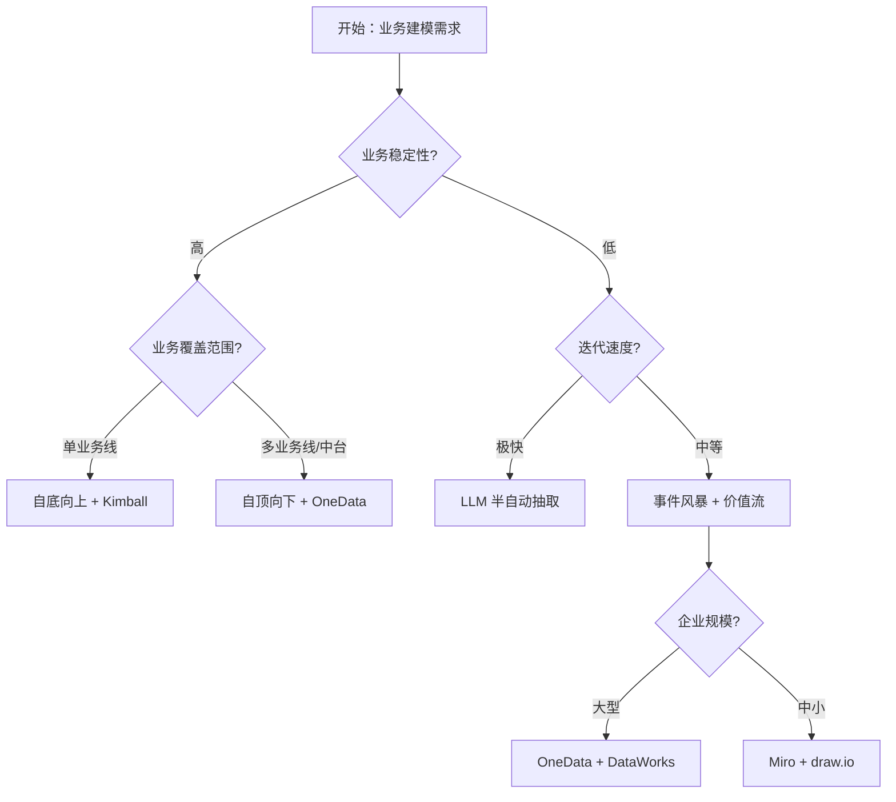

# 业务过程建模（Business Process Modeling）

> **一句话定位**：业务架构→数据架构的桥梁，把"业务怎么干活"翻译成"数据怎么落表"。

> 本文是 data-travel 项目 [Ch1 · 建模方法论](../../README.md) 的子章节（01-business-process-modeling），覆盖 **R3 数据建模** 能力领域中「数仓建模」的入口环节——把业务架构映射为可建模的数据架构。

---

## 1. 概念与定位

### 1.1 是什么

**业务过程建模（Business Process Modeling, BPM）** 在数据架构语境下，特指**用结构化方法识别企业核心业务过程，并将之映射为数据资产（事件、事实、维度）的方法论**。它不等同于纯 BPMN 流程图建模，而是要回答三个核心问题：

- **学术定义**：源自工作流管理联盟（WfMC）与 OMG 的 BPM 体系，关注"业务活动 + 触发条件 + 输入输出 + 角色责任"的四元组结构。
- **工程定义**：在 Kimball 维度建模体系中，**业务过程 = 数据仓库的"原子颗粒"**——一个业务过程对应一组业务过程度量（process metric），进而对应一张事实表（fact table）。
- **核心问题**：在企业数百个业务动作中，识别出"哪些动作会产生分析价值"，并把它们抽象为稳定的、可复用的数据模型。

### 1.2 为什么需要

- **业务驱动力**：当企业从"靠 Excel 决策"走向"靠数据中台决策"时，必须有一套方法把业务动作翻译成数据模型，否则每个业务团队都会"自建模型"，最终形成数据沼泽（data swamp）。
- **痛点**：缺少业务过程建模时，常见的失败模式包括——指标同名不同义（"GMV" 在 5 个部门 5 个定义）、事实表大爆炸（每出一个新报表就建一张宽表）、维度混乱（同一用户在不同表里 7 个 ID）。
- **AI 时代新诉求**：LLM 消费的是"语义化的业务过程"——`customer.churned.after_30_days_idle` 比 `user_status=3 AND last_login<today-30` 对 Agent 更友好。Agent 平台要求业务过程具备**可推理（reasoning）、可检索（retrieval）、可解释（traceability）** 三性。

### 1.3 在 AI 时代数据架构中的位置

业务过程建模是建模方法论的**入口**，处于"业务架构 → 数据架构"的金字塔顶：

```
       业务架构层（业务能力地图 / 价值流）
                ↓ 业务过程建模（本文）
       数据架构层（事件 → 事实 → 维度）
                ↓ 建模方法选型
       物理模型层（ER / 维度 / Data Vault / 本体）
                ↓ 工程实现
       物理存储层（Lakehouse / 图库 / 向量库）
```

与其他建模方法的关系：

| 方法 | 与业务过程建模的关系 |
| --- | --- |
| ER 建模 | 业务过程建模的"上游"——ER 描述静态实体关系，业务过程建模描述动态事件 |
| 维度建模（Kimball） | 业务过程建模的**直接下游**——一个业务过程 = 一张事实表 |
| Data Vault | 业务过程建模的**敏捷版本**——Hub 承载业务实体，Satellite 承载业务过程历史 |
| Anchor Modeling | 业务过程建模的**时序版本**——把过程建模成锚点（anchor）+ 属性的时间序列 |
| 本体建模（Ontology） | 业务过程建模的**语义升级**——把过程抽象为可推理的语义关系 |

**一句话判断**：本章是"建表 / 建模型 / 建体系"中的**建表的前置**——不识别业务过程，建表就是无源之水。

### 1.4 演进历程

- **传统阶段（1990s–2010s）**：以 Inmon 3NF 范式为代表，强调"自顶向下"从企业数据模型（EDW）出发；过程建模被弱化为 ER 图中的"关联关系"。
- **大数据阶段（2010s–2020）**：Kimball 维度建模占据数据仓库 70% 市场份额，业务过程识别（Bill of Process）成为数仓项目第 7 步标准动作；阿里 OneData 在此基础上提出"业务过程→指标体系→数据模型"三段式映射。
- **AI 原生阶段（2020+，LLM + Agent 驱动）**：业务过程建模从"人工梳理"走向"半自动抽取"——LLM 阅读 PRD / 用户故事 / 埋点文档，自动生成候选业务过程清单；Agent 平台要求过程模型支持**自然语言查询**与**多模态语义对齐**。
- **每阶段的核心矛盾**：传统阶段是"模型 vs 性能"、大数据阶段是"敏捷 vs 一致"、AI 原生阶段是"语义 vs 结构"。

---

## 2. 核心原理

### 2.1 关键概念定义

| 概念 | 定义 | 一句话解释 |
| --- | --- | --- |
| **业务过程（Business Process）** | 企业为产生价值而执行的一系列活动 | "用户注册 → 下单 → 支付 → 履约"是一个过程 |
| **业务事件（Business Event）** | 业务过程中发生的、可观测的离散动作 | "用户点击支付按钮"是一个事件 |
| **事实（Fact）** | 业务事件的量化度量结果 | 支付金额、支付时间、支付渠道 |
| **维度（Dimension）** | 描述业务事件"何时 / 何地 / 何人 / 何物"的上下文 | 用户维、商品维、时间维、地理维 |
| **业务能力（Business Capability）** | 企业能稳定提供的、与组织结构解耦的能力单元 | "营销能力"、"风控能力"、"履约能力" |
| **价值流（Value Stream）** | 从客户需求到价值交付的端到端业务流 | "线索 → 商机 → 订单 → 回款" |
| **5W1H** | 业务过程识别的经典框架 | Who/What/When/Where/Why/How |
| **事件风暴（Event Storming）** | Alberto Brandolini 提出的工作坊方法 | 通过"领域事件"贴纸识别业务过程 |
| **过程度量（Process Metric）** | 业务过程产生的可量化指标 | "下单转化率"、"履约时效"、"退款率" |
| **业务过程地图（Process Map）** | 业务过程的可视化资产，连接业务与数据 | 一张图说清"业务怎么干 → 数据怎么落" |

### 2.2 数学/形式化基础

业务过程可被形式化为**偏序事件序列**：

```
P = ⟨E, ≺, C, M⟩

P       = 业务过程
E       = 事件集合 {e1, e2, ..., en}
≺       = 事件间的时序偏序关系（e1 ≺ e2 表示 e1 先于 e2 发生）
C       = 上下文映射（事件 → 维度属性）
M       = 度量函数（事件 → 事实度量）
```

示例：

```
订单过程 P_order = ⟨{下单, 支付, 履约, 收货, 退款}, ≺, C, M⟩

M(下单)   = {订单金额, 下单时间}
C(下单)   = {用户维, 商品维, 渠道维}
≺         = {下单 ≺ 支付 ≺ 履约 ≺ 收货, 收货 ≺ 退款(可选)}
```

业务过程建模的核心目标，就是为每个业务过程 P 生成稳定的 `(E, ≺, C, M)` 四元组，进而映射为事实表 + 维度表。

### 2.3 关键算法/方法

| 方法 | 原理 | 适用边界 |
| --- | --- | --- |
| **5W1H 访谈法** | 通过结构化问题识别业务过程 | 业务访谈、需求调研 |
| **事件风暴（Event Storming）** | 跨角色工作坊，用橙黄贴纸识别领域事件 | 新业务 0→1、跨团队对齐 |
| **价值流图（Value Stream Mapping, VSM）** | 从客户视角识别端到端价值流 | 精益运营、流程优化 |
| **业务能力地图（Business Capability Map）** | 自顶向下分解企业能力 | 战略对齐、组织变革 |
| **BPMN 流程建模** | OMG 标准，用图形化符号建模流程 | 复杂流程编排、SOP 文档化 |
| **LLM 辅助抽取（2024+）** | 用 GPT/Claude 阅读 PRD 自动生成候选事件 | 海量文档、敏捷迭代 |

### 2.4 与相邻概念的关系

业务过程建模 vs 业务流程建模（BPMN）：前者关注"过程→数据"的映射，后者关注"过程本身的执行"。数据架构师关心前者，业务分析师关心后者。

业务过程建模 vs 数据建模：业务过程建模是数据建模的**前置环节**。如果跳过过程建模直接做 ER / 维度建模，会出现"模型能落表，但表说不清业务含义"的尴尬。

什么时候该用业务过程建模：永远要先做一遍；什么时候可以简化：业务稳定、过程清晰、团队已对齐时，可以把过程建模沉淀为模板复用。

---

## 3. 设计模式与范式

### 3.1 主要模式

| 模式 | 场景 | 结构 | 优点 | 缺点 |
| --- | --- | --- | --- | --- |
| **自顶向下（Top-Down）** | 企业级数据中台建设 | 业务能力 → 价值流 → 业务过程 → 事件 | 全局一致、避免重复 | 周期长、对组织能力要求高 |
| **自底向上（Bottom-Up）** | 单业务线敏捷数仓 | 从报表需求反推过程 → 抽事件 | 快速交付、立竿见影 | 全局失真、后期重构成本高 |
| **事件风暴（Event Storming）** | 复杂业务 0→1 | 跨角色工作坊 + 贴纸 + 时间线 | 全员对齐、发现隐藏过程 | 主持人要求高、容易跑题 |
| **OneData 业务过程切片（阿里）** | 中大型企业 | 业务过程 → 原子指标 → 派生指标 → 模型 | 指标口径统一 | 治理重、需配套组织 |
| **价值流驱动（VSM）** | 精益运营、零售电商 | 端到端价值流 → 关键节点 → 事件 | 客户视角、可优化 | 难以涵盖后台职能 |
| **LLM 半自动抽取（2024+）** | 文档丰富、迭代快 | PRD + LLM → 候选事件 → 人工校验 | 效率高、覆盖全 | 需校验、需 Prompt 工程 |

### 3.2 适用场景决策表

| 业务特征 | 推荐模式 | 理由 |
| --- | --- | --- |
| 0→1 创业公司 / 新业务 | 事件风暴 + 自底向上 | 快速对齐、容忍重构 |
| 单业务线数仓（电商交易线） | 自底向上 + Kimball | 报表驱动、迭代快 |
| 企业级数据中台 | 自顶向下 + OneData | 全局一致、避免重复 |
| 跨组织复杂业务（金融、制造） | 事件风暴 + 价值流 | 跨角色对齐、客户视角 |
| 文档丰富、迭代极快（互联网） | LLM 半自动抽取 | 效率优先 |
| 已有中台、做新业务扩展 | 模板复用 + OneData | 避免重复造轮子 |
| 监管严格行业（金融、医疗） | 自顶向下 + BPMN | 可审计、可追溯 |

### 3.3 反模式与陷阱

| 反模式 | 表现 | 后果 | 如何避免 |
| --- | --- | --- | --- |
| **过程爆炸** | 一个业务被拆成 200+ 业务过程 | 事实表碎片化、ETL 复杂度爆炸 | 用"业务过程粒度四问"过滤（是否产生度量、是否跨部门、是否稳定、是否有独立分析需求） |
| **过程遗漏** | 关键业务无对应事实表 | 报表数据"找不到源头" | 用价值流图反向校验 |
| **过程混淆** | 一个事件被错误归到两个过程 | 双计数、口径冲突 | 强制"事件归属唯一"原则 |
| **过程漂移** | 业务变更后过程模型未更新 | 数据与业务脱节 | 业务变更需触发模型评审 |
| **跳过过程建模直接建表** | 数据团队直接画 ER 图 | 模型无法回答"为什么要有这张表" | 强制建模评审前必须有过程地图 |
| **过程命名不统一** | 同义不同名（"下单"/"创建订单"） | 后续消费方认知负担 | 命名规范化 + 词根词典 |

---

## 4. 工程实现

### 4.1 落地步骤

业务过程建模的标准落地流程（8 步）：

1. **业务战略对齐** → 产出物：业务能力地图（Capability Map）
2. **价值流识别** → 产出物：端到端价值流图（1-5 条主线）
3. **业务过程切片** → 产出物：业务过程清单（通常 30-80 个）
4. **事件与度量抽取** → 产出物：业务事件 + 过程度量清单
5. **维度识别** → 产出物：维度清单 + 维度属性
6. **过程地图评审** → 产出物：跨部门签字的过程地图
7. **物理模型映射** → 产出物：事实表/维度表 DDL
8. **持续演进与治理** → 产出物：过程模型版本管理 + Owner 制度

### 4.2 关键技术点

- **命名规范**：业务过程用"动宾短语"（"创建订单"），事件用"过去时"（"订单已创建"），度量用"业务术语"（"订单金额"）。
- **版本管理**：过程模型纳入 Git/DataOps，每次变更留痕。
- **血缘追踪**：从业务过程 → 事实表 → 指标 → 报表，链路必须可追踪。
- **Owner 制度**：每个业务过程必须有 1 个业务 Owner + 1 个数据 Owner 双签。
- **变更控制**：业务侧需求变更必须经过"过程模型影响评估"，否则不允许直接改表。
- **统一术语**：建立企业级业务术语词典（Glossary），避免同名不同义。
- **过程粒度校验**：业务过程数量通常控制在 30-80 个，过细/过粗都有问题。
- **文档化资产**：业务过程地图是数据团队最重要的"对外文档"，需可视化、可检索。

### 4.3 工具链与平台

| 类别 | 工具 | 推荐组合 |
| --- | --- | --- |
| **流程建模** | BPMN.io、bpmn-js、Camunda Modeler、Enterprise Architect | BPMN.io（开源）+ Camunda（执行） |
| **事件风暴** | Miro、FigJam、Whimsical、Excalidraw | Miro（远程协作） |
| **数据建模** | ER/Studio、PowerDesigner、dbdiagram.io、draw.io、dbt | dbt（云原生）+ draw.io（轻量绘图） |
| **数据资产目录** | DataHub、Apache Atlas、阿里 DataWorks、DataHub Cloud | DataHub（开源元数据）+ DataWorks（阿里云） |
| **AI 辅助** | Cursor、Claude、GPT-4o、Qwen、Codia | Cursor（IDE）+ Claude/GPT-4o（文档解析） |
| **AI 原生数据建模（2024+）** | Unity Catalog + AI Generate、Databricks Assistant、Snowflake Cortex | Databricks Assistant + Snowflake Cortex |
| **企业架构** | ARIS、BiZZdesign、LeanIX、Mega Hopex | ARIS（重型） + LeanIX（云原生） |

### 4.4 代码 / SQL 示例

业务过程 → 事实表 DDL 映射（电商下单过程）：

```sql
-- 维度表
CREATE TABLE dim_user (
    user_key        BIGINT PRIMARY KEY,
    user_id         VARCHAR(64),
    user_name       VARCHAR(128),
    register_date   DATE,
    -- SCD Type 2 字段
    effective_date  DATE,
    expiry_date     DATE,
    is_current      BOOLEAN
);

-- 事实表（事务事实：订单创建过程）
CREATE TABLE fact_order_created (
    order_key        BIGINT PRIMARY KEY,
    user_key         BIGINT REFERENCES dim_user(user_key),
    product_key      BIGINT REFERENCES dim_product(product_key),
    channel_key      BIGINT REFERENCES dim_channel(channel_key),
    order_date_key   INT,         -- 退化维度：日期
    -- 度量
    order_amount    DECIMAL(18,2),
    item_count       INT,
    -- V1
    created_at       TIMESTAMP,
    source_event_id  VARCHAR(64)  -- 业务事件 ID（用于血缘）
);
```

---

## 5. 前沿演进（AI 时代）

### 5.1 LLM/Agent 时代的演进方向

**自动业务过程抽取**：用 LLM 阅读 PRD、用户故事、埋点文档，自动生成候选业务过程清单。代表性 prompt：

```
你是一名资深数据架构师。请阅读以下 PRD，识别其中描述的所有业务过程，
每个过程给出：过程 ID、过程名称、关键事件、过程度量、相关维度。
```

**自然语言建模（NL2Model）**：用自然语言描述业务过程，直接生成 ER 图 / 维度模型。Databricks Assistant（2024）、Snowflake Cortex（2024）均已上线类似能力。

**Agent 驱动的过程发现**：让 Agent 主动观察业务系统的日志/事件流，自动反向发现业务过程——这是 2024-2025 学术界与工业界的热点方向。

**语义化业务过程**：传统业务过程是"结构化的"，AI 时代要求"语义化的"——`order.canceled.within_24h` 这种语义化标签，能让 Agent 直接消费并推理。

### 5.2 与 RAG / 向量库 / GraphRAG 的结合

- **业务过程作为 RAG 索引维度**：检索时不仅检索"事实"，还要检索"业务过程"——例如用户问"上周有多少订单被取消"，需要先定位"取消订单"过程，再检索过程度量。
- **GraphRAG 与传统过程的差异**：GraphRAG（微软 2024）将业务过程建模为"实体-关系图"，相比传统过程列表，能更好地支持多跳推理（如"找出与流失客户相似的支付链路"）。
- **过程本体化**：把业务过程建模为本体（Ontology）中的 class，事件建模为 property，过程间关系建模为 objectProperty，使过程可被推理引擎消费。

### 5.3 学术与工业最新进展（2024-2025）

| 进展 | 时间 | 来源 | 要点 |
| --- | --- | --- | --- |
| **Microsoft GraphRAG** | 2024-07 | 微软研究院 | 用 LLM 构建实体关系图，替代传统 RAG 的 chunk 检索 |
| **Databricks Assistant / AI Generate** | 2024-2025 | Databricks | Unity Catalog 内置 NL2Model 能力 |
| **Snowflake Cortex** | 2024-2025 | Snowflake | 文档→SQL 自动生成 + 业务过程抽取 |
| **dbt + LLM 集成** | 2024 | dbt Labs | dbt-codegen + LLM 自动生成模型代码 |
| **Atlan Data Context Platform** | 2024 | Atlan | AI 自动识别业务过程与血缘 |
| **NL2SQL Benchmark** | 持续 | 学术界（BIRD-SQL、Spider 2.0） | 自然语言→数据模型的标准基准 |

### 5.4 未来 3-5 年趋势

- **从"人工梳理"到"Agent 驱动"**：业务过程建模的 80% 工作由 Agent 完成，人类只负责审核与异常处理。
- **从"过程模型"到"过程本体"**：业务过程不再是表格清单，而是可推理的语义网络，与本体建模、知识图谱深度融合。
- **从"静态模型"到"自进化模型"**：业务过程模型随业务变化自动演化（agent-driven schema evolution）。
- **风险点**：LLM 抽取的"幻觉"可能导致过程漂移；过度自动化可能丢失业务深度理解；本体建模的复杂度可能让中小团队望而却步。

---

## 6. 落地实践

### 6.1 真实案例

**案例 1：阿里 OneData 业务过程切片**

- **背景**：阿里中台覆盖 30+ 业务线、数千个指标口径。
- **做法**：自顶向下识别 6 大业务过程（流量、交易、营销、履约、售后、财务），每条线建立"业务过程→原子指标→派生指标"三级映射。
- **收益**：指标口径统一率从 40% 提升到 95%，新业务接入周期从 6 个月缩短到 6 周。

**案例 2：字节跳动 DataFinder 业务过程发现**

- **背景**：字节业务迭代极快（每周数十个新功能），靠人工梳理业务过程不可持续。
- **做法**：用 LLM 阅读 PRD + 埋点文档，自动生成候选业务过程；Agent 监控埋点变更，自动更新过程地图。
- **收益**：业务过程识别覆盖率从 60% 提升到 90%，新功能数据接入周期从 2 周缩短到 2 天。

### 6.2 踩坑与经验

| 场景 | 错在哪 | 怎么改 |
| --- | --- | --- |
| **过程爆炸** | 把"登录"和"退出"拆成两个过程 | 同一原子活动合并为一个过程，用事件区分 |
| **过程遗漏** | 售后流程只建了"退款"过程，遗漏"补发" | 用价值流图反向校验，穷举所有客户触点 |
| **过程命名不统一** | "下单" / "创建订单" / "订单生成" 三个名字 | 建立企业级词根词典 + 强制命名评审 |
| **过程漂移** | 业务新增"预售"模式后，过程模型未更新 | 业务变更必须触发模型评审 |
| **跳过过程建模** | 数据团队直接建事实表 | 强制"先有过程地图，后有事实表" |

### 6.3 落地路径

- **0→1 阶段**：用事件风暴工作坊识别核心业务过程（5-15 个），建立最小过程地图。工具：Miro + draw.io。
- **1→10 阶段**：补齐过程地图到 30-80 个，落地 OneData 思想，配套数据资产目录。工具：DataHub + DataWorks。
- **10→100 阶段**：过程模型进入元数据平台，与指标体系、血缘系统深度集成；引入 LLM 半自动抽取与 Agent 自进化。工具：Databricks Assistant + Atlan + GraphRAG。

### 6.4 ROI 评估

- **开发效率**：业务过程建模标准化后，新报表开发周期缩短 40-60%（避免重复设计）。
- **数据一致性**：指标口径冲突减少 80-90%。
- **新业务接入**：接入周期从 6 个月缩短到 6 周（阿里案例）。
- **投入成本**：初期投入约 3-6 个月人力（业务访谈 + 过程梳理 + 评审）；长期维护成本约 0.5 人/季度。

---

## 7. 与其他方法对比

### 7.1 对比维度

| 维度 | 业务过程建模 | BPMN 流程建模 | ER 建模 | 维度建模（Kimball） | Data Vault |
| --- | :---: | :---: | :---: | :---: | :---: |
| 抽象层次 | 业务层 | 业务层 | 数据层 | 数据层 | 数据层 |
| 关注点 | 过程→数据 | 过程执行 | 实体关系 | 事实/维度 | Hub/Link/Sat |
| 灵活度 | 4 | 2 | 2 | 3 | 5 |
| 学习成本 | 3 | 4 | 4 | 3 | 4 |
| 可演进性 | 4 | 2 | 2 | 3 | 5 |
| AI 友好度 | 5 | 2 | 2 | 3 | 4 |
| 生态成熟度 | 4 | 5 | 5 | 5 | 4 |

### 7.2 决策树



### 7.3 组合使用

**实战组合 1：业务过程建模 + 维度建模**（最经典）
- 业务过程建模识别过程 → 维度建模落到事实表
- 适用：90% 的企业数仓场景

**实战组合 2：业务过程建模 + Data Vault + 维度建模**
- 业务过程建模识别过程 → Data Vault 落 ODS/DWD → 维度建模落 DWS/ADS
- 适用：敏捷数仓、监管行业

**实战组合 3：业务过程建模 + 本体建模 + GraphRAG**
- 业务过程建模识别过程 → 本体建模抽象为语义 → GraphRAG 提供推理能力
- 适用：AI 智能体平台、知识密集型企业

---

## 8. 面试真题集

> 本节整合自题库《大数据平台架构师》（创脉思 cms365.cn，版本 2025-11-25）的真实面试题，题号沿用原题库编号（PDF §X.Y 第 K 题），便于读者回溯原题。
>
> **每题按五段式作答**：考察点 → 参考答案框架 → 常见陷阱 → 追问预测 → 参考资料。参考答案优先引用**头部互联网企业的公开架构实践**（Netflix / Uber / Meta / LinkedIn / 阿里 / 字节 等），便于读者进一步溯源。

### 8.1 全景视图

| 原 PDF §N.M | 主题 | 题号范围 | 收录题数 | 主/辅 |
| --- | --- | --- | :---: | :---: |
| §4.2 | 数据仓库分层与建模理论 | 4.2.1 ~ 4.2.5 | 5 | 辅 |

| 题号 | 难度 |
| --- | :---: |
| §4.2.1 | ★★★☆☆ |
| §4.2.2 | ★★★☆☆ |
| §4.2.3 | ★★★☆☆ |
| §4.2.4 | ★★★☆☆ |
| §4.2.5 | ★★★★☆ |

### 8.2 §4.2 数据仓库分层与建模理论

> 本主题考察「数仓建模的基本功」：维度建模的两大模型形态、缓慢变化维的历史处理、数仓分层职责划分，以及在大规模集群上把建模决策落到 ETL 工程的能力。面试官通常从概念问起，逐层下钻到工程代价与取舍。

#### §4.2.1 在构建数据仓库时，如何处理缓慢变化维？请至少描述两种常见的处理方式及其适用场景，并说明各自的优缺点。

**1. 考察点**

- 是否理解缓慢变化维（SCD）的本质是「**维度属性的历史可回溯性**」，而不是一张表怎么建。
- 能否从「业务查询模式 + 属性变更频率 + 存储成本」三个约束反推选型，而不是背三种类型的定义。
- 是否知道拉链表（Type 2）在**工程侧的真实代价**：行数随变更次数膨胀、下游关联必须带时间条件、分区裁剪会失效。
- 加分项：能区分 SCD 与 CDC——CDC 是**采集手段**，SCD 是**存储策略**，两者正交。

**2. 参考答案框架**

**第一层：先定义问题边界。** 缓慢变化维描述的是「维度的非主键属性随时间变化，但维度实体本身不变」——例如用户改手机号、商品改类目、门店改所属大区。需要先问清楚三件事：这个属性**变化频率**多高？业务是否需要**按历史值做归因**（如"这笔 2024 年的订单应归属当时的销售大区"）？维护历史带来的**存储与查询成本**能否接受？

**第二层：三类主流处理方式。**

- **Type 1（覆盖）**：直接 `UPDATE` 覆盖原值，不留历史。优点是表不膨胀、下游关联最简单；缺点是历史归因能力永久丢失。**适用场景**：事实本身与属性的历史值无关，典型如「用户手机号填错了，纠正一下」「商品名称错别字修正」——这类属于**数据纠错**而非**属性变更**。注意：很多团队把纠错误当 Type 1，其实纠错应当有独立的审计路径，不该静默覆盖。

- **Type 2（拉链 / 新增行）**：每次属性变更插入新行，用 `start_dt` / `end_dt`（或 `start_ts` + `is_current` 标志）界定有效期。优点是可以**精确回溯任意时间点的维度快照**，是审计和归因类需求的唯一正确答案。缺点有三：① 行数按变更次数累积——一个日活千万的用户维，若每天 1% 用户改属性，一年膨胀数十倍；② 下游所有关联都必须补 `fact.event_time BETWEEN dim.start_dt AND dim.end_dt`，一个漏写就是数据错误；③ 分区裁剪会退化，因为一条维度的有效期跨多个分区。

- **Type 3（前值列）**：只保留 `current_value` / `previous_value` 两列。优点是实现极简、无需时间关联；缺点只能回溯**一次**变更，且每新增一个需要追溯的属性就要加两列。**适用场景**很窄——典型是「同比 / 环比」这类只看相邻两期的分析，如信贷风控里对比「本次申请城市 vs 上次申请城市」。

**第三层：工程上的混合实践。** 生产环境几乎不会只用一种：

- **Type 2 + 冷热分离**：当前有效版本（`is_current = true`）单独放一张小表供高频关联，历史版本沉到归档表供低频回溯。这是头部厂商处理维度膨胀的标准手法——热表保持"一行一实体"，让 95% 的查询走最快的路径。
- **Type 1 + Type 2 组合**：把维度属性**分组**——"出错即纠"的描述性属性（`user_nickname`）走 Type 1，需要归因的**业务分组属性**（`user_tier`、`region`）走 Type 2。这样只有一小部分属性缺失历史，成本大幅下降。
- **按变更频率分治**：高频变更属性（如用户积分等级）单独拆表，避免污染整个维度的拉链。

**第四层：建模工具侧的现状。** `dbt` 的 `snapshot` 机制把 Type 2 拉链模板化（`check` / `timestamp` 两种策略），阿里 OneData 体系则把它固化为基础层（DWD）的标准动作，并配合 ETL 调度做每日全量 + 增量的合并。选型时值得注意：**拉链表的维护必须由调度系统原子完成**，否则会出现同一实体多行 `is_current = true` 的数据事故，这是拉链表最常见的线上故障。

**3. 常见陷阱**

- **只答 Type 2，不提代价。** 面试官问"优缺点"，只讲优点会被判定为背概念。必须主动说出行数膨胀和关联复杂度。
- **混淆 SCD 与 CDC。** 把"用 Flink CDC 采集 binlog"当作 SCD 方案——CDC 解决的是"如何拿到变更"，SCD 解决的是"如何存变更"。二者经常组合使用，但不是一回事。
- **忘记 `is_current` 的唯一性约束。** 拉链表若不做约束，重复跑批会产生多条 `is_current = true`，下游 `JOIN` 直接行数翻倍。
- **在事实表上做 SCD。** SCD 只作用于维度；事实表本身是事件流水，天然不可变，不需要拉链。
- **忽略时区与边界。** `start_dt <= t < end_dt` 还是 `<=` 闭区间，会让跨天边界的订单归错大区。必须显式定义并写入建模规范。

**4. 追问预测**

- **「拉链表在 Hive / Spark 上怎么实现每日合并？」** 答：读取 T-1 全量拉链表 + T 日增量变更，用 `FULL OUTER JOIN` 命中变更键：变更的关旧行、开新行；未变更的透传；新增的直接置 `is_current = true`。分区上通常按 `dt` 存快照，或按 `start_dt` 存增量以节省空间。
- **「维度膨胀到十亿行以上怎么办？」** 答：三板斧——属性分组降低拉链属性数量、冷热分离、对历史版本做周期性归档（只保留近 N 年明细，更早的按季度快照）。
- **「下游关联写漏了时间条件，怎么防？」** 答：不靠人。把「当前有效维度」封装成视图或语义层表（如 `dim_user_current`），让下游默认只看到一行一实体；直连拉链表需要走准入评审。
- **「Type 2 和 Data Vault 的 Satellite 是什么关系？」** 答：Satellite 本质就是把 Type 2 的拉链思想做了范式化拆分——每个属性的历史独立成卫星表，变更粒度更细、并发加载冲突更小，代价是关联层级更多。

**5. 参考资料**

- Ralph Kimball《The Data Warehouse Toolkit》第 5 章「Dimension Design」——SCD Type 1/2/3 的原始定义与最完整的适用场景讨论，是本题的标准出处。
- 阿里数据技术团队《大数据之路：阿里巴巴大数据实践》——OneData 体系下 DWD 层拉链表的标准实现与调度约束，对应第一手的国内落地经验。
- dbt 官方文档 `snapshots` 章节——Type 2 拉链的工程化模板与 `check` / `timestamp` 两种策略的取舍。
- Uber Engineering 关于 Hudi 的系列公开文章——增量写入与 upsert 语义如何在大规模场景下替代每日全量覆盖，是 SCD 在湖仓时代的工程演进方向。
- **蚂蚁集团的信贷用户画像维度表** —— 风控场景下用户风险等级、产品归属、所属客户经理均按 Type 2 拉链存储，"信贷申请时刻该用户的所属客户经理"必须按时间条件归因，是金融场景 SCD Type 2 的标准落地。
- **宁德时代的电池产品维表** —— 电池产品会随技术迭代变更所属产品线与能量等级，按 Type 2 拉链保留历年归属，下游召回与品质分析能精确定位到当时的产品分类，是制造业主数据 SCD 的典型实践。
- **永辉超市的门店大区归属表** —— 门店随区域划分调整需变更所属大区 / 省区，按 Type 2 保留历史归属，使历史销售可按当时大区归因，是零售业态 SCD 与历史归因的代表。
- **中信证券** —— 中信证券的指标管理实践——业务口径先于物理实现、Owner 制度落到人，对应「指标即资产」的工程范式。
- **京东数科** —— 京东数科的金融特征平台——支撑消费分期、信用支付等场景，特征口径与模型版本强一致。
- **京东物流** —— 京东物流仓储数据中台——AGV、库存、订单的多源整合与实时监控。
- **京东物流** —— 京东物流仓储数据中台——AGV、库存、订单的多源整合与实时监控。
- **滴滴** —— 滴滴实时订单与司机画像——万级 Flink 作业 + Iceberg 增量读下的冲突与 compaction 治理。
- **货拉拉** —— 货拉拉城配实时调度——Flink 实时订单分发 + Spark 离线对账 + 路径优化。
- **京东物流** —— 京东物流仓储数据中台——AGV、库存、订单的多源整合与实时监控。
- **滴滴** —— 滴滴实时订单与司机画像——万级 Flink 作业 + Iceberg 增量读下的冲突与 compaction 治理。
- **货拉拉** —— 货拉拉城配实时调度——Flink 实时订单分发 + Spark 离线对账 + 路径优化。

> 注：以上参考资料均指向公开出版物或企业公开技术博客。精确链接待联网环境补全。

---

#### §4.2.2 随着数据湖概念的普及，请阐述在 Lambda 架构中，如何协调数据仓库（批处理层）与数据湖（速度层）的关系，并说明这种协调面临的挑战。

**1. 考察点**

- 是否理解 Lambda 架构**为什么存在**——它不是"两套系统"，而是对「历史准确」与「实时新鲜」两个不可同时满足的目标的工程妥协。
- 能否说清批处理层（Batch Layer）与速度层（Speed Layer）各自的**正确性边界**，以及服务层（Serving Layer）如何做归并。
- 是否知道 Lambda 的**根本缺陷**（同一份逻辑写两遍）以及 Kappa / 流批一体如何回应它。
- 加分项：结合湖仓一体（Iceberg / Hudi / Delta Lake）说明"数据湖正在吞掉数仓"的现状。

**2. 参考答案框架**

**第一层：Lambda 的原始定义与分工。** Lambda 架构由 Nathan Marz 在 2011 年提出，出发点是一个强约束：**批处理层负责"正确性"，速度层负责"低延迟"，二者不可兼得**。

- **批处理层（对应数仓）**：对全量历史数据反复重算，产出**不可变、可重算的主数据集（Master Dataset）**。它的承诺是"给定同样的输入，永远得到同样的输出"——所以它可以修正历史错误。代价是延迟以小时计。
- **速度层（对应数据湖 / 流处理）**：只处理最近的增量窗口，用近似或增量算法给出**秒级 / 分钟级**的结果。它的结果会**被批处理层的结果覆盖**——这是关键：速度层的输出是"临时的、待修正的"。
- **服务层**：对外提供统一查询。查询时把批处理层的视图与速度层的视图做合并，通常以「批处理结果 + 窗口之后的增量」的方式拼接。

**第二层：数据湖在其中的角色演变。** 早期 Lambda 里，速度层往往是一套独立的流处理管道（Storm / Spark Streaming），数据落在一套独立的存储上。数据湖普及后，**数据湖同时承担了两层**：

- 批处理层把数据湖当作**唯一可信的落地存储**——Iceberg / Hudi / Delta Lake 提供 ACID、时间旅行、Schema 演进，让"数据湖"具备了原来数仓才有的能力。
- 速度层通过 CDC / Flink 把增量写进同一套湖表，批与流**共用一份存储**，服务层不再需要跨系统归并。

这正是**湖仓一体（Lakehouse）**的核心主张：用一套存储 + 一套元数据，消灭 Lambda 的双写。

**第三层：协调机制——具体怎么落地。**

- **口径统一（最难的一环）**：批与流必须用同一份业务逻辑。工程上的做法是把计算逻辑抽成**共享的 SQL / UDF 库**，Flink 与 Spark 都调用它；阿里 OneData 的做法是先定义**指标口径**，再由口径生成两套物理实现。任何"批流各写一遍 SQL"的方案最终都会口径漂移。
- **幂等与去重**：速度层必须容忍重复投递（at-least-once）。湖表的 upsert（Hudi 的 `upsert`、Iceberg 的 `MERGE INTO`）配合业务主键 + 事件时间做主键级去重，这是保证"流写进湖后与批算结果一致"的前提。
- **回填与切换**：当批处理层修正了历史（例如上游补了一批迟到数据），速度层的增量结果必须被**作废并重算**。健康的 Lambda 需要一套明确的「批结果生效水位」机制——服务层只信任水位之前来自批处理层、水位之后来自速度层的数据。
- **Schema 一致性**：批与流对同一张表的 Schema 演进必须同步，否则会出现流写入的新列在批处理侧不可见。

**第四层：挑战与演进方向。** Lambda 的根本痛点是**同一份逻辑维护两遍**——两套代码、两套监控、两套口径，运维成本随业务复杂度平方级上升。业界的三条回应路线：

- **Kappa 架构**（Jay Kreps 提出）：取消批处理层，只保留流处理，用"重放历史流"代替"重算全量"来修正错误。前提是消息队列能长期保留全量历史。
- **流批一体**：Flink 用同一套 API（DataStream / Table API）处理有界与无界流，批只是"有界流"的特例；Spark 的 Structured Streaming 走同样的思路。
- **湖仓一体**：把一致性交给存储层的 ACID 与增量读取能力，计算层按需选择批或流。这是当前头部企业的实际收敛方向——**数据湖正在取代数仓，而不是与数仓并存**。

对“万节点级别”的大规模场景，还需要额外考虑：批处理层的重算成本决定了它能多频繁地修正历史；速度层的资源必须与批分离（不同 YARN 队列 / K8s 命名空间），否则大促期间的流任务会被批任务挤占。

**3. 常见陷阱**

- **把 Lambda 当作"实时数仓"的同义词。** Lambda 是一种**架构模式**，核心是"批正确 + 流快速 + 服务归并"，不是"上了 Flink 就叫 Lambda"。
- **只讲架构不讲口径。** 面试官最想听的是"批流口径怎么对齐"——这是 Lambda 落地失败的第一大原因，只画框图是低分回答。
- **忽略速度层的可撤销性。** 如果速度层的结果不能被批处理层覆盖，那它就变成了第二份"真相来源"，架构退化成双主。
- **不提成本。** 双链路意味着双份存储和双份计算。能主动算一笔"这条链路一年多花多少，换来的是多少延迟下降"，是资深架构师与普通工程师的分水岭。
- **默认 Lambda 是终点。** 不提 Kappa / 流批一体 / 湖仓一体，会显得知识停在 2015 年。

**4. 追问预测**

- **「批流口径不一致，线上已经出问题了，你怎么排查和止血？」** 答：先止血——把服务层的开关切到只信任批处理层结果（牺牲新鲜度保正确性）；再定位——对比同一窗口内批与流各自算出的中间明细，定位是过滤条件、时间窗口边界（事件时间 vs 处理时间）、还是去重逻辑差异；最后固化——把口径抽成共享库 + 加批流对账任务，把"发现不一致"从人工变成监控。
- **「为什么 Uber / Netflix 最终走向了增量处理而不是 Lambda？」** 答：因为每日全量重算的成本随数据量线性增长，而增量处理（Hudi / Iceberg 的增量读）把成本与"变更量"而非"总量"挂钩。这是规模驱动的必然。
- **「上 Kappa 有什么代价？」** 答：要求消息中间件保留全量历史（Kafka 长期存储成本）、流处理作业的回放能力、以及状态后端能承载全量状态的恢复时间（RTO 会变长）。
- **「湖仓一体真的能消灭 Lambda 吗？」** 答：能消灭**双存储**，但消灭不了"批快 vs 流快"的取舍——修正历史仍然需要重算，只是重算的代价被增量计算大幅降低。

**5. 参考资料**

- Nathan Marz & James Warren《Big Data: Principles and Best Practices of Scalable Realtime Data Systems》——Lambda 架构的原始定义，含批处理层 / 速度层 / 服务层的完整论述。
- Jay Kreps（时任 LinkedIn 首席架构师）关于 Kappa 架构的公开文章《Questioning the Lambda Architecture》——对 Lambda 维护成本最直接的批评，是回答"演进方向"的必引材料。
- Uber Engineering 关于 Apache Hudi 的系列公开文章——增量处理如何在大规模场景下替代全量批算，是湖仓一体路线的工业实证。
- Netflix Technology Blog 关于增量处理与 Iceberg 的公开文章——展示头部流媒体公司如何用增量读替代每日全量重算，并用"下游数据新鲜度"作为核心 SLO。
- 阿里巴巴《大数据之路》中关于 OneData 与实时数仓（原 OneService / 实时计算）章节——国内批流口径统一的工程范式，含"口径先于实现"的方法论。
- **招商银行基于 Iceberg 的湖仓一体实践** —— 把原 Lambda 的批流两套存储统一到 Iceberg 湖表，批流共用一份存储与一份元数据，省去服务层归并，是国内大型银行典型的"消灭 Lambda 双写"路径。
- **滴滴实时订单分配的流批归并架构** —— 订单分配用 Flink 实时层 + Spark 离线修正层双链路，实时层处理秒级增量、离线层修正历史错误，对应服务层按水位拼接，是出行行业 Lambda 真实落地的代表。
- **中国移动 PB 级实时话单的 Lambda 落地** —— 用 Kafka + Flink 实时计算 + 离线 Hive 修正构成标准 Lambda，实时话单支撑实时计费、离线话单支撑对账与营收核算，是运营商行业分层的经典结构。
- **中国电信** —— 中国电信的 BSS 数据湖——计费、营账、客户数据统一入湖 + 实时营销推荐。
- **中国移动** —— 中国移动的实时话单 Flink 引擎——PB 级话单走 Flink 流 + Spark 小时级对账。
- **中国联通** —— 中国联通网络运维数据平台——告警、性能、配置的统一存储与 AI 故障预测。
- **中国电信** —— 中国电信的 BSS 数据湖——计费、营账、客户数据统一入湖 + 实时营销推荐。
- **中国移动** —— 中国移动的实时话单 Flink 引擎——PB 级话单走 Flink 流 + Spark 小时级对账。
- **中国联通** —— 中国联通网络运维数据平台——告警、性能、配置的统一存储与 AI 故障预测。
- **中国电信** —— 中国电信的 BSS 数据湖——计费、营账、客户数据统一入湖 + 实时营销推荐。
- **中国移动** —— 中国移动的实时话单 Flink 引擎——PB 级话单走 Flink 流 + Spark 小时级对账。
- **中国联通** —— 中国联通网络运维数据平台——告警、性能、配置的统一存储与 AI 故障预测。

> 注：以上参考资料均指向公开出版物或企业公开技术博客。精确链接待联网环境补全。

---

#### §4.2.3 在万节点级别的 Hadoop / Spark 集群上，如何设计和优化数据仓库的 ETL 流程，以保证其稳定性和效率？

**1. 考察点**

- 是否具备**万节点规模的工程直觉**——这个量级下，瓶颈几乎从来不是单机性能，而是调度、元数据、小文件与数据倾斜。
- 能否分层回答：调度层（DAG 编排与依赖）、计算层（并行度与倾斜）、存储层（文件组织与元数据）、治理层（SLA 与质量）。
- 是否知道在超大规模下「**成本**」与「**稳定性**」的取舍，以及如何用增量替代全量。
- 加分项：能给出具体的参数级经验（分区数、文件大小、并行度与核心数的关系）。

**2. 参考答案框架**

**第一层：先立原则——万节点下 ETL 的目标函数变了。** 在中小集群，"跑得快"是首要目标；到万节点量级，首要目标变成**「可预测」**：任何一个作业的失败都不应该波及集群其他作业，任何一个上游延迟都不应该引发下游雪崩。因此设计原则是：**隔离优先于极致优化，增量优先于全量，幂等优先于快速重试。**

**第二层：调度层设计。**

- **依赖编排**：用 DolphinScheduler / Airflow / Azkaban 管理 DAG，关键是**跨天依赖的边界要清晰**——上游延迟时，下游必须能被"卡住"而不是拿着不完整的分区开跑。健康实践是引入**数据就绪信号**（分区完成标记 / `_SUCCESS` 文件 / 湖表的 snapshot id），让依赖建立在数据而非时间上。
- **基线（Baseline）管理**：给每个作业定义承诺产出时间，并做基线预警——万节点集群里，一个作业晚 10 分钟可能连带几百个下游作业错过 SLA。基线是超大集群 ETL 治理的核心抓手。
- **分级与隔离**：按重要性把作业分 P0/P1/P2，映射到不同的 YARN 队列 / K8s 命名空间，并配置**抢占策略**——P0 作业可以抢占 P2 的资源，而不是大家一起等。
- **幂等与重跑**：每个作业必须能安全重跑（写入前清理目标分区，或用湖表的分区级 overwrite / `MERGE`），否则一次重试就可能产生重复数据。

**第三层：计算层优化。**

- **小文件治理**：这是大规模 ETL 的头号杀手。每次调度产生大量小文件，会把 NameNode 内存和后续读取性能一起拖垮。手段：写入前控制分区数与并行度、写入后做**compaction**（Hudi / Iceberg 内建，或独立合并作业）、目标文件大小控制在 128–512 MB 量级。
- **数据倾斜**：`GROUP BY` 热点键会让个别 task 拖住整个 stage。手段按代价递增——加盐打散（对热点 key 加随机后缀，两阶段聚合）、`MAP` 端预聚合、单独把热点键拆出来走独立链路。定位靠 Spark UI 的 task 时长分布（长尾 task 的输入大小）。
- **并行度与资源**：并行度与「单 task 处理的数据量」挂钩，而不是拍脑袋设成核数的倍数。经验上让单 task 处理 128–256 MB；开启**动态资源分配**让 Spark 按 stage 实际需求伸缩 executor；`AQE`（Adaptive Query Execution）在运行时合并小分区、处理倾斜 join，是大规模作业的必备开关。
- **Shuffle 治理**：Shuffle 是最大的 I/O 与失败来源。减少 shuffle 的手段有——用 `broadcast join` 处理小表、`bucket` 分桶让 join 免 shuffle、避免不必要的 `repartition` / `distinct`。
- **引擎选型**：超大集群上 Spark 逐渐取代 MapReduce，近年进一步向 **Spark on K8s / 云原生弹性**演进，把资源弹性从"集群内排队"变成"集群间伸缩"。

**第四层：存储层与元数据。**

- **分区策略**：分区数量要控制——按天分区是常态，但**不要按高基数列（如 user_id）分区**，否则分区数爆炸。高基数过滤靠分桶或列存统计信息（min/max 索引、Z-order / 聚簇）。
- **列存与压缩**：Parquet / ORC + 合适压缩（ZSTD 在压缩率与 CPU 之间较均衡）；小宽表反而可能不如行存。
- **元数据压力**：Hive Metastore 在万节点规模下会成为瓶颈——需要独立部署、上连接池、并对分区数量设硬上限；向 Iceberg / Hudi 迁移的一个隐性收益是把元数据压力从 Metastore 转移到表格式自身。

**第五层：治理与可观测。**

- **数据质量卡点**：在关键节点插入 DQC 校验（行数波动、主键唯一性、枚举值分布），异常时**阻断下游**而不是让脏数据流下去。
- **全链路血缘**：没有血缘，万节点集群里的问题定位基本靠猜。
- **成本归因**：把资源消耗按业务线/作业归因，否则优化没有靶子。这也是 FinOps 在大数据场景的落点。
- **灰度与回滚**：新逻辑先跑影子链路做对账，再切流；出问题能快速切回。

**3. 常见陷阱**

- **只谈调参不谈架构。** 上来就说"加大 executor 内存、调并行度"，会被判定为没做过大规模系统——万节点下的问题多半不是单作业调参能解决的。
- **忽略小文件。** 这是超大规模 ETL 最普遍、代价最高的技术债，答不出来会显得缺乏实战。
- **把全量重算当默认方案。** 每日全量在数据量小时很省心，到 PB 级就是成本灾难。
- **不提 SLA / 基线。** 没有 SLA 的 ETL 没有优先级，也就没有资源分配依据。
- **忽略幂等。** 不幂等的 ETL 在万节点集群上必然产生数据事故，因为没有作业是不重跑的。
- **忘记元数据瓶颈。** Hive Metastore / NameNode 是超大集群最常见的隐性天花板。

**4. 追问预测**

- **「小文件具体怎么治？给你 100 万个文件的表，怎么办？」** 答：先止血——跑一次全量 compaction 合并到目标大小；再防复发——在写入侧控制并行度与分区数、开启湖表自动 compaction；最后长期——把"文件数"纳入数据质量监控指标。
- **「某个 stage 有 3 个 task 跑了 2 小时，其余 5 分钟跑完，怎么定位？」** 答：典型数据倾斜。看 Spark UI 里这几个 task 的输入大小是否显著大于均值；是则定位热点键，用加盐或拆分热点键处理；如果输入大小相近但耗时差异大，则往 GC、磁盘/网络抖动的方向查。
- **「上游延迟了，下游几千个作业在等，你怎么设计？」** 答：不靠时间依赖靠数据依赖；引入基线预警提前通知；对非强依赖的下游用"上一分区兜底 + 标记补偿"的方式先出数，事后回刷。
- **「怎么平衡成本和 SLA？」** 答：按作业分级，P0 用预留资源保 SLA，P1/P2 用弹性资源（抢占式 / spot）压成本；同时用增量替代全量把绝对成本降下来。
- **「Spark 和 Flink 在超大集群上的分工？」** 答：Spark 承担有界的大批量计算与回刷，Flink 承担无界的实时链路；两者共用一份存储（湖表）与一份口径定义。

**5. 参考资料**

- Meta（Facebook）团队发表于 SIGMOD 2013 的论文《Scaling the Facebook Data Warehouse to 300 PB》——超大规模数仓在存储、调度、元数据上的真实工程权衡，是本题最权威的工业案例。
- 阿里 MaxCompute / ODPS 的公开技术材料与《大数据之路》——万节点级集群的调度（Fuxi）、基线管理与数据质量（DQC）体系，国内最完整的对标实践。
- Apache Spark 官方文档中 AQE、动态资源分配、分区调优相关章节——具体参数的权威出处。
- Apache Hudi / Apache Iceberg 官方文档的 compaction 与增量读章节——小文件治理与增量计算的工程解法。
- Uber Engineering 关于大规模 Spark 作业与 Hudi 的公开文章——倾斜、shuffle 与增量写入在真实生产中的问题与解法。
- **京东 PB 级订单 ETL 与促销稳定性** —— 在 618 / 双 11 大促场景下应对日常 5–10 倍流量峰值，靠作业分级（P0/P1/P2）、增量替代全量、独立 YARN 队列隔离，是电商大促 ETL 隔离策略的代表。
- **顺丰万亿级运单 ETL 的小文件治理** —— 每日数十亿运单状态更新写入湖表，依靠 Hudi / Iceberg 的 compaction 把小文件合并到目标大小，避免 NameNode 内存爆炸，是物流行业小文件治理的典型场景。
- **中国移动 PB 级话单 ETL 的 SLA 基线** —— 每天数百亿条话单在数万节点集群上调度，依赖"数据就绪信号"而非时间触发，基线预警成为治理核心抓手，是运营商超大集群 ETL 治理的真实案例。
- **Shein** —— Shein 跨境供应链实时数据——日均千万订单走实时分发 + 离线对账，柔性供应链的核心。
- **京东零售** —— 京东零售双 11 实时特征极限压力——KV 热点、Flink 反压、Schema 演进的工程化解法。
- **唯品会** —— 唯品会特卖场景的数据平台——日清模式 + 离线数仓 + 实时推荐三层结构。
- **Shein** —— Shein 跨境供应链实时数据——日均千万订单走实时分发 + 离线对账，柔性供应链的核心。
- **京东零售** —— 京东零售双 11 实时特征极限压力——KV 热点、Flink 反压、Schema 演进的工程化解法。
- **唯品会** —— 唯品会特卖场景的数据平台——日清模式 + 离线数仓 + 实时推荐三层结构。
- **Shein** —— Shein 跨境供应链实时数据——日均千万订单走实时分发 + 离线对账，柔性供应链的核心。
- **京东零售** —— 京东零售双 11 实时特征极限压力——KV 热点、Flink 反压、Schema 演进的工程化解法。
- **唯品会** —— 唯品会特卖场景的数据平台——日清模式 + 离线数仓 + 实时推荐三层结构。

> 注：以上参考资料均指向公开论文、官方文档或企业公开技术博客。精确链接待联网环境补全。

---

#### §4.2.4 请解释维度建模中的星型模型和雪花模型，并比较它们在查询性能和模型复杂度上的差异。

**1. 考察点**

- 是否理解星型与雪花的差别**只在维度侧**——事实表在两种模型里是一样的，区别是维度要不要继续规范化。
- 能否从「查询性能」「存储冗余」「ETL 复杂度」「可维护性」四个维度做结构化比较。
- 是否知道真实生产中的**混合形态**，以及为什么现代数仓（Snowflake / BigQuery / Databricks）让这场争论部分失效。
- 加分项：把「宽表 / 星座模型 / Data Vault」放进同一个坐标系里谈。

**2. 参考答案框架**

**第一层：定义与结构差异。**

- **星型模型（Star Schema）**：一张中心事实表，周围直接挂一组**完全反规范化**的维度表。维度表里保留所有描述属性（商品维里直接存"类目名""品牌名"），不进一步拆表。形状上像一颗星，事实表在中心、维度在四周、**只有一层 join**。
- **雪花模型（Snowflake Schema）**：把维度表按范式**继续拆分**——商品维拆成商品表 + 类目表 + 品牌表，类目表再挂到类目层级表。形状像雪花，**join 层数增加**。本质是「维度表的第三范式化」。

**第二层：四个维度的比较。**

| 维度 | 星型模型 | 雪花模型 |
| --- | --- | --- |
| 查询性能 | 更好——join 次数少（通常 1 层），优化器更容易选到高效的 join 顺序与广播 | 更差——join 层数多，中间结果放大，优化器搜索空间大 |
| 存储冗余 | 更高——维度属性重复存储（如类目名在每个商品行里重复） | 更低——属性只存一份 |
| ETL 复杂度 | 更低——维度表可以直接从业务库宽表化落地 | 更高——拆表后需要维护更多表的加载顺序与依赖 |
| 可维护性 | 属性变更只需改一处（维度表） | 属性变更需要跨多表，且要保证引用完整性 |
| 业务友好度 | 高——业务人员能直接看懂"一张事实表 + 几张维度表" | 低——需要理解表间的层级关系 |
| 一致性保证 | 依赖 ETL 保证维度一致性 | 范式化天然减少不一致 |

**第三层：为什么星型在实践中胜出。** Kimball 的核心论点是：**数仓是「为查询而设计」的系统，不是「为存储而设计」的系统**。冗余在这个场景下不是缺陷而是特性——

- 列存 + 高压缩（字典编码、RLE）让"重复的类目名"几乎不占额外空间，**存储冗余的代价被现代存储引擎大幅抵消**。
- 而 join 层数带来的性能代价是**实打实的**，且在并发查询下被放大。
- 业务侧：星型模型的语义更接近业务人员的思考方式（"按类目看销售额"），雪花模型要求使用者先理解数据模型的规范化设计。

**第四层：真实生产中的形态。**

- **星座模型（Fact Constellation）**：多个事实表共享一组维度表——这是真实数仓的常态，因为企业不会只有一个业务过程。
- **宽表 / 大宽表**：把常用维度直接打平进事实表（或把整张 DWD 大宽表作为 ADS 层），彻底消灭 join。这是国内数仓（尤其阿里 OneData 的 DWS/ADS 层）的主流做法——用存储换查询性能。
- **桥接表**：处理多值维度（一个订单属于多个标签）的标准解法。
- **现代云数仓的影响**：Snowflake / BigQuery / Databricks 的优化器与自动统计信息让雪花模型的性能劣势大幅缩小；同时云数仓的存储成本模型（按扫描量计费）又反过来让雪花模型（少读冗余列）在成本上更有优势。所以这场争论在云时代变成了**「性能 vs 扫描成本」**的权衡，没有唯一答案。

**第五层：选型建议。** 判断依据是**下游消费模式**：

- 面向 BI 报表 + 交互式分析、查询并发高 → **星型 / 宽表**。
- 维度层级深、层级本身会变更、且需要严格一致性 → **雪花**（典型如财务、合规场景的科目体系）。
- 需要快速迭代、上游表频繁变更 → **Data Vault**（Hub + Link + Satellite），把"集成"和"交付"分离，再在其上构建星型维度供消费。

**3. 常见陷阱**

- **说"雪花模型性能更好"。** 这是最常见的反向错误——雪花减少了冗余但增加了 join，在分析场景下通常更慢。
- **忘记事实表是相同的。** 两者的差别只在维度侧；面试官问"区别"时若描述事实表结构差异，说明没理解本质。
- **只谈性能不谈成本。** 云数仓按扫描量计费后，冗余存储直接等于查询成本，必须一起谈。
- **把星型等同于"宽表"。** 星型是"事实 + 维度"的建模形态，宽表是物理上的反规范化，二者相关但不等价。
- **不提现代演变。** 停在 Kimball vs Inmon 的经典争论，会显得不了解云数仓带来的变化。

**4. 追问预测**

- **「既然宽表性能最好，为什么不直接全做成宽表？」** 答：三个代价——① 构建成本与延迟（宽表往往需要更多 join 与回刷）；② 灵活性差，新增维度要重建整张表；③ 一致性风险，同一维度在不同宽表里可能口径不一致。所以健康做法是**分层**：DWD 保持规范化，DWS/ADS 才打平成宽表。
- **「维度表很大（上亿行），星型的广播 join 失效了怎么办？」** 答：改用分桶 join（bucket）或加盐后 join；也可以把维度裁剪到只保留必要列与必要分区，缩小到可广播的规模。
- **「雪花模型怎么优化查询性能？」** 答：在数仓侧物化常用的层级组合（把雪花"折叠"成星型的物化视图 / 汇总表），用物化换性能。
- **「星型模型怎么保证维度一致性？」** 答：靠一致性维度（Conformed Dimension）——同一维度在多张事实表中定义一致，通常由独立的维度建模流程 + 一致性维度总线矩阵来保证，这是 Kimball 体系的核心机制。

**5. 参考资料**

- Ralph Kimball《The Data Warehouse Toolkit》第 1–3 章——星型模型的完整论述，以及"为什么反规范化在数仓中是正确选择"的原始论证。
- Bill Inmon 关于企业数据仓库（EDW）与范式化建模的著作——雪花 / 范式化路线的对立观点，对照阅读能看清这场争论的前提差异。
- Snowflake / Google BigQuery / Databricks 官方文档中关于查询优化与计费模型的章节——理解"存储冗余在云上等于查询成本"这一现代约束。
- Dan Linstedt 关于 Data Vault 2.0 的公开材料——当上游变化频繁时，如何在规范化的集成层之上再构建星型交付层。
- **蚂蚁集团财务核算的雪花模型** —— 财务科目体系层级深（总账 → 一级 → 二级 → 末级科目），跨合规必须严格一致，使用雪花模型维护层级一致性，是金融财务场景雪花模型的标准形态。
- **海尔产品主数据的雪花层级** —— 产品按"品类 → 子品类 → 系列 → 型号"四级拆分，下游按层级做销售 / 库存分析，使用雪花模型便于层级变更隔离，是制造业产品主数据的典型做法。
- **京东 ADS 层的大宽表** —— 在面向业务报表的 ADS 层把所有常用维度打平到事实表，牺牲存储换查询性能，用列存压缩控制成本，是电商 ADS 层打平为星型 / 宽表的标准实践。
- **Shein** —— Shein 跨境供应链实时数据——日均千万订单走实时分发 + 离线对账，柔性供应链的核心。
- **京东零售** —— 京东零售双 11 实时特征极限压力——KV 热点、Flink 反压、Schema 演进的工程化解法。
- **唯品会** —— 唯品会特卖场景的数据平台——日清模式 + 离线数仓 + 实时推荐三层结构。
- **Shein** —— Shein 跨境供应链实时数据——日均千万订单走实时分发 + 离线对账，柔性供应链的核心。
- **京东零售** —— 京东零售双 11 实时特征极限压力——KV 热点、Flink 反压、Schema 演进的工程化解法。
- **唯品会** —— 唯品会特卖场景的数据平台——日清模式 + 离线数仓 + 实时推荐三层结构。
- **Shein** —— Shein 跨境供应链实时数据——日均千万订单走实时分发 + 离线对账，柔性供应链的核心。
- **京东零售** —— 京东零售双 11 实时特征极限压力——KV 热点、Flink 反压、Schema 演进的工程化解法。
- **唯品会** —— 唯品会特卖场景的数据平台——日清模式 + 离线数仓 + 实时推荐三层结构。

> 注：以上参考资料均指向公开出版物或官方文档。精确链接待联网环境补全。

---

#### §4.2.5 请简要说明数据仓库中常见的分层结构（例如 ODS、DWD、DWS、ADS）及其各自的职责，并说明分层的价值。

**1. 考察点**

- 是否理解分层**不是官僚主义的产物**，而是对「数据血缘可追溯」「计算复用」「变更隔离」三个工程问题的回应。
- 能否说清每层的**职责边界与准入规则**（什么数据能进这一层），而不只是背缩写。
- 是否知道分层在**实时链路**与**湖仓一体**下的形态变化。
- 加分项：能指出过度分层的代价，以及"分层该分几层"的判断依据。

**2. 参考答案框架**

**第一层：四层的标准职责。**

- **ODS（Operational Data Store，操作数据层）**：贴源存储。**职责**是"原样落地"——从业务库 / 日志 / 三方接口采集来的数据，保持与源系统一致的结构（或仅做最轻量的转换，如时间格式、编码统一）。**关键约定**：不做业务逻辑加工、不做清洗规则（除了明显的脏数据拦截）、可随时全量重刷。它存在的意义是**「可回溯源系统」**——上游改了，你能证明当时拿到的是什么。
- **DWD（Data Warehouse Detail，明细数据层）**：**数仓的事实层**，按维度建模组织，落到**最细业务粒度**（一行一个业务事件/事务）。**职责**是做清洗、规范化、维度关联、口径统一，产出**一致性的事实表与维度表**。这一层是数仓建模的核心产出，也是 SCD 拉链、一致性维度落地的位置。**准入规则**：必须是原子粒度的、可被任意维度切分的。
- **DWS（Data Warehouse Summary，汇总数据层）**：**按主题聚合的中间层**。以 DWD 为基础，按「分析主题 + 常用维度组合」做轻度汇总（如"按天 × 城市 × 品类"的销售额）。**职责**是**复用**——把高频的聚合口径沉淀下来，避免每个报表各算一遍。这一层体现的是"宽表化"的思路，也是 OneData 体系里按主题域组织的地方。
- **ADS（Application Data Store，应用数据层）**：**面向具体应用/报表的消费层**。直接按某个报表、某个看板、某个 API 的需求组织数据，允许为性能做彻底的反规范化。**职责**是**面向场景的交付**，可以被自由裁剪。它的边界是"某张报表"，而不是"某个主题"。

往上是应用（BI / API / 算法特征），往下是数据源系统。

**第二层：分层的价值——三个真实收益。**

1. **可追溯与可修复**：ODS 保底意味着任何上游问题都能定位、任何下游错误都能重算。没有 ODS，"数据为什么和源系统不一致"就无法回答。
2. **计算复用与成本控制**：DWS 一次计算，多份报表复用。没有中间层的话，N 张报表 = N 次全量扫描，成本按报表数线性增长。
3. **变更隔离**：业务需求变更时，改动的影响面被限制在相邻层。改一个口径通常只需动 DWD + 对应的 DWS/ADS，而不是推倒重来。这是分层最重要的**工程价值**——它把"变更成本"从"全局"降为"局部"。

另外还有两个常被忽略的收益：**口径统一**（同一指标在 DWD/DWS 只定义一次）与**权限隔离**（ODS 含敏感原数据，可以只对少数人开放，ADS 可以对外）。

**第三层：实时链路下的对应形态。** 流式数仓（Flink / 实时计算）沿用同样的思想，只是层名与形态变化：

- ODS → 实时采集层（CDC / 日志采集，通常落 Kafka）
- DWD → 实时明细层（Flink 作业做清洗与关联，写入湖表或 OLAP）
- DWS → 实时汇总层（窗口聚合，通常落 Doris / ClickHouse 等 OLAP 做高并发查询）
- ADS → 实时应用层（面向大屏、风控、推荐的在线服务）

关键差别是：实时链路里，**层与层之间的"物化"变成流式算子**，而"回刷历史"依赖消息回溯或湖表的重放能力。分发层（把 Kafka 数据分发给多个下游）是实时架构特有的、批处理时代没有的一层。

**第四层：湖仓一体与"分层该分几层"。** 湖仓一体（Iceberg / Hudi + Spark / Flink）让 ODS 与 DWD 的边界模糊——湖表本身就能做时间旅行（相当于 ODS 的溯源能力），而增量读让 DWD 不必等全量。常见的新形态是「ODS/DWD 合并为贴源明细层 + DWS + ADS」三层。

**过度分层的代价**必须说清楚：每多一层就多一次落盘、一次调度依赖、一次延迟累积，排查问题的链路也变长。判断依据是——**如果某一层没有独立的消费方，也没有独立的复用价值，那它就不该单独存在**。中小企业两层（明细 + 应用）往往比四层更健康。

**3. 常见陷阱**

- **只背缩写不讲师责。** 说"ODS 是原始数据、DWD 是明细"，不如说清"什么数据允许进 DWD、进来的数据必须满足什么约束"。
- **DWD 里做重度聚合。** DWD 的底线是**原子粒度**；一旦在 DWD 做汇总，下游就无法按新维度切分，模型的复用性丧失。
- **ODS 里做清洗。** 一旦 ODS 被加工过，"和源系统对账"的能力就没了。
- **忽略实时链路的层数映射。** 只讲离线四层，会显得没有实时数仓的落地经验。
- **不提分层的成本。** 只讲收益不讲代价，是明显的背诵痕迹。
- **ADS 被多个应用共享。** ADS 的边界应是单个应用；一旦被广泛依赖，它就退化成了事实上的 DWS，说明分层设计错了。

**4. 追问预测**

- **「DWS 和 ADS 的边界怎么划？」** 答：看**复用范围**。DWS 面向"主题域"，预期被多个应用复用；ADS 面向"单一应用/报表"，允许高度定制。如果一个"ADS 表"被三个以上应用依赖，它应该上提为 DWS。
- **「ODS 要不要保留全量历史？」** 答：分场景——强审计/合规要求的（金融交易、医疗）必须保留全量并可回溯；日志类可按保留期做冷热分层或采样。成本上，ODS 全量保留往往是存储预算的大头，需要和合规要求一起权衡。
- **「数据量很大时，DWD 还能保持原子粒度吗？」** 答：能，但要做**冷热分离 + 分区裁剪 + 列裁剪**；原子明细的存储成本靠列存压缩与冷存储消化，牺牲的是历史明细的查询延迟。
- **「上游业务库表结构频繁变更，分层怎么应对？」** 答：ODS 用 Schema-on-read / 半结构化字段承接变更；DWD 之上引入**适配层**（或 Data Vault 的 Raw Vault）做变更隔离，让下游不受影响。湖表的 Schema 演进（`add column` / `rename`）能力正是为此服务。
- **「分层和 Data Vault 的 Raw / Business Vault 怎么对应？」** 答：Raw Vault 近似 ODS+DWD 的集成职能（Hub/Link/Satellite 承载实体与关系历史），Business Vault 承载口径计算，再往上构建星型维度供 ADS 消费——是分层的另一种切法。

**5. 参考资料**

- 阿里巴巴数据技术团队《大数据之路：阿里巴巴大数据实践》——OneData 体系下 ODS / DWD / DWS / ADS 的分层规范、命名规范与准入规则，是国内最完整的分层落地范本。
- Ralph Kimball《The Data Warehouse Toolkit》——一致性维度、总线矩阵与"数据仓库是查询系统"的建模哲学，是分层之上建模决策的理论基础。
- Apache Hudi / Apache Iceberg 官方文档的时间旅行与 Schema 演进章节——湖仓一体如何改变 ODS / DWD 的边界。
- Apache Flink 官方文档关于流式数仓分层（CDC 入湖、实时明细、实时汇总）的实践指南——实时链路的层数映射。
- 阿里 OneData 相关的公开技术分享——"口径先于实现""指标即资产"的方法论，解释分层为什么必须与指标治理绑定。
- **京东实时物流大屏的分层映射** —— 从 Kafka 实时采集 → Flink 实时明细 → Flink 实时汇总（按城市 / 区域聚合）→ 应用层大屏，是物流行业实时链路分层的典型形态。
- **米哈游游戏数据实时分层** —— 原神 / 崩坏系列的实时玩家行为特征按"采集 → 实时明细 → 实时汇总（按副本 / 任务聚合）→ 应用"分层，对应在线运营、实时匹配、推荐等场景，是游戏行业实时分层的标准结构。
- **国家电网能源数据分层与 ODS 长期保留** —— 电力调度数据按"贴源 ODS → DWD 明细 → DWS 主题域汇总 → ADS 应用"分层，ODS 因合规要求长期保留全量历史，是能源行业分层与合规审计的代表。
- **中信证券** —— 中信证券的指标管理实践——业务口径先于物理实现、Owner 制度落到人，对应「指标即资产」的工程范式。
- **京东数科** —— 京东数科的金融特征平台——支撑消费分期、信用支付等场景，特征口径与模型版本强一致。
- **平安银行** —— 平安银行的数据分级与脱敏实践——把客户、账户、交易按敏感度分级，配合 ABAC 权限与脱敏网关，是国内金融业最完整的案例。
- **中信证券** —— 中信证券的指标管理实践——业务口径先于物理实现、Owner 制度落到人，对应「指标即资产」的工程范式。
- **京东数科** —— 京东数科的金融特征平台——支撑消费分期、信用支付等场景，特征口径与模型版本强一致。
- **微众银行** —— 微众银行的联邦学习实践——多家机构联合风控而不交换原始特征，对应「数据不动模型动」的反洗钱与信贷建模场景。
- **中信证券** —— 中信证券的指标管理实践——业务口径先于物理实现、Owner 制度落到人，对应「指标即资产」的工程范式。
- **京东数科** —— 京东数科的金融特征平台——支撑消费分期、信用支付等场景，特征口径与模型版本强一致。
- **招商银行** —— 招商银行湖仓一体的公开实践——用同一份湖表支撑监管报送、风险集市与营销分析，对应「口径先于实现」的数据治理落地。

> 注：以上参考资料均指向公开出版物、官方文档或企业公开技术博客。精确链接待联网环境补全。

### 8.3 本章小结

本节收录 5 道题，覆盖原 PDF §4.2「数据仓库分层与建模理论」一个子章节，横切主题为**数据建模与仓库建设**。五道题构成一条完整的下钻链路：**建模形态（星型/雪花）→ 历史处理（SCD）→ 体系组织（分层）→ 架构演进（Lambda/湖仓）→ 超大规模工程（万节点 ETL）**。

参考答题的通用心法：**先说清约束，再说清选项，最后说清取舍**。这一主题下的所有问题，面试官真正想听的都是"你为什么这么选"，而不是"有哪几种做法"。

### 8.4 返回

- 返回 [01-modeling 章节目录](../README.md)
