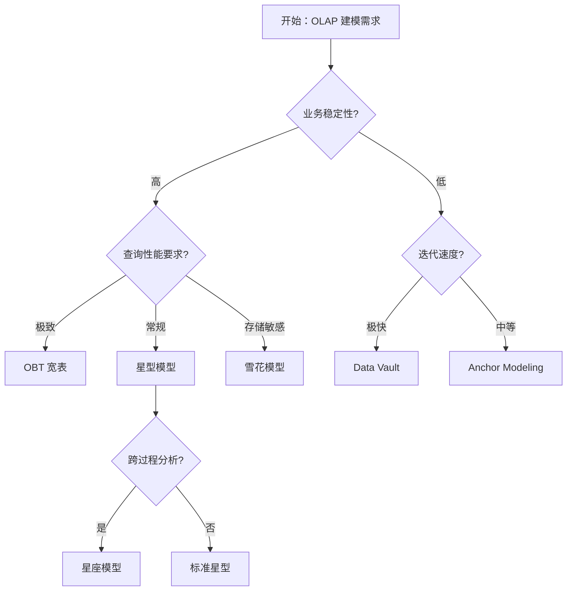

> 本文件是 **02-dimensional-modeling.md** 的子文件（§7. 与其他方法对比）。完整章节请回到 [index](02-dimensional-modeling.md)。

## 7. 与其他方法对比

### 7.1 对比维度

| 维度 | 维度建模 | ER 建模 | Data Vault | Anchor Modeling | OBT 宽表 |
| --- | :---: | :---: | :---: | :---: | :---: |
| 范式 | 反 3NF | 3NF | 混合 | 6NF | 反 3NF 极致 |
| 查询性能 | 4 | 2 | 3 | 3 | 5 |
| 灵活度 | 3 | 2 | 5 | 5 | 2 |
| 学习成本 | 3 | 4 | 4 | 5 | 2 |
| 可演进性 | 3 | 2 | 5 | 5 | 2 |
| AI 友好度 | 4 | 2 | 4 | 3 | 4 |
| 生态成熟度 | 5 | 5 | 4 | 2 | 3 |

### 7.2 决策树

### 7.3 组合使用

**实战组合 1：维度建模 + Data Vault**
- ODS/DWD 层用 Data Vault 保留全量历史
- DWS/ADS 层用维度建模面向分析
- 适用：监管行业 + 敏捷数仓

**实战组合 2：维度建模 + 语义层**
- 维度建模落表 + 语义层（dbt Semantic/Cube.js）定义度量
- 适用：BI + AI 双消费场景

**实战组合 3：维度建模 + OBT**
- ODS/DWD 用维度建模保持结构化
- ADS 层用 OBT 宽表做 Ad-hoc 查询
- 适用：湖仓场景

**实战组合 4：维度建模 + 语义化维度**
- 维度表增加 embedding 列 + 事实向量嵌入
- 适用：AI 智能体平台

---
