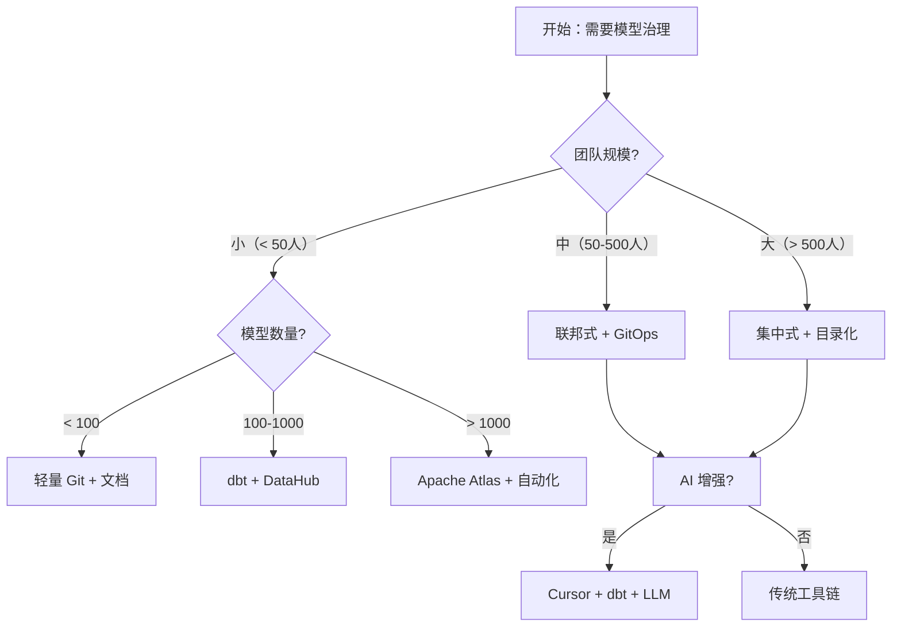

> 本文件是 **11-model-management.md** 的子文件（§7. 与其他方法对比）。完整章节请回到 [index](11-model-management.md)。

## 7. 与其他方法对比

### 7.1 对比维度

| 维度 | 模型管理 | 元数据管理 | 主数据管理 | 数据治理 |
| --- | :---: | :---: | :---: | :---: |
| 抽象层次 | 模型层 | 元数据层 | 主数据层 | 治理层 |
| 关注点 | 模型生命周期 | 元数据采集 | 主数据一致性 | 全面治理 |
| 灵活度 | 4 | 4 | 3 | 2 |
| 学习成本 | 3 | 3 | 4 | 5 |
| 可演进性 | 5 | 4 | 3 | 4 |
| AI 友好度 | 5 | 5 | 3 | 4 |
| 生态成熟度 | 4 | 5 | 4 | 5 |

### 7.2 决策树

### 7.3 组合使用

**实战组合 1：模型管理 + 元数据管理 + 数据目录**
- 模型管理是核心，元数据管理是工具，数据目录是对外界面
- 适用：90% 的企业级数据中台

**实战组合 2：模型管理 + 主数据管理 + OneID**
- 模型管理覆盖所有模型，OneID 专攻核心实体
- 适用：跨业务线的中大型企业

**实战组合 3：模型管理 + 本体建模 + GraphRAG**
- 模型管理是基础，本体建模抽象语义，GraphRAG 提供推理能力
- 适用：AI 智能体平台、知识密集型企业

**实战组合 4：模型管理 + DataOps + GitOps**
- 模型管理 + DataOps 工程化 + GitOps 版本化
- 适用：DevOps 文化浓厚的团队

**实战组合 5：模型管理 + AI 增强（Agent 自治）**
- 模型管理 + LLM 评审 + Agent 自审
- 适用：AI 原生数据团队

---
