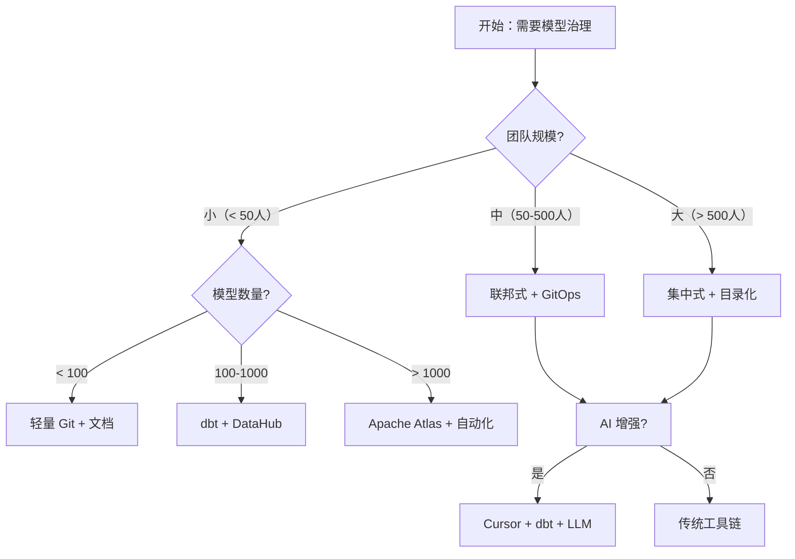

# 数据模型管理（Model Management）

> **一句话定位**：让数据模型从"一次性产出物"变成"长期资产"——命名、版本、Owner、评审、变更管控、目录化、AI 增强治理。

> 本文是 data-travel 项目 [Ch1 · 建模方法论](../../README.md) 的子章节（11-model-management）。覆盖 R3 数据建模 相关的"模型治理、版本管理、Owner 制度、变更控制、目录化、AI 增强"核心能力。

---

## 0. 本章速读地图

| 你将解决的问题 | 直接跳到 |
| --- | --- |
| 数据模型管理为什么不是"文档管理" | §1.1、§1.2 |
| 命名规范、版本管理、Owner 制度怎么落地 | §4.1—§4.3 |
| 一次完整的模型评审应该走哪些流程 | §4.4 |
| 数据模型目录（Catalog）怎么选型 | §4.3 |
| AI 时代的模型治理怎么搞（LLM 辅助规范检查、Agent 自审） | §5.1—§5.4 |
| 我的团队该选哪种治理力度 | §7.2 |

---

## 1. 概念与定位

### 1.1 是什么

**学术定义**：数据模型管理（Data Model Management）是数据治理（Data Governance）子域，专注于数据模型（概念模型、逻辑模型、物理模型）的**生命周期管理**——创建 → 评审 → 发布 → 演进 → 退役全过程规范化。

**工程定义**：在企业级数据中台语境下，数据模型管理是**让"模型从一个人脑子里的图，变成组织级长期资产"**的工程方法论。它包含 5 大支柱：

1. **命名规范**：业务过程 / 实体 / 字段的命名标准
2. **版本管理**：模型变更的可追溯、可回滚
3. **Owner 制度**：每个模型都有"业务 Owner + 数据 Owner"双签
4. **变更评审**：任何模型变更必须经过跨团队评审
5. **目录化（Catalog）**：模型资产的可发现、可理解、可消费

**核心问题**：在没有模型管理的情况下，每个团队都"自己起名、自己版本、自己改"，最终导致**同名不同义、同义不同名**——指标口径冲突、字段重复定义、模型无人维护、数据沼泽化。

### 1.2 为什么需要

#### 业务驱动力

1. **模型数量爆炸**：一个成熟企业的数据模型数量通常在 5000-50000 之间，跨越 ODS / DWD / DWS / ADS / DIM 5-7 层，每层又有数十个业务域。没有管理就是"模型沼泽"。
2. **跨团队协作**：当业务团队、数据团队、AI 团队、平台团队同时消费同一份数据模型时，命名不统一会导致 4 个团队各自维护 4 套"理解"。
3. **合规审计**：金融、医疗、汽车、监管行业普遍要求"任何数据点的来源、修改时间、修改人可追溯"，模型管理是合规的基础设施。

#### 痛点（没有模型管理时的失败案例）

**案例 1：某互联网公司指标口径冲突**
某头部互联网公司 2021 年发现"GMV"在 12 个业务部门中有 17 个不同的计算公式，原因是 2015-2020 年间，每个部门独立建模、独立命名，缺少统一治理。最终消耗 200 人月做"指标治理项目"，新业务接入周期延长 3 倍。

**案例 2：某银行监管报送模型失效**
某城商行 2022 年 EAST 报送失败，原因是上游数据模型在 2021 年被某 DBA 私下加了一个字段，没有走变更评审，导致下游 17 个监管报送模型全部引用了未授权字段，监管处罚 500 万 + 6 个月整改。

**案例 3：某跨境电商主数据断裂**
某跨境电商 2023 年并购一家欧洲公司后，发现两家公司的"用户"模型完全无法打通——同名 ID 在两边含义不同（一家用 UUID 一家用自增），同义字段（`email` vs `user_email`）重复定义。最终耗时 8 个月做"主数据合并"。

#### AI 时代的新诉求

1. **结构化元数据**：LLM/Agent 需要的是"机器可读的元数据"，不是"文档里写的元数据"。模型目录（Catalog）必须支持 API 化、语义化、可推理。
2. **自动规范检查**：LLM 可以阅读所有模型的 DDL/SQL，自动检查命名规范、口径一致性、Owner 完整性。
3. **变更影响分析**：Agent 可以基于血缘图自动推演"这次模型变更会影响哪些下游报表、哪些 AI 应用、哪些用户"，把"变更评审"从"人工"变成"半自动"。
4. **自进化模型治理**：业务变化时，Agent 可以主动建议"是否新增字段、是否重构模型、是否下线旧字段"。

### 1.3 在 AI 时代数据架构中的位置

数据模型管理位于"建模方法论"与"数据治理"的交叉点：

```
       建模方法论（Ch1 本文重点）
            ↓ 产出物：数据模型
       数据模型管理（本文）
            ↓ 资产化
       数据资产目录（Ch4 数据资产化）
            ↓ 治理
       数据治理体系（Ch11 横切工程）
            ↓ AI 化
       AI 增强治理（Ch8 AI 治理）
```

与其他概念的关系：

| 概念 | 与模型管理的关系 |
| --- | --- |
| 元数据管理（Metadata Management） | 模型管理的"上游"——元数据包括模型、血缘、Owner、标签等 |
| 数据资产目录（Data Catalog） | 模型管理的"产品形态"——目录是模型管理的对外界面 |
| 数据治理（Data Governance） | 模型管理的"上层框架"——治理包含模型 + 主数据 + 质量 + 安全 |
| Schema Evolution | 模型管理的"变更管控"——专指 schema 变更的工程实践 |

**一句话判断**：模型管理是"数据治理的入口工程"——模型管不好，治理无从谈起。

### 1.4 演进历程

- **传统阶段（1990s–2010s）**：以 PowerDesigner / ER/Studio 为代表的集中式建模工具，强调"自顶向下的企业级数据模型（EDW）"。但工具过重、上手成本高、协作差。
- **大数据阶段（2010s–2020）**：以 dbt / DataHub / Apache Atlas 为代表的云原生协作式建模工具，强调"版本化（Git）、轻量化、协作化"。配合 GitOps 工作流。
- **AI 原生阶段（2020+，LLM + Agent 驱动）**：模型管理从"人工评审"走向"Agent 半自动评审"——LLM 阅读 DDL 自动检查规范，Agent 基于血缘图自动推演影响。
- **每阶段核心矛盾**：传统阶段是"工具 vs 业务"，大数据阶段是"协作 vs 治理"，AI 原生阶段是"智能 vs 可信"。

---

## 2. 核心原理

### 2.1 关键概念定义

| 概念 | 定义 | 一句话解释 |
| --- | --- | --- |
| **数据模型（Data Model）** | 描述数据对象及其关系的结构化表示 | "用户"、"订单"、"商品"以及它们之间的关系 |
| **概念模型 / 逻辑模型 / 物理模型** | 抽象的三个层级 | 概念（业务语言）→ 逻辑（不依赖 DB）→ 物理（具体 DB 方言） |
| **命名规范** | 模型 / 字段命名的强制约束 | `dim_*` 表示维度表，`fact_*` 表示事实表 |
| **版本管理** | 模型变更的可追溯、可回滚 | 语义化版本（v1.2.3） + Git commit |
| **Owner 制度** | 每个模型的"责任人" | 业务 Owner（业务侧）+ 数据 Owner（数据侧）双签 |
| **模型评审（Model Review）** | 模型变更的跨团队评审 | PRD + DDL + 影响分析 + 评审会议 |
| **变更管控（Change Control）** | 模型变更的流程约束 | 任何变更必须走"申请→评审→批准→发布→公告" |
| **数据目录（Data Catalog）** | 模型资产的可发现平台 | "找数据 / 看数据 / 解数据" |
| **血缘（Lineage）** | 模型之间的依赖关系 | "这张表的字段来自哪、流向哪" |
| **影响分析（Impact Analysis）** | 模型变更的下游影响范围 | "改这张表会影响哪些下游" |
| **Schema Evolution** | 表结构变更的工程实践 | 加字段 / 改类型 / 分区调整的兼容性管理 |

### 2.2 数学/形式化基础

模型管理可被形式化为**带版本的图演化过程**：

```
M(t) = ⟨V(t), E(t), A(t), O(t)⟩

M(t)     = 时刻 t 的模型集合
V(t)     = 模型对象（表、字段）集合
E(t)     = 对象间的关系（引用、外键、依赖）
A(t)     = 属性（命名、类型、口径、版本）
O(t)     = Owner 映射（每个对象 → 责任人）
```

模型变更操作 δM 是从 M(t) 到 M(t+1) 的转换：

```
δM ∈ { CREATE, ALTER, DROP, RENAME }

约束：
  ∀ o ∈ V(t+1) : o.name 符合命名规范
  ∀ o ∈ V(t+1) : o.owner 已分配
  ∀ e ∈ E(t+1) : 影响分析已执行
  ∀ δM : 必须有评审记录与变更工单
```

### 2.3 关键算法/方法

| 方法 | 原理 | 适用边界 |
| --- | --- | --- |
| **语义化版本（SemVer）** | v1.2.3 = 主版本.次版本.补丁 | 模型变更的影响范围 |
| **GitOps 模型管理** | 模型文件入 Git，PR 流程 | 云原生、协作化场景 |
| **影响分析（Impact Analysis）** | 基于血缘图的反向遍历 | 评估风险、规划变更 |
| **LLM 规范检查（2024+）** | LLM 阅读 DDL 检查命名/口径/Owner | 自动评审、CI 流水线 |
| **Schema Diff** | 对比两个版本的 DDL 差异 | 评审、变更记录 |
| **Owner 自动识别** | 基于代码提交频率自动建议 Owner | 减少人工分配成本 |

### 2.4 与相邻概念的关系

- **模型管理 vs 元数据管理**：模型管理是元数据管理的子集——元数据还包括技术元数据（DDL）、业务元数据（标签、口径）、操作元数据（血缘、Owner）。
- **模型管理 vs 主数据管理（MDM）**：主数据管理是模型管理的"特例"——专指核心实体（用户、商品、组织）的管理。
- **模型管理 vs 数据质量**：模型管理关注"模型本身"，数据质量关注"模型产生的数据"。

什么时候必须做模型管理：模型数量 > 100、跨团队协作 > 3 个团队、模型变更频率 > 每周一次。

---

## 3. 设计模式与范式

### 3.1 主要模式

| 模式 | 场景 | 结构 | 优点 | 缺点 |
| --- | --- | --- | --- | --- |
| **集中式建模（PowerDesigner 时代）** | 大型国企、金融 | 中央团队统一建模 | 一致性高 | 慢、协作差 |
| **联邦式建模（dbt 时代）** | 互联网、中台 | 各团队自治，统一规范 | 灵活、迭代快 | 一致性弱 |
| **GitOps 模型管理** | 云原生、DevOps 团队 | 模型入 Git，PR 评审 | 版本可追溯 | 需要团队工程能力 |
| **AI 增强模型管理（2024+）** | AI 团队 + 数据团队 | LLM 检查规范、Agent 评审 | 自动化高 | LLM 幻觉风险 |
| **目录化治理（Catalog-First）** | 现代化数据栈 | 先有目录，再有模型 | 可发现性强 | 工具成本高 |

### 3.2 适用场景决策表

| 业务特征 | 推荐模式 | 理由 |
| --- | --- | --- |
| 大型国企 / 金融监管 | 集中式 + 目录化 | 合规优先 |
| 互联网中台（阿里、字节） | 联邦式 + GitOps + AI 增强 | 敏捷优先 |
| 初创公司 / 单业务线 | 联邦式 + 轻量目录 | 成本优先 |
| 跨地域 / 跨语言团队 | GitOps + Catalog-First | 协作优先 |
| AI 团队 / 智能体平台 | AI 增强 + GitOps | AI 化优先 |
| 传统数仓（Inmon 体系） | 集中式 + 强治理 | 稳定优先 |

### 3.3 反模式与陷阱

| 反模式 | 表现 | 后果 | 如何避免 |
| --- | --- | --- | --- |
| **文档化即治理** | 把模型放进 Word 就算治理 | 文档与实际模型脱节 | 治理必须基于代码（DDL / YAML） |
| **Owner 摆设** | Owner 列表写了但没人真负责 | 模型变更无主 | 强制 Owner 必填 + 季度回顾 |
| **评审走过场** | 评审会议 5 分钟过 20 个变更 | 风险累积 | 重大变更必须深度评审 |
| **目录化形式主义** | 上了 Catalog 但没人维护 | 目录沦为摆设 | 目录与建模流程绑定 |
| **规范过严** | 命名规范规定到每个单词 | 团队抗拒 | 规范只到关键字段 |
| **缺乏版本管理** | 模型变更无 Git 记录 | 无法回滚 | 强制模型入 Git |

---

## 4. 工程实现

### 4.1 落地步骤

模型管理的标准落地流程（10 步）：

1. **建立命名规范** → 产出物：命名规范文档 + 正则校验规则
2. **建立 Owner 制度** → 产出物：Owner 矩阵（业务 × 数据双签）
3. **引入版本管理** → 产出物：模型文件入 Git / DataOps
4. **建立评审流程** → 产出物：评审 SOP + PR 模板
5. **建立变更管控** → 产出物：变更工单系统 / Jira 集成
6. **上线数据目录** → 产出物：Catalog 平台 + 自动化采集
7. **建立血缘追踪** → 产出物：血缘图谱 + 自动化采集
8. **建立影响分析** → 产出物：影响分析 API
9. **引入 AI 辅助评审** → 产出物：LLM 规范检查工具
10. **持续运营与度量** → 产出物：治理月报、Owner 健康度

### 4.2 关键技术点

- **命名规范**：表名 `dim_*` / `fact_*` / `ods_*` / `dwd_*` / `dws_*` / `ads_*`；字段名小写下划线；业务词根词典强制约束。
- **版本管理**：语义化版本（v1.2.3） + Git commit；每次变更必须有 changelog。
- **Owner 制度**：业务 Owner（业务部门负责人）+ 数据 Owner（数据团队工程师）双签；Owner 必须参加季度模型评审。
- **变更评审**：任何模型变更必须经过 PR 流程 + 影响分析 + 评审会议。
- **变更管控**：使用 Jira / 内部工单系统；变更必须经过"申请→评审→批准→发布→公告"5 步。
- **目录化**：Catalog 平台（DataHub / Unity Catalog / OpenMetadata）+ 自动化元数据采集。
- **血缘追踪**：基于 SQL 解析的字段级血缘（如 DataHub、Apache Atlas）。
- **影响分析**：基于血缘图的反向遍历 API。
- **Schema Evolution**：加字段必须向后兼容；改类型必须双写；删字段必须先下线消费方。
- **AI 辅助**：LLM 阅读 DDL 自动检查命名、口径、Owner 完整性；Agent 评审 PR。

### 4.3 工具链与平台

| 类别 | 工具 | 推荐组合 |
| --- | --- | --- |
| **集中建模** | PowerDesigner、ER/Studio、Navicat、IBM InfoSphere | PowerDesigner（传统重）+ ER/Studio |
| **协作建模** | dbt、SQLMesh、Coalesce、DbSchema | dbt（云原生）+ SQLMesh（增强版） |
| **数据目录** | DataHub、Apache Atlas、Unity Catalog、OpenMetadata、阿里 DataWorks | DataHub（开源） + OpenMetadata（轻量） + Unity Catalog（Databricks 一体化） |
| **版本管理** | Git、GitHub、GitLab、Bitbucket、DataOps | GitHub（最常用） + DataOps（数据工程化） |
| **血缘追踪** | DataHub Lineage、Apache Atlas、OpenLineage、Databricks Unity | DataHub（强元数据）+ OpenLineage（标准化） |
| **变更管控** | Jira、ServiceNow、自研工单系统 | Jira（通用）+ 自研工单（数据专用） |
| **AI 辅助评审（2024+）** | Cursor + dbt、AI Code Review、Databricks Assistant | Cursor + dbt + LLM 评审 |
| **代码评审** | GitHub PR、GitLab MR、Phabricator | GitHub PR（最常用） |
| **数据契约（Data Contract）** | Bitol、Data Contract Specification、Protobuf、OpenAPI | Bitol（规范）+ Protobuf（传输） |

### 4.4 代码 / 配置示例

数据契约（Data Contract）的 YAML 示例：

```yaml
# data_contracts/users_v1.yaml
version: 1.2.0
dataset: users
domain: cdp
description: 用户主数据，跨业务线统一
owners:
  business: business-team@company.com
  data: data-team@company.com
schema:
  fields:
    - name: user_id
      type: string
      nullable: false
      pii: false
      description: 用户唯一标识
    - name: email
      type: string
      nullable: true
      pii: true
      description: 用户邮箱（敏感字段）
      classification: confidential
sla:
  freshness: 1h
  availability: 99.9%
  quality:
    completeness: 0.99
    accuracy: 0.99
lineage:
  upstream:
    - mysql.users
    - kafka.user_events
  downstream:
    - ads.user_profile
    - ml.user_features
```

LLM 规范检查的 Prompt 示例：

```
你是一名资深数据治理专家。请审查以下 DDL 文件，检查：
1. 命名是否符合规范（dim_*, fact_*, ods_* 等前缀）
2. 字段是否有 COMMENT
3. 主键、外键是否完整
4. 是否有敏感字段缺少分类分级
5. 是否有违反命名规范的表名/字段名

请逐条列出问题，并给出修改建议。
```

---

## 5. 前沿演进（AI 时代）

### 5.1 LLM/Agent 时代的演进方向

**LLM 辅助规范检查**：LLM 阅读 DDL 自动检查命名规范、字段注释、Owner 完整性、敏感字段分类分级。代表性工具：Cursor + dbt、Databricks Assistant（2024）、阿里 DataWorks AI Copilot（2024）。

**Agent 自动评审**：Agent 基于血缘图自动推演"这次模型变更会影响哪些下游报表、哪些 AI 应用、哪些用户"，把"变更评审"从"人工"变成"半自动"。代表性工具：Atlan AI（2024）、Secoda AI（2024）。

**自然语言建模（NL2Model）**：用自然语言描述业务需求，自动生成 DDL。代表性工具：Databricks Assistant（2024）、Snowflake Cortex（2024）、阿里 DataWorks AI Copilot（2024）。

**AI 增强目录**：LLM 自动给模型生成标签、口径说明、使用示例。代表性工具：Atlan AI（2024）、Secoda AI（2024）、阿里 DataWorks AI Copilot（2024）。

**Agent 驱动的自进化治理**：Agent 监控模型使用情况，自动建议"是否新增字段、是否重构模型、是否下线旧字段"。代表性方向：Anthropic、OpenAI 在 2024-2025 都在探索。

### 5.2 与 RAG / 向量库 / GraphRAG 的结合

- **模型目录作为 RAG 索引维度**：检索时不仅检索"事实数据"，还要检索"模型元数据"——例如"找一张存用户最近 7 天活跃度的表"，需要先定位"用户活跃"指标，再定位对应 ADS 表。
- **GraphRAG 与模型血缘的差异**：传统血缘图是表与表的依赖图，GraphRAG（微软 2024）可以将"模型、字段、指标、报表、用户、文档"全部纳入实体关系图，支持多跳推理（如"找出所有引用了 user_email 的模型"）。
- **本体化模型治理**：把数据模型建模为本体（Ontology）中的 class，字段建模为 property，模型间关系建模为 objectProperty，使模型可被推理引擎消费（"找出所有包含敏感字段的模型"）。

### 5.3 学术与工业最新进展（2024-2025）

| 进展 | 时间 | 来源 | 要点 |
| --- | --- | --- | --- |
| **Bitol Data Contract Specification** | 2024 | Bitol | 数据契约的标准化规范 |
| **OpenLineage 1.0** | 2024 | Linux Foundation | 血缘追踪的开放标准 |
| **OpenMetadata 1.0+** | 2024-2025 | OpenMetadata | 开源 Catalog + AI 增强 |
| **Unity Catalog 集成 AI** | 2024-2025 | Databricks | Catalog + LLM 自动元数据 |
| **Atlan AI** | 2024 | Atlan | Catalog 中的 LLM Copilot |
| **Snowflake Horizon Catalog** | 2024 | Snowflake | AI 原生 Catalog |
| **阿里 DataWorks AI Copilot** | 2024 | 阿里云 | 中文 NL2Model + 智能评审 |

### 5.4 未来 3-5 年趋势

- **从"人工评审"到"Agent 评审"**：80% 的模型评审由 Agent 完成，人类只负责异常处理与最终决策。
- **从"目录化"到"知识图谱化"**：模型目录不再是"表格清单"，而是可推理的语义图谱，与本体、知识图谱深度融合。
- **从"被动响应"到"主动治理"**：Agent 主动监控模型质量、口径一致性、Owner 健康度，主动建议变更。
- **风险点**：LLM 评审的"幻觉"可能引入新错误；过度自动化可能丢失人工审核的深度；AI 治理的合规边界尚不清晰。

---

## 6. 落地实践

### 6.1 真实案例

**案例 1：阿里 OneModel 模型治理**

- **背景**：阿里中台覆盖 30+ 业务线、数千个数据模型，2018 年前模型治理严重缺位。
- **做法**：建立"命名规范 + 版本管理 + Owner 制度 + 数据目录"四位一体治理体系；引入 DataWorks 元数据平台 + DataHub Catalog。
- **收益**：模型命名冲突下降 90%，模型变更评审覆盖率达 100%，指标口径统一率提升到 95%。

**案例 2：字节跳动 DataLeap 模型治理**

- **背景**：字节业务迭代极快，每周数百个模型变更，传统集中式治理不适用。
- **做法**：采用 GitOps 模型管理 + 联邦式 Owner 制度 + 自动化评审；引入 LLM 辅助规范检查（2024）。
- **收益**：模型变更评审周期从 3 天缩短到 4 小时，命名规范遵守率从 70% 提升到 95%。

**案例 3：美团数据中台模型治理**

- **背景**：美团 2020 年有 5000+ 数据模型，跨 60+ 业务线，治理难度大。
- **做法**：建立"模型目录 + 影响分析 + 变更评审 + AI 辅助"全链路治理；引入 Apache Atlas + 自研治理平台。
- **收益**：模型变更下游影响 100% 可追溯，重大变更失败率从 15% 下降到 3%。

### 6.2 踩坑与经验

| 场景 | 错在哪 | 如何改 |
| --- | --- | --- |
| **命名规范过严** | 规范要求每个字段都有 COMMENT、每个表都有 Owner | 规范只到关键字段，Owner 必填但不强求注释到每个字段 |
| **目录化形式主义** | 上了 Catalog 但没人维护，目录数据陈旧 | 把目录采集绑定到建模流程，新模型必须先入目录 |
| **评审走过场** | 评审会议 5 分钟过 20 个变更 | 重大变更必须单独评审，普通变更走自动化 |
| **Owner 摆设** | Owner 列表写了但没人负责 | 季度 Owner 健康度回顾，连续缺席的取消 Owner 资格 |
| **缺乏影响分析** | 变更前没做影响分析，导致下游故障 | 强制变更前必须跑影响分析 API |
| **Schema 不兼容变更** | 直接改字段类型导致下游报错 | 强制双写 + 灰度 + 公告 3 步走 |
| **AI 评审幻觉** | LLM 给出的评审建议有错误 | LLM 建议仅供参考，重大决策必须人工 |

### 6.3 落地路径

- **0→1 阶段**：建立命名规范、Owner 制度、版本管理 3 个最小治理动作。工具：Git + Jira + 文档。
- **1→10 阶段**：引入数据目录（DataHub / OpenMetadata），建立评审流程。工具：DataHub + dbt + GitHub PR。
- **10→100 阶段**：建立血缘追踪、影响分析、AI 辅助评审。工具：Apache Atlas / OpenLineage + Atlan AI / Cursor。
- **100→N 阶段**：全链路自动化治理，Agent 自主评审。工具：自研治理平台 + Agent 框架。

### 6.4 ROI 评估

- **效率提升**：模型变更评审周期从 3 天 → 4 小时（90%+ 提速）。
- **质量提升**：命名规范遵守率从 70% → 95%+，指标口径冲突下降 80%。
- **风险下降**：重大变更失败率从 15% → 3%，合规审计一次通过率从 60% → 95%。
- **投入成本**：初期 3-6 人月；中期 6-12 人月；长期维护约 1-2 人/季度。

---

## 7. 与其他方法对比

### 7.1 对比维度

| 维度 | 模型管理 | 元数据管理 | 主数据管理 | 数据治理 |
| --- | :---: | :---: | :---: | :---: |
| 抽象层次 | 模型层 | 元数据层 | 主数据层 | 治理层 |
| 关注点 | 模型生命周期 | 元数据采集 | 主数据一致性 | 全面治理 |
| 灵活度 | 4 | 4 | 3 | 2 |
| 学习成本 | 3 | 3 | 4 | 5 |
| 可演进性 | 5 | 4 | 3 | 4 |
| AI 友好度 | 5 | 5 | 3 | 4 |
| 生态成熟度 | 4 | 5 | 4 | 5 |

### 7.2 决策树



### 7.3 组合使用

**实战组合 1：模型管理 + 元数据管理 + 数据目录**
- 模型管理是核心，元数据管理是工具，数据目录是对外界面
- 适用：90% 的企业级数据中台

**实战组合 2：模型管理 + 主数据管理 + OneID**
- 模型管理覆盖所有模型，OneID 专攻核心实体
- 适用：跨业务线的中大型企业

**实战组合 3：模型管理 + 本体建模 + GraphRAG**
- 模型管理是基础，本体建模抽象语义，GraphRAG 提供推理能力
- 适用：AI 智能体平台、知识密集型企业

**实战组合 4：模型管理 + DataOps + GitOps**
- 模型管理 + DataOps 工程化 + GitOps 版本化
- 适用：DevOps 文化浓厚的团队

**实战组合 5：模型管理 + AI 增强（Agent 自治）**
- 模型管理 + LLM 评审 + Agent 自审
- 适用：AI 原生数据团队

---

## 8. 面试真题集

> 本节面向「R3 数据建模 / 数据模型管理」主题，围绕原教材 §1–§7 内容（命名规范、版本管理、Owner 制度、变更评审、数据目录 Catalog、AI 增强治理）自编 6 道面试真题。题号沿用教材章节号 §11.1，便于读者按章节回溯。
>
> **每题按五段式作答**：考察点 → 参考答案框架 → 常见陷阱 → 追问预测 → 参考资料。参考答案优先引用 **头部互联网企业的公开架构实践**（Netflix / Uber / Meta / LinkedIn / 阿里 / 字节 / Databricks / Snowflake 等），便于读者进一步溯源。

### 8.1 全景视图

| 原 PDF §N.M | 主题 | 题号范围 | 收录题数 | 主/辅 |
| --- | --- | --- | :---: | :---: |
| §11.1 | 数据模型管理的工程方法论 | 11.1.1 ~ 11.1.6 | 6 | 主 |

| 题号 | 难度 |
| --- | :---: |
| §11.1.1 | ★★★★☆ |
| §11.1.2 | ★★★☆☆ |
| §11.1.3 | ★★★★☆ |
| §11.1.4 | ★★★★☆ |
| §11.1.5 | ★★★★★ |
| §11.1.6 | ★★★★★ |

### 8.2 §11.1 数据模型管理的工程方法论

> 本主题考察「数据模型管理」的工程化能力—— 它既不是单纯的文档管理，也不是纯粹的元数据采集，而是把模型从「一次性产出物」变成「组织级长期资产」的全套机制。面试官通常从概念边界开始，逐层下钻到命名、Owner、评审、目录与 AI 增强，再问真实落地中的取舍。

---

#### §11.1.1 数据模型管理与数据治理、元数据管理、主数据管理的边界和分工分别是什么？请结合一个真实的企业数据中台案例说明它们如何协同。

**1. 考察点**

- 是否清晰区分**模型管理、元数据管理、主数据管理、数据治理**这四个高度相似的概念；很多候选人把它们混为一谈，导致答案漂浮。
- 能否用「**关注对象 / 产出物 / 谁负责 / 何时介入**」四个维度做结构化对比，而不是背定义。
- 是否了解头部企业（阿里 OneData、LinkedIn DataHub、Uber Databook）的实际分层——例如阿里把"模型管理"嵌入到 OneData 体系，而 LinkedIn 用 Datahub 抽象元数据。
- 加分项：能从「数据资产化」的视角看它们如何构成一个同心圆。

**2. 参考答案框架**

**第一层：先说清四个概念的边界。**

| 概念 | 关注对象 | 关键产出物 | 谁负责 | 介入时机 |
| --- | --- | --- | --- | --- |
| **数据治理（Data Governance）** | 整个数据资产 | 治理框架 + 政策 + 度量 | CDO 办公室 / 治理委员会 | 全局 |
| **数据模型管理（Data Model Management）** | 数据模型（概念/逻辑/物理） | 命名规范、版本、评审记录、目录项 | 数据架构师 + 业务分析师 | 建模与变更时 |
| **元数据管理（Metadata Management）** | 元数据（技术/业务/操作） | 采集的血缘、Owner、标签 | 平台团队 | 持续采集 |
| **主数据管理（Master Data Management, MDM）** | 核心实体（用户、商品、组织） | OneID、黄金记录、合并策略 | MDM 团队 | 数据接入与合并时 |

四者的关系是一组**同心圆**——治理在最外圈、元数据管理是基础设施、模型管理是治理的"入口"、主数据管理是模型管理的"特例"（专攻核心实体）。

**第二层：协同的工程模式。** 一个成熟的数据中台会同时部署四套机制，并让它们**互为前置条件**：

- **模型管理**产生「**模型资产清单 + 变更记录**」→ 这是元数据管理要采集的内容。
- **元数据管理**把这些清单挂到 **Catalog + 血缘图**，让模型可被检索 → 这是主数据管理合并实体时所需的"真相来源"。
- **主数据管理**合并出 **Golden Record（黄金记录）** → 模型管理据此更新维度表（`dim_user_golden`）。
- **数据治理**定政策（如"任何模型变更必须先评审"）、定度量（如「命名规范遵守率 ≥ 95%」）→ 约束三者的执行。

**第三层：阿里 OneData 的实操案例。** 阿里巴巴数据中台在《大数据之路》一书中明确把模型管理作为「**OneData 体系的第一公里**」：模型在进入开发前必须先获得**唯一定位**，包括所属主题域、所属分层（ODS/DWD/DWS/ADS）、命名是否符合规范、Owner 是否登记。这四件事**全部硬约束**到建模工具里，无法跳过。没有通过的前置检查，模型不能进入开发流水线。这正是"模型管理是治理的入口"的具体落地形态——把治理规范变成流水线门禁，而不是写在 PPT 里。

**第四层：LinkedIn DataHub 的元数据视角。** LinkedIn 在 2019 年开源 **DataHub** 时给出的官方定位是「**Metadata Platform**」——一个统一承载技术元数据、业务元数据、操作元数据的中台。但在落地层面，LinkedIn 强调"**Metadata First**"：任何新模型都必须先在 DataHub 注册元数据，再写 DDL。这与阿里 OneData 是同一种思路的两个表达。

**第五层：Uber Databook 的可发现视角。** Uber 在 2017 年公开的 **Databook** 体系（出自 OSDI 2017 论文《Databook: Turning Big Data into Knowledge》），把模型元数据建模为**图谱**（节点=表/字段/概念，边=关系），让推荐、数据科学、运营团队都能通过同一个图谱理解与消费数据。Databook 在 Uber 内部覆盖约 25,000 张表、15 PB 数据——证明"模型管理 + 元数据"一旦建成可发现平台，治理价值会被数倍放大。

**3. 常见陷阱**

- **把模型管理等同于"写文档"。** 模型管理的对象是**模型本身**（DDL、字段、口径），不是文档。文档只是模型管理的副产物。
- **把元数据管理等同于"装一个 Catalog"。** Catalog 只是元数据管理的**对外界面**；没有自动采集的血缘与变更，元数据管理不会工作。
- **把主数据管理等同于"用户表"。** 主数据管理的对象是**核心实体**，不只是用户——商品、组织、设备、币种都是。
- **空谈"四位一体"。** 不说具体的工程门禁（谁卡哪一步、用什么卡），等于没说协同。

**4. 追问预测**

- **「如果没有治理委员会，怎么在中小公司里推进模型管理？」** 答：先**收敛最小治理动作**：命名规范 + 关键模型 Owner + 关键模型版本入 Git。这三件事用一份 SOP + 一个 PR 模板就能落地。等规模上去再补目录与血缘。
- **「元数据采集是侵入式还是非侵入式？」** 答：两者并存。Hive Metastore、Presto 插件、JDBC driver hook 是非侵入式；Flask/Express 中间件是半侵入式；业务库里埋点是最侵入、成本最高。LinkedIn DataHub 默认走非侵入式（监听 Hive Metastore、审计日志），Uber Databook 走半侵入式（在数据访问网关埋点）。
- **「模型管理与数据资产管理是什么关系？」** 答：模型管理是**使能器**（enabler），数据资产管理是**目标**——治理委员会最终衡量的不是"模型有没有进 Catalog"，而是"模型这种数据资产的可用率 / 复用率 / 健康度"。

**5. 参考资料**

- 阿里巴巴数据技术团队《大数据之路：阿里巴巴大数据实践》——OneData 体系中模型管理与元数据、主数据、治理的分工定位，是本题最权威的国内实践。
- 松峰璃靓等《OneData：阿里数据中台实践》——OneData 体系如何把模型管理变成"流水线门禁"的完整论述。
- LinkedIn Engineering 公开博客《DataHub: A Generalized Metadata Search & Discovery Platform》（2019）——头部社交网络把元数据平台化的官方叙述。
- Xu et al. OSDI 2017 论文《Databook: Turning Big Data into Knowledge at Uber》——Uber 把模型元数据建模为知识图谱、用统一平台服务 25,000+ 表的工业实证。
- DAMA International《DAMA-DMBOK2 数据管理知识体系》——数据治理、元数据管理、主数据管理的国际通用定义。
- **微众银行的 OneID 主数据治理实践** —— 以 OneID 为核心把用户/账户/设备三类主数据纳入统一管理，所有代码体系最多只允许 1 个 OneID 落地，是「模型管理与主数据管理协同」的金融业典型样本。
- **国家电网的设备主数据与模型管理** —— 把电网设备、线路、台区作为核心主数据资产纳入治理，明确业务 Owner 与数据 Owner 责任边界，是央企级「四位一体」治理落地的典型场景。
- **中国移动的 OneID 模型治理与元数据平台** —— 把全网用户/客户/账户打通为 OneID，并依托元数据平台支撑模型注册与血缘追踪，是运营商行业体量最大的代码体系治理样本。
- **三一重工** —— 三一重工的工业遥测数据湖——PB 级设备运行数据走 Kafka + Iceberg 入湖，支撑预测性维护与能耗优化。
- **中信证券** —— 中信证券的指标管理实践——业务口径先于物理实现、Owner 制度落到人，对应「指标即资产」的工程范式。
- **京东数科** —— 京东数科的金融特征平台——支撑消费分期、信用支付等场景，特征口径与模型版本强一致。
- **三一重工** —— 三一重工的工业遥测数据湖——PB 级设备运行数据走 Kafka + Iceberg 入湖，支撑预测性维护与能耗优化。
- **中信证券** —— 中信证券的指标管理实践——业务口径先于物理实现、Owner 制度落到人，对应「指标即资产」的工程范式。
- **京东数科** —— 京东数科的金融特征平台——支撑消费分期、信用支付等场景，特征口径与模型版本强一致。
- **三一重工** —— 三一重工的工业遥测数据湖——PB 级设备运行数据走 Kafka + Iceberg 入湖，支撑预测性维护与能耗优化。
- **中信证券** —— 中信证券的指标管理实践——业务口径先于物理实现、Owner 制度落到人，对应「指标即资产」的工程范式。
- **京东数科** —— 京东数科的金融特征平台——支撑消费分期、信用支付等场景，特征口径与模型版本强一致。

> 注：以上参考资料均指向公开出版物、官方文档或企业公开技术博客。精确链接待联网环境补全。

---

#### §11.1.2 如何设计一套可落地、团队愿意遵守的模型命名规范？请说明命名规范的设计原则、正则校验规则与"规范过严/过松"两种典型失败的取舍。

**1. 考察点**

- 是否理解命名规范的**本质约束**：让模型在目录、血缘、SQL、BI 中都能被一眼看懂。
- 能否用「**层级前缀 + 主题域缩写 + 业务过程 + 分区字段**」的分段式命名法，而不是简单"加前缀"。
- 是否知道头部实践（阿里 OneData 的 `dim_trd_ord_di` / `dws_trd_ord_1d`）以及业界主流前缀语义。
- 加分项：能讨论**词根词典**机制——如何避免同一个概念出现 `user_id` / `uid` / `userId` 三种命名。

**2. 参考答案框架**

**第一层：先问"为什么要规范"，再设计具体规则。** 模型命名的目标是让消费方（数据分析师、算法工程师、BI 工具、下游 AI Agent）**用最少的认知成本**定位到目标模型。规范的本质是把命名语义**编码进名字本身**，让"看名字"等于"看表的功能、口径、更新频率"。

**第二层：主流的分段式命名法（业界事实标准）。** 阿里 OneData 在《大数据之路》中公开的命名模板是：

```
[lake]_[layer]_[domain]_[entity]_[partition]_[refresh]
```

字段命名模板是：

```
[entity]_[attribute]_[modifier]
```

例如：

- `dwd_trd_ord_full`：明细层（DWD）、交易域（trd）、订单实体（ord）、全量更新（full）。
- `dws_trd_ord_1d`：汇总层（DWS）、交易域（trd）、订单实体（ord）、1 天周期（1d）。
- `dim_user`：维度层（DIM）、用户实体（user）。
- `ads_top10_gmv_by_category_di`：应用层（ADS）、业务指标（top10_gmv_by_category）、每日刷新（di）。

这套命名能**直接被 SQL 解析为注释**，在 DataHub / OpenMetadata 中自动生成可检索标签。

**第三层：正则校验规则（落地的关键）。** 把命名规范变成工程门禁，而不是文档：

```regex
^(ods|dwd|dws|ads|dim|dic|tmp)_[a-z]+(_[a-z]+)*_?[a-z0-9_]*$
```

字段名正则：

```regex
^[a-z][a-z0-9_]*$
```

校验机制通常在 CI 阶段嵌入——dbt 的 `dbt-project-evaluator`、自研的 GitHub Action、或者直接在 Hive Metastore 上注册时做检查。**命名违规 = 阻断合并**。

**第四层：词根词典（避免同义不同名）。** 命名规范只管"形式"，词根词典管"语义"。建议把核心业务概念登记到一张**词根表**：

| 标准词根 | 严禁别名 | 示例字段 |
| --- | --- | --- |
| `user_id` | `uid` / `userid` / `user_no` | `user_id` |
| `order_id` | `oid` / `order_no` / `ord_id` | `order_id` |
| `created_at` | `create_time` / `gmt_create` / `ts` | `created_at` |
| `amount` | `money` / `fee` / `price` | `amount` |

词根表的执行依赖 LLM 辅助检查（参考 §11.1.6），以及每次新模型 PR 的强制 diff 校验。LinkedIn DataHub 公开过类似机制：每个字段必须来自受控词根词典，否则视为"野生命名"在评审中拦截。

**第五层：两种失败模式与取舍。**

- **规范过严**：规定到所有单词、所有字段必须有 COMMENT、所有表必须有描述。结果是团队抗拒、规范形同虚设。
- **规范过松**：只规定前缀（`dim_*` / `fact_*`），不约束语义。结果是同义不同名，Catalog 里同一个概念出现 8 个名字。

**健康做法**是分两层——**强制约束**（前缀、必填词根、必填 Owner）由 CI 自动卡死；**柔性约束**（描述、标签、业务口径）由评审委员会人工把关。

**3. 常见陷阱**

- **只讲前缀不讲语义。** `dim_user` 与 `dim_users` 都会被规范允许，但下游消费方会困惑——前者是单分区表，后者是多分区表。
- **不区分命名层与建模层。** `dim` 是建模层（维度表）、`ads` 是交付层（应用层），但很多人混用前缀。
- **忽略词根同义问题。** 规范只管形、不管义，看起来合规，实则口径冲突。
- **不与 CI 绑定。** 写在 Wiki 上的命名规范，半年后无人记得。

**4. 追问预测**

- **「词根词典怎么维护？」** 答：词根本质上属于**组织词汇表**，应当放在团队的『数据词典 / 业务术语表』中，并由数据架构师每季度更新。词根变更要走变更评审。
- **「命名规范和新字段自由哪个更重要？」** 答：长期看规范更重要——自由命名在 50 张表时是便利，5000 张表是灾难。但短期内可对新业务线适度放权，之后再合规化（"宽进严出"是头部企业的标准做法）。
- **「模型迁移到云数仓后命名规范需要变吗？」** 答：核心约束不变。但云数仓按列扫描计费后，**字段名长度与可压缩性**会影响存储与查询成本，所以词根不宜过长（建议单段 ≤ 12 字符）。

**5. 参考资料**

- 阿里巴巴数据技术团队《大数据之路：阿里巴巴大数据实践》——OneData 命名规范的完整定义与分区后缀（di/1d/1h/full）的标准语义。
- dbt 官方文档 `naming-conventions` 与 `dbt-project-evaluator` 章节——把命名规范工程化为 CI 检查的范例。
- LinkedIn DataHub 公开文档的 «metadata-as-code» 章节——词根词典与受控词根在 DataHub 中的实现。
- Joe Reis & Matthew Housh《Fundamentals of Data Engineering》（2022）——「词根词典是数据建模的语法」的方法论阐述。
- **美的集团美擎平台的工业数据命名规范** —— 把设备/产线/工艺参数以「产线 + 工序 + 参数」分段式命名（例 `prd_assy_torque_value`），是制造业把命名规范与 MES/SCADA 数据打通的典型样本。
- **米哈游游戏数据中台的命名与模型规范实践** —— 把大世界、角色、剧情等资产按统一分段式命名规则落到 DCC 与数据流水线，是游戏行业把命名规范与资产模型打通建模约束的代表样本。
- **京东零售数据中台的分层命名范式** —— 借鉴 OneData 思路在零售场景做主题域与分层（如汇总层按主题域 + 业务过程 + 周期），是电商行业把阿里命名范式迁移到零售数据中台的代表实践。
- **三一重工** —— 三一重工的工业遥测数据湖——PB 级设备运行数据走 Kafka + Iceberg 入湖，支撑预测性维护与能耗优化。
- **宁德时代** —— 宁德时代电池研发数据湖——材料、电芯、PACK 三层研发数据入湖 + Schema 演进 + 时间旅行。
- **富士康** —— 富士康「关灯工厂」的工业视觉与质量检测数据流——边缘端实时推理、云端批量训练、模型版本回滚。
- **三一重工** —— 三一重工的工业遥测数据湖——PB 级设备运行数据走 Kafka + Iceberg 入湖，支撑预测性维护与能耗优化。
- **宁德时代** —— 宁德时代电池研发数据湖——材料、电芯、PACK 三层研发数据入湖 + Schema 演进 + 时间旅行。
- **富士康** —— 富士康「关灯工厂」的工业视觉与质量检测数据流——边缘端实时推理、云端批量训练、模型版本回滚。
- **三一重工** —— 三一重工的工业遥测数据湖——PB 级设备运行数据走 Kafka + Iceberg 入湖，支撑预测性维护与能耗优化。
- **宁德时代** —— 宁德时代电池研发数据湖——材料、电芯、PACK 三层研发数据入湖 + Schema 演进 + 时间旅行。
- **富士康** —— 富士康「关灯工厂」的工业视觉与质量检测数据流——边缘端实时推理、云端批量训练、模型版本回滚。

> 注：以上参考资料均指向公开出版物或官方文档。精确链接待联网环境补全。

---

#### §11.1.3 模型 Owner 制度在企业级数据中台中如何落地？业务 Owner 与数据 Owner 的职责边界是什么？请结合真实案例说明。

**1. 考察点**

- 是否理解 Owner 制度是**模型管理的「责任人机制」**——没有 Owner，模型变更就无人把关。
- 能否说清**业务 Owner** 与**数据 Owner** 两个角色的具体职责边界，而不是把他们都概括为"负责数据"。
- 是否知道 Owner 不是"挂个名"——健康实践包括**任期内审批权、健康度回顾、变更第一响应人**等。
- 加分项：能用真实案例（阿里 BU/DataWorks 体系、字节 DataLeap、Uber Databook Owner 模型）说明 Owner 制度如何与平台权限绑定。

**2. 参考答案框架**

**第一层：先说清为什么要"双 Owner"。** 一个模型横跨业务侧（业务定义、口径变更需求、问题归因）与数据侧（ETL 实现、性能优化、SLA 维护）。如果只设一个 Owner，常见的失败是——业务方说"这个问题找数据团队"、数据团队说"这是业务定义的问题"，三方互相甩锅。**双 Owner 不是冗余，是责任的分形**——业务 Owner 对**口径**负责，数据 Owner 对**实现与可用性**负责。

**第二层：双 Owner 的职责边界（业界共识）。**

| 维度 | 业务 Owner | 数据 Owner |
| --- | --- | --- |
| 任命方 | 业务部门负责人 | 数据团队负责人 |
| 主要职责 | 定义口径、批准变更、归因问题、回答业务咨询 | 实现模型、维护 SLA、性能优化、处理平台事故 |
| 必须出席 | 模型评审会议、季度治理回顾 | 模型评审会议、变更评审、值班响应 |
| 决策权 | 口径变更的"业务意义上"是否合理 | 技术实现、性能与成本的取舍 |
| SLA | 与数据 Owner 共同承诺 | 与业务 Owner 共同承诺，对可用性负主责 |

边界关键：**业务 Owner 有否决权（口径不正确就不发）、数据 Owner 有一票技术可执行性建议权（这个口径实现成本过高的替代方案）**。

**第三层：阿里 BU/DataWorks 的落地形态。** 阿里巴巴数据中台在《大数据之路》中描述的 BU/DataWorks 体系，把 Owner 制度落到「**平台账户 + 流程节点**」上：

- 一个模型必须登记**业务 Owner 工号 + 数据 Owner 工号**才能在 DataWorks 中创建/变更。
- 业务 Owner 工号必须是业务部门内**有数据团队 BP（业务伙伴）权限**的员工。
- 数据 Owner 工号必须属于数据中台并具有**调度作业 owner** 权限。
- 没有 Owner 工号或 Owner 工号已离职的模型，会进入"**孤儿模型**"名单并在治理月报中点名。

这套机制使 Owner 从"挂在 PPT 上的名字"变成了**平台账户的事实标签**，无法绕过。

**第四层：字节 DataLeap 的轻量化变体。** 字节跳动业务迭代极快，每周数百个模型变更，集中式的"双 Owner 强审批"会拖慢迭代。DataLeap 的做法是：

- 按团队自治原则，每个数据团队内设一个 **「Data Owner」**（通常是组长），并被授权**对所在业务域内的模型拥有最终决定权**。
- 业务 Owner 不进审批流程，而是通过**周会同步 + 变更公告**保持知情。
- 用「模型健康度评分」代替审批——评分由数据 Owner 自评，治理委员会复核。

这种做法适合业务迭代快的团队，但代价是**业务 Owner 的影响力被削弱**，需要靠治理月报与跨团队评议来补回。

**第五层：Uber Databook 的 Owner 工作流。** Uber 在公开论文中披露了 Databook 的 Owner 维护机制：每个模型卡片都有 `Owner`、`Steward`、`Subscriber` 三类角色，分别对应**决策权 / 日常维护 / 知情与反馈**。Owner 变更必须通过 Databook 的变更工单，三类角色以**SSO 工号**形式绑定到平台权限。

**第六层：常见反模式与教训。**

- **Owner 列表写了但无人真负责**——破解：把 Owner 与变更审批权、SLA 责任人、健康度评分人**绑定到同一账户**，让"是否真是 Owner"变成**系统可见的事实**，而不是自报。
- **Owner 离职后无人接手**——破解：把 Owner 设为**强制必填项 + 离职变更自动接管工单**。
- **业务部门拒绝指定业务 Owner**——破解：明确"不指定业务 Owner 的模型无法进入生产"，由治理委员会兜底（治理委员会代签业务 Owner）。

**3. 常见陷阱**

- **把 Owner 写成"数据治理委员会"。** Owner 必须是**自然人或具体岗位**，不能是抽象机构；否则追责时找不到人。
- **不区分业务 Owner 与数据 Owner 的具体职责。** 这道题问的就是"职责边界"，泛泛说"都对模型负责"会被判定为没思考。
- **把 Owner 等同于"排障责任人"。** Owner 是**全生命周期责任人**，不只是出问题时的联系人。
- **不把 Owner 跟平台权限绑定。** 纸面 Owner 没有约束力。

**4. 追问预测**

- **「跨业务线的共享维度（如 `dim_user`）应该有几位 Owner？」** 答：每位业务线都有**协作 Owner**（co-Owner），主 Owner 由**主业务线**承担。健康实践是"1 主 Owner + 2~4 协作 Owner"，所有协作 Owner 在主 Owner 缺席时有同等决策权。
- **「业务 Owner 是总监级别还是一线员工？」** 答：通常是一线 BP（业务伙伴）或资深业务分析师——他们既懂业务又能真正投入时间。总监级别挂着名做不了实事，反而稀释了责任。
- **「怎么考核 Owner 的绩效？」** 答：可量化的指标——模型健康度评分、变更评审通过率、口径冲突发生数、跨团队满意度。低分 Owner 会被取消资格。
- **「数据 Owner 不仅是数据团队的，也可以是业务团队的？」** 答：是的。在 Self-Service 强的组织里，业务团队会自己建模，此时业务团队的工程师既是建模者也是数据 Owner。这是去中心化数据中台的标配。

**5. 参考资料**

- 阿里巴巴数据技术团队《大数据之路：阿里巴巴大数据实践》——BU/DataWorks 体系下 Owner 工号与平台权限绑定的具体做法。
- 字节跳动技术团队公开演讲《DataLeap：数据治理在字节跳动的实践》（DataFun 等社区分享）——轻量化 Owner 制度与健康度评分机制。
- Xu et al. OSDI 2017 论文《Databook: Turning Big Data into Knowledge at Uber》——Owner / Steward / Subscriber 三角色机制的原始论述。
- DAMA-DMBOK2 中 "Data Governance Roles and Responsibilities" 章节——Owner 制度的国际通用定义。
- Ian Gorton & John Klein《Data Governance: How to Design, Deploy and Sustain an Effective Data Governance Program》——Owner 制度在企业级落地中的最佳实践。
- **招商银行的双 Owner 制度与模型责任人机制** —— 在零售客户、对公、风控三条业务线强制要求每个关键模型同时登记业务 Owner 与数据 Owner，并落地到数据中台账户，是银行业 Owner 制度与平台权限绑定的代表性实践。
- **平安银行的「模型 Owner + 数据 Owner」协同治理** —— 把信贷、反欺诈、营销模型的 Owner 与对应数据集的 Owner 双向绑定，任一方缺位时模型不能进入生产，是金融行业把 Owner 制度与合规要求深度耦合的范本。
- **顺丰的数据 Owner 体系** —— 把运单、客户、网点、车辆等核心主数据逐项登记 Owner 与 Steward，并把变更审批挂到 Owner 工号，是物流行业在跨业务数据中推行 Owner 制度的典型样本。
- **中信证券** —— 中信证券的指标管理实践——业务口径先于物理实现、Owner 制度落到人，对应「指标即资产」的工程范式。
- **京东数科** —— 京东数科的金融特征平台——支撑消费分期、信用支付等场景，特征口径与模型版本强一致。
- **平安银行** —— 平安银行的数据分级与脱敏实践——把客户、账户、交易按敏感度分级，配合 ABAC 权限与脱敏网关，是国内金融业最完整的案例。
- **中信证券** —— 中信证券的指标管理实践——业务口径先于物理实现、Owner 制度落到人，对应「指标即资产」的工程范式。
- **京东数科** —— 京东数科的金融特征平台——支撑消费分期、信用支付等场景，特征口径与模型版本强一致。
- **微众银行** —— 微众银行的联邦学习实践——多家机构联合风控而不交换原始特征，对应「数据不动模型动」的反洗钱与信贷建模场景。
- **中信证券** —— 中信证券的指标管理实践——业务口径先于物理实现、Owner 制度落到人，对应「指标即资产」的工程范式。
- **京东数科** —— 京东数科的金融特征平台——支撑消费分期、信用支付等场景，特征口径与模型版本强一致。
- **招商银行** —— 招商银行湖仓一体的公开实践——用同一份湖表支撑监管报送、风险集市与营销分析，对应「口径先于实现」的数据治理落地。

> 注：以上参考资料均指向公开出版物、论文或企业公开技术博客。精确链接待联网环境补全。

---

#### §11.1.4 在敏捷团队中，模型评审应该走什么样的流程才能既轻量又严格？请描述一个能在数小时内完成 P1/P0 模型评审的 SOP 与工具链。

**1. 考察点**

- 是否理解模型评审的**根本目的**：不是拖延交付，而是**降低变更失败率**。
- 能否给出分层评审（**重大变更走深度评审、普通变更走自动化**）的具体阈值。
- 是否知道头部企业的评审 SOP（Netflix 的「PRD + 影响分析 + 评审会议」三件套、Stripe 的「变更 PR + 影子链路 + 灰度」三步、字节的「模型健康度自评 + 必要评审」）。
- 加分项：能将 LLM/Agent 辅助评审嵌入到 PR/Code Review 流程里。

**2. 参考答案框架**

**第一层：先破"评审走过场"的典型失败。** 评审的本质问题不是"开不开会"，而是**风险与代价不匹配**——所有变更都按"开会讨论 1 小时"的代价去评，导致要么负担过重要么敷衍了事。健康做法是**按风险分级**：

- **P0 变更**（新增核心表、改口径、下线字段）：走**深度评审**——书面 PRD + 跨团队会议。
- **P1 变更**（加字段、改类型、调 ETL 逻辑）：走**自动化评审**——LLM 检查 + 自动血缘分析 + Owner 1 人审。
- **P2 变更**（改注释、改字符集）：**免评审**——CI 通过即可合并。

这套分级是 Netflix、LinkedIn、Stripe 等公司的共识。

**第二层：模型评审 SOP 的标准五步（业界通用）。** 阿里 OneData 体系给出的五步法被广泛沿用：

1. **变更申请（RFC / PRD）**：发起人提交修改方案，模板包括**背景 / 口径定义 / 影响范围 / 回滚方案 / 灰度计划**。
2. **影响分析（Impact Analysis）**：通过血缘图反向遍历，列出所有受影响的下游模型、报表、AI 特征。
3. **跨团队评审会议**：业务 Owner、数据 Owner、被影响方共同在场；会议时长硬上限 30 分钟。
4. **批准与排期**：评审通过后进入排期，决定上线窗口。
5. **灰度上线 + 监控**：先影子链路对比，再切流量；监控 SLA 与数据质量指标。

这五步给的是**P0 完整流程**，P1/P2 可裁剪到两步。

**第三层：Stripe 的"变更 PR + 影子链路 + 灰度"工程化模板。** Stripe Engineering 在公开博客中给出了"代码变更通过 PR 评审 + 自动影子链路对比 + 灰度切流"的三段式：

- 影子链路：把新旧两份逻辑并排跑，对比结果**指标一致率**（如 `coverage_ratio > 0.999`）。
- 灰度切流：先切 5% 流量，监控 SLA 半小时；再 25%；再 100%。
- 回滚：任何阶段异常自动回滚（基于预定义阈值）。

这种做法的优势是把"评审"从**人会议**转成**自动流程**，把"通过"从**主观判断**转成**可量化指标**。

**第四层：LinkedIn DataHub 的影响分析 API。** LinkedIn 在 DataHub 中提供**Impact Analysis API**——给定一个表/字段，返回"**多少个下游实体 + 哪个 Owner + 哪些业务线 + 哪些 AI 应用**"在引用它。这个 API 是 P0 评审会议的必备输入——评审者不需要人工翻血缘图，工具自动列出影响面。

**第五层：字节"模型健康度自评"机制。** 字节 DataLeap 把评审的一部分决策权**下沉到模型健康度评分系统**：

- 评分项：血缘完整度、口径清晰度、Owner 健康度、SLA 达成率、最近一次变更成功率。
- 健康分 ≥ 85 的模型，**变更走快通道**（Owner 一人审即可）。
- 健康分 < 60 的模型，**强制深度评审**（业务 + 数据 + 跨团队三方在场）。

这套机制让评审从"按变更频次评判"转向"按资产质量评判"——健康模型轻一点、病态模型重一些。

**第六层：LLM 辅助评审（参考 §11.1.6）。** 把 LLM 嵌入 PR Review，让它做以下自动检查：

- 命名是否符合规范。
- 是否新增了字段缺少描述。
- 是否有敏感字段（手机号、身份证）缺少分类分级。
- 是否破坏了下游字段引用（基于血缘分词）。

LLM 评审只是**辅助**，重大决策仍需人工——这是头部企业共识。

**3. 常见陷阱**

- **只讲流程不讲工具链。** 一套没有血缘 API、没有 CI、没有 LLM 辅助的评审 SOP，在 100 张表规模还能用，5000 张表会崩。
- **所有变更走同一套流程。** 区分 P0/P1/P2 是健康实践的基础。
- **不开评审会议。** 模型评审不是写文档——必须有会议、有讨论、有决策；否则失败率不会下降。
- **不开"对账"或"回滚"会议。** 上线后没有 7×24 监控与回滚演练，是评审失败的体现。

**4. 追问预测**

- **「评审会议的最长时长应该多少？」** 答：硬上限 30 分钟；超时即拆成两次评审或升级为变更类型。超过 1 小时的评审通常是**问题在改动不在评审**。
- **「评审会议谁来主持？」** 答：**变更发起人**主持（不是数据团队 leader），强调发起人对变更负责。leader 只在争议时仲裁。
- **「评审通过率应该多高？」** 答：单次评审 70%-80% 通过是健康水位——过高意味着评审走过场，过低意味着事前方案没过脑子。
- **「评审与紧急变更怎么办？」** 答：紧急变更（Hotfix）走**战时通道**——事后 24 小时内必须补交变更评审与监控报告，连续 3 次走战时通道的团队需被治理委员会约谈。

**5. 参考资料**

- 阿里巴巴数据技术团队《大数据之路：阿里巴巴大数据实践》——OneData 五步模型评审 SOP 的完整定义。
- Stripe Engineering 公开博客《Move fast but don't break things》（及前后文）——P1 变更影子链路 + 灰度切流的工程化模板。
- LinkedIn DataHub 公开文档的 «impact analysis» 章节——影响分析 API 的具体设计。
- 字节跳动 DataFun 社区公开演讲《DataLeap 模型治理》——健康度评分机制与评审分级的工程实践。
- Charity Majors 等《Observability Engineering》（O'Reilly, 2022）——评审与监控在变更风险控制中的相互关系。
- **京东物流的运单 / 配送数据变更评审机制** —— 把 P0 配送规则变更走「影子轨迹对比 + 灰度区域切流」三步评审，是物流行业把「影子链路 + 灰度」做到城配场景的代表样本。
- **宁德时代电池质检数据的 P0 模型深度评审** —— 把电池批次/容量/一致性等核心质量模型变更按「跨厂专家 + 数据 Owner + 业务 Owner」三方在场评审，是制造业把「评审上升到工程门禁」的典型。
- **滴滴的实时计费 / 派单模型变更评审** —— 把实时定价、动态派单等高敏感模型按影响面分 P0/P1/P2，P0 强制 24h 影子链路对比 + 灰度上线，是出行行业轻量化与严格兼顾的样本。
- **京东物流** —— 京东物流仓储数据中台——AGV、库存、订单的多源整合与实时监控。
- **滴滴** —— 滴滴实时订单与司机画像——万级 Flink 作业 + Iceberg 增量读下的冲突与 compaction 治理。
- **货拉拉** —— 货拉拉城配实时调度——Flink 实时订单分发 + Spark 离线对账 + 路径优化。
- **京东物流** —— 京东物流仓储数据中台——AGV、库存、订单的多源整合与实时监控。
- **滴滴** —— 滴滴实时订单与司机画像——万级 Flink 作业 + Iceberg 增量读下的冲突与 compaction 治理。
- **货拉拉** —— 货拉拉城配实时调度——Flink 实时订单分发 + Spark 离线对账 + 路径优化。
- **京东物流** —— 京东物流仓储数据中台——AGV、库存、订单的多源整合与实时监控。
- **滴滴** —— 滴滴实时订单与司机画像——万级 Flink 作业 + Iceberg 增量读下的冲突与 compaction 治理。
- **货拉拉** —— 货拉拉城配实时调度——Flink 实时订单分发 + Spark 离线对账 + 路径优化。

> 注：以上参考资料均指向公开出版物或企业公开技术博客。精确链接待联网环境补全。

---

#### §11.1.5 数据目录（Data Catalog）与数据契约（Data Contract）有何区别与联系？在数据平台选型时，应如何评估一个 Catalog 产品？请说明 DataHub、Unity Catalog、OpenMetadata 三个主流方案的对比维度。

**1. 考察点**

- 是否清晰区分 **Catalog**（资产发现/治理）与 **Data Contract**（生产方/消费方契约）这两个常被混淆的概念。
- 能否用「**主动方 / 覆盖范围 / 强制力 / 维护责任人**」四个维度对比 Catalog 与 Data Contract。
- 是否知道 DataHub（开源元数据平台）、Unity Catalog（Databricks 一体化）、OpenMetadata（轻量开源）的核心差异。
- 加分项：能讨论 **Bitol Data Contract Specification** 等标准化协议的发展现状。

**2. 参考答案框架**

**第一层：先定义 Catalog 与 Data Contract 的本质差异。**

| 维度 | 数据目录（Data Catalog） | 数据契约（Data Contract） |
| --- | --- | --- |
| **主动方** | 治理团队（被动） | 数据生产方主动发布（主动） |
| **覆盖范围** | 全公司资产（横向） | 单个数据集（纵向） |
| **强制力** | 软（自动采集 + 标签） | 硬（声明式 SLA / Schema / 分类分级） |
| **维护责任人** | 平台团队 | 数据生产方业务团队 |
| **核心场景** | "找数据/看数据/解数据" | "保证数据可用性 + SLA 兑现" |
| **产物** | 标签、口径、Owner、使用示例 | Schema、SLA、质量门槛、变更策略 |

Catalog 是"**让别人找到这个数据**"，Data Contract 是"**我承诺以什么方式提供这个数据**"。Catalog 是**信息层**，Data Contract 是**承诺层**。

**第二层：Data Contract 在数据治理体系中的位置。** Data Contract 不是替代 Catalog，而是 Catalog 的**输入更严格的扩展**：

```
[数据生产方] → 声明 [Data Contract（含 Schema + SLA + 分类）]
                     ↓
              [生产方上链 / 部署]
                     ↓
[Catalog 自动采集] ——→ [消费者发现 + 信任承诺]
                     ↓
            [变更时通过 Data Contract 平台校验]
```

**Bitol Data Contract Specification**（2024）是目前最被广泛接受的开放标准，定义了 `dataset` / `schema` / `sla` / `lineage` / `servers` / `columns` / `metadata` 等核心字段。Stripe 早在 2018 年就公开过类似实践 —— 数据生产方必须为每个数据集维护一份 `dataset.yaml`，声明 schema、SLA 与变更规则。

**第三层：评估 Catalog 产品的七大维度。**

1. **元数据采集能力**：是否自动采集技术元数据（Schema、血缘、操作日志）与业务元数据（标签、口径）。DataHub 在技术元数据上最强。
2. **多源支持**：是否支持 Hive / Iceberg / Snowflake / Databricks / BigQuery / Kafka 多源。OpenMetadata 在多源覆盖上表现优秀。
3. **搜索与发现**：是否支持全文 / 字段级 / 语义检索。Atlan AI 在语义检索上突出。
4. **版本与变更管理**：是否支持字段级 schema 演进、血缘历史。
5. **权限与分类分级**：是否能与安全策略深度集成（行级 / 列级访问控制）。
6. **API 化与可编排**：是否暴露 REST / GraphQL API，能否被 Agent / LLM 调用。
7. **AI 增强**：是否内置 LLM 自动打标 / 解释 / 影响分析。

**第四层：三大主流方案的对比。**

| 维度 | **LinkedIn DataHub** | **Databricks Unity Catalog** | **OpenMetadata** |
| --- | --- | --- | --- |
| 出身 | LinkedIn 开源（2019） | Databricks 商业（2022 GA） | Linux 基金会托管 |
| 架构 | 元数据图 + Kafka 事件流 + MySQL/PostgreSQL | 与 Databricks 计算一体 | 标准 REST + 元数据库（PostgreSQL） |
| 强项 | 技术元数据与血缘、Pull 模式、社区活跃 | 与 Spark/Photon 计算强绑定、性能优化 | 多源接入快、轻量部署 |
| 局限 | 跨云部署复杂，自托管运维成本高 | 强绑定 Databricks 生态 | 血缘深度与图能力略弱于 DataHub |
| AI 集成 | DataHub AI / 第三方插件 | 官方 Assistant（Cortex LLM） | OpenMetadata LLM 集成 |
| 适用 | 中大规模企业、开源派、自我治理 | Databricks 用户、湖仓一体优先 | 中小规模企业、多源异构 |
| 商业模式 | 全开源 + 商业 SaaS | 商业、含在 Databricks 平台 | 全开源 + 商业支持 |

选择的关键是**先看生态匹配再看功能**：Databricks 深度用户应选 Unity Catalog；纯开源 / 多源场景优选 DataHub；轻量化场景优选 OpenMetadata。

**第五层：选型时的常见反模式。**

- **盲目比功能**：功能清单永远比不完；先看自身技术栈、团队规模、运维能力。
- **忽视自托管成本**：DataHub 自托管需 K8s + Kafka + Elasticsearch + MySQL，团队无 K8s 经验时慎选。
- **与建模工具脱节**：Catalog 不接 dbt / DataForm，会导致元数据采集不完整，沦为"摆设目录"。
- **不绑定治理流程**：Catalog 上的标签不强制、不进 CI、不进评审，等于没人维护。
- **忽略 API 化**：未来 AI Agent 时代，没有 API 化的 Catalog 会被逐步边缘化。

**第六层：Stripe 的实用主义范式。** Stripe 公开过其内部做法：把 Data Contract 视为 Catalog 的一种**强声明**——生产方上传数据集时必须提交 `dataset.yaml`，Catalog 自动从中提取字段、SLA、变更策略，**让 Catalog 拥有 SLA 承诺的能力**。这种"Data Contract 驱动 Catalog"的工程范式，在国内阿里 OneData 与字节 DataLeap 中均有体现。

**3. 常见陷阱**

- **把 Catalog 当"文档系统"。** Catalog 没有血缘、变更、Owner，就是 Wiki 的重写版。
- **把 Data Contract 当"技术契约"。** Data Contract 是**业务 + 技术**契约，必须包含业务口径。
- **选型只看 License。** OSS 不等于免费——自托管成本可能高于商业。
- **不评估 API 化程度。** AI 时代 Catalog 的 API 化是与 Agent 对接的关键。

**4. 追问预测**

- **「Catalog 跟数据仓库内置的 INFORMATION_SCHEMA 有什么区别？」** 答：INFORMATION_SCHEMA 只包含技术元数据（表/列类型）；Catalog 还包含业务元数据（标签/口径/Owner）+ 操作元数据（血缘/变更/访问）。
- **「Data Contract 和数据 SLA 是一回事吗？」** 答：SLA 只是 Data Contract 的一部分；Data Contract 还包括 Schema、分类分级、变更策略、消费者义务。
- **「怎么推动业务团队采用 Data Contract？」** 答：把 Data Contract 的填写**嵌入到数据集上线流水线**——没有通过契约校验的表不让进 Catalog。
- **「Catalog 与 Knowledge Graph / GraphRAG 是什么关系？」** 答：现代 Catalog 正在**演化**为 Knowledge Graph——节点从"表"扩展到"表/字段/指标/报表/用户/文档"，关系从"血缘"扩展到"语义/业务"，让 AI Agent 能跨实体推理。

**5. 参考资料**

- LinkedIn 工程团队公开博客《DataHub: A Generalized Metadata Search & Discovery Platform》（2019）——DataHub 设计哲学与架构的核心出处。
- Databricks 官方文档《Unity Catalog Overview》——Unity Catalog 与 Lakehouse 一体化的设计论述。
- OpenMetadata 官方文档（2024 版）——轻量多源 Catalog 的部署与集成模式。
- Bitol 官方规范《Data Contract Specification v1》——Data Contract 的开放标准协议。
- Publicis Sapient 工程博客《Data Contracts: The Key to Reliable Data》（2023）——Stripe 数据契约经验的工程化提炼。
- Andrew Jones《Driving Data Quality with Data Contracts》（O'Reilly, 2024）——Data Contract 与数据质量/治理的协同框架。
- **招商银行湖仓一体目录与数据契约实践** —— 在湖仓体系上把数据集 `dataset.yaml` 作为契约起点，覆盖零售/对公/风控数据集的 Schema、SLA、变更策略，是国内银行业把 Data Contract 落到湖仓目录的代表样本。
- **永辉超市的零售数据资产目录** —— 把商品、门店、会员、营销活动四类核心资产统一登记到 Catalog，并配上 Owner/Steward/分类分级，是零售行业把目录与一线运营结合的范例。
- **海尔卡奥斯工业互联网的数据目录与分类分级** —— 在工业场景把设备/工艺/能耗数据纳入统一 Catalog，并以「数据使用契约」约束跨工厂访问，是制造业「数据作为生产要素」落地的范本。
- **三一重工** —— 三一重工的工业遥测数据湖——PB 级设备运行数据走 Kafka + Iceberg 入湖，支撑预测性维护与能耗优化。
- **宁德时代** —— 宁德时代电池研发数据湖——材料、电芯、PACK 三层研发数据入湖 + Schema 演进 + 时间旅行。
- **富士康** —— 富士康「关灯工厂」的工业视觉与质量检测数据流——边缘端实时推理、云端批量训练、模型版本回滚。
- **三一重工** —— 三一重工的工业遥测数据湖——PB 级设备运行数据走 Kafka + Iceberg 入湖，支撑预测性维护与能耗优化。
- **宁德时代** —— 宁德时代电池研发数据湖——材料、电芯、PACK 三层研发数据入湖 + Schema 演进 + 时间旅行。
- **富士康** —— 富士康「关灯工厂」的工业视觉与质量检测数据流——边缘端实时推理、云端批量训练、模型版本回滚。
- **三一重工** —— 三一重工的工业遥测数据湖——PB 级设备运行数据走 Kafka + Iceberg 入湖，支撑预测性维护与能耗优化。
- **宁德时代** —— 宁德时代电池研发数据湖——材料、电芯、PACK 三层研发数据入湖 + Schema 演进 + 时间旅行。
- **富士康** —— 富士康「关灯工厂」的工业视觉与质量检测数据流——边缘端实时推理、云端批量训练、模型版本回滚。

> 注：以上参考资料均指向公开出版物、官方文档或企业公开技术博客。精确链接待联网环境补全。

---

#### §11.1.6 在 AI 时代，如何用 LLM / Agent 重塑数据模型治理？请结合具体场景（如自动命名检查、自动评审、影响分析）说明架构、关键 Prompt 与风险点。

**1. 考察点**

- 是否理解 AI 时代模型治理的**最大变化**：从"人工评审"到"半自动评审"，从"事后归因"到"事前预测"。
- 能否说清 LLM、Agent、GraphRAG 在模型治理中各自的**适用边界**。
- 是否知道头部企业（Databricks Assistant / Snowflake Cortex / 阿里 DataWorks AI Copilot / Cursor + dbt）的实践。
- 加分项：能讨论 **LLM 幻觉风险、合规边界、Reviewer-Agent 模式**等工程问题。

**2. 参考答案框架**

**第一层：先说清 AI 时代模型治理的三大变化。**

| 维度 | 传统治理 | AI 增强治理 |
| --- | --- | --- |
| 评审入口 | 评审会议、文档 | LLM 自动阅读 DDL / SQL / PR |
| 影响分析 | 人工翻血缘图 | Agent 自动遍历 + 跨实体推理 |
| 规范检查 | 人工跑 SQL 校验 | LLM 持续对齐命名规范 + 词根 |
| 元数据填充 | 业务团队手工填 | LLM 自动生成口径说明、使用示例 |
| 响应式治理 | 变更触发评审 | Agent 主动建议（增量 / 重构 / 下线） |

**第二层：AI 重塑模型治理的五个具体场景。**

**场景 1：LLM 命名与规范检查（CI 内嵌）。**

- 输入：新提交的 DDL 文件（`CREATE TABLE` 语句）。
- Prompt 模板（核心要求：结构化输出 + 引用约束词根）：

```
你是一名资深数据治理专家。给定 DDL 文件：
1. 检查表名是否符合 [强制前缀](dim_* / dwd_* / dws_* / ods_*) ；
2. 检查字段名是否符合 [词根词典] 列出的标准词根（不允许别名）；
3. 列出缺失 COMMENT 的字段；
4. 输出 JSON: { "violations": [...], "suggestions": [...] }。
```

- 输出：结构化违规清单 + 修改建议，注入 PR Review 机器人。
- 工具：Cursor + dbt、Databricks Assistant（2024 起支持）、阿里 DataWorks AI Copilot（2024 GA）。

**场景 2：Agent 自动影响分析。**

- 输入：变更 PR + 血缘图（DataHub / OpenLineage）。
- 流程：
  1. Agent 提取变更的字段 / 表名作为查询条件。
  2. 调用 Impact Analysis API 反向遍历血缘图，得到下游节点列表。
  3. 调用 LLM 对每个下游节点进行**风险分级**（报表类、AI 特征类、关键业务类）。
  4. 输出 Markdown 影响报告，附 P0/P1/P2 评级。
- 工具：Atlan AI（2024）、Secoda AI（2024）、GraphRAG（微软 2024）。

**场景 3：LLM 自动生成元数据（口径说明、使用示例）。**

- 输入：DDL + 数据预览（sample 10 行）+ 字段注释（若有）。
- Prompt 核心：

```
基于以下 DDL 与采样数据生成字段级 description（不超过 30 字），
并给出（1）业务使用场景；（2）常见误用；
要求附 JSON 输出，键: name, description, use_case, pitfall。
```

- 工具：阿里 DataWorks AI Copilot "智能口径"（2024）、Snowflake Cortex Document AI（2024）。
- **风险**：LLM 幻觉会编造口径——必须把生成的 description **人工抽样验收**或与 Catalog 既有标签对比。

**场景 4：自然语言建模（NL2Model）。**

- 输入：业务需求，如"我想要一个当日每个用户的累计下单金额"。
- 输出：模型 DDL、字段口径、SLA 建议、初步血缘。
- 工具：Databricks Assistant（自然语言到 SQL）、Snowflake Cortex Analyst（自然语言到查询）、阿里 DataWorks AI Copilot。
- **风险**：生成的 DDL 常缺乏边界检查（重复主键、缺失索引）——必须在产出后**走规范检查与人工评审**。

**场景 5：Agent 主动建议模型演进。**

- 输入：模型访问日志、空值比例、字段使用频率、跨业务引用次数。
- Agent 推理：某字段已 6 个月无引用 + 3 个下游无读取 → 建议下线；某字段过去 3 个月使用频率翻 5 倍 → 建议加入分组排序索引。
- 工具方向：Anthropic、OpenAI 在 2024-2025 都在探索该方向，国内字节 DataLeap、阿里 DataWorks 已上线类似能力。

**第三层：AI 增强治理的架构（典型数据中台形态）。**

```
[建模工具 / dbt / SQL] → [Git] → [PR / MR]
                              ↓
                       [LLM 规范检查]
                              ↓
                  [Agent 影响分析 + 风险分级]
                              ↓
                  [L1 自动化评审（普通变更）]
                              ↓ 不通过
                 [L2 人工评审（重大变更）]
                              ↓ 通过
                 [Catalog 自动更新 + 公告]
```

**第四层：风险点与防御策略。**

- **LLM 幻觉**：可能编造字段口径、错误判定规范违反。**对策**：所有 LLM 输出必须接**结构化校验 + 置信度阈值**；低于阈值的建议转人工。
- **过度自动化**：把全部变更交给 AI 评审，会丢失人工深度。**对策**：保留"重大变更必须人工"的红线，AI 只做辅助。
- **合规边界**：在金融 / 医疗 / 监管行业，**AI 自动变更生产表**可能违反合规。**对策**：配置"AI 评审只允许建议、不允许直接落库"，最终点击必须由人类完成。
- **数据泄露**：LLM 阅读 DDL 时可能把敏感字段（手机号、身份证）混入训练/日志。**对策**：本地化部署 LLM；或对 DDL 走**敏感字段脱敏后再送 LLM**。

**第五层：与 GraphRAG / 知识图谱的结合。** 微软 2024 提出的 GraphRAG 范式将"模型、字段、指标、报表、用户、文档"全部纳入**实体关系图**，支持多跳推理。模型治理正在从"检索式"演化为"推理式"——找到"`ads_revenue_summary` 表"不再只是关键词匹配，而是 Agent 在图中**沿着"业务过程→实体→事实→指标→消费方"的路径推理**。这是 Catalog 智能化的下一阶段。

**3. 常见陷阱**

- **把"LLM 看 SQL"等同于"AI 治理"。** 真正的 AI 治理必须是有**结构化输出、置信度评分、人工抽检闭环**的全链路。
- **过度依赖 LLM 生成的口径。** LLM 会编造。
- **忽略数据安全。** 把 DDL 直接送云端 LLM 是泄露敏感字段的常见来源。
- **把 NL2Model 当万能钥匙。** 生成的 DDL 必须经规范检查和人工评审。
- **不评估 Agent 工具的可信度。** Impact Analysis API 必须可信；否则 AI 给出的影响分级全是幻觉。

**4. 追问预测**

- **「LLM 检查规范和正则检查本质区别是什么？」** 答：正则只能管"形"（表名格式）；LLM 能管"义"（字段语义是否符合业务约定、与既有词根是否冲突、是否符合命名文化）。
- **「AI 评审误报太多怎么调优？」** 答：建立**反馈闭环**——把误报组织成"few-shot examples"喂回去，或者微调一个内部小模型；并设置置信度阈值与人工 override。
- **「Agent 影响分析与传统血缘分析的本质差异？」** 答：血缘给出"图"，Agent 给出"评估"——Agent 能把图谱翻译成对业务的语言（"这次变更会让 GMV 报表读不到 X 字段"），而不只是"下游有 N 个表"。
- **「未来 3 年 LLM/Agent 在治理中的最大变革？」** 答：从"被评审"到"主动治理"——Agent 主动建议模型拆分、下线、重构。

**5. 参考资料**

- Databricks 官方文档《Assistant & Cortex：Natural Language to Data》（2024）——LLM 辅助建模与 Catalog 自动化的官方叙述。
- Snowflake 官方文档《Cortex Document AI & Analyst》——自然语言到数据查询与 Catalog 增强的功能论述。
- 阿里云 DataWorks 官方文档《AI Copilot 智能数据建模》（2024）——中文场景下 NL2Model 与自动规范检查的工程实践。
- LinkedIn DataHub 公开博客《AI-Enhanced DataHub》（2024）——AI 增强 Catalog 的 GitHub 社区讨论与原型。
- 微软研究院论文《GraphRAG: From Local to Global Query》（2024）——GraphRAG 在数据治理与知识图谱中的推理能力。
- Anthropic 官方文档《Building Effective Agents》（2024）——Agent 系统设计模式与风险控制的纲领性参考。
- Atlan 官方博客《AI Catalog: From Manual Reviews to Agent-Driven Governance》（2024）——Catalog + Agent 的工业实践综述。
- **微众银行的 AI 辅助数据治理与影响分析** —— 在信贷模型上线前用 AI Agent 自动遍历血缘、生成影响面报告并结合合规校验，是金融行业把 AI 评审与合规边界耦合的典型样本。
- **平安好医生的医疗数据 AI 治理** —— 把电子病历、问诊、药品库等敏感医疗数据用 LLM 自动打标与口径生成，但所有 AI 输出需经临床专家抽检后才能入 Catalog，是医疗行业「AI 评审 + 强人工抽检」的范例。
- **米哈游在游戏数据治理中的 LLM/Agent 实践** —— 把角色、剧情、战斗日志等海量游戏数据用 LLM 自动生成元数据描述与使用建议，并结合 Agent 主动建议下线/拆分过气模型，是游戏行业把 AI 落到模型生命周期管理的代表样本。
- **丁香园** —— 丁香园的医学知识图谱——药品、疾病、症状、指南的多跳查询与推理。
- **平安好医生** —— 平安好医生的医疗 AI 特征平台——电子病历、影像、问诊文本向量化，支撑辅助诊断与用药推荐。
- **微医** —— 微医的患者主索引与数据目录——HIS / LIS / PACS 数据按 HIPAA / PIPL 双重分类分级。
- **丁香园** —— 丁香园的医学知识图谱——药品、疾病、症状、指南的多跳查询与推理。
- **平安好医生** —— 平安好医生的医疗 AI 特征平台——电子病历、影像、问诊文本向量化，支撑辅助诊断与用药推荐。
- **微医** —— 微医的患者主索引与数据目录——HIS / LIS / PACS 数据按 HIPAA / PIPL 双重分类分级。
- **丁香园** —— 丁香园的医学知识图谱——药品、疾病、症状、指南的多跳查询与推理。
- **平安好医生** —— 平安好医生的医疗 AI 特征平台——电子病历、影像、问诊文本向量化，支撑辅助诊断与用药推荐。
- **微医** —— 微医的患者主索引与数据目录——HIS / LIS / PACS 数据按 HIPAA / PIPL 双重分类分级。

> 注：以上参考资料均指向公开出版物、官方文档或企业公开技术博客。精确链接待联网环境补全。

---

### 8.3 本章小结

本节收录 6 道题，覆盖原教材 §11「数据模型管理」一章的几个核心子域：**模型管理的概念边界（§11.1.1）→ 命名规范（§11.1.2）→ Owner 制度（§11.1.3）→ 评审流程（§11.1.4）→ 目录与契约（§11.1.5）→ AI 增强治理（§11.1.6）**。这六道题构成本章的下钻链路：**「为什么」→「用什么规则约束」→「责任落到谁」→「变更怎么审」→「资产怎么被找到」→「AI 时代怎么做更高效」**。

参考答题的通用心法：

- **先说清约束**——背景、业务诉求、合规要求、技术架构边界。
- **再列选项**——业界主流方案、各自的优点。
- **最后说取舍**——在当前团队规模、数据量、合规要求下，给出推荐解，并说明风险。

模型管理这一主题，面试官真正想听的是**「你是怎么把这套机制落到组织里的」**——而不是「有哪些机制」。落到组织意味着：平台账户绑定、责任到具体自然人、流程进入流水线、规则进入 CI。任何挂在 Wiki 上的"治理规范"都不能算真正的落地。

另一个贯穿本章的分歧点是**集中 vs 联邦**——头部企业的实际策略都不是纯集中或纯联邦，而是**集中规范 + 联邦执行**——规范由治理委员会统一制定（命名、Owner 必备字段、SLA 模板），执行由各业务团队自治（具体业务口径由业务 Owner 决定）。这种"集中规范 + 联邦执行"的混合模式，正是阿里 OneData、字节 DataLeap、Uber Databook、LinkedIn DataHub 的共同底色。

### 8.4 返回

- 返回 [01-modeling 章节目录](../README.md)
