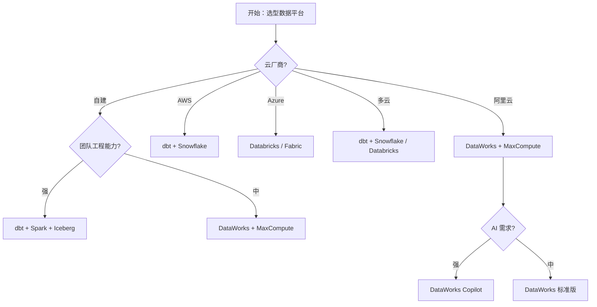

> 本文件是 **12-hands-on.md** 的子文件（§7. 与其他方法对比）。完整章节请回到 [index](12-hands-on.md)。

## 7. 与其他方法对比

### 7.1 对比维度

| 维度 | DataWorks | dbt + Snowflake | Databricks | 自研中台 |
| --- | :---: | :---: | :---: | :---: |
| 易用性 | 4 | 5 | 4 | 2 |
| 灵活度 | 3 | 5 | 5 | 5 |
| 阿里生态集成 | 5 | 1 | 2 | 1 |
| 跨云能力 | 2 | 5 | 4 | 2 |
| AI 原生 | 4 | 4 | 5 | 3 |
| 国产化合规 | 5 | 2 | 2 | 5 |
| 成本 | 3 | 4 | 3 | 5 |

### 7.2 决策树

### 7.3 组合使用

**实战组合 1：DataWorks + MaxCompute + Hologres**（阿里云生态）
- 离线用 MaxCompute，实时用 Hologres，治理用 DataWorks
- 适用：阿里云上的中大型互联网企业

**实战组合 2：dbt + Snowflake + Airflow + DataHub**（海外云原生）
- dbt 做建模，Snowflake 做存储，Airflow 做调度，DataHub 做目录
- 适用：海外 / 跨云 / 现代化数据栈

**实战组合 3：Databricks + Unity Catalog + dbt**（AI 优先）
- Databricks 做湖仓一体，Unity Catalog 做目录，dbt 做建模
- 适用：AI 团队 / 智能体平台

**实战组合 4：Iceberg + Spark + Flink + dbt**（湖仓开源）
- 湖仓一体，自服务
- 适用：自建 / 跨云 / 大数据团队

**实战组合 5：阿里 DataWorks + 自研 LLM 集成**（国产化 + AI）
- DataWorks 做底座，自研 LLM 做 Copilot
- 适用：国产化合规 + AI 增强

---
