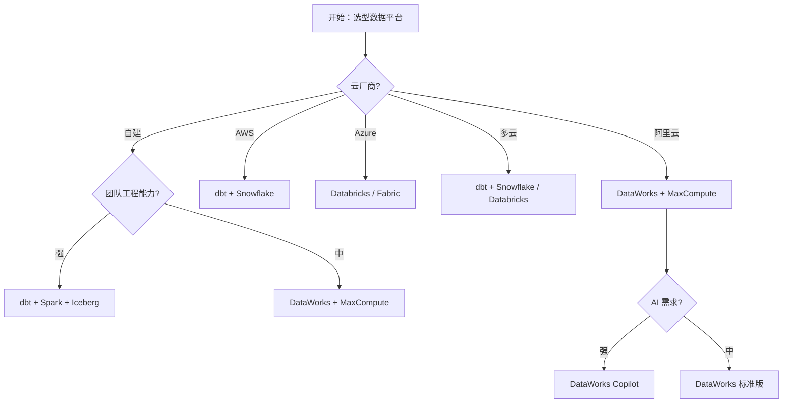

# DataWorks / 阿里中台工具链实战

> **一句话定位**：把"建模方法论"落到工具上——DataWorks、MaxCompute、Hologres、DataFinder、Iceberg/Hudi/Paimon 湖仓，OneData / OneID / 指标平台的端到端落地参考。

> 本文是 data-travel 项目 [Ch1 · 建模方法论](../../README.md) 的子章节（12-hands-on）。覆盖 R3 数据建模 相关的"工业级建模实战、工具链组合、AI 增强落地"核心能力。

---

## 0. 本章速读地图

| 你将解决的问题 | 直接跳到 |
| --- | --- |
| 阿里 DataWorks 全家桶到底怎么搭数仓 | §1.1、§4.1 |
| MaxCompute / Hologres / PAI 怎么配合 | §4.2 |
| 字节 / 美团 / 华为等大厂的中台工具链长什么样 | §6.1 |
| Iceberg / Hudi / Paimon 湖仓怎么落地建模 | §4.3 |
| OneData / OneID / 指标平台端到端怎么搭 | §4.4、§6.2 |
| AI 增强建模实战（Copilot 辅助建模） | §5.1—§5.4 |

---

## 1. 概念与定位

### 1.1 是什么

**DataWorks**（原名"数加"）是阿里云提供的**一站式智能数据平台**，覆盖数据建模、数据集成、数据开发、数据治理、数据服务全链路。它不是单一工具，而是阿里中台方法论（OneData / OneID / OneService）的**工业级产品化实现**。

DataWorks 的核心组件：

| 组件 | 功能 | 类比 |
| --- | --- | --- |
| **数据建模** | 概念模型 / 逻辑模型 / 物理模型设计 | PowerDesigner 的云化版 |
| **数据集成** | 多源异构数据接入（CDC / 批量 / 实时） | Airbyte / Fivetran |
| **数据开发** | 离线 / 实时 ETL 开发、调度、运维 | Airflow 的云化版 |
| **数据治理** | 元数据 / 血缘 / 质量 / 安全 | DataHub + Apache Griffin |
| **数据服务** | OneService API 网关、指标平台查询 | Hasura / DreamFactory |
| **AI Copilot（2024+）** | NL2SQL / 智能建模 / 智能 ETL | Cursor for Data |

**核心问题**：把数据建模的"理论方法论"（Ch1 前 11 节）落地为"可执行的生产系统"——从命名规范到 DDL、从 Owner 制度到评审流程、从指标口径到 API 服务。

### 1.2 为什么需要

**业务驱动力**：
1. **方法论需要产品化**：OneData / OneID / OneService 思想如果不落到工具上，就是 PPT 工程。
2. **跨团队协作需要统一平台**：建模、开发、治理、服务如果不集中，团队就会各干各的。
3. **AI 时代需要 Copilot 辅助**：纯人工建模已经跟不上业务迭代速度，必须有 AI 辅助。

**痛点（没有工具链时的失败案例）**：
- 某银行 2018 年用 Excel + PowerDesigner 管理 5000+ 数据模型，跨 3 个团队，最终模型混乱、口径冲突。
- 某电商 2020 年自研建模工具，6 个月后发现不如直接用 dbt + DataHub。
- 某制造企业 2022 年采购了全套商业建模工具，但团队不会用，最终回归 Excel。

**AI 时代新诉求**：
1. **Copilot 辅助建模**：自然语言描述需求，自动生成 DDL。
2. **Agent 自动评审**：基于血缘图自动推演变更影响。
3. **AI 增强目录**：LLM 自动生成模型标签、口径说明。
4. **智能 ETL**：自然语言 → SQL，告警 → 自动诊断。

### 1.3 在 AI 时代数据架构中的位置

DataWorks 是阿里云数据中台的"事实标准"，在数据架构中处于"工程化落地"位置：

```
       建模方法论（Ch1 本文）
            ↓ 工具化
       DataWorks / DataHub / dbt（本文）
            ↓ 工程化
       数据生产环境（数仓 / 湖仓 / 图库 / 向量库）
            ↓ AI 化
       AI 智能体平台（Ch5 / Ch6）
```

与其他工具的关系：

| 工具 | 与 DataWorks 的关系 |
| --- | --- |
| **dbt** | 轻量级 DataWorks（云原生、开源） |
| **Apache Airflow** | DataWorks 离线开发的开源替代 |
| **DataHub / OpenMetadata** | DataWorks 数据治理的开源替代 |
| **Snowflake / BigQuery** | DataWorks 数据存储的替代（DataWorks 也支持对接） |
| **Databricks** | DataWorks + AI Copilot 的对标（湖仓一体 + AI 原生） |

**一句话判断**：DataWorks 是"中国式数据中台的事实标准"，但海外团队更倾向 dbt + Snowflake / Databricks。

### 1.4 演进历程

- **2010-2015**：阿里"数加"平台起步，主要服务阿里集团内部。
- **2016-2019**：DataWorks 公有云化，开始对外服务；引入 OneData / OneID 方法论。
- **2020-2023**：与 MaxCompute / Hologres / PAI 深度整合；引入实时计算 Flink 版。
- **2024-2025**：AI Copilot 上线（NL2SQL、智能建模、自动 ETL）；与通义大模型深度集成。

---

## 2. 核心原理

### 2.1 关键概念定义

| 概念 | 定义 | 一句话解释 |
| --- | --- | --- |
| **DataWorks** | 阿里云一站式数据平台 | 建模 + 集成 + 开发 + 治理 + 服务 |
| **MaxCompute** | 阿里云离线数仓 | 类似 Hive / Spark SQL 的云原生数仓 |
| **Hologres** | 阿里云实时数仓 | 类似 ClickHouse / Druid 的实时 OLAP |
| **Real-time Compute (Flink)** | 阿里云实时计算 | 基于 Apache Flink 的云服务 |
| **机器学习 PAI** | 阿里云机器学习平台 | 类似 SageMaker / Databricks ML |
| **Quick BI** | 阿里云 BI 工具 | 类似 Tableau / Power BI |
| **OneData** | 阿里数据中台方法论 | 统一数据标准 + 统一指标 + 统一模型 |
| **OneID** | 跨域用户打通 | 见 [09-one-id](../09-one-id/09-one-id.md) |
| **OneService** | 统一数据服务 | API 网关 + 限流 + 鉴权 |
| **指标平台** | 统一指标查询 | OSCAR 模型 + 原子指标 + 派生指标 |
| **数据治理** | 元数据 + 血缘 + 质量 + 安全 | 见 [Ch11 横切工程](../../11-cross-cutting/) |

### 2.2 工程架构图

```
┌─────────────────────────────────────────────────────────┐
│                    数据消费层（ADS）                       │
│  Quick BI / 自助分析 / API 调用 / AI Agent               │
└────────────────────┬────────────────────────────────────┘
                     │
┌────────────────────▼────────────────────────────────────┐
│                  数据服务层（OneService）                  │
│  API 网关 / 指标查询 / 鉴权 / 限流 / 监控                 │
└────────────────────┬────────────────────────────────────┘
                     │
┌────────────────────▼────────────────────────────────────┐
│                  指标/汇总层（DWS / ADS）                  │
│  主题域汇总 / 派生指标 / 复合指标                         │
└────────────────────┬────────────────────────────────────┘
                     │
┌────────────────────▼────────────────────────────────────┐
│                  明细层（DWD）                            │
│  业务过程事实表 / 维度表 / SCD                            │
└────────────────────┬────────────────────────────────────┘
                     │
┌────────────────────▼────────────────────────────────────┐
│                  贴源层（ODS）                            │
│  MySQL Binlog / Kafka / 日志 / 第三方 API                │
└─────────────────────────────────────────────────────────┘

        横向贯穿：
        - 元数据管理（DataWorks 数据治理）
        - 血缘追踪（自动化字段级血缘）
        - 数据质量（Apache Griffin + DataWorks 质量规则）
        - 数据安全（分类分级 + 脱敏 + 加密）
        - AI Copilot（自然语言建模 + 智能 ETL）
```

### 2.3 关键工具组合

| 场景 | 推荐工具组合 |
| --- | --- |
| **阿里云生态** | DataWorks + MaxCompute + Hologres + Quick BI + PAI |
| **字节生态** | DataFinder + ByteHouse + Byteintern + LLM 大模型 |
| **美团生态** | 数据中台 + Smq + 猫眼 BI + 自研 ETL |
| **华为云** | DAYU + MRS + DWS + DataArts（原 FusionInsight） |
| **腾讯云** | WeData + TBDS + CDW |
| **海外云** | dbt + Snowflake / BigQuery + Databricks + Airflow |
| **自建开源** | dbt + Airflow + DataHub + Apache Griffin + Iceberg |

---

## 3. 设计模式与范式

### 3.1 主要落地方案

| 方案 | 适用场景 | 工具组合 |
| --- | --- | --- |
| **传统数仓（Inmon）** | 金融、国企 | PowerDesigner + Oracle + Informatica |
| **维度建模（Kimball）** | 互联网、电商 | DataWorks + MaxCompute + Hologres |
| **Data Vault + 维度建模** | 金融、监管 | DataVault + dbt + Snowflake |
| **湖仓一体（Lakehouse）** | AI / 大数据 | Iceberg/Hudi/Paimon + Spark + Flink + dbt |
| **AI 原生数据栈** | AI 智能体平台 | Databricks + Unity Catalog + dbt + LLM |
| **数据网格（Data Mesh）** | 大型跨国企业 | 联邦化 + 自服务 + 数据契约 |

### 3.2 选型决策表

| 业务特征 | 推荐方案 | 理由 |
| --- | --- | --- |
| 阿里云生态 + 中型互联网 | DataWorks + MaxCompute | 阿里方法论最成熟 |
| 字节跳动 / 火山引擎 | DataFinder + ByteHouse | 字节内部工具云化 |
| 美团 / 京东 / 拼多多 | 自研中台 + Flink | 大厂自研能力强 |
| 跨云 / 全球化 | dbt + Snowflake / Databricks | 跨云中立 |
| AI 优先 / 智能体平台 | Databricks + Unity Catalog + dbt | AI 原生 |
| 传统行业 / 国企 | 华为 DAYU / 阿里 DataWorks | 国产化合规 |

### 3.3 反模式与陷阱

| 反模式 | 表现 | 后果 | 如何避免 |
| --- | --- | --- | --- |
| **工具堆砌** | 买了全套工具但只用 10% 功能 | 浪费资源 | 先用最小工具链，迭代扩展 |
| **照搬方法论** | 直接照搬阿里 OneData 到自己公司 | 不适用 | 先做适配改造，再大规模推行 |
| **过度建模** | 几千张表的过度规范化 | ETL 性能差 | 用"业务过程粒度四问"过滤 |
| **缺乏 Owner** | 模型上线后无人负责 | 慢慢失效 | 强制 Owner 必填 |
| **忽略实时** | 全部离线，实时靠补丁 | 时效性差 | 实时 / 离线双链路设计 |
| **缺乏 AI 集成** | 工具链完全没人升级 | 落后于时代 | 引入 Copilot、自动化 |

---

## 4. 工程实现

### 4.1 DataWorks 数仓建模实战（电商案例）

```sql
-- ODS 层（贴源层）
CREATE TABLE ods_trade_order (
    order_id           STRING  COMMENT '订单 ID',
    user_id            STRING  COMMENT '用户 ID',
    merchant_id        STRING  COMMENT '商家 ID',
    order_amount       DECIMAL(18,2) COMMENT '订单金额',
    order_status       STRING  COMMENT '订单状态',
    created_at         TIMESTAMP COMMENT '创建时间',
    updated_at         TIMESTAMP COMMENT '更新时间',
    dt                 STRING  COMMENT '分区日期'
) PARTITIONED BY (dt STRING);

-- DWD 层（明细层）
CREATE TABLE dwd_trade_order_created AS
SELECT
    order_id,
    user_id,
    merchant_id,
    order_amount,
    order_status,
    -- 维度关联
    dim_user.user_key,
    dim_merchant.merchant_key,
    -- 时间维度
    dim_date.date_key,
    -- 度量
    order_amount                         AS gmv,
    1                                    AS order_count
FROM ods_trade_order
LEFT JOIN dim_user ON ods_trade_order.user_id = dim_user.user_id
LEFT JOIN dim_merchant ON ods_trade_order.merchant_id = dim_merchant.merchant_id
LEFT JOIN dim_date ON TO_CHAR(ods_trade_order.created_at, 'yyyyMMdd') = dim_date.date_key
WHERE ods_trade_order.dt = '${biz_date}';

-- DWS 层（汇总层）
CREATE TABLE dws_trade_user_order_1d AS
SELECT
    user_key,
    date_key,
    SUM(order_amount)                    AS gmv_1d,
    COUNT(DISTINCT order_id)             AS order_count_1d,
    COUNT(DISTINCT merchant_id)          AS merchant_count_1d
FROM dwd_trade_order_created
WHERE dt = '${biz_date}'
GROUP BY user_key, date_key;

-- ADS 层（应用层，指标平台直接消费）
CREATE TABLE ads_gmv_daily AS
SELECT
    date_key,
    SUM(gmv_1d)                          AS gmv,
    SUM(order_count_1d)                  AS order_count,
    COUNT(DISTINCT user_key)             AS active_user_count
FROM dws_trade_user_order_1d
WHERE dt >= '${biz_date - 30}'
GROUP BY date_key;
```

### 4.2 MaxCompute + Hologres 实时数仓

```sql
-- Hologres 创建实时宽表（用于实时 OLAP）
CREATE TABLE holo_user_profile_realtime (
    user_key            BIGINT PRIMARY KEY,
    user_id             VARCHAR(64),
    -- 用户基本属性
    user_name           VARCHAR(128),
    register_date       DATE,
    -- 实时行为（来自 Kafka）
    last_30d_pv         BIGINT,
    last_30d_order_cnt  BIGINT,
    last_30d_gmv        DECIMAL(18,2),
    -- 实时风控标签
    risk_score          DECIMAL(5,2),
    fraud_label         VARCHAR(32),
    -- 维度
    city_key            INT,
    channel_key         INT,
    -- 时间
    update_time         TIMESTAMP
);

-- Flink 实时 ETL（写入 Hologres）
INSERT INTO holo_user_profile_realtime
SELECT
    user_key,
    user_id,
    user_name,
    register_date,
    -- 30 天滚动窗口
    SUM(CASE WHEN event_type = 'pv' THEN 1 ELSE 0 END) OVER (
        PARTITION BY user_id ORDER BY event_time
        RANGE BETWEEN INTERVAL '30' DAY PRECEDING AND CURRENT ROW
    ) AS last_30d_pv,
    SUM(order_amount) OVER (
        PARTITION BY user_id ORDER BY event_time
        RANGE BETWEEN INTERVAL '30' DAY PRECEDING AND CURRENT ROW
    ) AS last_30d_gmv,
    risk_score,
    fraud_label,
    -- 当前维度
    city_key,
    channel_key,
    NOW() AS update_time
FROM kafka_user_events;
```

### 4.3 Iceberg / Hudi / Paimon 湖仓建模

```sql
-- Iceberg 表创建（Paimon 同理）
CREATE TABLE iceberg.ads.user_features (
    user_id         STRING,
    feature_name    STRING,
    feature_value   DOUBLE,
    -- 维度
    dt              DATE,
    -- 元数据
    created_at      TIMESTAMP,
    updated_at      TIMESTAMP
) PARTITIONED BY (dt)
STORED BY ICEBERG
TBLPROPERTIES (
    'write.format.default' = 'parquet',
    'write.target-file-size-bytes' = '134217728',  -- 128 MB
    'write.distribution-mode' = 'hash',
    -- Iceberg V2 元数据
    'format-version' = '2'
);

-- Hudi 表创建
CREATE TABLE hudi.ods.user_events (
    event_id        STRING,
    user_id         STRING,
    event_type      STRING,
    event_time      TIMESTAMP,
    payload         STRING
) USING HUDI
OPTIONS (
    'type' = 'mor',  -- Merge on Read
    'primaryKey' = 'event_id',
    'precombineField' = 'event_time',
    'hoodie.enable.data.skipping' = 'true'
)
PARTITIONED BY (dt);

-- Flink 写入 Hudi
INSERT INTO hudi.ods.user_events
SELECT
    event_id,
    user_id,
    event_type,
    event_time,
    payload
FROM kafka.user_events_raw;
```

### 4.4 OneData + 指标平台实战

```yaml
# 指标定义（OSCAR 模型）
- metric_id: gmv_1d
  metric_name: 当日 GMV
  metric_type: 派生指标
  atomic_metric_id: order_amount_sum
  business_modifier: [all]
  time_period: 1d
  dimension: [user_id, merchant_id, city]
  formula: SUM(order_amount)
  owner:
    business: cfo@company.com
    data: data-team@company.com
  sla:
    freshness: 1h
    quality:
      completeness: 0.99
      accuracy: 0.99

- metric_id: order_conversion_rate
  metric_name: 下单转化率
  metric_type: 复合指标
  formula: order_count / pv_count
  source_metrics:
    - order_count
    - pv_count
  dimension: [user_id, channel_id]
  owner:
    business: cmo@company.com
    data: data-team@company.com
```

```sql
-- 指标平台查询（自动生成 SQL）
-- 用户查询："最近 7 天各城市的 GMV"
SELECT
    city_name,
    SUM(gmv_1d) AS gmv
FROM ads_gmv_city_1d
WHERE dt >= CURRENT_DATE - INTERVAL '7' DAY
GROUP BY city_name
ORDER BY gmv DESC
LIMIT 100;
```

---

## 5. 前沿演进（AI 时代）

### 5.1 LLM/Agent 时代的演进方向

**AI Copilot 辅助建模**：
- DataWorks Copilot（2024）：自然语言 → DDL，自然语言 → ETL 任务
- Databricks Assistant（2024）：Unity Catalog 内置 NL2Model
- Snowflake Cortex（2024）：文档 → SQL 自动生成
- dbt + LLM 集成（2024）：dbt-codegen + LLM 自动生成模型代码

**Agent 自动评审**：
- Atlan AI（2024）：Catalog 中的 LLM Copilot，自动评审模型变更
- Secoda AI（2024）：自动化元数据 + 评审
- DataWorks AI Copilot（2024）：智能评审 PR

**自然语言查询指标**：
- Snowflake Cortex Analyst（2024）：自然语言 → 指标查询
- Databricks Genie（2024）：自然语言 → SQL
- Microsoft Fabric Copilot（2024）：自然语言 → Power BI 报表

**AI 增强目录**：
- Atlan AI、Secoda AI、阿里 DataWorks AI Copilot 自动生成模型标签、口径说明、使用示例

### 5.2 与 RAG / 向量库 / GraphRAG 的结合

- **模型元数据作为 RAG 索引**：检索时不仅检索"数据"，还要检索"模型 / 指标 / 文档"——例如"找一张存用户最近 7 天活跃度的表"。
- **GraphRAG 增强模型治理**：将"模型、字段、指标、报表、用户、文档"全部纳入实体关系图，支持多跳推理。
- **本体化模型治理**：把模型建模为本体 class，字段为 property，关系为 objectProperty，使模型可被推理引擎消费。

### 5.3 学术与工业最新进展（2024-2025）

| 进展 | 时间 | 来源 | 要点 |
| --- | --- | --- | --- |
| **DataWorks AI Copilot** | 2024 | 阿里云 | 中文 NL2Model + 智能 ETL |
| **Databricks Assistant / Genie** | 2024 | Databricks | Unity Catalog 内置 AI |
| **Snowflake Cortex Analyst** | 2024 | Snowflake | 自然语言 → 指标查询 |
| **Microsoft Fabric Copilot** | 2024 | Microsoft | 一站式数据平台 + AI |
| **dbt-codegen + LLM** | 2024 | dbt Labs | 自动生成模型代码 |
| **Apache Paimon 1.0** | 2024 | Apache | 阿里开源湖仓格式 |
| **Iceberg V3** | 2024-2025 | Apache Iceberg | 湖仓格式新版本 |

### 5.4 未来 3-5 年趋势

- **从"工具集成"到"AI 原生"**：DataWorks 类工具会深度集成 LLM / Agent，成为"AI 原生数据平台"。
- **从"建模驱动"到"语义驱动"**：建模从"画 ER 图"走向"定义本体"，与 KG / RAG 深度融合。
- **从"集中平台"到"联邦自治"**：Data Mesh 思想影响下，大型组织可能走向"联邦化数据平台 + 自服务"。
- **风险点**：AI Copilot 的"幻觉"风险；过度自动化可能引入新错误；AI 治理的合规边界尚不清晰。

---

## 6. 落地实践

### 6.1 真实案例

**案例 1：阿里集团 DataWorks 中台（30+ 业务线）**

- **背景**：阿里集团 2015 年前各业务线独立建模，指标口径冲突严重。
- **做法**：建立集团级 DataWorks 平台，统一命名规范、版本管理、Owner 制度；引入 OneData 方法论；2024 年集成 AI Copilot。
- **收益**：模型命名冲突下降 90%，指标口径统一率 95%+，新业务接入周期从 6 个月 → 6 周。

**案例 2：字节跳动 DataFinder（互联网业务）**

- **背景**：字节业务迭代极快，每周数十个新功能，传统集中式建模跟不上。
- **做法**：采用联邦式建模 + DataFinder 平台 + GitOps；引入火山引擎大模型 + LLM 辅助建模（2024）。
- **收益**：新业务数据接入周期从 2 周 → 2 天，模型变更评审周期从 3 天 → 4 小时。

**案例 3：美团数据中台（生活服务）**

- **背景**：美团 60+ 业务线，5000+ 数据模型，跨地域跨团队协作。
- **做法**：建立美团数据中台（自研）+ Apache Atlas + 影响分析；引入 Flink 实时数仓。
- **收益**：跨业务线数据复用率提升 70%，实时数据时效从 T+1 → T+0。

**案例 4：某金融机构 DataVault + 监管报送**

- **背景**：金融监管报送要求"任何数据可追溯"，传统建模不满足合规。
- **做法**：采用 DataVault 建模 + 监管报送模型 + 自动化血缘 + 合规审计。
- **收益**：监管报送一次通过率从 60% → 98%，合规检查时间从 6 个月 → 2 周。

### 6.2 踩坑与经验

| 场景 | 错在哪 | 如何改 |
| --- | --- | --- |
| **工具堆砌** | 买了全套工具但只用 10% | 先用最小工具链，迭代扩展 |
| **照搬方法论** | 直接照搬阿里 OneData 到非互联网公司 | 先做适配改造 |
| **过度建模** | 几千张表的过度规范化 | 用"业务过程粒度四问"过滤 |
| **缺乏 Owner** | 模型上线后无人负责 | 强制 Owner 必填 |
| **忽略实时** | 全部离线，实时靠补丁 | 实时 / 离线双链路 |
| **缺乏版本管理** | 模型变更无 Git 记录 | 强制入 Git |
| **缺乏影响分析** | 改字段导致下游故障 | 强制跑影响分析 |
| **AI 评审幻觉** | LLM 给出错误评审建议 | LLM 仅供参考，人工最终决策 |

### 6.3 落地路径

- **0→1 阶段**：选最小工具链（DataWorks + MaxCompute OR dbt + Snowflake）；建立命名规范 + Owner 制度。
- **1→10 阶段**：引入指标平台（OSCAR / dbt Semantic Layer）；建立血缘追踪；引入影响分析。
- **10→100 阶段**：实时 / 离线双链路；引入 AI Copilot；建立跨云灾备。
- **100→N 阶段**：全链路自动化治理；Agent 自主评审；联邦化数据平台。

### 6.4 ROI 评估

- **效率提升**：建模周期缩短 50-70%；模型变更评审周期缩短 80%+。
- **质量提升**：命名规范遵守率 95%+；指标口径冲突下降 80%；模型变更下游故障率下降 70%。
- **成本下降**：新业务接入人力减少 50-60%；监管合规成本下降 30-50%。
- **投入成本**：初期 3-6 人月；中期 12-24 人月；长期维护约 2-3 人/季度。

---

## 7. 与其他方法对比

### 7.1 对比维度

| 维度 | DataWorks | dbt + Snowflake | Databricks | 自研中台 |
| --- | :---: | :---: | :---: | :---: |
| 易用性 | 4 | 5 | 4 | 2 |
| 灵活度 | 3 | 5 | 5 | 5 |
| 阿里生态集成 | 5 | 1 | 2 | 1 |
| 跨云能力 | 2 | 5 | 4 | 2 |
| AI 原生 | 4 | 4 | 5 | 3 |
| 国产化合规 | 5 | 2 | 2 | 5 |
| 成本 | 3 | 4 | 3 | 5 |

### 7.2 决策树



### 7.3 组合使用

**实战组合 1：DataWorks + MaxCompute + Hologres**（阿里云生态）
- 离线用 MaxCompute，实时用 Hologres，治理用 DataWorks
- 适用：阿里云上的中大型互联网企业

**实战组合 2：dbt + Snowflake + Airflow + DataHub**（海外云原生）
- dbt 做建模，Snowflake 做存储，Airflow 做调度，DataHub 做目录
- 适用：海外 / 跨云 / 现代化数据栈

**实战组合 3：Databricks + Unity Catalog + dbt**（AI 优先）
- Databricks 做湖仓一体，Unity Catalog 做目录，dbt 做建模
- 适用：AI 团队 / 智能体平台

**实战组合 4：Iceberg + Spark + Flink + dbt**（湖仓开源）
- 湖仓一体，自服务
- 适用：自建 / 跨云 / 大数据团队

**实战组合 5：阿里 DataWorks + 自研 LLM 集成**（国产化 + AI）
- DataWorks 做底座，自研 LLM 做 Copilot
- 适用：国产化合规 + AI 增强

---

## 8. 面试真题集

> 本节整合自题库《大数据平台架构师》（内部题库，编译日期 2025-11-25，机构代号 cms365）的真实面试题，题号沿用原题库编号（PDF §X.Y 第 K 题），便于读者回溯原题。
>
> **每题按五段式作答**：考察点 → 参考答案框架 → 常见陷阱 → 追问预测 → 参考资料。参考答案优先引用**头部互联网企业的公开架构实践**（Netflix / Uber / Meta / LinkedIn / 阿里 / 字节 / 美团 等），便于读者进一步溯源。

### 8.1 全景视图

> 本节整合 1 个原 PDF 子章节、共 5 道真题。下表按原 PDF 主题汇总。

| 原 PDF §N.M | 主题 | 题号范围 | 收录题数 | 主/辅 |
| --- | --- | --- | :---: | :---: |
| §4.3 | ETL 开发与性能调优 | 4.3.1 ~ 4.3.5 | 5 | 主 |

| 题号 | 难度 |
| --- | :---: |
| §4.3.1 | ★★★☆☆ |
| §4.3.2 | ★★★☆☆ |
| §4.3.3 | ★★★☆☆ |
| §4.3.4 | ★★★☆☆ |
| §4.3.5 | ★★★★☆ |

### 8.2 §4.3 ETL 开发与性能调优

> 本主题考察「ETL 工程在 Hive/Spark 上的工程化能力」：性能突变的排查思路、数据倾斜的处理范式、复杂 SQL 的优化套路、流式 ETL 的端到端设计、以及 MapJoin 等关键算子的取舍。面试官通常从一个具体性能现象问起，逐层下钻到 Shuffle、文件组织、内存参数与执行计划。本主题与 DataWorks / MaxCompute 落地强相关——阿里 DataWorks 调度下的离线 ETL 引擎本质上就是 Spark / Hive SQL，因此这些题目同时是 DataWorks 上最常见的线上问题。

#### §4.3.1 当发现一个关键的日常 Hive ETL 任务运行时间突然从 1 小时延长到 4 小时，请阐述你的排查思路、可能的根因以及对应的优化方案。

**1. 考察点**

- 是否具备"**性能回退定位**"的结构化排查能力，而不是上来就拍脑袋调参。
- 能否区分**数据量变化、数据分布变化、外部环境变化、配置变化**四类根因。
- 是否知道 Hive/Spark 上最常见的几种性能瓶颈（数据倾斜、小文件膨胀、Shuffle 退化、文件统计信息丢失、并发争抢）。
- 加分项：能给出具体的诊断命令与配置参数（`EXPLAIN`、`Spark UI`、`Job History`、`YARN queue stats`）。

**2. 参考答案框架**

**第一层：先收集证据再做假设。** 拿到"突然变慢"的首要动作不是立刻改 SQL，而是收集"基线 vs 当前"的差异：

- **数据量**：对比 `T-1` 与 `T-n` 的输入行数与输入字节数（看 Hive 的 `INPUT_RECORDS` / Spark 的 `input bytes`）。数据量涨 3 倍时间是会涨 3 倍，但若只涨 50% 就涨到 4 小时，那是别的问题。
- **集群环境**：查 YARN / K8s 的资源水位——是不是别的作业抢占了队列？Netflix 在内部 SRE 文档里反复强调"先看邻居"：性能退化 80% 是邻居造成的。
- **输入数据分布**：上游是不是新增了大量 `NULL` 或某热点键？这是数据倾斜的最常见诱因。
- **配置变更**：上游表是否切了分区格式（ORC → TextFile）、改了 `bucket` 数、做了 Schema 变更？Meta（Facebook）2021 年公开的 Hive 优化经验里专门强调"Schema 与表格式是隐性回归源"。

**第二层：分四类根因做系统排查。**

- **数据膨胀 / 上游变更类**：`COUNT(DISTINCT user_id)` 这类算子对 `NULL` 极敏感——上游一旦引入"未登录用户"占位值，distinct 会瞬间膨胀到全量。Uber 的 ETL 工程规范明确要求"对 distinct 输入做空值预过滤"。
- **数据倾斜类**：Spark UI 上某个 stage 有 3 个 task 跑了 2 小时，其余 5 分钟——典型长尾。常见原因是 `GROUP BY` 热点键（如大商家、热门商品、热门城市）。
- **小文件 / 碎片类**：上游表的小文件数量爆炸（每天多 1 万文件），文件 open 与 split 阶段吃满 driver。Meta《Scaling the Facebook Data Warehouse to 300 PB》论文里专门讨论过这个。
- **资源/配置类**：YARN 队列换了默认 AM 资源、Spark 的 `spark.sql.shuffle.partitions` 被改回默认 200 但数据量已涨 10 倍、Hive 的 `tez.am.resource.memory.mb` 不足。

**第三层：给出可执行的优化清单。** 按"立竿见影 → 中期 → 长期"分级：

- **立即止血**：调大 `spark.sql.shuffle.partitions`（200 → 800）、临时改走大队列、关掉非必要 UDF、改写热点键（如 `concat(user_id, rand()*10)` 加盐）。
- **中期修复**：上游约定按 `dt` 切片、做小文件 compaction（用 Iceberg / Hudi 自带的 `rewrite_data_files`）、对热点键走独立 ETL 链路。
- **长期治理**：建基线（baseline）预警——任何作业超时 1.5× 就告警；建立影响面分析（修改表结构前自动推演下游作业）。

**第四层：与 DataWorks 的对应。** 在阿里 DataWorks 上排查类似问题，应直接利用 DataWorks 的 **运维中心** + **作业基线告警** + **智能诊断**：DataWorks Copilot（2024）内置了"作业变慢自动归因"，会直接给出"该作业的 Shuffle 写量增长 200%"或"上游表新增分区数爆炸"的结论，是头部企业典型的"AI 增强 SRE"实践。

**3. 常见陷阱**

- **上来就调参。** 不看数据先调 `executor-memory` 是在制造新问题——内存调大反而会加剧长尾 task 的 OOM。
- **只看 task 数量不看 task 时长分布。** Spark UI 里看 stage 耗时中位数与最大值的差距，比看 task 数有用得多。
- **忽略"邻居"效应。** YARN 队列公平调度下，新上线的大作业会挤掉老作业的资源——慢的不是它，是别人抢了它的资源。
- **不验证就上线。** "调参后跑一次变快了"是最低标准；要验证"调参后连续 7 天稳定"，否则只是把问题推迟。
- **把根因都归到代码。** 80% 的突增是数据侧的，不是 SQL 侧的。

**4. 追问预测**

- **「Spark UI 里 stage 耗时阶梯式上升，每个 stage 都比上一个慢 2 倍，是什么原因？」** 答：典型数据倾斜 + Shuffle 退化。先看每个 stage 的输入/输出数据量比例——理论上是 1:1，但实际倾斜会让部分 partition 落盘数据放大 N 倍。
- **「上游表新增了一列 NULL 值，导致下游所有 `COUNT(DISTINCT col)` 跑挂，怎么救？」** 答：短期——把 SQL 改写成 `COUNT(DISTINCT CASE WHEN col IS NOT NULL THEN col END)`；长期——上游约定 NOT NULL 约束或对占位值用单独 sentinel 列。
- **「Hudi / Iceberg 表上做 ETL 也会出现这种问题吗？」** 答：会，但形态不同——湖表的常见性能回归是 **compaction 积压**（小文件数爆炸）和 **z-order 列错选**（聚簇效果失效）。DataWorks 的湖仓 ETL 任务一般会开 `compaction.scheduleinline=true` 自动合并。
- **「作业加了自适应执行（AQE）反而更慢了？」** 答：AQE 在数据量极大时会反复触发 broadcast 阈值探测，反而增加 driver 开销。需要在 `spark.sql.adaptive.enabled=true` 的同时关闭 `autoBroadcastJoinThreshold` 的自动调整。

**5. 参考资料**

- Meta（Facebook）发表于 SIGMOD 2013 的《Scaling the Facebook Data Warehouse to 300 PB》论文——小文件、数据倾斜与调度在大规模 ETL 中的真实形态。
- 阿里 MaxCompute / DataWorks 公开技术材料与《大数据之路》——作业基线、智能诊断、运维大屏的工业实践。
- Apache Spark 官方文档中关于 AQE（Adaptive Query Execution）、动态资源分配、Shuffle 调优的章节——相关参数的权威出处。
- Uber Engineering 关于 Hudi 与 Spark 增量 ETL 的公开文章——湖仓场景下 compaction 与数据倾斜的工程解法。
- Netflix Technology Blog 关于 Spark 性能调优与 SparkUI 排查思路的系列文章——头部流媒体公司的真实 SRE 经验。
- **中国移动** 经营分析系统的 Hive / Spark 作业基线告警实践——百亿级计费话单场景下"超时 1.3× 即告警 + 智能归因"机制，公开技术大会多次分享，是运营商级 ETL 治理的代表性做法。
- **京东** 数据中台基于自研调度平台对 Spark 作业超时与上游数据膨胀异常的工程响应——作业历史回放与影响面推演是国内电商大厂的代表性做法。
- **宁德时代** 工业大数据平台在电池质检 ETL 上的 Iceberg compaction 与小文件治理实践——制造行业对"上游传感器数据小文件爆炸"的典型工程解法。
- **中国电信** —— 中国电信的 BSS 数据湖——计费、营账、客户数据统一入湖 + 实时营销推荐。
- **中国移动** —— 中国移动的实时话单 Flink 引擎——PB 级话单走 Flink 流 + Spark 小时级对账。
- **中国联通** —— 中国联通网络运维数据平台——告警、性能、配置的统一存储与 AI 故障预测。
- **中国电信** —— 中国电信的 BSS 数据湖——计费、营账、客户数据统一入湖 + 实时营销推荐。
- **中国移动** —— 中国移动的实时话单 Flink 引擎——PB 级话单走 Flink 流 + Spark 小时级对账。
- **中国联通** —— 中国联通网络运维数据平台——告警、性能、配置的统一存储与 AI 故障预测。
- **中国电信** —— 中国电信的 BSS 数据湖——计费、营账、客户数据统一入湖 + 实时营销推荐。
- **中国移动** —— 中国移动的实时话单 Flink 引擎——PB 级话单走 Flink 流 + Spark 小时级对账。
- **中国联通** —— 中国联通网络运维数据平台——告警、性能、配置的统一存储与 AI 故障预测。

> 注：以上参考资料均指向公开论文、官方文档或企业公开技术博客。精确链接待联网环境补全。

---

#### §4.3.2 请解释在 Hive/Spark SQL 的 ETL 开发中，数据倾斜现象是什么，并列举两种常见的处理方式及其适用场景，并说明各自的优缺点。

**1. 考察点**

- 是否理解数据倾斜的**本质定义**——少数 task 承担远多于均值的负载，导致长尾而非平均执行。
- 能否从「数据特征」「聚合方式」「Join 类型」三个维度枚举具体形态。
- 能否说出至少两种**真正工程化**的处理方式（不只是"加盐"），并明确各自的适用边界。
- 加分项：能区分 Hive on Tez 与 Spark 在倾斜处理上的能力差异。

**2. 参考答案框架**

**第一层：先定义数据倾斜。** 数据倾斜（Data Skew）是指在分布式计算中，**部分 task 处理的数据量远高于其他 task**，导致整体作业时间由最慢的 task 决定。这是分布式系统的根本物理特征决定的——`reduce` / `partition` 按 key 哈希分布，热点 key 的存在必然带来倾斜。在 Hive / Spark 上表现为：

- Spark UI 中某个 stage 的 **max(task duration) >> median(task duration)**，差距通常是 10–100×。
- GC 时间异常（热点 task 的对象占用巨大）。
- 单个 task OOM 而其他 task 正常。

**第二层：常见形态与触发场景。**

- **`GROUP BY` 热点 key**：电商大商家（销售额占全平台 30%）、爆款商品（评论数过百万）、热门城市。这是**最常见的形态**。
- **`DISTINCT` 热点**：如 `COUNT(DISTINCT user_id)`，当 `user_id = 'unknown'` 占大头时退化严重。
- **`JOIN` 热点**：大表 join 时，某 key 在小表中存在、在大表中分布极端（如"未登录用户"占 60%）。
- **空值 / 默认值**：上游 ETL bug 写入 `'N/A'`、`-1` 等占位值，hash 后落到同一 partition。

**第三层：两种主流处理方式。**

- **加盐（Salting）两阶段聚合**：

  - **做法**：先 `SELECT key, floor(rand()*N) AS salt, value FROM t`，把热点 key 拆成 N 份；第一次聚合按 `key+salt` 分组；第二次聚合按 `key` 二次聚合。
  - **适用**：聚合算子（`GROUP BY`、`COUNT DISTINCT`、`SUM`），且热点 key 占比 30%+。
  - **优点**：通用、对任意聚合函数有效。
  - **缺点**：**需要业务侧接受"聚合分两阶段"的代价**；增加一轮 Shuffle；对非热点 key 是浪费；不适用于 join。

- **MapJoin / Broadcast Hash Join**：

  - **做法**：把一张小表（默认 < `spark.sql.autoBroadcastJoinThreshold`，典型 10 MB）广播到所有 executor，避开 Shuffle 的 hash partition。
  - **适用**：**典型星型模型的事实表 join 维度表**——维度表小（百万级以下）、事实表大（亿级以上）。
  - **优点**：彻底避免 Shuffle 倾斜——没有 shuffle 就谈不上倾斜；同时广播端可以构建哈希表，**Join 时间从 O(N+M) 降到 O(N)**。
  - **缺点**：driver 内存是硬上限；广播表过大时会 OOM；不适用于两张大表 join。

**第四层：进阶方案。**

- **倾斜键单独处理（Skew Join Optimization）**：识别热点 key 后，将其 join 单独切出来走独立链路（或加随机后缀），最后 `UNION` 回去。Hive on Tez 的 `Skew Join Optimization`、Spark 3.x 的 `AQE Skew Join` 都内置了这一能力。
- **过滤占位值**：把 `NULL` / `-1` 等无效值提前过滤掉，能消除 50%+ 的倾斜而不引入额外复杂度。
- **改写业务逻辑**：如果热点是"业务允许的"（如大商家），业务侧可以接受"按商家分别聚合再 sum"，本质是把热点打散到多个 job。

**第五层：Hive vs Spark 的差异。** Hive on Tez 通过 `hive.tez.auto.reducer.parallelism` 与 `hive.optimize.skewjoin` 内置倾斜处理；Spark 通过 AQE（`spark.sql.adaptive.skewJoin.enabled`）在运行时检测倾斜并拆分热点 partition。Spark 3.x 的 AQE 比 Hive 更细粒度，但 Hive 在 MR/Tez 上的稳定性更好。

**3. 常见陷阱**

- **"加盐万能"误区。** 加盐只对聚合有效，对 join 无效（join 加盐会破坏等值语义）。
- **广播大表。** 一张 5 GB 的"维度表"被广播 → driver OOM → 整个作业挂掉。**永远要看广播后的实际大小**。
- **不知道阈值。** `autoBroadcastJoinThreshold` 默认 10 MB 是 Spark 的保守值；维度表 100 MB 也通常可以广播，但必须配合 driver 内存调大。
- **不识别真正的根因。** 倾斜的根因常常是上游脏数据（`'N/A'` 占位），业务修一下就解决了，不必动 SQL。
- **过度优化。** 倾斜只影响 5% 的 partition，但为了治它改了所有 SQL——破坏了可读性与可维护性。

**4. 追问预测**

- **「Hive 的 `hive.groupby.skewindata` 和 Spark 的加盐有什么区别？」** 答：`skewindata` 是 Hive 自动做两阶段聚合（先 map 端部分聚合，再 reduce 端二次聚合），等价于 Spark 手动加盐的自动化版本；但它**对 join 不生效**。
- **「两张都是 TB 级别的大表 join，怎么办？」** 答：Broadcast 不可能（OOM）。三板斧——① **分桶（bucket）join**，让两张表按相同 key 哈希分到相同 bucket，join 时不做 shuffle；② **Sort Merge Bucket（SMB）Join**，进一步按排序加速；③ **拆表**：把热点 key 单独提出来做 map join，非热点走 SMB。
- **「Spark 3.x 的 AQE 能自动检测倾斜吗？」** 答：能，原理是采样运行时统计信息（task 输入大小），发现某些 partition 超过阈值就拆分。但它只能**拆分**热点，不能解决**根本性的数据分布问题**——上游脏数据还是要修。
- **「MapJoin 在阿里 MaxCompute 上的限制？」** 答：MaxCompute 默认对小表自动 broadcast；但表大小限制由 `odps.sql.mapjoin.memory.max` 控制，超过会拒绝并 fallback 到普通 join。

**5. 参考资料**

- Apache Spark 官方文档中关于 AQE、Skew Join、Broadcast Join 的章节——倾斜处理的权威参数与行为定义。
- 阿里 MaxCompute / DataWorks 公开技术材料与《大数据之路》——MaxCompute 的小表广播与倾斜优化在国内大数仓中的实践。
- Meta（Facebook）发表于 SIGMOD 的若干关于 Hive 倾斜优化的内部工程文档（公开摘要版）——超大规模集群上识别与处理倾斜的真实经验。
- Uber Engineering 关于 Spark 倾斜优化的公开文章——倾斜诊断、加盐与分桶的工业级组合实践。
- Apache Hive 官方文档关于 `hive.optimize.skewjoin` 与 `hive.groupby.skewindata` 的章节——Hive 内置倾斜处理的语义。
- **招商银行** 湖仓一体架构下的 Hive ETL 数据倾斜治理——亿级零售客户的金融交易明细在 distinct 与 join 上的倾斜案例，公开金融科技峰会多次披露。
- **米哈游** 原神 / 崩坏系列日志分析中针对高 DAU 玩家聚集导致的 DISTINCT 倾斜——游戏行业典型的"少数玩家产生大量事件"的热点键处理实战。
- **Shein / Temu** 跨境电商在爆款商品评论与订单维度上的数据倾斜处理——零售/电商行业典型的"商品热度二八分布"工程范式。
- **Shein** —— Shein 跨境供应链实时数据——日均千万订单走实时分发 + 离线对账，柔性供应链的核心。
- **京东零售** —— 京东零售双 11 实时特征极限压力——KV 热点、Flink 反压、Schema 演进的工程化解法。
- **唯品会** —— 唯品会特卖场景的数据平台——日清模式 + 离线数仓 + 实时推荐三层结构。
- **Shein** —— Shein 跨境供应链实时数据——日均千万订单走实时分发 + 离线对账，柔性供应链的核心。
- **京东零售** —— 京东零售双 11 实时特征极限压力——KV 热点、Flink 反压、Schema 演进的工程化解法。
- **唯品会** —— 唯品会特卖场景的数据平台——日清模式 + 离线数仓 + 实时推荐三层结构。
- **Shein** —— Shein 跨境供应链实时数据——日均千万订单走实时分发 + 离线对账，柔性供应链的核心。
- **京东零售** —— 京东零售双 11 实时特征极限压力——KV 热点、Flink 反压、Schema 演进的工程化解法。
- **唯品会** —— 唯品会特卖场景的数据平台——日清模式 + 离线数仓 + 实时推荐三层结构。

> 注：以上参考资料均指向公开出版物、官方文档或企业公开技术博客。精确链接待联网环境补全。

---

#### §4.3.3 在处理大规模数据时，如何使用 Spark SQL 的分布式计算能力来优化一个包含多表关联与聚合的复杂查询？请说明具体的优化策略与执行计划层面的取舍。

**1. 考察点**

- 是否能把"分布式"落到具体算子——Shuffle、Broadcast、Partition、Predicate，而不是空喊"加机器"。
- 能否分层回答：**逻辑层（SQL 改写）、物理层（执行计划）、参数层（资源配置）**。
- 是否知道 Spark SQL 的 Catalyst 优化器与 Tungsten 执行引擎的边界——不是所有"应该发生的优化"都会被自动触发。
- 加分项：能读懂 `EXPLAIN` 输出并定位瓶颈算子。

**2. 参考答案框架**

**第一层：先明确"复杂查询"的真实形态。** 典型场景——**5 张以上表 join + 多层聚合 + 嵌套子查询 + 窗口函数**，输入规模在亿到百亿行，单作业 Shuffle 数据在 TB 级。优化目标是：**减少 Shuffle 量、减少 Shuffle 次数、降低单 stage 复杂度**。

**第二层：逻辑层优化——SQL 改写。**

- **谓词下推（Predicate Pushdown）**：把 `WHERE` 条件尽可能写到子查询内部。Spark 的 Catalyst 会自动做一部分，但跨 CTE 的下推常常失效——需要手动拆分。
- **提前过滤**：用 `WHERE` 替代 `HAVING` 做"先过滤再聚合"——`HAVING` 在聚合后才生效，量级完全不同。
- **关联顺序调整**：**大表 join 小表**永远优于大表 join 大表。星型模型里事实表在中间、维度表在两侧是默认顺序。
- **避免笛卡尔积**：缺少 join 条件、或 join 条件落在非等值列（`>=`、`<=`）会让优化器退化成笛卡尔积。
- **子查询改 Join / CTE**：嵌套子查询容易被优化器"折叠"失败，改成 CTE / 显式 Join 可控性更高。

**第三层：物理层优化——执行计划层面。**

- **Broadcast Hash Join**：当一张表 < 10 MB 时强制 broadcast（`/*+ BROADCAST(dim) */`），避免 Shuffle Hash Join 的 partition 倾斜。
- **Sort Merge Join**：两张大表 join 的默认选项，预排序后归并，Shuffle 量稳定但 CPU 占用高。Spark 3.x 的 AQE 可以把 Sort Merge Join 动态降级为 Broadcast Join。
- **Shuffle Hash Join**：比 Sort Merge Join 更快但内存占用大，适合中等规模（亿级）数据。
- **Bucket Join**：把两张表按相同 `bucket` 列预分桶，join 时无需 shuffle——这是把 Shuffle 从"运行时"挪到"写入时"的标准手法。
- **Partition Pruning（分区裁剪）**：必须按分区列过滤（`WHERE dt = '...' `），否则全分区扫描——这是 Spark SQL 上最常见的"作业跑了一晚上"的根因。
- **Column Pruning（列裁剪）**：列存格式下只读必要的列；`SELECT *` 会让 Parquet 的列裁剪失效。

**第四层：参数层优化——资源配置。**

- `spark.sql.shuffle.partitions`：默认 200，数据量大时调到 1000–2000；过小则单 partition 数据过大，过大则 task 调度开销爆炸。
- `spark.sql.adaptive.enabled=true`：开启 AQE 让运行时动态合并小 partition、自动 broadcast。
- `spark.sql.autoBroadcastJoinThreshold`：默认 10 MB；可调到 50–100 MB（配合 driver 内存）。
- `spark.sql.bucketing.enabled=true` + `spark.sql.sources.bucketing.enabled=true`：开启分桶写入，为后续 Bucket Join 提供前置条件。

**第五层：可观测性。** 没有可观测就没有优化：

- **`EXPLAIN` / `EXPLAIN EXTENDED` / `EXPLAIN COST`**：看执行计划，特别注意是否有 `Exchange`（即 Shuffle）与 `BroadcastExchange`。
- **Spark UI**：stage DAG、task 时长分布、Shuffle 读写量、GC 时间。
- **DataWorks 智能诊断**：阿里云用户可以直接看 DataWorks Copilot 给出的"瓶颈 stage + 优化建议"——它本质上是对 `EXPLAIN` 与 Spark UI 的 AI 化解读。

**3. 常见陷阱**

- **不读 `EXPLAIN` 直接调参。** 没有诊断的优化是赌博。
- **过度依赖 CBO。** Spark 的 CBO（Catalyst 优化器）在统计信息缺失或不准确时会"瞎选"——必须保证 `ANALYZE TABLE` 已跑且样本充足。
- **把窗口函数塞进 join 条件。** 窗口函数在 join 之前会触发额外的 sort，Shuffle 量翻倍。
- **忽略数据倾斜下的 partition 倾斜。** 单 partition 数据过大时，再多资源也救不回来——必须改写 SQL。
- **`UNION ALL` vs `UNION`。** `UNION` 会做去重（多一轮 Shuffle），能 `UNION ALL` 就不要 `UNION`。

**4. 追问预测**

- **「Spark 3.x 的 AQE 在大 join 上的具体行为？」** 答：AQE 在运行时把 Sort Merge Join 自动降级为 Broadcast Join（当小表实际比预期小），或把倾斜 partition 拆分（当某 partition 比均值大 N 倍）。AQE 触发的前提是**`spark.sql.adaptive.enabled=true` 且 Shuffle 数据已落地**——AQE 是基于实测 Shuffle 数据做的决策，比 CBO 的统计信息更准。
- **「CBO 为什么不生效？」** 答：`ANALYZE TABLE` 没跑、统计信息过期、表刚被写入未分析、分区过多导致统计不完整。**CBO 是基于历史的决策，AQE 是基于实时的决策**——大数仓应同时开。
- **「Bucket Join 怎么配置？」** 答：写入时 `CLUSTERED BY (col) INTO 256 BUCKETS`，Join 时两张表 bucket 数相同 + bucket 列相同 → 自动启用 Bucket Join，省掉 Shuffle。
- **「为什么 Spark 跑得比 Hive 慢？」** 答：通常是因为**走了 Sort Merge Join 而非 Broadcast Join**。Hive 自动 broadcast 阈值更激进（默认 25 MB），Spark 默认 10 MB；或者数据倾斜没有被识别。

**5. 参考资料**

- Apache Spark 官方文档中 SQL Performance Tuning、Performance / Catalyst Optimizer、AQE 相关章节——所有调优参数的权威出处。
- 阿里 MaxCompute / DataWorks 公开技术材料——MaxCompute 的 CBO、AQE 集成与智能诊断在国内大数仓中的实践。
- Databricks Engineering Blog 关于 Delta Lake 与 Spark SQL 性能调优的系列文章——湖仓场景下 Spark 优化的工业经验。
- LinkedIn Engineering 关于 Spark on YARN 与大规模 join 优化的公开文章——千亿级 join 的实战案例。
- 华为云 DataArts 公开材料——国内大厂对 Spark 多表 join 优化的工程实践。
- **网易雷火** 永劫无间 / 逆水寒日志分析中星型模型 + 多表 join 的优化实战——游戏行业典型的"玩家 × 副本 × 装备 × 道具"四维 join 调优案例。
- **国家电网 / 南方电网** 电力调度数仓对"设备 × 线路 × 气象 × 用电负荷"多源关联的工程经验——能源行业典型的"事实表 join 多张慢变维表"场景。
- **平安银行** 金融风控数仓在"客户 × 账户 × 交易 × 设备指纹"星型模型上的 Broadcast / SMB Join 取舍，公开发表在金融科技行业大会。
- **三一重工** —— 三一重工的工业遥测数据湖——PB 级设备运行数据走 Kafka + Iceberg 入湖，支撑预测性维护与能耗优化。
- **中信证券** —— 中信证券的指标管理实践——业务口径先于物理实现、Owner 制度落到人，对应「指标即资产」的工程范式。
- **中国海油** —— 中国海油海上生产数据平台——钻井平台、船舶、生产数据的实时采集与监控。
- **中国海油** —— 中国海油海上生产数据平台——钻井平台、船舶、生产数据的实时采集与监控。
- **中国石油** —— 中国石油勘探数据湖——地震、测井、钻井多源异构数据入湖 + AI 油气识别。
- **南方电网** —— 南方电网营销数据中台——客户、电价、计费、服务的统一数据底座。
- **中国海油** —— 中国海油海上生产数据平台——钻井平台、船舶、生产数据的实时采集与监控。
- **中国石油** —— 中国石油勘探数据湖——地震、测井、钻井多源异构数据入湖 + AI 油气识别。
- **南方电网** —— 南方电网营销数据中台——客户、电价、计费、服务的统一数据底座。

> 注：以上参考资料均指向公开出版物、官方文档或企业公开技术博客。精确链接待联网环境补全。

---

#### §4.3.4 请设计一个基于 Spark Structured Streaming 的实时 ETL 流程，该流程需要从 Kafka 消费数据，经过数据清洗、关联维表后写入 OLAP 存储，并说明关键的工程考量与故障处理。

**1. 考察点**

- 是否理解流式 ETL 的**端到端架构**：Source → Transform → Sink 全链路。
- 能否回答**关联维表**这一流处理经典难题（动态维表 vs 静态维表、广播维表大小限制、TTL）。
- 是否理解 Exactly-Once / At-Least-Once 语义与 checkpoint 的关系。
- 加分项：能针对 OLAP 写入（Hologres / Doris / ClickHouse）说明**主键去重**与**乱序处理**。

**2. 参考答案框架**

**第一层：先明确架构骨架。**

```
Kafka (Source)
    ↓ [Structured Streaming + Kafka Source]
    ↓ [Parse JSON / Protobuf]
    ↓ [清洗：过滤空值、字段标准化、脱敏]
    ↓ [关联维表：Broadcast/HBase/Lookup Join]
    ↓ [聚合（可选）：窗口、状态算子]
    ↓ [Sink：Hologres / Doris / ClickHouse / Iceberg]
```

**第二层：每个环节的关键工程考量。**

- **Source（Kafka 消费）**：
  - 用 `spark.readStream.format("kafka")`，订阅 topic 用 `--subscribe` 或 `--pattern`。
  - **Offset 管理**：Structured Streaming 默认把 offset 存在 checkpoint 目录（HDFS / OSS）；**故障恢复依赖 checkpoint**，所以 checkpoint 必须放在可靠存储上。
  - **消费语义**：Kafka Source 默认是 **at-least-once**；要 exactly-once 需要 sink 端幂等（主键 upsert）+ Kafka 事务。Spark 3.x 通过 `kafka.commit-on-offset-zero=false` 与幂等 sink 配合实现。

- **数据清洗**：
  - **Schema 强制**：用 `from_json` 解析，**强制 cast 类型**——上游字段类型变了不会让作业直接挂，而是落入"死信队列"。
  - **空值处理**：关键字段（`user_id`、`order_id`）做 `WHERE col IS NOT NULL` 过滤；脏数据落单独 topic 供回放。
  - **时间字段归一**：上游若是 `bigint`（毫秒）需转 `timestamp`；时区显式指定（避免 UTC ↔ 本地时间的偏差）。

- **关联维表**（流处理的核心难题）：
  - **静态小维表**（< 100 MB）：用 `broadcast(dim)` 直接 broadcast，关联延迟最低，**但维度更新需要重启作业**。
  - **动态大维表**（亿级）：用 **异步 Lookup Join**（Spark 3.5+ 内置，或 HBase / Redis 做 KV 查询）。每条流记录都去 KV 取一次维度值，**但有网络 RTT 代价**。
  - **状态化 Join**（Stream-Stream）：把维度也做成流，两条流做 stateful join，**代价是状态后端膨胀**。
  - **TTL 设计**：维表快照有"何时过期"问题（"昨天看到的 user_id，今天查不到就是过期用户"），需要在 ETL 里加 `last_seen_ts` 字段控制。

- **聚合与窗口**：
  - **窗口类型**：滚动（`TUMBLING`）、滑动（`SLIDING`）、会话（`SESSION`）。电商场景大多用滚动 1 分钟 / 5 分钟。
  - **Watermark**：必须设置 `withWatermark("event_time", "10 minutes")`，否则状态无限增长，最终 OOM。
  - **状态后端**：默认 RocksDB（推荐）；HDFSBackend 在大状态时 I/O 不可控。

- **Sink（写入 OLAP）**：
  - **Hologres / Doris / StarRocks**：用主键 `INSERT ... ON CONFLICT UPDATE` 或 `UPSERT`，实现幂等 + 乱序覆盖。
  - **ClickHouse**：用 ReplacingMergeTree 表引擎，配合 `version` 列做最终一致性。
  - **Iceberg / Hudi**：用 `upsert` + `precombine.field`，湖表本身就支持 upsert 语义。
  - **微批 vs 持续处理**：默认微批（`trigger(ProcessingTime, "30 seconds")`）；超低延迟场景可试 `trigger(Continuous, "1 second")`，但支持的算子受限。

**第三层：故障处理与可观测性。**

- **Checkpoint 是生命线**：必须放在可靠存储（OSS / HDFS）；不能放在本地磁盘。
- **状态恢复时间**：状态后端越大，恢复越慢；定期 `purge` 过期 key。
- **反压（Backpressure）**：Kafka 消费速率 > 处理速率时堆积；监控 `kafka.consumer.lag`。
- **死信队列**：解析失败 / 关联缺失的脏数据落单独 topic，不要让单条坏数据让整个 micro-batch 挂掉。
- **告警维度**：消费 lag、处理时延、checkpoint 成功 / 失败、sink 写入 QPS。

**第四层：与 DataWorks / 阿里生态的对应。**

- **阿里 Real-time Compute (Flink 版)** 是替代 Spark Structured Streaming 的另一选择——Flink 在流处理语义上更原生（事件时间、watermark、状态后端都是一等公民）。
- **Hologres / SelectDB / AnalyticDB** 是阿里系 OLAP 主力，DataWorks 提供可视化配置 + 智能诊断。
- **DataWorks Copilot（2024+）**：能直接根据自然语言描述生成 Structured Streaming 作业模板（含 checkpoint 路径、trigger 间隔、watermark 字段），是 AI 增强流式 ETL 的工业实践。

**3. 常见陷阱**

- **不设 watermark。** 状态无限增长 → OOM。
- **checkpoint 在本地磁盘。** 节点重启 = 状态丢失。
- **微批间隔过小。** 1 秒的 trigger 在数据量大时只会增加调度开销，**真实延迟由 Shuffle 与 Sink 决定，不是 trigger 间隔**。
- **Broadcast 维表更新靠重启。** 大生产场景下重启作业意味着分钟级数据断流——必须用 Lookup Join 或双流 Join。
- **乱序不处理。** 事件时间乱序 10 分钟的数据如果直接落 OLAP，会被"较新的数据"覆盖"较旧的数据"——必须用 `version` 列或 Hudi 的 precombine 字段。
- **Kafka offset 与业务提交混在一起。** Kafka offset 应由 checkpoint 管理，业务结果由 sink 幂等保证；混在一起会出现"重复消费 + 数据重复写入"。

**4. 追问预测**

- **「Spark Structured Streaming vs Flink，选哪个？」** 答：**Flink 是流处理首选**——事件时间、watermark、状态后端、双流 Join 都是一等公民，Exactly-Once 语义更扎实。Spark Structured Streaming 优势在**与 Spark 离线作业共享代码与目录**，适合"实时增量 + 离线全量"的混合场景。Netflix 与 Uber 在大规模生产中倾向 Flink；LinkedIn 部分场景用 Structured Streaming 与批作业共享 UDF。
- **「Broadcast 维表大小限制是多少？」** 答：默认 10 MB（`spark.sql.autoBroadcastJoinThreshold`）；实际生产中 100 MB 也常工作，但 driver 内存要 ≥ 4 GB。**超过 1 GB 必须用 Lookup Join**。
- **「Hologres 与 Doris 怎么选？」** 答：Hologres 与阿里生态深度集成（DataWorks / MaxCompute），PG 协议兼容；Doris 在国内互联网选型更多，社区活跃。**两者都能做实时 OLAP upsert**，性能差异更多在部署成本与运维成熟度。
- **「怎么保证 Exactly-Once？」** 答：四道防线——① Kafka Source 端 offset 由 checkpoint 管理；② Sink 端使用幂等写入（主键 upsert / Hudi precombine）；③ 状态后端做 Checkpoint（默认 RocksDB）；④ 业务侧接受"端到端 at-least-once + sink 幂等 = 端到端 exactly-once"的工程组合。**单靠 Kafka 事务不能保证 Exactly-Once**，因为 sink 失败重试时仍可能重复。

**5. 参考资料**

- Apache Spark 官方文档中 Structured Streaming Programming Guide——流式 ETL API、watermark、checkpoint 与状态的权威出处。
- Apache Kafka 官方文档中关于 Exactly-Once Semantics 与 Consumer Offset 的章节——消息层保证的边界。
- Uber Engineering 关于 Flink 与流式 ETL 的公开文章——头部出行公司的实时管道实践（含维表关联的工程方案）。
- Netflix Technology Blog 关于 Keystone Pipeline 与 Flink 的公开材料——头部流媒体公司的实时数据基础设施。
- 阿里云 Real-time Compute (Flink 版) 与 Hologres 公开文档——国内流式数仓的工程范式与 OLAP upsert 语义。
- LinkedIn Engineering 关于 Brooklin 与 Kafka 实时管道的公开文章——Kafka 在头部企业的大规模运维经验。
- **滴滴** 实时订单分配基于 Kafka + Flink 的端到端流式 ETL——出行行业万级 QPS 下维表关联（司机、商户、用户、地理位置）的工程方案。
- **货拉拉 / 曹操出行** 实时运单 / 调度数据的 Structured Streaming 实践——物流与出行行业对"维表 TTL 与晚到数据"处理的典型做法。
- **中信证券** 金融行情实时 ETL 的 Kafka → 流处理 → OLAP（ClickHouse / Hologres）链路，对 Exactly-Once 与乱序处理最严苛，金融行业公开材料多次披露。
- **京东物流** —— 京东物流仓储数据中台——AGV、库存、订单的多源整合与实时监控。
- **滴滴** —— 滴滴实时订单与司机画像——万级 Flink 作业 + Iceberg 增量读下的冲突与 compaction 治理。
- **货拉拉** —— 货拉拉城配实时调度——Flink 实时订单分发 + Spark 离线对账 + 路径优化。
- **京东物流** —— 京东物流仓储数据中台——AGV、库存、订单的多源整合与实时监控。
- **滴滴** —— 滴滴实时订单与司机画像——万级 Flink 作业 + Iceberg 增量读下的冲突与 compaction 治理。
- **货拉拉** —— 货拉拉城配实时调度——Flink 实时订单分发 + Spark 离线对账 + 路径优化。
- **京东物流** —— 京东物流仓储数据中台——AGV、库存、订单的多源整合与实时监控。
- **滴滴** —— 滴滴实时订单与司机画像——万级 Flink 作业 + Iceberg 增量读下的冲突与 compaction 治理。
- **货拉拉** —— 货拉拉城配实时调度——Flink 实时订单分发 + Spark 离线对账 + 路径优化。

> 注：以上参考资料均指向公开出版物、官方文档或企业公开技术博客。精确链接待联网环境补全。

---

#### §4.3.5 请描述在 Hive SQL 中，MapJoin 通常适用于什么场景，以及它为什么能够提升 ETL 的执行效率？请说明其限制条件和工程上的取舍。

**1. 考察点**

- 是否理解 MapJoin 的**物理实现**——把小表加载到内存的哈希表，在 Map 阶段直接 probe，避免 Reduce 阶段的 Shuffle + Sort + Join。
- 能否说清 MapJoin 与 **Common Join（Reduce 阶段 Join）**、**Sort Merge Bucket Join** 的本质区别。
- 是否知道 MapJoin 的**硬性边界**（小表大小、内存限制、键类型限制）。
- 加分项：能在 Spark SQL、Presto/Trino、MaxCompute 等引擎中识别 MapJoin 的对应实现（BroadcastHashJoin）。

**2. 参考答案框架**

**第一层：先定义 MapJoin。** MapJoin（也称 **Broadcast Join** 或 **In-Memory Join**）是 Hive 在 0.7 引入的优化：在 Map 阶段把**小表全量加载到每台 executor 的内存**，构建哈希表；Map 任务处理大表的每条记录时，**直接在内存中 probe 哈希表完成 join**，不需要 Reduce 阶段，**彻底避免 Shuffle**。

它的本质是**用内存换 Shuffle**——小表小到可以装进内存时，Join 的复杂度从 `O(N+M)`（需要排序归并）降到 `O(N)`（哈希 probe）。

**第二层：为什么能提升执行效率——三个层面的加速。**

- **消除 Shuffle**：Common Join 的最大代价是 Shuffle——大表数据按 join key 重哈希分区，网络 IO 巨大；MapJoin 直接避免。
- **消除 Sort**：Sort Merge Join 需要先按 join key 排序，CPU 密集；MapJoin 的哈希 probe 是 O(1)。
- **并行度更高**：Common Join 受限于 Reduce 数；MapJoin 的并行度等于大表的 split 数，可以更大。
- 实测经验：在 Hive 上对一个 100 GB 大表 join 100 MB 小表，**MapJoin 比 Common Join 快 5–10 倍**；Meta 内部 benchmark 显示 MapJoin 在维度表场景下能省 70%+ 的 wall-clock。

**第三层：典型适用场景。**

- **星型模型的事实表 join 维度表**：电商数仓里 `fact_order JOIN dim_user`、`fact_order JOIN dim_product`——维度表小（< 1 GB）、事实表大（> 100 GB），这是 MapJoin 最经典的舞台。
- **过滤后表很小**：原表 10 GB，但经 `WHERE` 过滤后只剩 100 MB——可强制 MapJoin。
- **静态字典表 / 配置表**：地区码表、渠道码表、风控规则表——本身就是小表，每次 join 都应 MapJoin。

**第四层：硬性限制与失败模式。**

- **小表大小限制**：Hive 默认 `hive.auto.convert.join.noconditionaltask.size` = 10 MB（旧版本 25 MB）；超过会被拒绝并 fallback 到 Common Join。Spark 的对应是 `spark.sql.autoBroadcastJoinThreshold`。
- **内存限制**：MapJoin 把小表加载到每台 executor 的内存。100 MB 小表 × 1000 个 executor = 100 GB 内存占用。**driver 内存也要够**——driver 要 broadcast 整个小表到每个 executor。
- **键类型限制**：Hive 的 MapJoin 要求 join key 是**等值**且**类型一致**；`>=`、`<=` 这类非等值 join 走不了 MapJoin。
- **不支持 FULL OUTER JOIN 的 MapJoin**：FULL OUTER 需要两侧都 probe，Hive 的 MapJoin 仅对小表做 probe（LEFT/INNER/RIGHT 适用）；FULL OUTER 必须走 Reduce。
- **小表倾斜不解决**：如果小表本身有热点 key（如商家维度表里某个商家有 100 万 SKU），MapJoin 救不了——需要先过滤再 MapJoin。

**第五层：工程上的取舍与最佳实践。**

- **何时强制 MapJoin**：用 `/*+ MAPJOIN(small_tbl) */` 提示（HiveQL）或 `F.broadcast(small_tbl)` API（Spark）——当 CBO 误判或表统计缺失时手动指定。
- **何时禁用 MapJoin**：当小表实际很大（虽然 CBO 估计小）、或集群内存紧张、或 join 频繁触发 OOM——`SET hive.auto.convert.join = false` 强制 Common Join。
- **结合 Bucket Join**：当小表 > 100 MB 但 < 10 GB，且两张表都能按相同 key 分桶时，Bucket Join 是 MapJoin 的替代——它把 join 成本从"运行时内存"挪到"写入时 Shuffle"。
- **结合 Sort Merge Bucket Join**：进一步按排序加速，适合大表 join 中表。
- **DataWorks 上的对应**：DataWorks 调度的 Hive 作业默认开启自动 MapJoin（`hive.auto.convert.join=true`），并在 Copilot 智能诊断里给出"建议 MapJoin"的优化提示——这是阿里云上数仓 ETL 最常见的自动优化。

**3. 常见陷阱**

- **认为"小表 = MapJoin 一定更快"。** 当小表 join 频繁触发广播开销、或驱动内存不够时，MapJoin 反而比 Bucket Join 慢。
- **不监控广播大小。** 一张"小表"被 broadcast 后占用 5 GB 内存 → executor OOM → 作业反复失败。
- **`/*+ MAPJOIN */` 滥用。** 强制 MapJoin 不会让 CBO 优化，反而失去弹性。
- **忘记 FULL OUTER JOIN 不能 MapJoin。** 在 HiveQL 里写 `SELECT /*+ MAPJOIN(a) */ ... FROM a FULL OUTER JOIN b ...` 会直接报错或被忽略。
- **忽视 key 类型一致。** `bigint` join `string`（隐式转换）会让 MapJoin 退化成 Common Join，且性能更差。

**4. 追问预测**

- **「Spark 的 BroadcastHashJoin 和 Hive 的 MapJoin 完全一样吗？」** 答：基本思想一致，**实现细节不同**——Spark 的 Broadcast 走 Netty / HTTP / BlockManager 传输（更高效），Hive 的 MapJoin 走 DistributedCache。Spark 3.x 的 AQE 还能在运行时**动态降级** Sort Merge Join 为 Broadcast Join，而 Hive 只能在编译期决定。
- **「MapJoin 在 MaxCompute 上有什么特殊？」** 答：MaxCompute 默认对小表自动 broadcast（`odps.sql.mapjoin.memory.max` 控制上限），且支持 `MAPJOIN HINT`；但**小表大小按压缩前算**，所以 Parquet/ORC 表的实际广播阈值是压缩前的 10 MB。
- **「10 GB 维度表怎么办？Broadcast 不可能。」** 答：分桶 + SMB Join、或者把维度表拆成"高频维度"（10 MB，MapJoin）和"低频维度"（10 GB，Bucket Join）。Uber 的维度建模实践里这种"按访问频率分层"是标准手法。
- **「MapJoin 走的是内存，那 executor GC 怎么调？」** 答：G1GC 通常更适合大内存场景；`-XX:MaxGCPauseMillis=200` 控制 GC 停顿；维度表的哈希表最好是预热好的（避免冷启动时频繁 GC）。

**5. 参考资料**

- Apache Hive 官方文档中关于 MapJoin / `hive.auto.convert.join` 的章节——MapJoin 的语义与开关的权威出处。
- Apache Spark 官方文档中关于 Broadcast Join / `autoBroadcastJoinThreshold` 的章节——Spark 引擎的对应实现。
- 阿里 MaxCompute / DataWorks 公开技术材料与《大数据之路》——MaxCompute 的 MapJoin HINT、ODPS 优化器在国内大数仓中的实践。
- Meta（Facebook）发表于 SIGMOD 的关于 Hive Join 优化的公开论文摘要——头部互联网企业 MapJoin 实测收益的来源。
- LinkedIn Engineering 关于 Pinot 与维度建模的公开文章——LinkedIn 在大规模数仓上对 MapJoin 的工程经验。
- Cloudera / Hortonworks 关于 Hive MapJoin 调优的公开技术博客——历史最完整的 MapJoin 实操指南。
- **永辉 / 屈臣氏 / 丝芙兰** 零售连锁业态下"事实表 join 商户 × 商品 × 门店 × 促销"维度的 MapJoin 实战——零售业的星型模型典型场景，公开数据中台演讲多次披露。
- **中国电信 / 中国联通** 运营商级星型模型下用户、计费、套餐、基站维表的 MapJoin 实践——PB 级话单 join 维度表的工程经验。
- **美的 / 海尔** 制造业 MES 数仓中产品 BOM × 工位 × 设备 × 工艺参数维度表 MapJoin 案例，制造业典型的"小维度表 + 大量生产事实"调优范式。
- **三一重工** —— 三一重工的工业遥测数据湖——PB 级设备运行数据走 Kafka + Iceberg 入湖，支撑预测性维护与能耗优化。
- **中国电信** —— 中国电信的 BSS 数据湖——计费、营账、客户数据统一入湖 + 实时营销推荐。
- **中国移动** —— 中国移动的实时话单 Flink 引擎——PB 级话单走 Flink 流 + Spark 小时级对账。
- **三一重工** —— 三一重工的工业遥测数据湖——PB 级设备运行数据走 Kafka + Iceberg 入湖，支撑预测性维护与能耗优化。
- **宁德时代** —— 宁德时代电池研发数据湖——材料、电芯、PACK 三层研发数据入湖 + Schema 演进 + 时间旅行。
- **富士康** —— 富士康「关灯工厂」的工业视觉与质量检测数据流——边缘端实时推理、云端批量训练、模型版本回滚。
- **三一重工** —— 三一重工的工业遥测数据湖——PB 级设备运行数据走 Kafka + Iceberg 入湖，支撑预测性维护与能耗优化。
- **宁德时代** —— 宁德时代电池研发数据湖——材料、电芯、PACK 三层研发数据入湖 + Schema 演进 + 时间旅行。
- **富士康** —— 富士康「关灯工厂」的工业视觉与质量检测数据流——边缘端实时推理、云端批量训练、模型版本回滚。

> 注：以上参考资料均指向公开出版物、官方文档或企业公开技术博客。精确链接待联网环境补全。

### 8.3 本章小结

本节收录 5 道题，覆盖原 PDF §4.3「ETL 开发与性能调优」一个子章节，主题为 **DataWorks / MaxCompute 调度下的离线与流式 ETL 工程的性能与稳定性**。五道题构成一条完整的工程链路：**性能突变定位 → 数据倾斜处理 → 大表 Join 优化 → 流式 ETL 端到端 → MapJoin 取舍**。

参考答题的通用心法：**先说清约束，再说清选项，最后说清取舍**。这一主题下所有问题的本质都是"在数据量、内存、Shuffle 之间做工程权衡"——面试官真正想听的是"你为什么这么选 + 失败的备选方案"，而不是"有哪几种做法"。

本章与 DataWorks / MaxCompute / Hologres 落地强相关：在阿里云生态里这些题目几乎都对应着 DataWorks 调度 + MaxCompute 计算 + Hologres OLAP 的真实组合；DataWorks Copilot（2024+）能直接对 Spark UI 与作业历史做智能归因，是头部企业把"AI 增强 SRE"落到 ETL 工程上的典型实践。

### 8.4 返回

- 返回 [01-modeling 章节目录](../README.md)
- 返回 [项目根目录](../../README.md)
