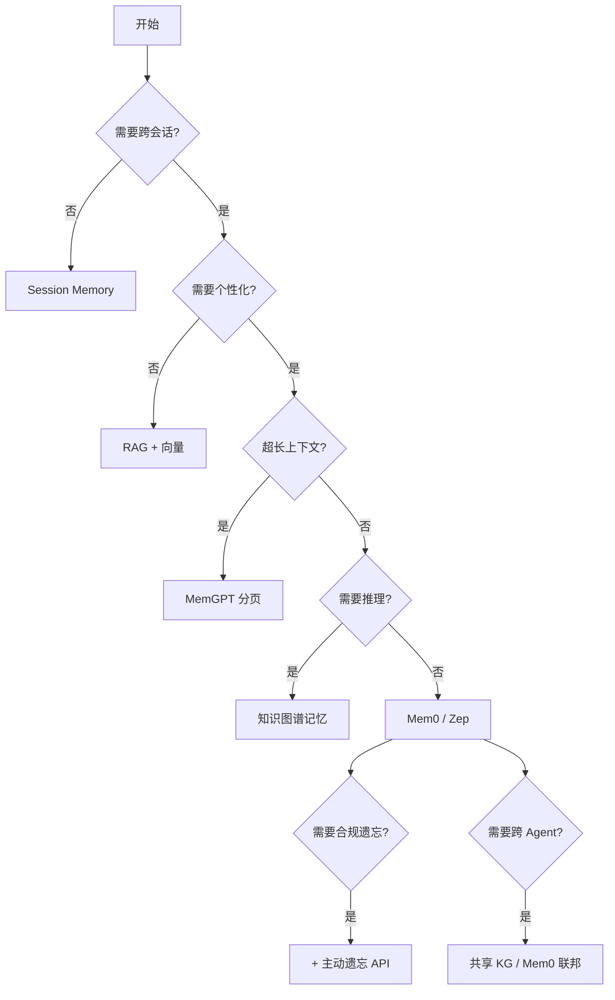

> 本文件是 **01-long-term-memory.md** 的子文件（§6. 落地实践）。完整章节请回到 [index](01-long-term-memory.md)。

## 6. 落地实践

### 6.1 真实案例

**案例 1：客服 Agent 长期记忆**
某电商客服 Agent 引入 Mem0 后，用户满意度提升 25%，转化率提升 15%。

**案例 2：研发 Copilot 个性化**
某研发 Copilot 引入 Zep 后，代码接受率提升 30%。

**案例 3：教育 Agent**
某在线教育 Agent 用 MemGPT 处理长对话（多轮互动），学生续课率提升 18%。

**案例 4：医疗咨询 Agent**
某医疗 Agent 用 KG + LTM 存储患者长期病史，咨询准确率提升 22%（合规前提下）。

**案例 5：法律 Agent**
某法律 Agent 用情景记忆 + Episodic Memory 做案件复盘，胜诉率提升 10%。

### 6.2 案例详解

#### 案例 1：电商客服 Mem0 落地

背景：用户每次进线都要重述问题（订单号、问题类型、上次处理结果）。

方案：
1. 会话结束时调用 Mem0.add() 提取事实。
2. 下次进线自动 search() 召回关键事实。
3. 注入 prompt："这是老用户，3 天前咨询过退款..."。

效果：用户满意度 +25%，转化率 +15%。

踩坑：
- 早期 Mem0 提取会"幻觉"（把用户没说过的话提取出来）——加 confidence 字段 + 显式确认 prompt 解决。
- 记忆爆炸（每用户几千条事实）——加重要性阈值 + 时间衰减解决。

#### 案例 2：研发 Copilot Zep 落地

背景：用户用研发 Copilot 时，每次都要"提醒"自己的技术栈（"我用 Python 3.11 + FastAPI"），推荐准确率低。

方案：
1. Zep memory.add(messages) 自动提取时序事实。
2. 每次推荐前 search("用户技术栈")。
3. 推荐结果注入 prompt。

效果：代码接受率 +30%。

#### 案例 3：医疗咨询 KG + LTM

背景：医疗咨询 Agent 需要"长期病史"——但医疗数据高敏感。

方案：
1. 用 KG 建模患者实体（疾病、用药、过敏）+ 时间戳。
2. 用 LTM 存患者偏好（"医生用通俗语言解释"）。
3. 严格 GDPR / HIPAA 合规：遗忘 API + 加密 + 审计。

效果：咨询准确率 +22%。

### 6.3 踩坑与经验

- 提取式记忆的 LLM 幻觉需要校验。
- 记忆爆炸需要主动清理。
- 跨用户记忆必须严格隔离。
- 时间戳必填，否则冲突无法解决。
- 重要性评分不要硬编码阈值，要 LLM 评 + 行为反馈联合。
- 记忆检索不是"越多越好"，top-5 + rerank 通常比 top-20 准。

更系统的踩坑清单：

| 踩坑 | 表现 | 根因 | 解决 |
| --- | --- | --- | --- |
| 记忆"自相矛盾" | 用户改地址后还说旧地址 | 无时间戳 | 时间戳 + 最近优先 |
| 记忆爆炸 | 检索耗时飙到秒级 | 无重要性筛选 | 重要性阈值 + 衰减 |
| 记忆幻觉 | 提取出用户没说过的 | LLM 幻觉 | confidence 字段 + 校验 |
| 跨用户泄露 | A 用户看到 B 用户信息 | 隔离 bug | 强制 user_id 过滤 |
| 删除不彻底 | 用户要求遗忘但还有痕迹 | 软删除 | 硬删除 + 索引清理 |
| 评估失真 | 离线好、线上差 | 评估集与真实分布偏差 | 在线 A/B + 真实反馈 |

### 6.4 落地路径

- 0→1：用 LangChain ConversationBufferMemory
- 1→10：用 Mem0 或 Zep
- 10→100：自研记忆层 + 知识图谱融合

具体路径：

| 阶段 | 选型 | 投入 | 效果 |
| --- | --- | --- | --- |
| 0→1 | LangChain Memory | 1-2 周 | 能跨轮记住 |
| 1→10 | Mem0 / Zep | 1-2 月 | 跨会话记住 |
| 10→100 | 自研记忆层 + KG + 评估 | 半年+ | 复杂推理 + 合规 |

### 6.5 ROI 评估

- 客服场景 ROI 显著（满意度提升 20%+）
- 研发 Copilot ROI 中等（接受率提升 15-30%）
- 长期投入与 LTM 成本边际递减

更系统的 ROI 评估模型：

```
ROI = (业务价值 - LTM 成本) / LTM 成本

业务价值：
  - 客服：CSAT 提升 × 客户留存价值
  - Copilot：接受率提升 × 节省时间 × 人数
  - 营销：CTR 提升 × GMV
  - 教育：续课率提升 × 客单价

LTM 成本：
  - 存储：向量库 + DB + S3
  - 计算：embedding + retrieval + extraction
  - 工程：开发 + 维护 + 监控
```

### 6.6 合规与 GDPR

记忆是高敏感数据，需要：

1. **主动遗忘 API**：用户可一键删除记忆。
2. **数据可携带**：用户可导出自己所有记忆。
3. **写入审计**：每条记忆的写入可追溯（来源对话、提取模型、时间）。
4. **读取审计**：谁在什么时候读了用户的记忆。
5. **加密**：存储加密 + 传输加密。
6. **匿名化**：分析时用匿名化数据。
7. **跨境合规**：跨境记忆传输要走合规审查。

GDPR 第 17 条"被遗忘权"映射到记忆系统：

| GDPR 要求 | 工程实现 |
| --- | --- |
| 删除权 | DELETE /memory/{user_id}（硬删除 + 索引清理） |
| 更正权 | UPDATE /memory/{id} |
| 访问权 | GET /memory/{user_id}（导出 JSON） |
| 限制处理权 | POST /memory/{user_id}/freeze |
| 可携带权 | 导出 + 标准 schema（JSON-LD / FHIR） |

个保法（中国）合规要点：
- 单独同意（写入记忆需明确告知 + 同意）。
- 敏感个人信息（医疗 / 金融 / 行踪）需"单独同意"+"显著提示"。
- 跨境传输：安全评估 / 标准合同 / 保护认证。

HIPAA（美国医疗）合规要点：
- PHI（Protected Health Information）加密 + 访问审计。
- Business Associate Agreement（BAA）与云服务商签。
- 最小必要原则。

### 6.7 监控与告警

记忆系统不是"建好就用"，需要持续监控：

| 指标 | 阈值 | 告警 |
| --- | --- | --- |
| 提取成功率 | < 95% | 提取器异常 |
| 提取幻觉率 | > 5% | 模型漂移 |
| 检索命中率 | < 80% | embedding 退化 |
| 检索延迟 P99 | > 500ms | 向量库压力 |
| 写入 QPS | 异常突增 / 突降 | 业务异常 |
| 存储量 | 日增 > 10% | 记忆爆炸 |
| 遗忘 API 调用 | 突增 | 信任事件 |

监控工具：
- Prometheus + Grafana（基础设施指标）
- Langfuse / Helicone（LLM 指标）
- Arize Phoenix（记忆质量）

### 6.8 跨文化 / 跨语种落地

国际化 Agent 面临：
- 用户用多种语言切换（中文 / 英文 / 日文）。
- 同一事实不同语言表达（"我爱咖啡" vs "I love coffee"）。
- 文化差异（欧美重视隐私、日韩重视礼仪）。

工程方案：
- 跨语种 embedding（bge-m3 multilingual、cohere embed-v3 multilingual）。
- 跨语种记忆去重（多语种 embedding + 相似度合并）。
- 文化规则库（不同地区不同遗忘 / 推荐策略）。

### 6.9 性能优化技巧

记忆系统上线后，最常见的性能瓶颈：

1. **embedding 慢**：embedding 调用是高频操作，单次 100-300ms。
   - 解决：批量（bge-m3 / openai 支持 batch）、缓存常见 query、模型蒸馏。
2. **检索慢**：向量库 P99 突破 500ms。
   - 解决：HNSW 调参 efConstruction / M；标量过滤下推；分片；缓存热数据。
3. **提取慢**：每条对话都调 LLM 提取事实，单次 1-3s。
   - 解决：异步 + 批量；用小模型（Haiku / GPT-4o-mini）做提取；规则化（高频模式不调 LLM）。
4. **存储膨胀**：每用户几 MB 事实 + 几 MB 向量。
   - 解决：重要性阈值 + 时间衰减；冷数据归档 S3 + 离线索引；向量量化（PQ / SQ）。
5. **并发写冲突**：同一用户多设备同时写记忆。
   - 解决：CRDT / 版本号 + 最后写胜出；或者悲观锁 / 分布式锁。

### 6.10 团队组织与协作

记忆系统是跨团队工程，建议的组织分工：

| 角色 | 职责 |
| --- | --- |
| AI 架构师 | 记忆选型、模型选型、整体设计 |
| 后端工程师 | 记忆层 API、向量库、KG 维护 |
| 算法工程师 | 提取 prompt、重要性评分、冲突解决 |
| 数据工程师 | 评估集构建、监控、归因分析 |
| 合规 / 法务 | GDPR / 个保法审计 |
| PM / 业务 | ROI 评估、业务场景定义 |

记忆系统的"高 ROI"特征：一旦跑通，能持续给业务供能（无需重新训练模型）。

### 6.11 上线 Checklist

生产级记忆系统上线前的检查清单：

- [ ] 记忆 schema 已版本化（migration 系统）
- [ ] 提取 prompt 有版本管理与 A/B
- [ ] 重要性阈值有默认值（建议 0.3）
- [ ] 主动遗忘 API 已暴露
- [ ] GDPR / 个保法合规审查通过
- [ ] 多租户隔离压测通过
- [ ] 写入 / 读取全链路审计
- [ ] 监控指标 + 告警规则就绪
- [ ] 评估集 + 离线评估 + 在线 A/B 三件套就绪
- [ ] 回滚预案（关闭 LTM 后业务不挂）
- [ ] 成本预算与扩容方案
- [ ] 安全：SQL 注入 / XSS / Prompt 注入防护

### 7.1 对比维度

| 维度 | Session | RAG | MemGPT | Mem0 | KG |
| --- | :---: | :---: | :---: | :---: | :---: |
| 跨会话 | 1 | 3 | 5 | 5 | 5 |
| 个性化 | 1 | 2 | 4 | 5 | 5 |
| 工程复杂度 | 1 | 3 | 5 | 3 | 5 |
| 隐私可控 | 5 | 4 | 3 | 4 | 4 |
| AI 友好度 | 2 | 4 | 5 | 5 | 5 |
| 成本 | 1 | 3 | 5 | 3 | 5 |
| 推理能力 | 1 | 2 | 3 | 3 | 5 |

### 7.2 决策树



### 7.3 组合使用

**实战组合 1：RAG + Mem0**
- RAG 提供知识，Mem0 提供个性化。
- 适用：90% 的客服 / 助手场景。

**实战组合 2：MemGPT + 知识图谱**
- MemGPT 处理长上下文，知识图谱提供结构化推理。
- 适用：复杂研究 / 咨询场景。

**实战组合 3：Session + Mem0 + KG + RAG（四件套）**
- Session：当前会话上下文。
- Mem0：用户偏好事实。
- KG：用户实体关系。
- RAG：外部知识文档。
- 适用：复杂业务 Agent（金融、医疗、跨境）。

### 7.4 选型决策矩阵

| 业务场景 | 首选 | 备选 | 关键原因 |
| --- | --- | --- | --- |
| 单次客服 | Session | RAG | 简单即可 |
| 个性化推荐 | Mem0 | Zep | 自动提取用户偏好 |
| 长任务协作 | MemGPT | Mem0 + 摘要 | 处理超长上下文 |
| 复杂推理 | KG + Mem0 | Cognee | 实体关系推理 |
| 高合规 | Session + 主动遗忘 | 自研记忆层 | GDPR / 个保法 |
| 多 Agent 协作 | 共享 KG | Mem0 联邦 | 跨 Agent 共享 |
| 调试密集 | Episodic Memory | 全量日志 | 复盘决策 |

### 7.5 成本对比

| 方案 | 存储成本 | 计算成本 | 工程成本 |
| --- | --- | --- | --- |
| Session Memory | 低 | 低 | 低 |
| RAG | 中（向量库） | 中 | 低 |
| MemGPT | 高（外部存储） | 高（function call） | 高 |
| Mem0 | 中 | 高（提取 LLM） | 中 |
| KG Memory | 高（图谱） | 高 | 高 |
| 混合 | 最高 | 最高 | 最高 |

每用户每月记忆成本估算（量级）：

| 方案 | 存储 | Embedding | 提取 | 检索 | 合计 |
| --- | --- | --- | --- | --- | --- |
| RAG | $0.05 | $0.02 | $0 | $0.01 | $0.08 |
| Mem0 | $0.10 | $0.05 | $0.30 | $0.05 | $0.50 |
| KG | $0.30 | $0.10 | $0.20 | $0.20 | $0.80 |
| MemGPT | $0.20 | $0.05 | $0 | $0.30 | $0.55 |
| 混合 | $0.50 | $0.15 | $0.50 | $0.30 | $1.45 |

数字会随实际 embedding / LLM 价格变化，仅作量级参考。

### 7.6 与本仓库其他章节的关系

- **与 Ch4 数据资产化**：长期记忆是 Ch4"企业私有数据资产"的特殊形态（动态 / 个人）。
- **与 Ch5 Agent 平台**：长期记忆是 Agent 平台的"持久化层"。
- **与 Ch6 多模型编排**：不同模型对记忆的"接受度"不同（小模型可能用 RAG + 短记忆，大模型可直接吃 MemGPT 长 context）。
- **与 Ch7 反馈闭环**：记忆的"重要性"评分依赖反馈（详见 Ch7 §2 反馈闭环）。
- **与 Ch7 资产管理**：记忆也是一种 AI 资产，需要版本 / Owner / 评审（详见 Ch7 §3）。
- **与 Ch7 技能提取**：程序性记忆（Procedural Memory）是 Skill 提取的输入（详见 Ch7 §4）。
- **与 Ch8 AI 治理**：记忆的合规边界是 AI 治理的核心议题。

---
