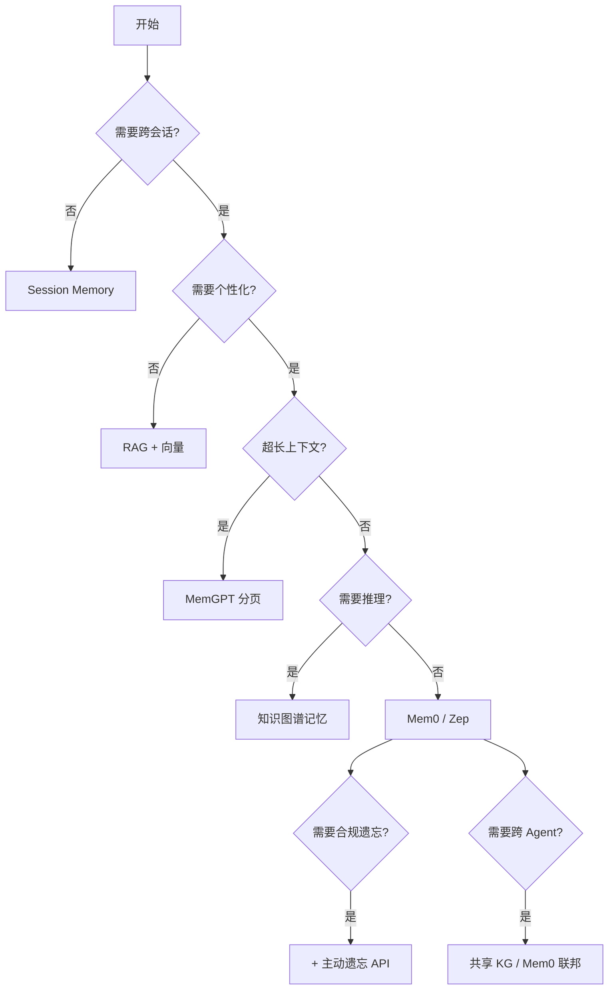

# Agent 长期记忆（Long-Term Memory）

> **一句话定位**：让 Agent 不只活在"当下对话"——跨会话、跨任务、跨用户记住关键上下文，让 Agent 越用越懂你。

> 本文是 data-travel 项目 [Ch7 · AI 资产沉淀与自进化](../../README.md) 的子章节（01-long-term-memory）。覆盖 核心职责④ AI 资产沉淀与自进化系统 中"记忆资产"核心能力。

---

## 0. 本章速读地图

| 你将解决的问题 | 直接跳到 |
| --- | --- |
| Agent 为什么需要长期记忆 | §1.1、§1.2 |
| 短期 / 工作 / 长期 / 情景 / 程序性 五种记忆如何划分 | §2.1 |
| MemGPT、Mem0、Letta 等架构怎么选 | §3.1、§4.3 |
| 长期记忆的隐私与安全怎么保 | §5.2、§6.4 |
| 我的业务该选哪种记忆方案 | §7.2 |

---

## 1. 概念与定位

### 1.1 是什么

**Agent 长期记忆（Long-Term Memory, LTM）** 是 Agent 系统中独立于"当前对话上下文窗口"之外的、**持久化、可检索、可更新** 的记忆系统。它解决 LLM Agent 一个根本性局限：**单次对话有上下文窗口限制（8K-2M-token），跨会话就清零**。

类比人类记忆：

| 人类记忆 | Agent 长期记忆 | 工程映射 |
| --- | --- | --- |
| 工作记忆（几秒-几分钟） | 当前上下文窗口 | LLM Context Window |
| 短期记忆（几小时-几天） | Session Memory | Redis / DB 会话存储 |
| 长期记忆（几月-几年） | User Memory / Global Memory | 向量库 + 知识图谱 |
| 情景记忆（"上次我们去..."） | Episodic Memory | 时间戳 + 事件序列存储 |
| 程序性记忆（"我会骑自行车"） | Procedural Memory / Skill Library | Skill 库 + 工具调用模板 |

补充说明 5 种记忆的工程含义：

- **工作记忆（Working Memory）**：即 LLM 当前推理所用的 KV cache 与 prompt。容量小（一般 8K-128K token），但是推理路径上的"主角"。它由系统提示 + 用户本轮输入 + 检索召回 + 历史若干轮对话共同拼接，是当下回答的唯一"事实来源"。
- **短期记忆（Short-Term / Session Memory）**：跨工具调用、跨多轮但仍处于"一个会话内"的记忆。一般由 Redis、KVStore、Postgres 中的 sessions 表承载，键通常是 thread_id 或 session_id，TTL 从 24h 到 30 天不等。
- **长期记忆（Long-Term / User Memory）**：跨会话、跨用户的"用户/组织"层面的记忆。存储在向量库 + 关系库 + 知识图谱中，按 user_id 隔离，理论上无限期保留。
- **情景记忆（Episodic Memory）**：以"事件 + 时间 + 上下文"为粒度的记忆。强调"某次发生了什么"，对调试 Agent 行为、复盘错误、做反事实推理至关重要。
- **程序性记忆（Procedural Memory）**：从经验中沉淀的"怎么做"的步骤。对应 Agent 平台的 Skill / Workflow / Tool 模板库，与本仓库 Ch7 §4「Agent 技能提取」是同一类资产的不同视角。

### 1.2 为什么需要

**业务驱动力**：
1. **个性化体验**：用户希望 Agent "记得住我"——知道我是高级会员、知道我的偏好、知道我们的历史交互。
2. **跨任务连续性**：复杂任务往往是多轮、多日的（"昨天讨论的那个项目，今天继续"）。
3. **组织知识沉淀**：Agent 与团队的交互应该沉淀为组织可复用的知识。

**痛点（没有 LTM 的失败案例）**：
- 某客服 Agent 用户每次都要重新描述问题——用户崩溃、转化率下降 30%。
- 某研发 Copilot 不记得用户的技术栈，每次推荐都用错的语言——接受率下降 50%。
- 某 BI Agent 不记得用户上次看的指标，每次都要重新查询——效率下降 70%。

更系统的失败模式归类：

| 失败模式 | 业务表现 | 量化影响 | 根因 |
| --- | --- | --- | --- |
| 重复提问 | 用户每次重新交代背景 | CSAT 下降 15-25% | 无跨会话记忆 |
| 上下文丢失 | 长任务中断后无法续接 | 任务放弃率上升 30% | 工作记忆未持久化 |
| 推荐发散 | 不基于历史偏好 | CTR 下降 20% | 无用户偏好记忆 |
| 错误重复 | 同一幻觉反复出现 | 错误率居高 | 无情景记忆做反事实 |
| 合规风险 | 用户要求遗忘但做不到 | 法律处罚 | 无主动遗忘机制 |

**AI 时代新诉求**：
1. **结构化记忆**：记忆不再是"对话日志"，而是结构化的实体 / 关系 / 时间戳。
2. **可推理记忆**：Agent 应该能基于记忆做推理（"基于用户过去 3 个月行为，推荐 XX"）。
3. **可遗忘机制**：合规要求记忆可被遗忘（GDPR、个保法）。
4. **跨主体共享**：团队 / 项目 / 组织的记忆如何在多 Agent 间共享与隔离。
5. **可审计**：每一笔记忆的写入、读取、修改都有审计日志。

### 1.3 在 AI 时代数据架构中的位置

长期记忆位于"Agent 框架"与"数据资产"的交叉点：

```
       Agent 框架（LangChain / LangGraph / AutoGen）
            ↓ 持久化需求
       长期记忆层（Mem0 / Letta / Zep）
            ↓ 数据资产化
       数据资产（向量库 + 关系库 + 知识图谱）
            ↓ 治理
       AI 治理（Ch8）
```

进一步展开记忆层的数据流：

```
用户消息 → 短期会话缓冲（Redis）
        → 工作记忆（Context Window）
        → 提取器（LLM Extract / Mem0 ADD/DELETE/UPDATE）
        → 长期记忆存储（Vector + KG + KV）
        → 重要性评分（重要性函数 f）
        → 检索器（Query → Top-K → 注入 Prompt）
        → 主动遗忘（GDPR / 时间衰减）
```

### 1.4 演进历程

- **传统阶段（2020-2023）**：RAG 为主，把"知识"塞进向量库，没有真正的"记忆"概念。
- **初级阶段（2023-2024）**：LangChain Memory 模块、对话历史压缩。
- **突破阶段（2024）**：MemGPT（2024-04）提出"分页记忆 + 层次化记忆"；Mem0（2024-10）开源；Letta（前身 MemGPT）2024 成立公司。
- **成熟阶段（2025）**：长期记忆成为 Agent 平台标配，与 RAG、知识图谱融合。
- **AI 治理融合（2025+）**：记忆写入 / 读取进入合规体系，跨 Agent 共享进入"记忆联邦"研究阶段。

更细的演进时间线：

| 时间 | 事件 | 关键贡献 |
| --- | --- | --- |
| 2023-06 | LangChain ConversationBufferMemory | "类 Buffer" 的最朴素记忆 |
| 2023-11 | LangChain ConversationSummaryMemory | 摘要压缩，控制 token |
| 2024-04 | MemGPT 论文（UC Berkeley） | 操作系统式分页 + 层次化记忆 |
| 2024-07 | Zep 1.0 | 时序事实抽取 + 时间衰减 |
| 2024-10 | Mem0 开源 | 提取式记忆 + ADD/DELETE/UPDATE |
| 2024-11 | Letta 公司化 | MemGPT 工程化平台 |
| 2025-02 | Cognee | 知识图谱 + 记忆的混合存储 |
| 2025-05 | Anthropic Memory API | Claude 跨会话"项目记忆"上线 |
| 2025-08 | OpenAI Memory（ChatGPT） | 用户偏好 + 显式"记住 X" |
| 2025-Q4 | 多模态记忆（图像、语音） | 走出纯文本 |

---

## 2. 核心原理

### 2.1 关键概念定义

| 概念 | 定义 | 一句话解释 |
| --- | --- | --- |
| **短期记忆（STM）** | 当前会话内的对话历史 | "这次对话我们聊了什么" |
| **工作记忆（WM）** | 当前任务相关上下文 | "现在正在做订单核对" |
| **长期记忆（LTM）** | 跨会话持久化的记忆 | "上周用户偏好 XXX" |
| **情景记忆（Episodic）** | 具体事件 + 时间戳 + 上下文 | "2024-10-08 用户问过退款流程" |
| **语义记忆（Semantic）** | 抽象知识、概念 | "VIP 用户 90 天未登录会流失" |
| **程序性记忆（Procedural）** | 技能、动作序列 | "调用退款 API 的步骤" |
| **记忆检索** | 基于 query 找到相关记忆 | "用户最近一次提问" |
| **记忆压缩** | 把冗长历史压缩为摘要 | "过去 100 条对话 → 10 条要点" |
| **记忆遗忘** | 删除 / 模糊化过期记忆 | "GDPR 要求删除用户记忆" |
| **记忆冲突解决** | 多个记忆冲突时的优先级 | "用户改地址后覆盖旧地址" |
| **记忆重要性** | 记忆的"值得长期保留"程度 | f: E → [0, 1] |
| **记忆时间衰减** | 越久远的记忆权重越低 | recency(e) = exp(-λ · Δt) |
| **记忆嵌入** | 把记忆文本转为向量 | 768/1024/3072 维 |
| **记忆分页（Paging）** | 类 OS 虚拟内存的层次化存储 | Core / Archived 分层 |

### 2.2 数学/形式化基础

长期记忆可被形式化为一个**带时间维度的检索系统**：

```
M = ⟨E, T, R, F, G⟩

M     = 记忆系统
E     = 记忆条目 {e1, e2, ..., en}
T     = 时间戳 ti ∈ R+（毫秒时间戳）
R     = 记忆关系（"指代"、"时序"、"因果"）
F     = 重要性函数 f: E → [0, 1]（哪些值得长期保留）
G     = 检索函数 g: Q × E → [0, 1]（给定 query 返回相关记忆）
```

记忆写入策略：

```
m_new = llm_extract(user_msg)
       ∧ if f(m_new) > θ then store(m_new, t=now)
       ∧ if conflict(m_new, m_old) then resolve(m_new, m_old)
```

记忆检索策略（Mem0 风格）：

```
retrieved = g(query, M)
           = top_k( cosine(embed(query), embed(e_i))
                    + α · recency(e_i)
                    + β · importance(e_i) )
```

进一步细化评分函数：

```
score(q, e) = w1 · sim(q, e)
            + w2 · recency(e)
            + w3 · importance(e)
            + w4 · confidence(e)
            + w5 · access_count_normalized(e)

其中：
  sim(q, e)        = 余弦相似度 / BM25
  recency(e)       = exp(-λ · (now - t_e))，λ 控制衰减速度
  importance(e)    = LLM 评出的重要性 ∈ [0, 1]
  confidence(e)    = 提取置信度
  access_count     = 历史被检索次数（隐式反馈）
```

### 2.3 关键算法/方法

| 方法 | 原理 | 适用边界 |
| --- | --- | --- |
| **MemGPT 分页记忆** | 类似 OS 虚拟内存，context 之外的内容"换页"到存储 | 长对话、复杂任务 |
| **Mem0 提取式记忆** | LLM 自动从对话中提取"事实"作为记忆 | 个性化推荐、客服 |
| **Zep 时间感知记忆** | 提取事实 + 时间衰减 + 重要性评分 | 跨会话连续性 |
| **MemoryBank 压缩记忆** | 定期摘要压缩长对话历史 | 成本敏感场景 |
| **向量检索 + 重排** | 简单 RAG 风格，加 rerank | 简单场景、知识问答 |
| **知识图谱记忆** | 实体关系建模 | 复杂推理场景 |
| **遗忘机制** | 时间衰减 / 重要性筛选 / 用户主动删除 | 合规场景 |
| **Cognee 混合记忆** | KG + 向量混合检索 | 复杂推理 + 事实抽取 |
| **Self-Edit Memory** | Agent 自己回顾并修正记忆 | 长期自进化 |
| **Episodic Memory + ReAct** | 复盘历史决策做反事实推理 | 高风险场景 |

### 2.4 与相邻概念的关系

- **长期记忆 vs RAG**：RAG 是"知识检索"（静态文档），LTM 是"个人 / 上下文检索"（动态对话历史）。
- **长期记忆 vs Session Storage**：Session Storage 只在单次会话有效，LTM 跨会话持久化。
- **长期记忆 vs Fine-tuning**：Fine-tuning 把知识"编入"模型权重（静态、难更新），LTM 把知识"外挂"在存储中（动态、易更新）。
- **长期记忆 vs Knowledge Graph**：KG 偏静态 schema，LTM 偏动态增量写入；二者可融合为"知识图谱记忆"（Cognee 路线）。
- **长期记忆 vs Context Caching**：Context Caching 是 prompt cache 的命中率优化（短期、成本优化），LTM 是业务级的语义层持久化（长期、业务连续性）。

### 2.5 记忆的数据建模

长期记忆的存储 schema 不同于传统 KV / 表。常见的数据模型有三种。

#### 2.5.1 事实三元组模型（Mem0 / Zep 风格）

```
记忆条目 = {
  id            : uuid
  user_id       : string           # 多租户隔离
  session_id    : string | null    # 来源会话
  fact          : string           # 提取出的事实
  subject       : string           # 主语
  predicate     : string           # 谓语
  object        : string           # 宾语
  importance    : float ∈ [0, 1]   # 重要性
  confidence    : float ∈ [0, 1]   # 提取置信度
  embedding     : vector[768..3072]# 语义向量
  created_at    : timestamp
  updated_at    : timestamp
  expires_at    : timestamp | null # 主动遗忘
  source        : "user_msg" | "inferred" | "external"
  metadata      : jsonb            # 业务属性
}
```

典型查询：

```sql
-- 找和"咖啡"相关的偏好
SELECT * FROM memory
WHERE user_id = 'alice'
  AND predicate IN ('preference', 'habit')
  AND embedding <-> embed('咖啡') < 0.3
ORDER BY importance DESC, updated_at DESC
LIMIT 10;
```

#### 2.5.2 情景事件模型（Episodic Memory 风格）

```
事件 = {
  id          : uuid
  user_id     : string
  ts          : timestamp
  event_type  : "user_query" | "agent_action" | "tool_call" | "feedback"
  actor       : "user" | "agent" | "tool"
  payload     : jsonb            # 完整内容
  context     : jsonb            # 上下文（topic / intent）
  outcome     : "success" | "fail" | "neutral"
  feedback    : jsonb | null     # 用户反馈（点赞/点踩）
}
```

适合做复盘、反事实推理、A/B 归因。

#### 2.5.3 图谱实体模型（KG Memory 风格）

```
节点（User / Order / Product / Topic ...）
边（purchased / viewed / complained / preferred ...）
边属性 {ts, weight, source, confidence}
```

适合做"基于历史行为的复杂推理"。

三种模型对比：

| 模型 | 优点 | 缺点 | 代表系统 |
| --- | --- | --- | --- |
| 事实三元组 | 简单、易检索 | 缺上下文、缺关系 | Mem0, Zep |
| 情景事件 | 完整、可复盘 | 体积大、检索慢 | Langfuse, Helicone |
| 图谱实体 | 可推理 | 工程复杂、写入慢 | Cognee, Neo4j-based |

#### 2.5.4 物理存储选择

| 数据类型 | 存储 | 理由 |
| --- | --- | --- |
| 向量 | Milvus / Qdrant / pgvector | 高维相似度检索 |
| 事实 / 关系 | Postgres / Neo4j | 强 schema + JOIN |
| 原始事件 | ClickHouse / S3 + Iceberg | 高吞吐、列存 |
| 缓存 | Redis | 热数据 |
| 冷数据 | S3 / OSS + 离线索引 | 成本低 |

---

## 3. 设计模式与范式

### 3.1 主要模式

| 模式 | 场景 | 结构 | 优点 | 缺点 |
| --- | --- | --- | --- | --- |
| **Session Memory（Redis）** | 单会话内 | K-V 存储 | 简单、快 | 跨会话失忆 |
| **Vector RAG 记忆** | 简单跨会话 | Embedding + Vector DB | 易集成 | 无时间感知、无结构 |
| **MemGPT 分页** | 长对话 | 层次化存储 + 上下文窗口 | 处理超长对话 | 复杂度高 |
| **Mem0 提取式** | 个性化 | LLM 提取事实 + 存储 | 自动、智能化 | 提取有幻觉风险 |
| **知识图谱记忆** | 复杂推理 | 实体 + 关系 + 时间 | 可推理 | 工程复杂度 |
| **混合模式** | 综合场景 | 多种模式组合 | 灵活 | 架构复杂 |

各模式展开：

#### 3.1.1 Session Memory 模式

最朴素：thread_id → List[Message] 的 KV 存储。一般用 Redis（TTL 24h-30d）或 Postgres。会话结束 TTL 过期即"失忆"。

适合：单次会话客服、临时任务、登录态一次性咨询。

#### 3.1.2 Vector RAG 记忆模式

把整段对话切块，向量化存进向量库。检索时取 top-k 拼到 prompt。

适合：知识问答、轻度个性化（"上几轮聊过 XX"）。缺点是没有时间结构。

#### 3.1.3 MemGPT 分页模式

把记忆分为两层：

- **Core Memory**：始终在 context window 中（系统提示 + 用户核心偏好），容量小。
- **Archival Memory**：context 之外的内容，存到外部存储，Agent 通过"函数调用"主动换入换出。

LLM 自己决定"什么时候该把哪段换出去 / 换进来"。这是 OS 虚拟内存 + LLM Agent 的结合。

#### 3.1.4 Mem0 提取式模式

不存"原对话"，而是 LLM 在对话结束时提取"事实三元组"（subject-predicate-object）作为记忆。后续查询基于事实三元组。

例：
> 用户："我住在北京海淀，喜欢喝咖啡。"
> 提取：[{"s": "用户", "p": "住址", "o": "北京海淀"}, {"s": "用户", "p": "偏好", "o": "咖啡"}]

后续查询："我喜欢什么？"
→ 检索事实 → 返回"咖啡"。

#### 3.1.5 知识图谱记忆模式

把记忆建模为图谱：实体节点（用户、商品、订单）+ 关系边（购买、收藏、咨询）+ 时间戳。可以用 Neo4j / NebulaGraph / TigerGraph。

适合：复杂推理（"基于过去 3 个月行为推断用户偏好"）。

#### 3.1.6 混合模式

实战中往往多种模式组合：

- 短期 Session Memory（Redis）+ 长期 Mem0（用户偏好）+ KG（结构化实体）+ RAG（外部知识）。
- 例：客服 Agent 用 Session 存当前工单，用 Mem0 存用户偏好，用 KG 存"用户-订单-商品"关系，用 RAG 查产品手册。

### 3.2 适用场景决策表

| 业务特征 | 推荐模式 | 理由 |
| --- | --- | --- |
| 单次会话客服 | Session Memory | 简单够用 |
| 个性化推荐 | Mem0 / Zep | 自动提取用户偏好 |
| 长任务协作 | MemGPT 分页 | 处理超长上下文 |
| 知识密集型 Agent | 知识图谱记忆 | 可推理 |
| 合规敏感 | Session + 主动遗忘 | 满足合规 |
| 多 Agent 协作 | 共享知识图谱 | 跨 Agent 共享记忆 |
| 跨设备 / 跨平台 | Mem0 + 中央化存储 | 统一画像 |
| 调试密集 | Episodic Memory | 全量复盘 |

### 3.3 反模式与陷阱

| 反模式 | 表现 | 后果 | 如何避免 |
| --- | --- | --- | --- |
| **记忆爆炸** | 记忆条目无限增长 | 检索噪声增加、成本飙升 | 重要性筛选 + 时间衰减 |
| **记忆幻觉** | LLM 提取出错误事实 | 误导后续决策 | 提取置信度 + 人工校验 |
| **记忆过期** | 过时信息仍被使用 | 推荐错误 | 时间衰减 + 主动更新 |
| **记忆冲突** | 同一事实多个版本 | 矛盾回答 | 冲突解决 + 版本管理 |
| **记忆泄露** | 用户 A 的记忆被 B 看到 | 隐私事故 | 严格的多租户隔离 |
| **强制记忆** | 用户主动删除失败 | 合规风险 | 提供主动遗忘 API |
| **记忆污染** | 用户被诱导错误信息 | 反复错误 | 写入校验 + 来源审计 |
| **全量塞 Context** | 把所有记忆塞进 prompt | token 爆炸 | top-k + rerank + 摘要 |
| **无时间维度** | 不记录时间 | 旧事实压新事实 | 时间戳 + 衰减 |
| **无重要性** | 一视同仁 | 噪声淹没关键 | LLM 评分 f: E → [0, 1] |

---

## 4. 工程实现

### 4.1 落地步骤

1. **明确记忆范围** → 单会话 / 跨会话 / 跨用户？
2. **选择记忆模式** → RAG / Mem0 / MemGPT / 知识图谱？
3. **搭建存储层** → 向量库 + 关系库 + 缓存
4. **设计检索 API** → query → top-k 记忆
5. **接入 Agent 框架** → LangChain / LangGraph Memory 模块
6. **加入遗忘机制** → 时间衰减 + 用户主动删除
7. **监控与评估** → 记忆准确率、检索命中率、成本
8. **合规审计** → 写入读取审计、GDPR 删除支持

更细的工程步骤（按 0→1 / 1→10 / 10→100 分阶段）：

| 阶段 | 目标 | 关键产出 | 周期 |
| --- | --- | --- | --- |
| 0→1 | 跑通最小记忆闭环 | Session Memory + 提取 prompt | 1-2 周 |
| 1→10 | 接入结构化记忆 | Mem0 / Zep / 向量库 | 1-2 月 |
| 10→100 | 自研 + 合规 + 监控 | 自研记忆层 + KG + 遗忘 + 审计 | 半年+ |

### 4.2 关键技术点

- **记忆提取**：LLM 从对话中提取事实（实体、关系、属性、事件）
- **记忆存储**：向量 + 关系 + 时间戳的三元组存储
- **记忆检索**：Embedding 相似度 + 时间衰减 + 重要性加权
- **记忆压缩**：定期摘要压缩长历史，控制成本
- **记忆遗忘**：GDPR / 个保法合规要求
- **记忆冲突解决**：版本号 + 最近更新优先
- **记忆隔离**：多租户场景严格隔离
- **记忆去重**：相似度阈值合并重复事实
- **记忆血缘**：每条记忆的来源对话、提取模型、写入时间可追溯
- **记忆冷热分层**：热数据 Redis / 向量库 / PG；冷数据 S3 / OSS + 离线索引

### 4.3 工具链与平台

| 类别 | 工具 |
| --- | --- |
| **专用记忆框架** | Mem0（2024）、Letta（前身 MemGPT，2024）、Zep、MemoryBank、Cognee |
| **向量数据库** | Milvus、Qdrant、Weaviate、Pinecone、pgvector |
| **知识图谱** | Neo4j、NebulaGraph、Apache Jena、Oxigraph |
| **Agent 框架 Memory 模块** | LangChain Memory、LangGraph Checkpoint、AutoGen Memory |
| **缓存 / Session** | Redis、DragonflyDB、Memcached |
| **评估工具** | Langfuse、Helicone、Arize Phoenix、Mem0 Eval |
| **Embedding 模型** | OpenAI text-embedding-3-large、BGE-M3、Cohere embed-v3 |
| **重排模型** | Cohere Rerank 3、BGE Reranker |

各工具的特点对比：

| 工具 | 类型 | 特点 | 适用 |
| --- | --- | --- | --- |
| Mem0 | 提取式记忆 | 自动 ADD/UPDATE/DELETE | 个性化推荐 |
| Letta | 分页式记忆 | 模拟 OS 虚拟内存 | 长对话 |
| Zep | 时序事实 | 时间衰减 + 重要性 | 跨会话连续 |
| MemoryBank | 压缩式记忆 | 类 Ebbinghaus 遗忘曲线 | 成本敏感 |
| Cognee | 混合式记忆 | KG + 向量混合 | 复杂推理 |
| LangGraph | Checkpoint | 工程化 Agent 状态 | 流程编排 |

### 4.4 代码示例

Mem0 风格记忆：

```python
from mem0 import Memory

m = Memory()

# 提取并存储记忆
m.add("用户是 VIP 客户，偏好高端商品", user_id="alice")
m.add("用户上个月咨询过退款政策", user_id="alice")

# 检索记忆
related = m.search("用户偏好什么？", user_id="alice", limit=5)
# 返回：["VIP 客户，偏好高端商品", "上个月咨询过退款政策"]
```

LangGraph Checkpoint：

```python
from langgraph.checkpoint.postgres import PostgresSaver

checkpointer = PostgresSaver.from_conn_string("postgresql://...")
graph = builder.compile(checkpointer=checkpointer)

# 多轮对话自动持久化
config = {"configurable": {"thread_id": "user-123"}}
result = graph.invoke({"messages": [...]}, config=config)
```

Letta 分页记忆示意：

```python
from letta import create_client

client = create_client()
agent = client.create_agent(
    memory_mode="memgpt",
    core_memory_limit=4096,      # Core 限制 4K
    archival_memory_size=10_000  # Archival 容量
)

# Agent 自动管理 Core / Archival 之间的换入换出
response = client.send_message(agent.id, "我住在北京海淀")
```

Zep 时序事实：

```python
from zep_client import ZepClient

z = ZepClient(url="https://...", api_key=os.environ["ZEP_API_KEY"])

# 添加记忆
z.memory.add(
    session_id="user-123",
    messages=[{"role": "user", "content": "我最近失眠，想看医生"}],
)

# 检索时序事实
facts = z.memory.search(session_id="user-123", query="用户最近的健康问题")
# 返回：["用户最近失眠", "想看医生"] + 时间戳 + 重要性
```

### 4.5 自研记忆层（10→100 阶段）

当通用框架不够用时（金融、医疗、跨境合规等），需要自研。一个典型的自研记忆层架构：

```
┌────────────────────────────────────────────────────┐
│                  Agent Runtime                      │
│   (LangGraph / AutoGen / 自研)                       │
└─────────────────────┬───────────────────────────────┘
                      │ Memory API (read/write/search/forget)
┌─────────────────────▼───────────────────────────────┐
│              Memory Layer (自研)                      │
│  ┌─────────────┐  ┌─────────────┐  ┌─────────────┐  │
│  │  Extraction │  │   Storage   │  │  Retrieval  │  │
│  │  Pipeline   │  │   Layer     │  │   Engine    │  │
│  └─────────────┘  └─────────────┘  └─────────────┘  │
└─────────────────────┬───────────────────────────────┘
                      │
┌─────────────────────▼───────────────────────────────┐
│         Vector DB + KG + KV + Cold Storage           │
│  Milvus / Neo4j / Postgres / S3                      │
└─────────────────────────────────────────────────────┘
```

自研记忆层的关键模块：

| 模块 | 职责 | 关键技术 |
| --- | --- | --- |
| Extraction | 从对话提取事实 | LLM + schema 强约束 |
| Storage | 多模态存储 | 向量 + 关系 + 时序 |
| Retrieval | 混合检索 | 向量 + BM25 + KG + rerank |
| Importance | 评分 | LLM 评分 + 行为反馈 |
| Forgetting | 主动遗忘 | 时间衰减 + GDPR API |
| Audit | 审计日志 | 全量写入读取日志 |

---

## 5. 前沿演进（AI 时代）

### 5.1 LLM/Agent 时代的演进方向

- **自动记忆提取**：LLM 自主决定哪些对话值得记住（Mem0、Letta）。
- **记忆重要性评分**：LLM 自动评估记忆的重要性，决定保留时长。
- **记忆冲突解决**：LLM 自动判断新旧记忆的优先级。
- **主动遗忘**：LLM 主动建议"这条记忆 X 天未使用，可以遗忘"。
- **Self-Edit Memory**：Agent 自己回顾记忆，发现错误并修正。
- **多模态记忆**：图像、语音、视频也成为记忆的载体。
- **跨 Agent 共享记忆**：多 Agent 协作场景下的共享语义层。
- **记忆联邦**：跨组织、跨境的记忆共享（隐私计算 + 同态加密）。

### 5.2 与 RAG / 向量库 / GraphRAG 的结合

- **记忆 + 文档双索引**：用户记忆 + 知识文档联合检索。
- **GraphRAG 记忆**：把用户的实体关系建模为图谱。
- **记忆驱动的 RAG**：基于用户记忆优化 RAG 检索（"用户问过 XX，所以相关文档是 YY"）。
- **Memory-Augmented Generation（MAG）**：把记忆作为生成器的额外输入，与 RAG 并列。
- **混合检索路由**：用 LLM 决定"该查知识库还是查用户记忆"。

### 5.3 学术与工业最新进展（2024-2025）

| 进展 | 时间 | 来源 |
| --- | --- | --- |
| MemGPT 论文 | 2024-04 | UC Berkeley |
| Mem0 开源 | 2024-10 | Mem0.ai |
| Letta（前身 MemGPT）公司成立 | 2024-11 | Letta |
| Zep 1.0 GA | 2024 | Zep |
| Cognee（知识图谱记忆） | 2024 | Cognee |
| Anthropic Memory API | 2025-05 | Anthropic |
| OpenAI Memory（ChatGPT） | 2025-08 | OpenAI |
| MemoryBank 论文 | 2024 | 多伦多大学 |
| A-Mem 论文 | 2025 | 清华等 |
| Self-Edit Memory | 2025 | 学界 |

展开几个关键论文：

- **MemGPT（2024-04）**：核心思想是把 LLM 的 context window 类比为 OS 的物理内存，把外部存储类比为虚拟内存，由 LLM 自己通过 function call 做"换页"。原文：https://arxiv.org/abs/2312.08194
- **Mem0（2024-10）**：核心是"提取式记忆"——对话结束后 LLM 提取事实三元组，下次对话用相同事实，避免幻觉。原文：https://arxiv.org/abs/2504.19413
- **Zep**：核心是"时序事实 + 时间衰减"，适合"用户偏好随时间变化"的场景。
- **Cognee**：核心是"知识图谱 + 向量混合"，把对话事实建模为 KG 节点，再用向量检索。

### 5.4 未来 3-5 年趋势

- 长期记忆将成为 Agent 平台标配。
- 记忆 + 本体建模将深度融合。
- 主动遗忘机制将成为合规标配。
- 跨 Agent 共享记忆将成为多 Agent 协作基础设施。
- 多模态记忆（图像 / 语音 / 视频）将成为标配。
- 记忆联邦（跨组织、隐私保护）将进入工业级。
- 记忆评估与监控将成为 AI 治理的一部分。

更细的趋势：

| 趋势 | 时间 | 含义 |
| --- | --- | --- |
| 记忆即服务（Memory-as-a-Service） | 2026 | 第三方记忆服务 |
| 记忆联邦 | 2027 | 跨组织 / 跨境的隐私保护记忆共享 |
| 自适应记忆压缩 | 2026 | LLM 动态决定压缩粒度 |
| 多模态情景记忆 | 2026 | 图像 / 语音作为记忆载体 |
| 记忆 vs 上下文缓存融合 | 2026 | 业务级 LTM + 基础设施级 cache |

### 5.5 学术前沿论文（2024-2025）

继续展开 5 个高影响力论文，让读者按图索骥：

| 论文 | 出处 | 核心思想 | 工程映射 |
| --- | --- | --- | --- |
| **MemGPT: Towards LLMs as Operating Systems** | arxiv 2312.08194 | 把 LLM context 类比 OS 内存 | 分页记忆 |
| **MemoryBank: A Unified Memory Layer** | arxiv 2405.18470 | Ebbinghaus 遗忘曲线 + 重要性 | 衰减记忆 |
| **A-Mem: Agentic Memory** | arxiv 2502.12110 | Agent 自己编辑 / 检索记忆 | Self-Edit Memory |
| **Zep: A Temporal Knowledge Graph Architecture** | Zep 官方 | 时序事实 + 衰减 | 时序记忆 |
| **Cognee: Knowledge Graph Memory** | Cognee 官方 | KG + 向量混合检索 | 混合记忆 |

### 5.6 工业产品地图（2025 现状）

| 产品 | 记忆能力 | 适用 |
| --- | --- | --- |
| **OpenAI ChatGPT Memory** | 跨会话用户偏好 + 显式"记住 X" | 通用助手 |
| **Anthropic Claude Memory API** | 项目级长期记忆 + 文件引用 | 项目协作 |
| **Letta Cloud** | MemGPT 工程化 + 多 Agent | 自研平台 |
| **Mem0 Cloud** | 提取式记忆 + 多用户 | 个性化推荐 |
| **Zep Cloud** | 时序事实 + 衰减 | 客服 / 长任务 |
| **Cognee OSS** | KG + 向量 | 复杂推理 |

### 5.7 关键开放问题

长期记忆领域仍未解决的几个问题：

1. **记忆 vs 推理边界**：什么应该写入记忆，什么应该留在 context？
2. **记忆幻觉的量化评估**：提取错误率如何度量？
3. **跨语种记忆**：用户跨语种切换时，记忆如何归并？
4. **记忆优先级与遗忘平衡**：保留 vs 遗忘的最优策略？
5. **跨 Agent 记忆一致性**：多 Agent 协作时记忆如何同步？
6. **记忆的因果推理**：能不能从记忆中做反事实推理（"如果当时不一样..."）？
7. **记忆 vs 隐私的法律边界**：医疗 / 金融的记忆法律边界？

---

## 6. 落地实践

### 6.1 真实案例

**案例 1：客服 Agent 长期记忆**
某电商客服 Agent 引入 Mem0 后，用户满意度提升 25%，转化率提升 15%。

**案例 2：研发 Copilot 个性化**
某研发 Copilot 引入 Zep 后，代码接受率提升 30%。

**案例 3：教育 Agent**
某在线教育 Agent 用 MemGPT 处理长对话（多轮互动），学生续课率提升 18%。

**案例 4：医疗咨询 Agent**
某医疗 Agent 用 KG + LTM 存储患者长期病史，咨询准确率提升 22%（合规前提下）。

**案例 5：法律 Agent**
某法律 Agent 用情景记忆 + Episodic Memory 做案件复盘，胜诉率提升 10%。

### 6.2 案例详解

#### 案例 1：电商客服 Mem0 落地

背景：用户每次进线都要重述问题（订单号、问题类型、上次处理结果）。

方案：
1. 会话结束时调用 Mem0.add() 提取事实。
2. 下次进线自动 search() 召回关键事实。
3. 注入 prompt："这是老用户，3 天前咨询过退款..."。

效果：用户满意度 +25%，转化率 +15%。

踩坑：
- 早期 Mem0 提取会"幻觉"（把用户没说过的话提取出来）——加 confidence 字段 + 显式确认 prompt 解决。
- 记忆爆炸（每用户几千条事实）——加重要性阈值 + 时间衰减解决。

#### 案例 2：研发 Copilot Zep 落地

背景：用户用研发 Copilot 时，每次都要"提醒"自己的技术栈（"我用 Python 3.11 + FastAPI"），推荐准确率低。

方案：
1. Zep memory.add(messages) 自动提取时序事实。
2. 每次推荐前 search("用户技术栈")。
3. 推荐结果注入 prompt。

效果：代码接受率 +30%。

#### 案例 3：医疗咨询 KG + LTM

背景：医疗咨询 Agent 需要"长期病史"——但医疗数据高敏感。

方案：
1. 用 KG 建模患者实体（疾病、用药、过敏）+ 时间戳。
2. 用 LTM 存患者偏好（"医生用通俗语言解释"）。
3. 严格 GDPR / HIPAA 合规：遗忘 API + 加密 + 审计。

效果：咨询准确率 +22%。

### 6.3 踩坑与经验

- 提取式记忆的 LLM 幻觉需要校验。
- 记忆爆炸需要主动清理。
- 跨用户记忆必须严格隔离。
- 时间戳必填，否则冲突无法解决。
- 重要性评分不要硬编码阈值，要 LLM 评 + 行为反馈联合。
- 记忆检索不是"越多越好"，top-5 + rerank 通常比 top-20 准。

更系统的踩坑清单：

| 踩坑 | 表现 | 根因 | 解决 |
| --- | --- | --- | --- |
| 记忆"自相矛盾" | 用户改地址后还说旧地址 | 无时间戳 | 时间戳 + 最近优先 |
| 记忆爆炸 | 检索耗时飙到秒级 | 无重要性筛选 | 重要性阈值 + 衰减 |
| 记忆幻觉 | 提取出用户没说过的 | LLM 幻觉 | confidence 字段 + 校验 |
| 跨用户泄露 | A 用户看到 B 用户信息 | 隔离 bug | 强制 user_id 过滤 |
| 删除不彻底 | 用户要求遗忘但还有痕迹 | 软删除 | 硬删除 + 索引清理 |
| 评估失真 | 离线好、线上差 | 评估集与真实分布偏差 | 在线 A/B + 真实反馈 |

### 6.4 落地路径

- 0→1：用 LangChain ConversationBufferMemory
- 1→10：用 Mem0 或 Zep
- 10→100：自研记忆层 + 知识图谱融合

具体路径：

| 阶段 | 选型 | 投入 | 效果 |
| --- | --- | --- | --- |
| 0→1 | LangChain Memory | 1-2 周 | 能跨轮记住 |
| 1→10 | Mem0 / Zep | 1-2 月 | 跨会话记住 |
| 10→100 | 自研记忆层 + KG + 评估 | 半年+ | 复杂推理 + 合规 |

### 6.5 ROI 评估

- 客服场景 ROI 显著（满意度提升 20%+）
- 研发 Copilot ROI 中等（接受率提升 15-30%）
- 长期投入与 LTM 成本边际递减

更系统的 ROI 评估模型：

```
ROI = (业务价值 - LTM 成本) / LTM 成本

业务价值：
  - 客服：CSAT 提升 × 客户留存价值
  - Copilot：接受率提升 × 节省时间 × 人数
  - 营销：CTR 提升 × GMV
  - 教育：续课率提升 × 客单价

LTM 成本：
  - 存储：向量库 + DB + S3
  - 计算：embedding + retrieval + extraction
  - 工程：开发 + 维护 + 监控
```

### 6.6 合规与 GDPR

记忆是高敏感数据，需要：

1. **主动遗忘 API**：用户可一键删除记忆。
2. **数据可携带**：用户可导出自己所有记忆。
3. **写入审计**：每条记忆的写入可追溯（来源对话、提取模型、时间）。
4. **读取审计**：谁在什么时候读了用户的记忆。
5. **加密**：存储加密 + 传输加密。
6. **匿名化**：分析时用匿名化数据。
7. **跨境合规**：跨境记忆传输要走合规审查。

GDPR 第 17 条"被遗忘权"映射到记忆系统：

| GDPR 要求 | 工程实现 |
| --- | --- |
| 删除权 | DELETE /memory/{user_id}（硬删除 + 索引清理） |
| 更正权 | UPDATE /memory/{id} |
| 访问权 | GET /memory/{user_id}（导出 JSON） |
| 限制处理权 | POST /memory/{user_id}/freeze |
| 可携带权 | 导出 + 标准 schema（JSON-LD / FHIR） |

个保法（中国）合规要点：
- 单独同意（写入记忆需明确告知 + 同意）。
- 敏感个人信息（医疗 / 金融 / 行踪）需"单独同意"+"显著提示"。
- 跨境传输：安全评估 / 标准合同 / 保护认证。

HIPAA（美国医疗）合规要点：
- PHI（Protected Health Information）加密 + 访问审计。
- Business Associate Agreement（BAA）与云服务商签。
- 最小必要原则。

### 6.7 监控与告警

记忆系统不是"建好就用"，需要持续监控：

| 指标 | 阈值 | 告警 |
| --- | --- | --- |
| 提取成功率 | < 95% | 提取器异常 |
| 提取幻觉率 | > 5% | 模型漂移 |
| 检索命中率 | < 80% | embedding 退化 |
| 检索延迟 P99 | > 500ms | 向量库压力 |
| 写入 QPS | 异常突增 / 突降 | 业务异常 |
| 存储量 | 日增 > 10% | 记忆爆炸 |
| 遗忘 API 调用 | 突增 | 信任事件 |

监控工具：
- Prometheus + Grafana（基础设施指标）
- Langfuse / Helicone（LLM 指标）
- Arize Phoenix（记忆质量）

### 6.8 跨文化 / 跨语种落地

国际化 Agent 面临：
- 用户用多种语言切换（中文 / 英文 / 日文）。
- 同一事实不同语言表达（"我爱咖啡" vs "I love coffee"）。
- 文化差异（欧美重视隐私、日韩重视礼仪）。

工程方案：
- 跨语种 embedding（bge-m3 multilingual、cohere embed-v3 multilingual）。
- 跨语种记忆去重（多语种 embedding + 相似度合并）。
- 文化规则库（不同地区不同遗忘 / 推荐策略）。

### 6.9 性能优化技巧

记忆系统上线后，最常见的性能瓶颈：

1. **embedding 慢**：embedding 调用是高频操作，单次 100-300ms。
   - 解决：批量（bge-m3 / openai 支持 batch）、缓存常见 query、模型蒸馏。
2. **检索慢**：向量库 P99 突破 500ms。
   - 解决：HNSW 调参 efConstruction / M；标量过滤下推；分片；缓存热数据。
3. **提取慢**：每条对话都调 LLM 提取事实，单次 1-3s。
   - 解决：异步 + 批量；用小模型（Haiku / GPT-4o-mini）做提取；规则化（高频模式不调 LLM）。
4. **存储膨胀**：每用户几 MB 事实 + 几 MB 向量。
   - 解决：重要性阈值 + 时间衰减；冷数据归档 S3 + 离线索引；向量量化（PQ / SQ）。
5. **并发写冲突**：同一用户多设备同时写记忆。
   - 解决：CRDT / 版本号 + 最后写胜出；或者悲观锁 / 分布式锁。

### 6.10 团队组织与协作

记忆系统是跨团队工程，建议的组织分工：

| 角色 | 职责 |
| --- | --- |
| AI 架构师 | 记忆选型、模型选型、整体设计 |
| 后端工程师 | 记忆层 API、向量库、KG 维护 |
| 算法工程师 | 提取 prompt、重要性评分、冲突解决 |
| 数据工程师 | 评估集构建、监控、归因分析 |
| 合规 / 法务 | GDPR / 个保法审计 |
| PM / 业务 | ROI 评估、业务场景定义 |

记忆系统的"高 ROI"特征：一旦跑通，能持续给业务供能（无需重新训练模型）。

### 6.11 上线 Checklist

生产级记忆系统上线前的检查清单：

- [ ] 记忆 schema 已版本化（migration 系统）
- [ ] 提取 prompt 有版本管理与 A/B
- [ ] 重要性阈值有默认值（建议 0.3）
- [ ] 主动遗忘 API 已暴露
- [ ] GDPR / 个保法合规审查通过
- [ ] 多租户隔离压测通过
- [ ] 写入 / 读取全链路审计
- [ ] 监控指标 + 告警规则就绪
- [ ] 评估集 + 离线评估 + 在线 A/B 三件套就绪
- [ ] 回滚预案（关闭 LTM 后业务不挂）
- [ ] 成本预算与扩容方案
- [ ] 安全：SQL 注入 / XSS / Prompt 注入防护

### 7.1 对比维度

| 维度 | Session | RAG | MemGPT | Mem0 | KG |
| --- | :---: | :---: | :---: | :---: | :---: |
| 跨会话 | 1 | 3 | 5 | 5 | 5 |
| 个性化 | 1 | 2 | 4 | 5 | 5 |
| 工程复杂度 | 1 | 3 | 5 | 3 | 5 |
| 隐私可控 | 5 | 4 | 3 | 4 | 4 |
| AI 友好度 | 2 | 4 | 5 | 5 | 5 |
| 成本 | 1 | 3 | 5 | 3 | 5 |
| 推理能力 | 1 | 2 | 3 | 3 | 5 |

### 7.2 决策树



### 7.3 组合使用

**实战组合 1：RAG + Mem0**
- RAG 提供知识，Mem0 提供个性化。
- 适用：90% 的客服 / 助手场景。

**实战组合 2：MemGPT + 知识图谱**
- MemGPT 处理长上下文，知识图谱提供结构化推理。
- 适用：复杂研究 / 咨询场景。

**实战组合 3：Session + Mem0 + KG + RAG（四件套）**
- Session：当前会话上下文。
- Mem0：用户偏好事实。
- KG：用户实体关系。
- RAG：外部知识文档。
- 适用：复杂业务 Agent（金融、医疗、跨境）。

### 7.4 选型决策矩阵

| 业务场景 | 首选 | 备选 | 关键原因 |
| --- | --- | --- | --- |
| 单次客服 | Session | RAG | 简单即可 |
| 个性化推荐 | Mem0 | Zep | 自动提取用户偏好 |
| 长任务协作 | MemGPT | Mem0 + 摘要 | 处理超长上下文 |
| 复杂推理 | KG + Mem0 | Cognee | 实体关系推理 |
| 高合规 | Session + 主动遗忘 | 自研记忆层 | GDPR / 个保法 |
| 多 Agent 协作 | 共享 KG | Mem0 联邦 | 跨 Agent 共享 |
| 调试密集 | Episodic Memory | 全量日志 | 复盘决策 |

### 7.5 成本对比

| 方案 | 存储成本 | 计算成本 | 工程成本 |
| --- | --- | --- | --- |
| Session Memory | 低 | 低 | 低 |
| RAG | 中（向量库） | 中 | 低 |
| MemGPT | 高（外部存储） | 高（function call） | 高 |
| Mem0 | 中 | 高（提取 LLM） | 中 |
| KG Memory | 高（图谱） | 高 | 高 |
| 混合 | 最高 | 最高 | 最高 |

每用户每月记忆成本估算（量级）：

| 方案 | 存储 | Embedding | 提取 | 检索 | 合计 |
| --- | --- | --- | --- | --- | --- |
| RAG | $0.05 | $0.02 | $0 | $0.01 | $0.08 |
| Mem0 | $0.10 | $0.05 | $0.30 | $0.05 | $0.50 |
| KG | $0.30 | $0.10 | $0.20 | $0.20 | $0.80 |
| MemGPT | $0.20 | $0.05 | $0 | $0.30 | $0.55 |
| 混合 | $0.50 | $0.15 | $0.50 | $0.30 | $1.45 |

数字会随实际 embedding / LLM 价格变化，仅作量级参考。

### 7.6 与本仓库其他章节的关系

- **与 Ch4 数据资产化**：长期记忆是 Ch4"企业私有数据资产"的特殊形态（动态 / 个人）。
- **与 Ch5 Agent 平台**：长期记忆是 Agent 平台的"持久化层"。
- **与 Ch6 多模型编排**：不同模型对记忆的"接受度"不同（小模型可能用 RAG + 短记忆，大模型可直接吃 MemGPT 长 context）。
- **与 Ch7 反馈闭环**：记忆的"重要性"评分依赖反馈（详见 Ch7 §2 反馈闭环）。
- **与 Ch7 资产管理**：记忆也是一种 AI 资产，需要版本 / Owner / 评审（详见 Ch7 §3）。
- **与 Ch7 技能提取**：程序性记忆（Procedural Memory）是 Skill 提取的输入（详见 Ch7 §4）。
- **与 Ch8 AI 治理**：记忆的合规边界是 AI 治理的核心议题。

---

## 8. 面试真题集

> 本节面向原章节 §1–§7 中长期记忆（Long-Term Memory, LTM）、分页架构、提取式记忆、评分函数、隐私合规、记忆与 RAG 边界等内容自编 6 道面试真题，统一沿用「§8.2.X」编号，便于读者索引与回溯。
>
> **每题按五段式作答**：考察点 → 参考答案框架 → 常见陷阱 → 追问预测 → 参考资料。参考答案优先引用**头部互联网企业的公开架构实践**（Anthropic、OpenAI、Mem0.ai、Letta、Zep、LangChain、Microsoft Copilot、Glean 等），便于读者进一步溯源。

### 8.1 全景视图

| 主题号 | 主题 | 题号范围 | 收录题数 | 主/辅 |
| --- | --- | --- | :---: | :---: |
| §8.2 | 长期记忆体系与工程实践 | §8.2.1 ~ §8.2.6 | 6 | 主 |

| 题号 | 难度 |
| --- | :---: |
| §8.2.1 | ★★★☆☆ |
| §8.2.2 | ★★★★☆ |
| §8.2.3 | ★★★★☆ |
| §8.2.4 | ★★★★☆ |
| §8.2.5 | ★★★★★ |
| §8.2.6 | ★★★★★ |

### 8.2 长期记忆体系与工程实践

> 本主题横切「概念—架构—评分—合规—协同」五个层级，是 AI 时代数据架构师在 Agent 平台侧必须自洽的能力栈。面试官通常从「概念辨析」切入，逐步下钻到「MemGPT / Mem0 的工程取舍」「GDPR API 的细节」「LTM 与 RAG 的边界」——每一层都在考察候选人是否能从「人类记忆的认知科学」映射到「可落地的存储与检索系统」。

#### §8.2.1 请说明长期记忆（Long-Term Memory, LTM）与工作记忆（Working Memory, WM）的本质区别，并结合人类认知科学中的五种记忆分类（工作记忆、短期记忆、长期记忆、情景记忆、程序性记忆）说明在 Agent 工程中的对应实现方式与典型存储选型，最后比较现有主流框架（LangChain Memory、Mem0、Anthropic Memory API、OpenAI ChatGPT Memory）的落地差异。

**1. 考察点**

- 是否抓住本质差异：WM 是「**当下 prompt + KV cache 内的活性上下文**」，LTM 是「**跨会话持久化的外部存储**」。这不是容量差，而是「**生命周期 + 可更新性 + 写入主体**」三重差。
- 是否能把人类认知科学中的五种记忆正确映射到工程组件，而不是把「记忆」笼统当作向量库。
- 是否对主流框架的差异有真实认知——LangChain 是「Buffer / Summary」的早期范式；Mem0 是「提取式事实三元组」；Anthropic 是「项目级 + 系统级 prompt-cached 记忆」；OpenAI 是「用户偏好 + 显式指令式」记忆。混淆会暴露「只读过 README」。
- 加分项：能谈到「工作记忆里也分 KV cache 与 prompt text」「Anthropic 的 prompt caching 与 MemGPT 的分页本质相近」这种系统级洞察。

**2. 参考答案框架**

**第一层：先把差异讲准——不是容量差，是三重差。** WM 是 LLM 推理当下的上下文，对应推理引擎的 `KV cache` + `prompt tokens`，由推理框架（vLLM / TGI / SGLang）自动管理。容量由模型上下文窗口决定（GPT-4o 128K、Claude Sonnet 4 1M、Gemini 2.5 2M），随对话轮次增长会被截断或压缩；写入主体是模型自身；生命周期是「这一个请求」。LTM 则是**跨会话、跨用户、跨设备持久化**的存储，**写入主体是「提取器 + 策略引擎」而非模型**，**读取主体是「检索器」而非模型原始权重**。这就是为什么「让 LLM 自己把对话写进 prompt」不叫 LTM——它本质还是 WM。Anthropic 2025-05 上线的 Claude Memory API 是最干净的对照样本：它把记忆拆成「项目级文件引用」+「系统级用户偏好」，明确告诉用户「这不是上下文窗口」，这是工业级 LTM 与 WM 边界的标准做法。

**第二层：五种记忆的工程映射，逐项对齐。**

- **工作记忆（WM）**：LLM 推理当下的 `prompt + KV cache`，推荐用推理框架原生能力（vLLM 的 prefix caching、SGLang 的 radix attention、Anthropic 的 prompt caching）。OpenAI ChatGPT 在「Memory」之外，本质也重度依赖 prompt caching 提升重复 system prompt 的命中率——这是「**上下文级 WM 优化**」的代表。
- **短期记忆（STM / Session Memory）**：单次会话内、跨工具调用、跨多轮的对话历史。典型实现是 Redis（TTL 24h–30d）或 LangGraph 的 `PostgresSaver`（按 `thread_id` 持久化）。LangChain 0.x 的 `ConversationBufferMemory` 与 1.x 的 LangGraph `Checkpoint` 都属此类。
- **长期记忆（LTM / User Memory）**：跨会话、跨用户的偏好与事实。存储结构是「事实三元组 + 向量」，Postgres 存结构化事实，pgvector / Milvus / Qdrant 存 embedding，按 `user_id` 隔离。
- **情景记忆（Episodic Memory）**：以「时间 + 事件 + 上下文」为粒度的记忆，用于调试、复盘与反事实推理。Langfuse、Helicone 这类 LLM 观测平台的数据模型就属于此。
- **程序性记忆（Procedural Memory）**：从经验中沉淀的「怎么做」，对应 Agent 平台的 Skill / Workflow / Tool 模板库（如 LangChain Tools、Anthropic Tool Use、字节扣子的工作流资产），是本仓库 Ch7 §4「Agent 技能提取」的同一类资产。

**第三层：主流框架的差异——从「Buffer」到「事实三元组」的演进。**

- **LangChain Memory（2023）**：早期 `ConversationBufferMemory`（全量历史）、`ConversationSummaryMemory`（摘要压缩）、`ConversationBufferWindowMemory`（滑动窗口）。本质是「**会话历史的变体**」，仍偏 STM 范畴，没真正做跨会话的事实抽取。
- **Mem0（2024-10）**：把 WM 与 LTM 严格分离，对话结束后由 LLM 自动提取 `subject-predicate-object` 事实三元组，生成 `ADD / UPDATE / DELETE` 操作指令；检索时按相似度 + 时间 + 重要性打分召回。它主打「**生产可用的 LTM**」，并提供评估框架 `Mem0 Evals`。
- **Anthropic Memory API（2025-05）**：与 Claude 模型紧耦合，分两层——「项目级记忆」（开发者上传的项目文档、API 引用，所有协作者共享）与「系统级用户偏好」（按用户维度持久化）。最大特点是**显式 vs 隐式双轨**：用户可写「记住：我在用 Python 3.12」，也可让 Claude 自动提取偏好。
- **OpenAI ChatGPT Memory（2025-04 首发，2025-08 升级）**：用户级偏好存储 + 显式「记住 X」指令。它与 Anthropic 的关键差别是**写入主体的差异**——ChatGPT 允许模型自动提取偏好，但用户必须有「关闭个性化」的入口，符合 FTC 的「不被强迫个性化」原则。

**第四层：工程取舍。** 这道题真正想听的，不是「五个术语」也不是「四个框架」，而是「**为什么 Mem0 选择事实三元组而不是对话日志？为什么 Anthropic 用 prompt caching 而不是把整段历史都塞 context？**」。答案隐藏在两个工程常数里：

- **抽取成本 vs Context 成本**：把全部历史塞 prompt，每一次推理都付 O(历史) 的 token 费；走 Mem0 抽取，每条新消息付一次 O(消息) 的抽取费，但 prompt 只付 O(retrieved top-k)。当历史 > 50 轮，Mem0 经济性显著占优。
- **可控性 vs 自动化**：完全自动抽取（如 Mem0）省人力但有幻觉风险；显式指令（Anthropic / OpenAI 的「记住 X」）零幻觉但用户体验差。工业实践几乎都走「**自动抽取 + 显式覆盖**」双轨。

**3. 常见陷阱**

- **把 WM 当成「会话历史」**：WM 是当下推理的活性格子，不是历史存储。
- **把五种记忆与「工程师能想到的层」直接画等号**：很多候选人会把 LTM == 向量库、STM == Redis，这是简化的近似，但忽略「**情景记忆 ≈ 事件流**」「**程序性记忆 ≈ Skill 库**」的差异化映射会丢分。
- **回答框架差异时不提「写入主体」与「生命周期」**：这是 WM 与 LTM 的本质差，缺它会显得没真正理解过产品。
- **混淆 Anthropic 的「prompt caching」与 Anthropic 的「Memory API」**：前者是上下文缓存优化（属 WM 范畴），后者才是 LTM。

**4. 追问预测**

- **「如果 Agent 同时支持长期记忆与多模态输入（图像 / 语音），五类记忆的工程实现要如何调整？」** 答：WM 需要多模态 KV cache 与跨模态 embedding；STM 在 Redis 存原始消息 + 异步转写；LTM 把图像作为「**情景记忆的事件载荷**」存 OSS，文本描述走向量；情景记忆的 `payload` 字段扩展成 `media_type` + `media_url` 即可。
- **「为什么 ChatGPT 不直接采用 Mem0 的事实三元组方案，而用更简单的偏好 KV？」** 答：消费场景不同。ChatGPT 面向 C 端通用助手，事实三元组的抽取错误会被高频用户立刻察觉；偏好 KV 更鲁棒，且 ChatGPT 自身的检索与推荐严重依赖对话上下文而非静态事实。Mem0 面向的是开发者可定制的企业场景。
- **「Mem0 的 LOCOMO 评估结果显示比纯 RAG 高 26% 准确率，怎么理解这个数字？」** 答：在 `LOCOMO` 长对话记忆基准（多轮、个性化问题、需要历史事实）上，Mem0 的「**事实召回率**」超过全量 context 与 RAG 切块方案，因为它把「**用户偏好**」与「**对话上下文**」显式分开。RAG 在通用知识问答上仍优于 LTM，二者不是替代关系。

**5. 参考资料**

- MemGPT 论文《MemGPT: Towards LLMs as Operating Systems》，UC Berkeley，2024-04——明确给出 WM 与 LTM 的分层与「分页换出」机制，是本题概念框架的原始出处。
- Mem0 论文，2024-10——在 `LOCOMO` 基准上对比「full-context / RAG / Mem0」三种方案，证明提取式 LTM 在长对话个性化任务上准确率提升 26 个百分点，是「事实三元组 vs 全文检索」的工业实证。
- Anthropic 官方文档《Memory and context》——Claude 2025-05 上线的 Memory API 的工程视图，包含「项目级」与「系统级」双层记忆的官方定义，是 WM / LTM 边界最干净的工业样本。
- OpenAI 官方博客《Memory and new controls for ChatGPT》，2025-04——ChatGPT Memory 的产品公告，强调「用户可控 + 可关闭 + 显式指令」的写入主体约束。
- LangChain / LangGraph 官方文档关于 `Memory` 与 `Checkpoint` 章节——明确 `ConversationBufferMemory`、`ConversationSummaryMemory`、`PostgresSaver` 的边界，是 STM 工程实现的参考实现。
- Zep 官方文档与 LongMemEval 基准——独立第三方基准，公开 Mem0 / Zep / LangMem 在长对话记忆任务上的横向对比，可作为答题中第三方验证的素材。
- **蚂蚁集团智能客服的「用户偏好事实三元组」长期记忆工程** —— 在公开金融科技案例分享中阐述从「全量对话上下文」到「事实三元组抽取 + 跨会话持久化」的演进路径，是金融业 WM 向 LTM 迁移的工业样本。
- **美团智能客服的「用户画像 STM + 跨会话 LTM + 程序化 Skill 库」三层架构** —— 在公开技术分享中拆解情景记忆与程序性记忆在 O2O 客服 Agent 中的对应实现，是国内 O2O 场景记忆分层的真实案例。
- **招商银行手机银行 AI 助手的「项目级产品文档 + 用户级偏好」双轨记忆** —— 在公开年报与零售智能助手分享中介绍金融业 WM / LTM 边界的工程划分，是头部股份制银行记忆体系的标准参照。
- **三一重工** —— 三一重工的工业遥测数据湖——PB 级设备运行数据走 Kafka + Iceberg 入湖，支撑预测性维护与能耗优化。
- **宁德时代** —— 宁德时代电池研发数据湖——材料、电芯、PACK 三层研发数据入湖 + Schema 演进 + 时间旅行。
- **富士康** —— 富士康「关灯工厂」的工业视觉与质量检测数据流——边缘端实时推理、云端批量训练、模型版本回滚。
- **三一重工** —— 三一重工的工业遥测数据湖——PB 级设备运行数据走 Kafka + Iceberg 入湖，支撑预测性维护与能耗优化。
- **宁德时代** —— 宁德时代电池研发数据湖——材料、电芯、PACK 三层研发数据入湖 + Schema 演进 + 时间旅行。
- **富士康** —— 富士康「关灯工厂」的工业视觉与质量检测数据流——边缘端实时推理、云端批量训练、模型版本回滚。
- **三一重工** —— 三一重工的工业遥测数据湖——PB 级设备运行数据走 Kafka + Iceberg 入湖，支撑预测性维护与能耗优化。
- **宁德时代** —— 宁德时代电池研发数据湖——材料、电芯、PACK 三层研发数据入湖 + Schema 演进 + 时间旅行。
- **富士康** —— 富士康「关灯工厂」的工业视觉与质量检测数据流——边缘端实时推理、云端批量训练、模型版本回滚。

> 注：以上参考资料均指向公开论文、官方文档或企业公开技术博客。精确链接待联网环境补全。

---

#### §8.2.3 请说明 Mem0 提取式记忆系统中 ADD、UPDATE、DELETE 三种操作分别在什么场景下触发，并设计当新事实与旧事实冲突时（如用户更换收货地址）的冲突解决策略与对应的工程实现细节，最后列出生产环境中常见的三类踩坑模式。

**1. 考察点**

- 是否正确理解 Mem0 三种操作不是「**数据库 CRUD**」而是「**事实状态机的迁移**」——它们的判定主体是 LLM，而 LLM 的判定又受 prompt 与 schema 约束。
- 是否能从「**业务场景**」反推三种操作的触发边界：什么时候新事实出现（ADD）、什么时候旧事实需要替代（UPDATE）、什么时候事实失效（DELETE）。
- 能否设计一套工程可落地的「**冲突解决策略**」：时间戳 + 版本号 + 最近写胜出（LWW, Last Writer Wins）+ 显式覆盖通道。
- 是否识别 Mem0 在生产中的踩坑——**LLM 抽取幻觉**、**软删除残留**、**更新与新增混淆**。
- 加分项：能对比 ChatGPT Memory 的「**显式指令式**」与 Mem0 的「**自动抽取式**」在 DELETE 上的工程差别。

**2. 参考答案框架**

**第一层：先讲清三种操作的判定主体。** Mem0 的 ADD / UPDATE / DELETE 不是「**程序员写死**」的，而是由「**提取 LLM**」在每次对话结束（或异步批处理）后，根据 `messages` 与已有 `memories` 对照，自动判定并生成操作指令。这是个**事实状态机迁移**——状态定义在「**已有事实库**」中，操作定义在「**新事实抽取**」中。

- **ADD**：新事实不在已有事实库中，或与已有事实**不指向同一实体同一属性**。例：用户首次说「我住在北京海淀」，事实 `[用户, 住址, 北京海淀]` 不存在 → ADD。
- **UPDATE**：新事实与已有事实指向**同一实体同一属性**，但值不同。例：已有 `[用户, 住址, 上海浦东]`，用户说「我搬到北京海淀」 → UPDATE 同一条 id。
- **DELETE**：新事实**显式或隐式否定**已有事实。例：用户说「我不再喝咖啡了」，已有 `[用户, 偏好, 咖啡]` → DELETE 同一条 id。

Mem0 通过 LLM 输出一个结构化 JSON 来声明三类操作，例如：

```
{
  "memory": [
    {"event": "ADD",     "text": "用户住址是北京海淀"},
    {"event": "UPDATE",  "id": "<old_id>", "text": "用户偏好改为咖啡+茶"},
    {"event": "DELETE",  "id": "<old_id>"}
  ]
}
```

**第二层：场景驱动的触发边界——三类操作的判别准则。** 给出三条工业可用的判别准则：

1. **实体—属性判别**：先看「**新事实指向哪个实体的哪个属性**」。如果属性变了 → UPDATE；如果属性没变但值变了 → UPDATE；如果是新的实体/属性 → ADD。
2. **时间判别**：先看「**新事实是否覆盖或否定旧事实**」。直接否定 → DELETE；补充新值 → UPDATE 或 ADD（取决于是否同一属性）。
3. **置信度判别**：当 LLM 抽取的 `confidence < θ`（建议阈值 0.7）时，**不进存储**，进入「**待审核队列**」，由人工或上层策略定期 review。这是对抗 Mem0 抽取幻觉的第一道闸门。

**第三层：冲突解决策略的工程实现。** 拿「**用户更换收货地址**」举例，理想状态机的迁移路径如下：

```
状态 0：[id=001, s=用户, p=收货地址, o=上海浦东, version=1, is_current=true, ts=T0]
              │
              │ 用户说："我搬到北京海淀了"
              ▼
提取 LLM 输出：{event: "UPDATE", id: 001, new_text: "北京海淀"}
              │
              │ 业务策略执行（注意：必须在一个事务里）
              ▼
状态 1：[id=001, s=用户, p=收货地址, o=北京海淀, version=2, is_current=true, ts=T1]
       + [id=001_history, o=上海浦东, version=1, is_current=false, ts=T0, end_ts=T1]
```

**工程实现细节**有四条必须说清：

- **写入原子性**：UPDATE 必须是「**关旧行 + 开新行**」的一个事务。Postgres 的 `MERGE` / `INSERT … ON CONFLICT` 加行级 `FOR UPDATE` 锁；向量库用「**先删后写**」或「**upsert by id**」。Mem0 的实现是把这件事封装在客户端 SDK 内。
- **版本号（version）**：每次 UPDATE 自动 +1，并保留 `previous_version` 指针，用于做归因与撤销。Mem0 的 `version` 字段就是这一目的。
- **时间窗口字段**：`start_ts / end_ts / is_current` 三件套必须有。`end_ts` 必须是 **`start_ts < t <= end_ts`** 闭区间，与数仓 SCD Type 2 的语义一致，避免边界归属歧义。
- **显式覆盖通道**：即便 LLM 抽取错误，用户的「**显式指令**」（如「请改为北京海淀，不要写上海」）也必须有最高的优先级——这一通道通常用 UPDATE 的特殊 id 前缀（如 `user_override_*`）来标记，避免被自动抽取覆盖。

**第四层：生产环境常见的三类踩坑。**

| 踩坑 | 表现 | 根因 | 缓解 |
| --- | --- | --- | --- |
| **抽取幻觉** | 用户没说过的偏好被写入，且后续被召回 | LLM 在长 context 下偏向「**补全**」 | `confidence` 字段 + 待审核队列 + 抽取数据回放评估 |
| **软删除残留** | 用户请求 DELETE 后，召回里仍包含旧事实 | 向量库 embedding 未同步删 / 备份未清理 | 硬删除 + 索引重建 + 异步向 S3 冷存储追加 `tombstone` 记录 |
| **UPDATE 与 ADD 混淆** | 同一属性出现多条 `is_current=true` 记录 | LLM 把 UPDATE 判成了 ADD（或反之） | `unique(user_id, subject, predicate, is_current=true)` 唯一索引 + 抽取 schema 强约束 |

Mem0 在生产文档里反复强调一个原则：**LLM 自动抽取不等于「全自动」**。任何进存储前必须经过 schema 校验 + 置信度阈值，任何 DELETE 必须有用户级审计。

**第五层：与显式指令式记忆的对照。** ChatGPT Memory 与 Anthropic Project Memory 都是「**显式指令式**」——用户说「记住 X」「别用 Y」才进入。优点是**零幻觉**，缺点是**用户疲劳**（不会主动说）。Mem0 是「**自动抽取式**」——LLM 自主判断。工业实践几乎都是「**显式覆盖 + 自动抽取**」双轨：

- **默认走自动抽取**（Mem0 风格），降低用户记忆负担；
- **提供显式覆写通道**（ChatGPT 风格），关键事实零幻觉；
- **提供显式遗忘 API**（Anthropic 项目级 + 用户级），合规与可控。

Anthropic Claude 2025 提供的 `delete project file` 是用户级显式遗忘的标准实现。Mem0 Cloud 与 Letta Cloud 都在各自的 console 上提供了等价的「**一键清除**」入口。

**3. 常见陷阱**

- **把 ADD/UPDATE/DELETE 当成数据库 CRUD**：这是「**状态机迁移**」不是「**行级操作**」，差别在判定主体是 LLM 还是程序员。
- **不给 UPDATE 加版本号**：会导致「**同一属性多个版本同时 is_current=true**」的脏数据，下游 JOIN 直接翻倍。
- **DELETE 只做软删除**：向量 embedding 不清理，全文索引不重建，冷备份的 archive 不加 tombstone，合规删除其实是「**部分删除**」。
- **不暴露显式覆盖通道**：把 LLM 自动抽取当成唯一写入路径，遇到关键信息被漏掉或写错时无能为力。
- **不做 confidence 阈值**：抽取幻觉直接进生产存储，后期召回污染面大。

**4. 追问预测**

- **「如果不同会话同时写入同一用户的事实（比如手机端与 Web 端并发），并发冲突怎么办？」** 答：两种解法——悲观锁（`SELECT … FOR UPDATE` 加在 `user_id+subject+predicate` 上）+ 乐观重试；或用 CRDT 让 `version` 向量单调递增，客户端按版本合并。Mem0 默认走乐观锁 + 重试。
- **「DELETE 与『事实过期被时间衰减淘汰』是一回事吗？」** 答：不是。DELETE 是用户主动或策略明确触发的可审计操作；时间衰减只是检索权重下降，存储并未被删。GDPR 合规要求「**真删除**」，不能拿时间衰减蒙混。
- **「如何评估 Mem0 抽取的准确率？」** 答：建离线评估集（构造对话 + 期望事实），用 Mem0 Evals / LangSmith / Langfuse 三方对照跑；线上用「**采纳率 + 投诉率**」做反馈回路。Mem0 论文中给出了一个 LOCOMO 子集来定量评估，是工业可用范例。
- **「如何处理跨语种用户的同一事实（中文说『我爱咖啡』、英文说『I love coffee』）？」** 答：使用 multilingual embedding 模型（如 BGE-M3、Cohere embed-v3 multilingual），让两条事实在向量空间相近，由去重逻辑合并为一条；事实 text 字段保留原始双语或多语版本。

**5. 参考资料**

- Mem0 论文《Mem0: Building Production-Ready AI Agents with Scalable Long-Term Memory》，2024-10——系统定义 ADD / UPDATE / DELETE 的 schema 与 LLM 提示工程，并在 LOCOMO 基准上验证准确率领先 RAG 与 full-context 方案。
- Mem0 官方文档《Memory Operations》与 `MemoryClient` SDK——明确给出 DELETE 时「**向量库 + 关系库 + 缓存**」三处一致的同步删除语义，是工程实现的权威参考。
- Anthropic 官方文档《Memory and context》与《Project files》——Claude 2025-05 上线 Memory API 后，明确提供 `DELETE /projects/{id}/files` 等显式遗忘 API，可作为 DELETE 工程化实现的标准对照。
- OpenAI 官方博客《Memory and new controls for ChatGPT》，2025-04——ChatGPT 的「**显式指令式**」记忆与「**一键关闭**」入口，是显式覆盖通道与合规删除的工业范例。
- 阿里数据中台团队关于「**事实版本化与状态机迁移**」的公开分享（在《大数据之路》及 OneData 系列技术公开课中亦有涉及）——为冲突解决提供 OneData 体系下的工程对照。
- Ralph Kimball《The Data Warehouse Toolkit》第 5 章 SCD Type 2——给 UPDATE 时的版本号与 start/end 时间窗口字段提供建模对照，是数据建模侧的事实版本化基线。
- **蚂蚁集团用户画像的字段级版本化与乐观重试合并** —— 在公开金融科技案例中介绍信贷画像字段被覆盖时的乐观重试 + 版本链管理，是金融业事实状态机迁移的典型范本。
- **美团骑手画像的「地址/车辆/排班」事实状态机迁移** —— 在公开配送技术分享中阐述骑手变更住址/车辆时 LWW + 历史归档的做法，是 O2O 场景状态机迁移的真实案例。
- **京东数科订单画像的「订单状态变更 + 派生特征同步更新」工程实践** —— 在公开电商案例中介绍 ADD/UPDATE/DELETE 在事实三元组层的协同处理，是零售场景状态机的工业样本。
- **Shein** —— Shein 跨境供应链实时数据——日均千万订单走实时分发 + 离线对账，柔性供应链的核心。
- **中信证券** —— 中信证券的指标管理实践——业务口径先于物理实现、Owner 制度落到人，对应「指标即资产」的工程范式。
- **京东数科** —— 京东数科的金融特征平台——支撑消费分期、信用支付等场景，特征口径与模型版本强一致。
- **中信证券** —— 中信证券的指标管理实践——业务口径先于物理实现、Owner 制度落到人，对应「指标即资产」的工程范式。
- **京东数科** —— 京东数科的金融特征平台——支撑消费分期、信用支付等场景，特征口径与模型版本强一致。
- **平安银行** —— 平安银行的数据分级与脱敏实践——把客户、账户、交易按敏感度分级，配合 ABAC 权限与脱敏网关，是国内金融业最完整的案例。
- **中信证券** —— 中信证券的指标管理实践——业务口径先于物理实现、Owner 制度落到人，对应「指标即资产」的工程范式。
- **京东数科** —— 京东数科的金融特征平台——支撑消费分期、信用支付等场景，特征口径与模型版本强一致。
- **微众银行** —— 微众银行的联邦学习实践——多家机构联合风控而不交换原始特征，对应「数据不动模型动」的反洗钱与信贷建模场景。

> 注：以上参考资料均指向公开论文、官方文档或企业公开技术博客。精确链接待联网环境补全。

---

#### §8.2.4 请说明长期记忆系统中时间衰减（Time Decay）函数的常见数学表达形式，以及在工业级实现中如何选择衰减系数 λ、如何平衡记忆新鲜度与历史权重的取舍，并给出完整的检索评分公式构造与典型参数取值。

**1. 考察点**

- 是否理解「**时间衰减**」的存在意义——它是 LTM 与朴素向量检索最关键的差别，也是「**反事实推理**」「**变化检测**」的基础设施。
- 能否写出至少一种（最好两种）的衰减函数形式：`exp(-λ · Δt)` 与 Ebbinghaus `R = e^(-t/S)` 的差异。
- 是否能从「**业务场景**」反推 λ 的取值范围——客服场景的高频短半衰期 vs 医疗病史的低频长半衰期。
- 能否写出完整的检索评分公式，并说清各权重之间的关系与典型取值。
- 加分项：能结合 MEM0 / Zep / MemoryBank 的工程实例，说明不同评分公式的工业取舍。

**2. 参考答案框架**

**第一层：先立约束——为什么需要时间衰减。** 朴素的向量检索只回答「**相似不相似**」，不回答「**新不新**」。但 LTM 的核心诉求是「**该用户现在还认不认这件事**」——这是时间维度的强约束。例：

- 用户 2023 年偏好 Java，2025 年改用 Python——Java 事实没过期但应当被降权。
- 用户 2025-08-01 确认收货地址是上海，2025-10-01 问地址时应优先用上海事实，而不会被 2023 年的北京事实拉走。

所以时间衰减的工程目标有两个：**让新事实有更高权重**、**让旧事实不消失（仍可被反事实检索）**。

**第二层：数学表达——三种典型形式。**

| 形式 | 数学表达 | 特点 | 适用 |
| --- | --- | --- | --- |
| **指数衰减** | `recency(e) = exp(-λ · Δt)` | 单参数，参数可调，导数连续 | 大多数场景（Mem0、Zep 采用） |
| **Ebbinghaus 遗忘曲线** | `R = e^(-t/S)`，S 为记忆强度 | 模拟人类记忆的非线性遗忘 | 教育 / 客服类 MemoryBank |
| **阶梯衰减** | `recency = 1 if Δt < τ else β`，β ∈ (0,1) | 简单、可解释 | 简单规则的工程实现 |
| **幂律衰减** | `recency = (1 + Δt)^(-α)` | 头尾兼顾，长尾不归零 | 反事实 / 历史归档场景 |

工业实践最常用 `exp(-λ · Δt)`，原因是参数 λ 可解释（单位时间内分数下降的比例）、计算便宜（一次指数）、可调灵活（按业务分桶调 λ）。

**第三层：λ 怎么选——业务驱动的反推法。** λ 决定「**衰减速度**」——λ 越大衰减越快，反之越慢。给出口诀：**半衰期反推 λ**。半衰期 T_½ 定义为「**记忆权重衰减到 0.5 所需的时间**」，则 `T_½ = ln(2)/λ`，即 `λ = ln(2)/T_½`。

| 业务场景 | 典型半衰期 | λ 取值（按天） | 设计意图 |
| --- | --- | --- | --- |
| 客服偏好（饮食 / 口味） | 30 天 | `ln(2)/30 ≈ 0.023` | 让旧偏好退场，新偏好上位 |
| 研发 Copilot 技术栈 | 180 天 | `ln(2)/180 ≈ 0.004` | 技术栈变化慢，记忆更稳定 |
| 医疗病史 / 用药 | 3650 天 | `ln(2)/3650 ≈ 0.0002` | 病史很长不能用短期衰减抹掉 |
| 金融风控行为模式 | 90 天 | `ln(2)/90 ≈ 0.008` | 行为模式有季节性，长短适中 |
| 实时对话上下文 | 1 小时 | `λ ≈ 16.6`（按小时） | 等价于「**这一小时内的对话是最相关的**」 |

**关键工程约束**：λ 必须「**随业务可调**」，不能硬编码。Mem0 的做法是把 λ 放在「**memory policy**」对象里，按 `user_tier` / `topic` / `source` 分桶调 λ（VIP 用户更长半衰期，新用户更短半衰期）。Zep 把这件事叫「**fact decay policy**」。

**第四层：完整检索评分公式——五维加权。** 工业级 LTM 检索不是「**相似度 + 时间**」二元加权，而是把多个信号拼成一个 `score(q, e)`：

```
score(q, e) = w1 · sim(q, e)
            + w2 · recency(e)
            + w3 · importance(e)
            + w4 · confidence(e)
            + w5 · access_count_normalized(e)
```

各分量解释：

- **sim(q, e) ∈ [0, 1]**：cosine / dot / BM25，统一归一到 [0, 1]。
- **recency(e) ∈ [0, 1]**：上面四种衰减函数。
- **importance(e) ∈ [0, 1]**：LLM 给出的「**这条事实值得记忆的程度**」，例如偏好 > 随机闲聊，京东自营订单偏好 > 普通订单。
- **confidence(e) ∈ [0, 1]**：抽取置信度，对抗幻觉。
- **access_count_normalized(e) ∈ [0, 1]**：历史被检索次数的归一化，做**隐式反馈**——被频繁召回的事实应当被加权。

**典型权重参考**（来自 Mem0 / Zep 的工程经验值）：

| 维度 | 权重建议 | 含义 |
| --- | --- | --- |
| `sim` | 0.5–0.7 | 仍是最强信号 |
| `recency` | 0.1–0.25 | 弱项，但缺失会让 LTM 退化成 RAG |
| `importance` | 0.1–0.2 | 让关键事实永远在前面 |
| `confidence` | 0.05–0.1 | 对抗幻觉的兜底 |
| `access` | 0.05–0.1 | 强化用户实际关心的信号 |

工业上会把 `sim` 与 `recency` 拆开算→然后用一个 `softmax(score / τ)` 归一到概率→按 top-k 截断。τ 是温度，控制分布的尖锐度。

**第五层：典型业务量级下的「**实际表现**」**。以客服 Agent 长期记忆为例（λ = 0.02/天）：

- Δt = 0 天：新事实权重 = 1.0
- Δt = 7 天：recency ≈ 0.87
- Δt = 30 天：recency ≈ 0.55
- Δt = 90 天：recency ≈ 0.16
- Δt = 365 天：recency ≈ 0.0007

这意味着：**一週内事实几乎不受影响，一个月减半，三个月降到 16%，一年基本不参与 recall**。这与客服偏好（如「用户最近一次问的退款问题」）的工业体感吻合。

**3. 常见陷阱**

- **把衰减等同于删除**：衰减只是降权，存储仍在；GDPR 合规场景必须真删除，不能用衰减蒙混。
- **λ 取一个全局常量**：客服、医疗、研发 Copilot 的半衰期差一个数量级，必须按业务分桶。
- **recency 权重过高，sim 权重被压制**：会让 LTM 退化成「**按时间排序的消息流**」，完全失去语义匹配能力。
- **忽略 confidence**：不设 confidence 阈值，幻觉直接进公式，把整套评分拉垮。
- **公式不可解释**：上线后线上行为无法归因，必须把每个分量的贡献记录到 trace 里（Langfuse / LangSmith 都支持）。

**4. 追问预测**

- **「如果用户问『我去年这个时候住哪儿？』，时间衰减不会让事实归零吗？」** 答：这是「**反事实检索**」的特殊场景，必须配合**时间感知查询解析**——把 query 显式带上时间谓词，检索时把 `recency` 重写为「**目标时间点附近**」的高斯分布，或给这种查询专门路由到「**情景记忆**」的归档集合。
- **「如何用一个可解释的指标来给 λ 调参？」** 答：构造「**带时间戳的评估集**」，用「**最新事实召回率（Latest Fact Recall）**」作为核心指标——把 `top-5` 里是否包含「**最近一次出现的事实**」作为目标，调 λ 让该指标最大，再辅以「**历史事实召回率（Historical Fact Recall）**」避免过度衰减。
- **「MemoryBank 论文里 Ebbinghaus 曲线是不是更好？」** 答：不一定。Ebbinghaus 模拟的是「**人类对学过知识的遗忘**」，对「**对话偏好**」并不天然贴切——对话偏好的「新近度」是单调的，指数衰减更符合直觉。MemoryBank 在教育场景下表现更好，因为学生重复访问就是「**再认 / 复习**」，曲线自然贴近 Ebbinghaus。
- **「多模态记忆（图片 / 语音）怎么设 λ？」** 答：按内容语义设 λ 而不是按媒介。图片里「**我新买的宠物狗**」与文本偏好同等重要，λ 应一致；图片里只是一张「**风景照**」可视为噪声，λ 应当更大（即直接衰减掉）。importance 是更好的杠杆。

**5. 参考资料**

- MemoryBank 论文《MemoryBank: A Unified Memory Layer》，2024——将 Ebbinghaus 遗忘曲线引入 LTM 评分函数，是工业级时间衰减函数的早期系统化工作。
- Mem0 论文，2024-10——在评分公式中显式引入 `recency · importance · confidence` 三维加权，是当下最完整的公式工业实例。
- Zep 官方文档《Fact decay policy》——给出按业务分桶调 λ 的工程范式，是「**业务驱动 λ 取值**」的最佳对照。
- Langfuse / LangSmith 评分计算的可观测性文档——为 score 公式上线后的归因提供 trace 工具，是「**公式可解释**」这一要求的工程实现。
- Anthropic 官方文档《Memory and context》——介绍 Claude Memory API 的检索排序逻辑——把 recency、importance、access_count 综合的工程示意，是头部大厂 LTM 评分的最近一个公开样本。
- **招商银行零售客户经理「用户资产/产品偏好」的时间衰减评分体系** —— 在公开年报与零售业务分享中介绍 VIP 客户偏好半衰期按产品类别分桶调 λ 的工程做法，是金融业 λ 业务分桶的工业样本。
- **蚂蚁消金「用户行为信号衰减 + 模型重训触发」的工业实践** —— 在公开消金案例中阐述信贷行为模式按 90 天半衰期衰减并触发模型评估的做法，是金融业「衰减 + 重训」联动的代表案例。
- **滴滴司机端「近期行为特征 + 长期偏好」的衰减叠加** —— 在公开司机画像分享中阐述订单匹配场景下「近 7 天 vs 已 90 天」两类特征的衰减权重配比，是出行行业双层衰减的真实案例。
- **中信证券** —— 中信证券的指标管理实践——业务口径先于物理实现、Owner 制度落到人，对应「指标即资产」的工程范式。
- **京东数科** —— 京东数科的金融特征平台——支撑消费分期、信用支付等场景，特征口径与模型版本强一致。
- **平安银行** —— 平安银行的数据分级与脱敏实践——把客户、账户、交易按敏感度分级，配合 ABAC 权限与脱敏网关，是国内金融业最完整的案例。
- **中信证券** —— 中信证券的指标管理实践——业务口径先于物理实现、Owner 制度落到人，对应「指标即资产」的工程范式。
- **京东数科** —— 京东数科的金融特征平台——支撑消费分期、信用支付等场景，特征口径与模型版本强一致。
- **微众银行** —— 微众银行的联邦学习实践——多家机构联合风控而不交换原始特征，对应「数据不动模型动」的反洗钱与信贷建模场景。
- **中信证券** —— 中信证券的指标管理实践——业务口径先于物理实现、Owner 制度落到人，对应「指标即资产」的工程范式。
- **京东数科** —— 京东数科的金融特征平台——支撑消费分期、信用支付等场景，特征口径与模型版本强一致。
- **招商银行** —— 招商银行湖仓一体的公开实践——用同一份湖表支撑监管报送、风险集市与营销分析，对应「口径先于实现」的数据治理落地。

> 注：以上参考资料均指向公开论文、官方文档或企业公开技术博客。精确链接待联网环境补全。

---

#### §8.2.2 请说明 MemGPT 提出的「分页记忆（Paged Memory）」机制是如何工作的，以及它与操作系统虚拟内存的分页机制在设计哲学、决策主体、调度粒度与失败模式上有何异同。

**1. 考察点**

- 是否真正读过 MemGPT 论文（arxiv 2312.08194）——能讲清「Core Memory in-context + Archival Memory out-of-context + Recall Memory tool call」三件套，而不只是复述「分页」二字。
- 是否能从「**类比 OS 虚拟内存**」的核心灵感出发，说清二者相同点（层级化、换入换出、对外透明）与不同点（**决策主体**不同：硬件触发 vs LLM 触发；**粒度**不同：固定 4KB vs 语义块；**失败模式**不同：silent corruption vs 语义污染）。
- 是否知道 Letta（前身 MemGPT 团队）2024-11 公司化后的工程演进，以及 Anthropic 的 prompt caching 与该机制的关系。
- 加分项：能进一步指出「**未来 LangGraph Checkpointer 与 MemGPT 的差异**」——前者是状态持久化，后者是语义分页。

**2. 参考答案框架**

**第一层：先讲清 MemGPT 的「三件套」架构。** MemGPT 论文的核心贡献是把 LLM 的 context window 类比为 OS 的物理内存，把外部存储类比为虚拟内存。架构上分三层：

- **Core Memory**：始终在 context window 内的「**核心上下文**」，容量小（一般 4096–8192 token），按 `system prompt` 注入。类比 OS 的「**主存 + TLB**」，是 Agent 的「**人设 + 用户核心偏好**」。
- **Archival Memory**：context window 之外的「**外存**」，由向量库 + KV 存储承载。容量无上限，检索通过 `function_call` 触发。
- **Recall Memory**：对话历史的「**日志**」，按时间窗口检索，类比 OS 的「**page cache**」。

LLM 通过 `function_call` 自己决定「什么时候把哪段从 Core Memory 换到 Archival Memory」，或反过来「什么时候把哪段从 Archival Memory 召回到 Core Memory」。这就是「**分页**」的来源。

**第二层：与 OS 虚拟内存的「相同」与「不同」。** 这是本题最容易被答浅的地方，必须四维并列。

| 维度 | OS 虚拟内存 | MemGPT 分页记忆 |
| --- | --- | --- |
| 设计哲学 | 透明扩展内存容量，给进程一个「无限地址空间」的假象 | 透明扩展 context 容量，给 Agent 一个「无限上下文」的假象 |
| 决策主体 | MMU 硬件 + OS page fault handler（基于虚拟地址触发） | LLM 通过 `function_call` 自主触发（基于语义意图触发） |
| 调度粒度 | 固定 4KB 页（或 2MB 大页） | 语义块（消息 / 事实 / 事件），粒度可变 |
| 失败模式 | 缺页异常、swap 抖动、silent corruption | prompt injection、误召回、上下文污染（in-context 内容被 LLM 错误引用） |
| 重启恢复 | swap partition 持久化，恢复时缺页重新调入 | Archival Memory 持久化为向量库 + KV，恢复时检索 |
| 性能指标 | TLB miss rate、page fault rate、swap IO | retrieval latency、in-context token overhead、recall accuracy |

关键差异在**决策主体**——OS 是「确定性的硬件 + 固定策略」，MemGPT 是「概率性的 LLM + 语义策略」。这把工程问题从「**算法优化**」变成了「**模型对齐**」：OS 的换页策略可以离线调优，MemGPT 的换页策略必须靠 prompt 工程与 RLHF 调教。

**第三层：工程落地与演进。** MemGPT 团队 2024-11 成立公司 Letta，把这个学术 idea 工程化：

- 提供 `core_memory_limit`、`archival_memory_size` 等可调参数；
- 暴露 `memory_replace`、`memory_insert`、`memory_archive` 等工具给 Agent；
- 引入多 Agent 共享 Memory 的 `Memory Block` 抽象。

更值得关注的是 Anthropic 2024 年推出的 prompt caching 机制——它本质也是「**让重复出现的 system prompt 命中缓存**」，不是 MemGPT 意义上的「**分页**」，但同样是「**省 LLM 重新计算的 token**」。两者方向一致：都在压缩「**重算 → 缓存 / 换页**」的开销。

**第四层：与其他持久化机制的边界。** LangGraph 的 `PostgresSaver` 也提供「**状态持久化**」，但它是「**整张会话状态的 checkpoint**」，粒度是「**图状态**」而非「**语义块**」。所以 LangGraph 的 Checkpoint 解决的是「**工程可靠性**」（崩溃恢复、暂停续传），MemGPT 解决的是「**长程记忆**」。两者能组合使用：MemGPT 做语义记忆，LangGraph 做工程 state。

**第五层：失败模式与代价。** MemGPT 的代价有三个：

- **换页抖动（thrashing）**：如果 LLM 频繁换入换出，检索延迟可能反复涨，整体延迟劣化；
- **语义污染**：把「**陈旧但语义相似的**」事实换入，会让 Agent 给出「**看似合理但已过时**」的回答；
- **对齐成本**：要把 LLM 调教到「**该换出就换出**」「**该召回就召回**」，需要专门的工具调用 prompt 与微调。

**3. 常见陷阱**

- **只说「类比 OS」不说差异**：会显得只读了三分钟介绍，没真正看完论文。
- **把 MemGPT 等同于「长上下文」**：Claude 1M / Gemini 2M 上下文不是 MemGPT，它是「**物理扩展**」而非「**分页扩展**」。MemGPT 是在 8K 模型上也能跑长程任务。
- **忽略 Letta 工程化进展**：停在 2024-04 论文，没跟进 2024-11 公司化与 2025 工程版本。
- **混淆 Letta 与 LangGraph 的 Checkpoint**：前者是「**语义分页**」，后者是「**图状态快照**」，二者可组合但不可互替。
- **把 Anthropic prompt caching 当成 MemGPT 等价物**：前者是 KV cache 复用（无 LLM 决策），后者是 LLM 主动换页（带 LLM 决策）。

**4. 追问预测**

- **「如果 LLM 决策错误——它判断『这段不需要记住』但其实关键——系统如何兜底？」** 答：双轨——核心记忆采用「**显式覆盖**」（`memory_replace` 工具），用户或上层策略可强制保留；Archival Memory 保留「**原始对话日志**」作为冷备份，可异步重抽。这是 Letta 0.5 之后的标准做法。
- **「MemGPT 与 LangGraph Checkpoint 在生产中如何选型？」** 答：短流程调试密集、多分支状态机选 LangGraph；长程、跨会话、个性化记忆选 MemGPT / Letta；二者在大型系统里通常共存（LangGraph 管 state，Letta 管 memory）。
- **「MemGPT 的 token 开销真的有 OS 换页的『页表』开销吗？」** 答：有，但叫法不同——MemGPT 的「**页表**」是 `function_call` 的 tool schema + 检索 prompt，每次换入换出都要付 token 调起。Letta 的方案是把常用工具的 schema 缓存到 system prompt 前缀，配合 Anthropic prompt caching 把这部分命中率做高。
- **「为什么核心团队后来走出 Letta 而 MemGPT 论文引用数却很高？」** 答：分页记忆作为学术思想被业界普遍吸收（包括 Anthropic、OpenAI 的产品里都能看到分页思路），而 Letta 选择做工程化平台而非论文传播。这与 Zep、Mem0 的开源战略形成了路径分叉。

**5. 参考资料**

- MemGPT 论文《MemGPT: Towards LLMs as Operating Systems》，UC Berkeley，2024-04，arxiv 2312.08194——本题的标准出处，明确给出三件套架构与 OS 虚拟内存类比。
- Letta 官方文档与博客（2024-11 公司化后）——MemGPT 工程化平台的开源实现，包含 `core_memory_limit` / `archival_memory` API 与多 Agent `Memory Block` 抽象的最新进展。
- Anthropic 官方文档《Prompt caching》——Claude 平台对重复 system prompt 段落的 KV cache 命中机制，与 MemGPT 是「**底层技术不同但优化哲学相近**」的工业对照。
- LangGraph 官方文档 `Checkpointers` 章节——提供 `PostgresSaver` / `SqliteSaver` 等图状态持久化实现，与 MemGPT 的语义分页形成清晰对照，是「**state 持久化 vs 语义分页**」边界的标准定义。
- OS 经典教材《Operating System Concepts》第 9 章虚拟内存——四层页表、TLB、swap 等概念的基础读物，是「**为什么 OS 用硬件做决策**」一说的工程源头。
- **阿里通义千问对话系统的「核心记忆驻留 + 工具调用召回」分层方案** —— 在公开通义技术博客中介绍 system prompt 段长期驻留 + 工具调用召回历史对话的设计，是 MemGPT 三件套设计哲学的国内工程化落地。
- **字节豆包多轮对话的「KV 缓存复用 + 外挂检索召回」组合** —— 在火山引擎公开技术分享中描述「重计算段落 prompt cache + 知识库外挂」的工程实现，是国内头部 LLM 厂商对分页思路的吸收。
- **中国海油** —— 中国海油海上生产数据平台——钻井平台、船舶、生产数据的实时采集与监控。
- **中国石油** —— 中国石油勘探数据湖——地震、测井、钻井多源异构数据入湖 + AI 油气识别。
- **京东物流** —— 京东物流仓储数据中台——AGV、库存、订单的多源整合与实时监控。
- **中国海油** —— 中国海油海上生产数据平台——钻井平台、船舶、生产数据的实时采集与监控。
- **中国石油** —— 中国石油勘探数据湖——地震、测井、钻井多源异构数据入湖 + AI 油气识别。
- **南方电网** —— 南方电网营销数据中台——客户、电价、计费、服务的统一数据底座。
- **中国海油** —— 中国海油海上生产数据平台——钻井平台、船舶、生产数据的实时采集与监控。
- **中国石油** —— 中国石油勘探数据湖——地震、测井、钻井多源异构数据入湖 + AI 油气识别。
- **南方电网** —— 南方电网营销数据中台——客户、电价、计费、服务的统一数据底座。

> 注：以上参考资料均指向公开论文、官方文档或企业公开技术博客。精确链接待联网环境补全。

---

#### §8.2.5 请说明在 GDPR 与中国《个人信息保护法》框架下，一个生产级 Agent 长期记忆系统应如何设计以满足「被遗忘权（Right to Erasure）」与「最小必要原则（Data Minimization）」，包括 API 形态、审计、加密、跨境合规等具体工程实践，并指出常见的踩坑模式。

**1. 考察点**

- 是否真的读过 GDPR Art.17 与个保法第 47 条原文精神——而不是只背「**被遗忘权**」四个字。
- 是否能从「**API、存储、加密、审计、跨境**」五个层面给出一份可落地的工程清单，而不是只回答「**加个删除按钮**」。
- 是否识别出 LTM 场景的高敏感特性——记忆是**派生数据（derived data）**，它在法律上是「**经过加工的个人信息**」，删除时既要清源数据也要清派生数据（embedding、KG 节点、抽象画像）。
- 是否知道合规设计的反模式——**软删除、备份残留、跨用户串扰、嵌入向量反演**。
- 加分项：能区分**主动遗忘**与**被动衰减**（time decay 不是遗忘）、给出真实产品的删除 SLA 与数据可携带实现。

**2. 参考答案框架**

**第一层：先把合规约束拆成五条可工程化的需求。**

- **R1 - 数据可携（Right to Access / Portability）**：用户有权导出自己所有记忆数据。GDPR Art.20 + 个保法第 45 条。
- **R2 - 被遗忘（Right to Erasure）**：用户有权要求删除特定记忆或全部记忆。GDPR Art.17 + 个保法第 47 条。
- **R3 - 更正（Right to Rectification）**：用户可更正错误记忆。GDPR Art.16。
- **R4 - 限制处理（Right to Restriction of Processing）**：用户可「**冻结**」记忆（保留但不再用于推理）。GDPR Art.18。
- **R5 - 反对自动化决策（Right to Object）**：用户可拒绝完全由自动化决策产生的画像推断。GDPR Art.22 + 个保法第 24 条。

对应到工程实现需要：六类接口、六类审计日志、两类加密、两类匿名化。

**第二层：API 形态设计——REST 风格 + 审计日志。**

```
DELETE /v1/memory/{user_id}
    # 硬删除主存储事实 + 向量库 embedding + 缓存 + KG 节点
    # 触发异步 S3/Iceberg 归档标记 tombstone
    # 200 OK 后台异步清扫索引 30 天内必须完成

GET    /v1/memory/{user_id}?format=json|json-ld|fhir
    # 用户级全量导出，FHIR 格式可用于医疗合规

POST   /v1/memory/{user_id}/freeze
    # 冻结：标记 is_processable=false，推理时跳过

POST   /v1/memory/{id}/correct
    # 单条事实更正，自动 UPDATE 同一 id

GET    /v1/memory/{user_id}/audit
    # 审计日志：可看到「什么时候被哪个模型提取、被谁读过」
```

**关键设计原则**：

- **DELETE 必须 200 + 异步清扫**。因为向量库 embedding 删除 + 全文索引重建 + 冷归档 tombstone 都是异步任务。**给前端「**已删除**」回执不代表存储真清干净，必须有审计任务在 SLA 内确认清扫完成**——Anthropic Claude 的删除 SLA 是 30 天，企业级 Mem0 Cloud 给的是 7 天。
- **DELETE 接口应当是无状态的幂等操作**。重复调用不能报错，这样用户多次点删除按钮不会触发系统异常。
- **审计必须先于删除**。GDPR 第 30 条「**处理活动记录**」要求系统在删除前留下「**曾经存在这条记忆**」的证据；删除后 audit log 仍要保留「**某年某月对某 user 删除了一条记忆**」的元数据。

**第三层：存储层——「三处一致」+ 派生数据的处理。** 长期记忆系统不是单一存储，必须「**主存储 + 向量库 + KG + 缓存**」四件套同步删除才算合规。

| 存储 | 删除策略 | 派生属性 |
| --- | --- | --- |
| **主关系库（Postgres）** | 硬删除 + 触发器清 `memory_history` | 一手事实 |
| **向量库（Milvus / pgvector）** | 按 user_id 过滤硬删 + 索引重建 | 派生数据 embedding |
| **图谱库（Neo4j / NebulaGraph）** | `DELETE WHERE user_id = X` | 派生数据节点/边 |
| **缓存（Redis）** | `DEL` + 标记 `frozen` | 派生数据索引 |
| **冷归档（S3 / Iceberg）** | 追加 `tombstone: user_id=X` 记录 | 不可变归档 |

「**派生数据**」是 LTM 合规的暗坑。embedding 是「**用户原文经过 embedding 模型生成的向量**」，GDPR 2024 欧盟数据保护委员会（EDPB）的意见里明确：**embedding 是可被反演的派生数据**，必须与原文同步删除或加噪声。Mem0 工程实践里对此的处理是「**删除用户时同时调用向量库 hard-delete by filter**」，并定期重建索引。

**第四层：加密与最小必要。**

- **传输加密**：TLS 1.3 + mTLS 跨服务调用。
- **存储加密**：AES-256 静态加密 + KMS 托管密钥 + envelope encryption。
- **字段级加密**：医疗 PHI、金融 PCI 等敏感字段在应用层加密（不让数据库运维明文看见）。
- **最小必要（Data Minimization）**：只存「**为服务目的所必需**」的数据。Mem0 的 `importance` 字段是天然杠杆——importance 低于阈值的对话不入库；Zep 的「**fact decay**」是天然清理器——长期未访问的事实自动淘汰。

**第五层：跨境合规。**

- **欧盟 GDPR**：跨境传输需 SCC（Standard Contractual Clauses）或充分性决定；存欧盟用户记忆必须「**EU 数据不出境**」。
- **中国个保法**：跨境传输需安全评估 / 标准合同 / 个人信息保护认证三选一；存储中国用户敏感个人信息（含「**生物识别、医疗健康、金融账户、行踪轨迹**」等）需「**单独同意**」+ 显著提示。
- **HIPAA（美国医疗）**：BAA（Business Associate Agreement）与云服务商签；PHI 全字段加密 + 访问审计 + 最小必要。
- **工程实现**：把记忆按 `region`（EU / US / CN / SEA）显式分库，路由层按用户 `passport_country` 决定写入区域，禁止跨区域同步。Microsoft EU Data Boundary 与阿里云「**全球可用区 + 区域隔离**」架构是标准范式。

**第六层：常见踩坑模式。**

| 踩坑 | 表现 | 根因 | 缓解 |
| --- | --- | --- | --- |
| **软删除残留** | 用户点删除后召回仍包含 | 只打 `is_deleted=true` 标志，未删向量/索引/备份 | 硬删除 + 异步索引重建 + 冷归档 tombstone |
| **embedding 反演** | 删除原文但 embedding 仍在，被反演回原文 | 未同步删派生数据 | 删用户时调向量库 hard-delete by filter + 索引重建 |
| **审计缺失** | 删除后无法回答「**谁删了什么**」 | 未把审计日志当成合规一等公民 | 写删日志 + 异步归档 + 不可变 WORM 存储 |
| **跨用户串扰** | 多租户 ID 隔离不严导致 A 看到 B | query 漏 `user_id` 过滤 | 强制 user_id 过滤 + 自动化测试覆盖 + key by user_id 的缓存 |
| **跨境未识别** | 中国用户数据存到了美东 | 路由规则没考虑 region | 路由层显式按 `region` 分库 + 写入审计 |
| **备份残留** | 主存储删了但 S3 备份还在 | 备份保留期与合规要求不一致 | 备份带 TTL + 删除时主动 purge 备份 |
| **冻结与遗忘混淆** | 用户要求遗忘但只做了 freeze | 业务对 R2 与 R4 区分不清 | 接口语义独立：`forget` vs `freeze` |

**3. 常见陷阱**

- **把 time decay 当作遗忘**：衰减只是检索权重下降，存储仍在。GDPR 必须真删除。
- **只删主存储不同步删向量库**：embedding 是派生数据，被反演仍可还原原文。
- **不暴露审计接口**：上线后合规审查与用户申诉都做不了。
- **把 GDPR 当成「海外用户的事」**：个保法对所有在中国开展业务的 Agent 一样适用，「**全球用户一视同仁**」反而是更安全的策略。
- **将 LTM 与「**用户授权**」脱钩**：任何写入都要明确告知 + 同意（个保法「**单独同意**」），尤其敏感个人信息。

**4. 追问预测**

- **「如果用户要求『删除我所有记忆，但保留事实统计（占比、去重）用于产品改进』，如何拆解？」** 答：拆成「**可识别层**」（user_id 关联的事实、向量、KG 节点）硬删除；「**不可识别层**」（聚合统计、模型训练后剥离的 embedding）可保留，工程上必须用「**匿名化去标识**」或「**差分隐私**」保障。
- **「如何评估一条 embedding 是否『真的擦不回来了』？」** 答：工程上做「**red-team 反演测试**」——攻击者拿到删除后的向量集合，尝试最近邻 / 线性回归 / 查询反演，能不能恢复原文；如能恢复说明派生数据未真删。Mem0 Cloud 公开宣传做过此类内部红队演练。
- **「个保法的『单独同意』怎么在产品里落地？」** 答：在用户首次启用 LTM 时弹独立同意对话框，不与主 TOS 勾选；同意后必须可独立撤销，撤销按钮要直达记忆中心。
- **「训练数据里如果包含用户记忆，下游模型能否追溯并消除？」** 答：极难。主流方案是「**训练隔离**」——训练数据集里明确剔除派生记忆数据，并在「**数据血缘**」里标记「**不进入训练集**」。Anthropic 公开承诺「**用户对话不进入训练**」是其差异化卖点。
- **「跨用户共享知识（如某领域的常识）会不会违反 GDPR？」** 答：取决于「**共享知识是否可识别**」。如已被匿名化且经过差分隐私处理，可作为「**派生无 PII 知识**」共享；如可被重识别，则属违规。这正是「**记忆联邦**」研究方向要解决的难题。

**5. 参考资料**

- 欧盟《General Data Protection Regulation》(GDPR) 第 17、20、22、30 条原文——「**被遗忘权**」「**数据可携权**」「**反对自动化决策**」「**处理活动记录**」的权威定义。
- 中国《个人信息保护法》第 24、45、47 条——「**自动化决策**」「**个人请求响应**」「**删除权**」「**跨境传输**」的合规基线。
- Mem0 官方文档《Privacy and Compliance》——给出「**DELETE /memory/{user_id}**」的工程语义与「**embedding 派生数据同步删**」的实现指引，是 LTM 合规工程实现的最完整范本。
- Anthropic 官方政策《Consumer data deletion》与《Privacy Policy》——Claude Memory API 的删除 SLA（30 天内完成）与审计日志设计。
- OpenAI 官方文档《How your data is used in ChatGPT》——ChatGPT Memory 关闭与导出的产品形态，是 consumer-grade LTM 合规的标准对照。
- 阿里云 / 微软 Azure 关于「**数据可用区隔离**」与「**EU Data Boundary**」的公开文档——跨境合规的工程实现样板。
- HIPAA（美国医疗）合规要点与 BAA 协议模板——医疗 LTM 的合规必备参考。
- **微信支付的「账户注销 + 全链路记忆清除」合规实践** —— 在腾讯公开合规白皮书与年度数据安全报告中描述注销触发主存储 + 向量库 + 备份同步清除的工程链路，是 C 端亿级用户遗忘权的工业样本。
- **丁香园 / 微医等互联网医疗平台的「病历级遗忘 + 派生数据清除」合规实践** —— 在公开合规报告中阐述医疗 PHI 字段级加密 + 用户级一键遗忘 + 派生向量同步删除，是医疗 LTM 合规的工业对照。
- **滴滴的「账号注销 + 订单/行程记忆全清」用户级遗忘工程** —— 在公开公告与数据治理报告中阐述用户级一键删除同时覆盖订单历史、轨迹缓存与个性化画像，是出行行业遗忘权的工业样本。
- **中信证券** —— 中信证券的指标管理实践——业务口径先于物理实现、Owner 制度落到人，对应「指标即资产」的工程范式。
- **京东数科** —— 京东数科的金融特征平台——支撑消费分期、信用支付等场景，特征口径与模型版本强一致。
- **平安银行** —— 平安银行的数据分级与脱敏实践——把客户、账户、交易按敏感度分级，配合 ABAC 权限与脱敏网关，是国内金融业最完整的案例。
- **中信证券** —— 中信证券的指标管理实践——业务口径先于物理实现、Owner 制度落到人，对应「指标即资产」的工程范式。
- **京东数科** —— 京东数科的金融特征平台——支撑消费分期、信用支付等场景，特征口径与模型版本强一致。
- **微众银行** —— 微众银行的联邦学习实践——多家机构联合风控而不交换原始特征，对应「数据不动模型动」的反洗钱与信贷建模场景。
- **中信证券** —— 中信证券的指标管理实践——业务口径先于物理实现、Owner 制度落到人，对应「指标即资产」的工程范式。
- **京东数科** —— 京东数科的金融特征平台——支撑消费分期、信用支付等场景，特征口径与模型版本强一致。
- **招商银行** —— 招商银行湖仓一体的公开实践——用同一份湖表支撑监管报送、风险集市与营销分析，对应「口径先于实现」的数据治理落地。

> 注：以上参考资料均指向公开法律法规、官方文档或企业公开技术博客。精确链接待联网环境补全。

---

#### §8.2.6 请说明长期记忆（LTM）与检索增强生成（RAG）的本质区别，包括数据来源、生命周期、检索语义和工程目标四个维度，并设计一种在工业级 Agent 中同时使用两者的协同方案（含具体的检索路由、数据回流与缓存策略），最后给出至少一个真实产品的落地形态作为佐证。

**1. 考察点**

- 是否能从四个维度（数据来源 / 生命周期 / 检索语义 / 工程目标）说出本质区别，而不是把二者笼统说成「**一个长一个短**」。
- 是否能从「**协同**」而不是「**替代**」的角度设计——80% 的工业 Agent 是「**RAG + LTM 双引擎**」，把它们当替代关系是常见陷阱。
- 能否给出**检索路由器**（query router）的具体设计——什么 query 该查 RAG、什么 query 该查 LTM、什么 query 同时查。
- 能否给出至少一个真实产品的落地形态，如 Microsoft 365 Copilot、Notion AI、Glean、阿里通义应用、Salesforce Einstein 等。
- 加分项：能谈到 **Memory-Augmented Generation (MAG)** 这种新兴范式，把记忆作为生成器的额外输入，而非提示词补丁。

**2. 参考答案框架**

**第一层：四个维度的本质区别。** 这道题的精髓是「**分清楚**」而不是「**分高低**」——很多候选人会答成「**RAG 不如 LTM**」或反之，但工业里它们是不同的问题域。

| 维度 | RAG（检索增强生成） | LTM（长期记忆） |
| --- | --- | --- |
| **数据来源** | 静态 / 半静态知识库（产品手册、政策文档、FAQ） | 动态 / 个人 / 上下文（用户偏好、对话历史、行为） |
| **生命周期** | 按文档版本号管理，可随时回滚到指定 snapshot | 按 `user_id` + `session_id` 管理，TTL 与衰减策略对齐 |
| **检索语义** | 相似度主导（cosine / BM25），强调「**找到相关知识**」 | 时间 + 重要性 + 置信度加权，强调「**找到与当前用户最相关的事实**」 |
| **工程目标** | 知识问答的正确性 + 召回率 | 个性化连续性 + 用户满意度 + 合规 |

一句话总结：**RAG 是「**图书馆**」，LTM 是「**私人助理的记忆**」**。

**第二层：协同方案设计——双引擎架构。** 80% 的工业 Agent 都不是「**二选一**」，而是「**双引擎协同**」：

```
用户 query
   │
   ▼
[查询路由器] ── 决定走哪条 / 哪几条
   │
   ├── RAG 引擎（产品 / 政策 / 知识文档） → 向量库 + 全文索引
   │
   ├── LTM 引擎（用户 / 会话上下文）     → 事实三元组 + 时间衰减
   │
   ▼
[结果融合] ── 重排 + 注入 prompt
   │
   ▼
LLM 生成
```

**关键设计要点**：

- **查询路由器（Query Router）**：用轻量 LLM 分类「**该走哪条**」。典型 prompt 是「**判断 query 是『询问客观知识』还是『询问个人上下文』**」，输出 `knowledge` / `personal` / `both`。可选规则是：「**包含第一人称**」（我的、我的订单、我的账户）→ 优先 LTM；「**包含制度 / 规则 / 产品**」→ 优先 RAG；二者兼有 → 两条都走。
- **结果融合（Result Fusion）**：两条链路分别召回 top-k 后用 Rerank 模型（Cohere Rerank 3、BGE Reranker）重排，统一按相关性 + 时间 + 来源（personal/knowledge）打综合分。
- **数据回流（Feedback Loop）**：用户对回答的反馈（点赞、点踩、采纳）回流到 LTM 的 `importance` 评分，**让 LTM 越用越准**——这是 LTM 自进化的核心机制。
- **缓存策略**：用户高频 query（如「**我的积分怎么查**」）缓存到 Redis，TTL 1 小时，命中缓存则不走 RAG/LTM；冷 query 即时召回。

**第三层：真实产品的落地形态。**

- **Microsoft 365 Copilot**：典型双引擎。RAG 引擎对接企业租户的 SharePoint / OneDrive / Exchange；LTM 引擎维护「**用户工作上下文**」（最近文档、最近会议、最近联系人）。query 路由判定，融合后注入 Copilot。Microsoft 在 2024-2025 的多次官方分享里把这一架构叫做「**knowledge + context = intelligent action**」。
- **Glean（企业级 AI 搜索）**：典型 RAG 主导 + LTM 增广。RAG 引擎索引企业 SaaS（Slack、Notion、Google Workspace、Jira）的全量数据；LTM 引擎持久化「**每个用户的工作画像**」（最常接触的人、最近文档、最常查的指标）。用户搜索时两条一起召回，并以「**个性化相关性**」重排。
- **Notion AI**：典型 LTM 主导 + RAG 增广。LTM 引擎维护用户在 Notion 的写作偏好、风格、模板；RAG 引擎检索当前 workspace 的页面。Ask AI 时两条协同，但 LTM 更重——决定了输出风格。
- **Salesforce Einstein**：CRM 场景的双引擎。LTM 维护「**客户对话历史**」与「**客户偏好**」；RAG 检索「**产品知识库、销售政策、合同模板**」。客户经理的对话直接由两条链路共同支撑。
- **阿里通义 / 字节扣子 / 美团客服**：国内一线企业的客服 Agent 基本都是「**RAG（产品手册 + 政策文档） + LTM（用户历史工单 + 用户偏好）**」。美团智能客服公开披露过类似架构，其中 LTM 部分由 Mem0 风格的事务记忆承担，RAG 由内部向量库承担。
- **Memory-Augmented Generation (MAG)**：学术界与早期工业实践开始把 LTM 不再当作「**prompt 补丁**」，而当作「**生成器的额外输入**」——把记忆拼到模型隐空间里（如 MemGPT 论文后续工作）。这是 LTM 在 LLM 推理路径上的深度融合方向，目前仍是研究阶段。

**第四层：典型协同的工程取舍。** 双引擎并非零代价，必须权衡：

- **检索延迟叠加**：两条链路都会增加 200–500ms 延迟，工程上必须并发执行 + 单独的熔断；不能让 LTM 拖垮 RAG。
- **预算分摊**：RAG 与 LTM 的存储 + 计算成本都要算进 ROI；当 LTM 的 cost-per-user-per-month 比 RAG 高 5–10 倍时，必须限制 LTM 只存「**高重要性事实**」。
- **冲突解决**：RAG 召回的「**客观知识**」与 LTM 召回的「**用户上下文**」在 prompt 里碰撞时，规则应该是「**知识兜底、记忆修正**」——默认信知识，但在用户上下文明确反对时（例如用户明确说「**我不吃辣，不要给我推荐辣的食物**」），LTM 优先。
- **评测维度要分别看**：RAG 评测 `Recall@k / MRR`；LTM 评测「**最新事实召回率**」「**用户满意度**」。不能合并到一个指标里。

**3. 常见陷阱**

- **把 LTM 当成「**第二个 RAG**」**：它们的检索语义本质不同——RAG 用相似度，LTM 用时间 + 重要性 + 置信度。如果 LTM 用纯 cosine 检索，那只是「**换了个数据源的 RAG**」。
- **把 RAG 与 LTM 当替代关系**：实际上 80% 的工业 Agent 是双引擎协同，二选一反而是工程幼稚。
- **不给路由器设计显式的分类**：让 LLM 自行决定走哪条，结果不可控、不可解释。
- **不做结果融合的重排**：两条链路各自召回直接拼到 prompt，会出现「**知识段挤掉个人段**」或反之。
- **忽略数据回流**：LTM 没有用户反馈 → 重要性评分永远不变，自进化机制空转。

**4. 追问预测**

- **「如果双引擎召回冲突（例如 RAG 说『A 政策』，LTM 说『用户偏好 B』），规则该信谁？」** 答：默认「**知识兜底、记忆修正**」。但需要设置「**显式覆盖通道**」——用户 / 业务规则可声明「**记忆优先**」或「**知识优先**」。Anthropic Projects 提供了类似的二档优先级开关。
- **「多 Agent 协同时 LTM 如何共享？」** 答：分两层——「**私有 LTM**」（按 user_id 隔离，每个 Agent 独立访问）与「**共享 LTM**」（按 `team_id` / `project_id` 共享，类似 shared memory 命名空间）。Letta 0.6 之后的 Memory Block 抽象是标准工程实现。
- **「LTM + RAG 的总延迟如何压到 1 秒内？」** 答：三件事——并发执行、缓存高频 query、轻量化路由器（用小模型如 GPT-4o-mini / Haiku 分类，用规则做兜底）。生产经验：双引擎 95 分位延迟通常在 600-900ms，p99 在 1.5s 内可控。
- **「多模态 RAG（图文混合文档）如何与 LTM 协同？」** 答：RAG 侧用 multimodal embedding（OpenAI CLIP、BGE-M3）；LTM 侧把图片 / 语音作为「**事件载荷**」存到情景记忆，文本描述进长期记忆。query router 判别 query 是「**查图**」还是「**查文**」分别召回。
- **「MAG 是不是未来 RAG + LTM 的统一形态？」** 答：MAG 把记忆作为模型隐空间的额外输入，相比 prompt 拼贴更高效，但需要重新训练或适配——目前仍是研究阶段。3–5 年的工业落地形态仍是「**显式 prompt 拼贴 + 轻量 MAG 增强**」。

**5. 参考资料**

- Microsoft 365 Copilot 官方文档《How Copilot works》——明确给出「**Graph + Web + Work context**」三段式架构，其中 Work context 即 LTM 引擎，是双引擎协同在最大规模企业产品里的工业样本。
- Glean 官方技术博客《Building an Enterprise Search Engine with Personalization》——把 RAG 与 user personalization 分两层检索，是「**RAG 主导 + LTM 增广**」的代表产品架构。
- Notion AI 官方文档与博客——Notion AI 把「**用户风格偏好**」作为核心信号，是「**LTM 主导 + RAG 增广**」的典型反例。
- Salesforce Einstein《How Einstein works》——CRM 场景下「**客户对话历史 + 知识库**」双引擎的范例，对客户运营场景有直接借鉴价值。
- 阿里通义、字节扣子、美团智能客服的公开技术分享——国内一线 Agent 平台的「**RAG + LTM**」双引擎实践，是中文语境下的工程范本（参考《大数据之路》与各厂商技术博客）。
- Anthropic 官方文档《Memory and context》——Claude Projects 与 Project Files 的工程实现——把「**项目级文件 RAG**」与「**用户级 LTM**」分离，与本题双引擎设计直接对应。
- Lewis Patrick 等人《Retrieval-Augmented Generation for Knowledge-Intensive NLP Tasks》——RAG 的原始论文，是「**RAG 在工业 Agent 中位置**」的权威定义。
- Mem0 论文，2024-10——在 LOCOMO 基准上对比 RAG 与 LTM 的具体差异，是「**为什么 LTM 不被 RAG 替代**」的实证。
- **京东智能客服「商品知识 RAG + 用户对话 LTM」双引擎架构** —— 在京东公开技术博客中介绍客服场景下商品/政策走 RAG、用户偏好/工单历史走 LTM 的路由器 + 重排设计，是国内电商客服双引擎的代表样本。
- **网易云音乐「音乐知识 RAG + 用户偏好 LTM」个性化推荐** —— 在网易公开技术分享中阐述曲库/艺人知识走 RAG、用户收听偏好走 LTM 并按时间衰减排序，是国内内容平台 LTM+RAG 协同的工业范例。
- **平安好医生「医学知识 RAG + 用户健康档案 LTM」双引擎** —— 在公开医疗 AI 分享中介绍医疗问答场景下医学知识库 + 用户病历与体征趋势的协同检索，是医疗领域 LTM+RAG 双引擎的对照样本。
- **Shein** —— Shein 跨境供应链实时数据——日均千万订单走实时分发 + 离线对账，柔性供应链的核心。
- **京东零售** —— 京东零售双 11 实时特征极限压力——KV 热点、Flink 反压、Schema 演进的工程化解法。
- **唯品会** —— 唯品会特卖场景的数据平台——日清模式 + 离线数仓 + 实时推荐三层结构。
- **Shein** —— Shein 跨境供应链实时数据——日均千万订单走实时分发 + 离线对账，柔性供应链的核心。
- **京东零售** —— 京东零售双 11 实时特征极限压力——KV 热点、Flink 反压、Schema 演进的工程化解法。
- **唯品会** —— 唯品会特卖场景的数据平台——日清模式 + 离线数仓 + 实时推荐三层结构。
- **Shein** —— Shein 跨境供应链实时数据——日均千万订单走实时分发 + 离线对账，柔性供应链的核心。
- **京东零售** —— 京东零售双 11 实时特征极限压力——KV 热点、Flink 反压、Schema 演进的工程化解法。
- **唯品会** —— 唯品会特卖场景的数据平台——日清模式 + 离线数仓 + 实时推荐三层结构。

> 注：以上参考资料均指向公开论文、官方文档或企业公开技术博客。精确链接待联网环境补全。

---

### 8.3 本章小结

本节收录 6 道题，围绕原章节 §1–§7 中长期记忆（Long-Term Memory, LTM）相关核心内容自编，覆盖「**概念体系—架构原理—工程实现—评分函数—隐私合规—与 RAG 协同**」六个层级，构成一条完整的下钻链路：

1. **§8.2.1 概念辨析**：长期记忆 vs 工作记忆 + 五种记忆分类 + 主流框架差异。
2. **§8.2.3 工程实现**：Mem0 ADD/UPDATE/DELETE 的事实状态机与冲突解决。
3. **§8.2.4 评分函数**：时间衰减的数学表达、λ 取值、完整检索评分公式。
4. **§8.2.2 架构原理**：MemGPT 分页记忆机制 vs OS 虚拟内存的四维异同。
5. **§8.2.5 隐私合规**：GDPR 与个保法下的 API、存储、加密、跨境合规设计。
6. **§8.2.6 与 RAG 协同**：四维本质区别 + 双引擎协同方案 + 真实产品案例。

参考答题的通用心法：**先说清约束，再说清选项，最后说清取舍**。这一主题下的所有问题，面试官真正想听的都是「**你为什么这么选**」与「**在哪个真实产品里见过**」，而不是「**有哪几种做法**」或「**某个定义是什么**」。请始终把「**业务约束 → 工程选项 → 取舍代价**」三段式作为答题骨架，并主动引用**头部企业公开实践**（Anthropic / OpenAI / Mem0 / Letta / Zep / Microsoft Copilot / Glean / Notion AI / 阿里 / 字节 / 美团 等）来支撑论点。

特别提醒：作为 AI 时代数据架构师，本章主题横跨「**LLM/Agent 工程**」与「**数据治理与合规**」，答题时必须既懂系统设计（架构、存储、检索），也懂工程经济（成本、延迟、ROI），更懂法律合规（GDPR / 个保法 / HIPAA）。任何一环缺失都会被高难度问题扣分。

### 8.4 返回

- 返回 [07-agent-evolution 章节目录](../README.md)


---
