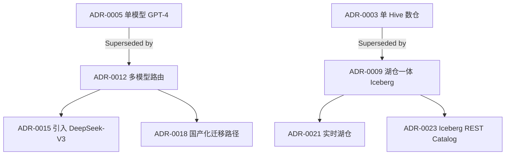

> 本文件是 **01-adr.md** 的子文件（§4. 工程实现）。本节讲怎么把 [§3](01-adr-section-3-sec3.md) 里的模板、流程与门禁装进一个真实组织与一个存量文档库：顺序、判据、产物、存量迁移与多久见效。完整章节请回到 [index](01-adr.md)。

## 4. 工程实现

本节按「落地步骤 → 关键技术点 → 工具链 → 存量迁移 → 模板 → 自检」组织。术语与主文件 [§2 核心原理](01-adr.md) 逐字一致：**Context / Options / Decision / Consequences / Status**、**MADR**、**Y-statement**、**ADL（Architecture Decision Log）**、**ADR Index**、**Decision Owner**、**Supersede**，在本节里指的就是 §3 里那几件事，不另立口径。模式本身被什么约束逼出来、代价与失效点见 [§3 设计模式与范式](01-adr-section-3-sec3.md)。

读者分两类，本节两栏都覆盖。**从零搭建**的组织按 4.1 的八步往下走，4.4 可以略读；**在存量上改造**的组织（已经在 Confluence / 设计文档 / 聊天记录里存着大量未归档的决策）建议先读 4.4 再回到 4.1——存量组织最贵的成本不是把模板定出来，而是把散落在设计文档与聊天记录里的结论，收敛成一条条能被检索、能被 supersede 的记录，这件事的顺序与从零搭完全不同。

### 4.1 落地步骤（八步，其中三步是硬顺序）

**Step 1：定义什么决策必须写 ADR（1 周【经验】，随组织规模与决策密度变）**

1. 列触发条件：**跨团队或跨接口与数据契约、难回滚、引入新依赖或新组件、违反直觉（同团队会得出不同结论）、成本量级显著**——任一命中即必须写（本章 [§3.7](01-adr-section-3-sec3.md) 把这条列为库能否长期存活的前提）。
2. 同时列「不写」的反例：单团队内、一周内可回退、恢复成本低于记录成本的改动不写——「恢复成本低于记录成本约一个数量级」是 §3.1 给的保守止损线【经验】。
3. 把两份清单写进库的 README，并指定**谁有权判定「这算不算触发」**——这个判定权必须落在一个人身上。

- **产物**：一页触发条件清单 + 一页反例清单，落进 `docs/adr/README.md`。
- **判据**：拿过去三个月已发生的 10 次技术变更回测清单。命中不足 1 次，说明清单写成了正确的废话；要求写而实际没写的有 5 次以上，说明门槛定得远高于现状，先把强制范围收缩到其中一类。
- **为什么必须第一步**：模板、生命周期、Index 都只回答「怎么装」，不回答「这一条该不该存在」。顺序反过来，库里第一批记录的构成由「谁写得多」决定而不是由「哪些决策重要」决定，结果是两种失败之一：库先变成流水账再变成空库，或重要决策一条都没进去【经验，症状见 §3.7 自检清单倒数第二条（12 条中的第 11 条）】。

**Step 2：选择模板（1–2 周【经验】，随候选模板数与是否要 RFC 收敛而变）**

1. 按 §3.3 决策表定形态：Nygard 四段 / MADR / Y-statement / Lightweight ADR + Decision Matrix / Pattern-based / Living。
2. 在 `docs/adr/README.md` 里定义模板与字段，并把**「结构固定、内容可扩展」**写成明文约定——跨业务可横向对比与自动检查都建立在这一条上（本章 [§6 案例 6.3](01-adr-section-6-sec6.md)）。
3. 在仓库根放 `.github/adr-template.md` 或 `.adr-template.md`，并在 `docs/adr/templates/` 下落一份 `adr-template.md`。

- **产物**：带版本号与生效日期的模板文件 + README 里的字段定义。
- **判据**：让两个不同团队的人各填一条同题目的 ADR，逐段比对两份材料的段落标题是否一致；不一致则「可横向对比」和「可自动检查」都还不成立。
- **为什么必须排在触发条件之后、仓库结构之前**：模板决定一条记录装哪些字段，字段一旦落进历史记录里，整体重排就要动全部旧条目；而它又必须先于目录结构，因为 `templates/` 下放几个文件由模板数决定，反过来先建目录会留下一个永远只用了一部分的空目录。

**Step 3：建立 ADR 仓库结构（1 周【经验】，随模板数量与是否要分主题子目录而变）**

```text
docs/
  adr/
    README.md            # ADL 索引（编号 / 标题 / 状态 / 主题 / Owner）
    0001-use-kafka-for-event-bus.md
    0002-adopt-iceberg-as-lake-format.md
    0003-multi-model-routing-strategy.md
    templates/
      adr-template.md    # 团队标准模板
      lightweight.md
      madr-full.md
```

1. 目录按编号排（起步够用），超过上百条时再按主题分子目录（§3.2.5 的规模判断）。
2. 编号由脚本或 CI 分配，不靠人眼看最大号。
3. 一条决策横跨两个主题时，只放一个主目录，另一个目录的索引里写一行链接。

- **产物**：`docs/adr/` 目录树 + 编号分配规则 + 一条「副目录只放链接」的约定。
- **判据**：抽 3 个文件名，看前缀编号与文件内一级标题的编号是否一致；再新建一条 ADR 试一次，编号是否由工具给出而不是人填。
- **为什么排在模板之后**：目录里那一层 `templates/` 是模板的落点；顺序反了，目录会先长成「按人分」「按季度分」这类只反映当时组织形态的形状，之后每次组织调整都要搬文件。

**Step 4：定义生命周期（1 周【经验】，随是否需要 supersede 检测而变）**

1. Status 四态：`Proposed → Accepted → Deprecated / Superseded by ADR-XXXX`（取值同主文件 [§2.1](01-adr.md)）。
2. 每条写 Date、Deciders、Reviewers；`Superseded by` 必须双向写（新记录写它取代了谁，旧记录写它被谁取代）。
3. 引入 **Supersede 检测**：每条新 ADR 提交时扫描库内相关内容，列出可能被取代的条目。

- **产物**：一张状态机图（4 个状态 + 迁移条件）写进 README；一条「Decision Owner 必须落在有权拍板的人身上」的约定。
- **判据**：随机抽 10 条 Accepted，看它们描述的方案是否仍是当前实现——对不上的条数就是状态链的断口数（与 §3.7 同一动作）。
- **为什么排在评审之前**：状态是 PR 评审的退出条件。状态机没定义时，评审只能产出「通过 / 不通过」这种没有落点的结果，会后没人需要改任何字段；定义了状态机，评审才有一个必须写下的产物。

**Step 5：PR 化 ADR 评审（2–4 周【经验】，随团队评审习惯成熟度而变）**

1. ADR 当成 PR 提交，评审意见留在同一处。
2. 至少 2 名 Reviewer，其中含 1 名架构师或资深工程师；评审范围按影响面分级，不是所有决策都上同一级评审（本章 [§6 案例 6.2](01-adr-section-6-sec6.md) 的分级做法）。
3. Review Checklist：Context 是否完整、Options 是否齐全、Consequences 是否双面、可逆性是否标注、Status 是否合法。

- **产物**：PR 模板里的 ADR Checklist + 一份带评论历史的评审记录。
- **判据**：翻最近 5 个 ADR PR，看有没有任何一次评审真的改变了 Options 或 Consequences。一次都没有，说明评审在执行签字而不是在讨论论证。
- **为什么排在双向链接之前**：链接会把编号写进代码注释与架构图，编号一旦被引用就不能再变；评审还没定型时先建链接，改一次编号就要扫一遍整个代码库。

**Step 6：建立 ADR Index（1–2 周【经验】，随库内条目数与能否由脚本生成而变）**

在 `docs/adr/README.md` 维护一张表：

| 编号 | 标题 | 状态 | 日期 | Owner | 影响范围 |
| --- | --- | --- | --- | --- | --- |
| ADR-0001 | 使用 Kafka 作为事件总线 | Accepted | 2025-01-15 | @张三 | 数据平台 |

- **产物**：可由脚本生成的 Index 表（而不是手填表）。
- **判据**：抽 3 行 Index 与对应正文比对状态与日期是否一致；手填维护时，不一致的行数就是这张表的漂移率。再回答一次「我们为什么不用 X」需要读几篇——答案接近全量说明索引还没起作用。
- **为什么排在评审之后**：状态由评审产出，Index 只是状态的投影。顺序反了会得到一张没有状态可填的空表，而空表的手工维护成本在库变大的过程中会持续上升。

**Step 7：与代码 / 文档双向链接（持续，首轮 1–2 周【经验】）**

1. 代码注释引用 ADR：`// See ADR-0007 for why we use Cassandra instead of HBase.`
2. README / 架构图引用 ADR：` — see ADR-0001, ADR-0005.`
3. 把「ADR 编号」写进变更类 PR 的模板字段：改到受某条决策约束的模块时，PR 里必须填对应编号。

- **产物**：一份「ADR 编号 → 引用它的仓库路径」的反向清单（可由代码检索工具生成），以及走进 PR 模板的那个字段。
- **判据**：近三个月合并的 PR 里，有没有任何一条引用过 ADR 编号。有，说明记录进入了流程；没有，说明它还是独立于工程活动的旁路产物（§3.7 同一条判据）。
- **为什么必须排在这里且不能被省**：它是八步里**唯一不产出新文档**的步骤，因此最容易被当成可选项。而「与代码同库」的全部价值依赖这一环——没有引用，记录等同于 wiki 条目，记录里写的方案与代码里跑的方案会各自演化（§3.4 组合 C）。

**Step 8：定期复盘（持续，每季度一次【经验】）**

1. 每季度对 Accepted 超过 6 个月的 ADR 做一次复盘：Consequences 是否符合预期。
2. 对决策错误或已过时的条目写 supersede，不改旧记录正文。
3. 把「当初预判的哪一条代价真的出现了」记进复盘结论——这是决策质量唯一能被长期评估的入口（本章 [§6 案例 6.2](01-adr-section-6-sec6.md) 的代价回看做法）。

- **产物**：一份复盘结论清单，每条给出「维持 / 补写 supersede / 补监测字段」三种处置之一。
- **判据**：复盘会上能不能说出「当初预判的哪一条代价真的出现了」。只能说出好处，说明这些条目的 Consequences 当初只写了正面；说不出受影响的系统，说明 Step 7 的链接没建起来。
- **为什么放在最后**：复盘的对象是已经落地一段时间的决策，且它要能按编号找到受影响的系统；这个入口由 Step 7 提供。缺了它，复盘会只能凭记性开，结论也回不到库里。

**顺序里的三条硬约束**：① **Step 1 → Step 2**：模板的字段数由触发条件决定强制的粒度，触发条件未定则模板只能靠猜；② **Step 4 → Step 5**：状态是评审的退出条件，没有状态机，评审产出不落库；③ **Step 3 → Step 7 之间不可跳过 Step 6**：编号要先被登记进索引，才能被外部引用——先建链接后建索引，会出现一批指向未登记编号的引用。三条里只有 ①②③ 的顺序是有代价的，Step 8 可与任一步并行。

**八步里最常被跳过的是 Step 7**：其余七步各自产出一份看得见的东西（清单、模板、目录、状态机、PR 记录、索引表、复盘结论），只有它只增加一次「去代码里写一行编号」的动作。跳过之后第一个出问题的时点通常不是当季，而是半年后的一次重构：改代码的人按自己的理解改了实现，记录仍停在旧方案上，且因为不可变约定被冻结——这正是 §3.5 记的「文档僵尸」的暴露方式（`docs/adr/` 里最近一条是旧的，改代码的人从没打开过它），于是库给出的是一条带权威语气的过期结论，而不是少了一条记录。

### 4.2 关键技术点

**1. 模板引擎（Jinja2 / Handlebars）**

- **做法**：把模板字段做成占位符，由脚本或 CI 生成带编号、日期、状态骨架的草稿文件，作者只填内容。
- **机制**：因为生成物本身保证了字段齐全，所以「有没有 Consequence / 有没有 Options」从评审时的人才检查变成生成时就成立——这把评审者的注意力从不合规转到论证是否成立（§3.4 组合 C）。
- **失效条件**：**当模板字段被扩展而生成脚本没同步、或团队存在多个版本模板时，这条会失效**。症状是同一批新提交的 ADR 段落标题不一致——一眼可查：随机抽 5 条新记录看段落名是否逐字一致。
- **档位**：字段数属结构项，不涉数字。

**2. ADR Lint 与校验 CI（markdownlint + 自定义规则）**

- **做法**：用 markdownlint 加自定义规则检查结构完整性（必须有 Status / Decision / Consequences），在每次 ADR PR 上触发；结构检查通过后才进入人工评审。
- **机制**：因为格式类缺陷在 CI 阶段被判掉，人工评审的时间预算就落在论证上；这项收益的量级可以直接算——若一次评审 20–40 分钟【经验：随 ADR 篇幅与评审人数变】、其中格式往返占四分之一到三分之一【经验：随模板字段数、以及草稿是手写的还是脚本生成的变】，那么在每个 PR 上省下的是几分钟到十几分钟，与决策复杂度无关。
- **失效条件**：**当检查规则被写成「有这一段就算过」时，这条会失效**。症状是库里出现一批字段齐全但 Options 全是陪衬的记录，且它们比普通记录更容易被后来者采信——形式完整性会被误读为论证完整性（§3.2.2 的失效点）。判定方法：随机抽 5 条通过检查的 ADR，看 Options 里有没有一条是当时真的有人倾向的。
- **档位**：评审时长 20–40 分钟、格式往返占比 1/4–1/3 均为【经验】，随 ADR 篇幅、评审人数与模板字段数变。

**3. Supersede 检测（向量相似度 / KG 关联）**

- **做法**：新 ADR 提交时，用文本相似度对库内已有条目排序，把最相近的若干条放进 PR 描述，请作者逐条确认是否构成取代；有 KG 关联（技术 / 组件 / 接口）时按关联边收窄候选集。
- **机制**：因为取代关系是两条记录之间的一条边，而写新记录的人通常不知道旧记录存在，所以检测的作用是把「知道旧记录存在」这件事从人的记忆里移到工具里；**这正是「永不 supersede」这类断链的成本来源被消掉的地方**（§3.5）。
- **失效条件**：**当库内条目少于几十条、或相似度阈值调得过低时，这条会失效**——候选集要么为空、要么噪声过多，作者学会直接跳过提示。症状是提示长期被无视，而 supersede 边只在少数「作者本来就知道」的情形下出现。
- **档位**：库规模阈值【经验】，与 §3.2.5 的「几十条以内编号目录足够、上百条之后检索入口才开始划得来」同口径。

**4. Decision Matrix 表格化（Markdown 表格 / CSV）**

- **做法**：把 Options 与准则写成表，权重与打分独立成一列；ADR 正文记结论与代价，矩阵记依据与权重，矩阵更新不改正文（§3.2.4 的载体重划）。
- **机制**：因为评估过程与不可变的正文分离，评审可以反复改权重与评分而不破坏「一度 Accepted 就不再修改」的约定；两份载体的生命周期不同，分开之后各自都干净。
- **失效条件**：**当矩阵的分被当成结论时，这条会失效**——「加权算出来 B 更高所以选 B」。症状是评审里没有人再追问权重从哪来，而决定权从人手里移到了表格上（§3.2.4 的失效点，§7.1 对打分表的批评同源）。判定方法：问一句这批权重是谁定的、结论与矩阵不一致时以哪份为准。
- **档位**：不涉数字。

**5. 可视化决策图谱（Graphviz / Mermaid / 图数据库）**

- **做法**：把 ADR 当节点、supersede 与依赖当边，用 Graphviz / Mermaid 生成静态图，或用图数据库承载多跳查询。
- **机制**：因为「这条决策的谱系是什么」从逐条阅读变成一次遍历，所以回答「我们为什么不用 X」的成本从读接近全量降到读一条链——**这条收益的量级可以算出来**：【推算】设库内 N = 200 条【经验：两三年的中等规模积累量，随决策密度变】、按标题逐条判断 15–30 秒【经验：随标题写法与读者对该领域的熟悉度变】，无索引时一次历史问题需通读 200 条，即 200 × 15 秒 ÷ 60 = 50 分钟到 200 × 30 秒 ÷ 60 = 100 分钟；按主题与状态收窄到 10–20 条后为 2.5–10 分钟。这就是索引与图谱值得做的量化依据。
- **失效条件**：**当图上的边靠人手工维护、或库内记录之间本就很少 supersede 与依赖关系时，这条会失效**——手工边跟不上新增记录，而稀疏的图看起来像「这条链到这里就结束了」，读者会把「没画出来」误读成「没有后续」。症状是问「这条决策后来被谁改过」时图上查不到，只能退回去做全文检索，图谱退化成一张装饰图。判定方法：从 Index 里随机抽 5 条 Accepted 记录，看图上有没有它的节点、该节点有没有出边，对不上的节点数就是这张图的腐坏率。
- **档位**：N = 200、逐条判断 15–30 秒为【经验】，50–100 分钟与 2.5–10 分钟为【推算，链：200 × 15 秒 ÷ 60 与 200 × 30 秒 ÷ 60；10 × 15 秒 ÷ 60 与 20 × 30 秒 ÷ 60】。

**6. 版本控制友好（编号文件名 + git log）**

- **做法**：文件名带零填充编号（`0007-xxx.md`），与代码同库；用 git log 追溯每条记录的提交历史与修改人。
- **机制**：因为表状态与变更历史由版本控制天然提供，所以「这条记录是谁在什么时候写的、被谁改过」不需要额外系统；同时 diff 能力让「只改状态、不改正文」这种操作可被审查。
- **失效条件**：**当 ADR 放在独立文档库（Confluence / Notion）且不与代码仓库同源时，这条会失效**——diff 与评审环节都不存在，此时记录的时效完全取决于有没有人记得去改。症状是问「这条记录最后一次修改是什么时候」只能得到页面上的「最后编辑」时间，而看不出改了什么。
- **档位**：不涉数字。

**7. 跨仓库聚合（Git Submodule / 仓库索引）**

- **做法**：组织级库聚合各团队的 ADR：用 submodule 或索引仓库汇总，只汇总索引与元数据，正文留在原仓库。
- **机制**：因为聚合的是编号、状态、主题、Owner 这些字段而不是正文，所以组织级视图的维护成本与正文总量解耦；跨 BU 重复讨论才可能被结构性地发现（本章 [§6 案例 6.3](01-adr-section-6-sec6.md)）。
- **失效条件**：**当各团队的模板结构不一致时，这条会失效**——汇总得到一堆无法对比的条目，横向比较只能靠人工读。症状是组织级索引长期只有编号与标题两列能看，状态与主题两列大面积空缺。
- **档位**：不涉数字。

**8. 决策检索（全文检索 + 标签检索）**

- **做法**：标签取三个稳定维度（status / topic / impact），配全文检索；标签维度按「提问者会怎么问」选，而不是按技术栈怎么分（§3.2.5）。
- **机制**：因为标签只对「已经知道该看哪一类」的人有效，所以全文检索负责覆盖「不知道看哪类」的提问，标签负责覆盖「要按类聚合」的提问，两者不可互相替代。
- **失效条件**：**当标签维度与提问维度不一致时，这条会失效**——读者问「跨数据域的权限怎么定」而目录按技术栈分。症状是新人仍然靠问人，库的实际使用者永远是同一批老人（§3.2.5 的失效点）。判定方法：让一个没参与过决策的人只靠检索回答一个历史问题，记录他中途问了谁。
- **档位**：不涉数字。

### 4.3 工具链与平台

工具表给的是**类别与判据**，不是推荐组合。产品是否仍以表中的能力提供，以各自官方文档与发布说明的当前版本为准。

**不再列入候选的四个名字要说清楚**：**AdrGPT**、**Decider.ai**、**Decision Intelligence Platforms**（AI 决策助手类）与 **adrsearch.dev**（跨仓库 ADR 检索）——它们是否仍以当时的能力与形态提供，无法按官方文档确认，因此不进表；要评估这一类时，请按上述关键词自行检索并以其当前文档为准，判据仍用「AI 辅助起草」那一列（输出是可复核的草稿还是写权限）。

| 类别 | 候选 | 选型判据（在什么约束下选哪个） | 不选它的代价 |
| --- | --- | --- | --- |
| 模板与规范 | MADR、Nygard 四段式、Y-statement | 读者还能不能当面问到拍板人；跨团队或跨年则必须有 Considered Options 与 Decision Drivers（§3.3） | 轻量模板缺 Options，后人无法质疑结论，只能把同一个选型重开一轮 |
| 目录与脚手架 | `adr-tools` 一类 CLI（新建、链接、生成索引）、ADR-as-Code 式的 DSL 编译方案 | 会不会被 CI 调用——能进流水线才值得引入 | 靠人工维护编号与索引，库一大就出现重号与漏登 |
| 静态站点与浏览 | log4brains 一类 ADR 静态站点生成器、`mkdocs-adr-viewer` 一类 MkDocs 生态的 ADR 渲染方案 | 库是否需要被非工程同学按主题浏览 | 只有 Markdown 目录时，非工程读者按编号找记录的成本与库规模同比上升 |
| 开发者入口 | Backstage 生态的 ADR 插件、VS Code 类编辑器的 ADR 片段扩展（以插件市场当前版本为准） | 目标读者是否常驻该入口——入口在哪，记录才被读到 | 记录放在读者不会路过的地方，等同于没有记录 |
| 协作与评审 | GitHub / GitLab PR、Confluence + Markdown 插件、Notion Database、Linear / Jira | 评审能不能留下带版本的评论与状态变更；PR 能，纯 wiki 不能 | 用不产生版本化评论的载体时，决策过程无法成为对齐工具（§3.4 组合 C） |
| AI 辅助起草 | 通用大模型（Claude / GPT-4 类）作起草助手、编辑器内补全（GitHub Copilot 类）、把 ADR 库作为语料喂给文档问答类工具（NotebookLM 类） | 输出是可复核的草稿还是写权限；有没有可检索的语料作为输入（§5.2.1、§5.2.2） | 把判断权交给模型，而模型的建议无法被评委追溯到证据 |
| 图谱与检索 | Mermaid / Graphviz、图数据库（Neo4j / NebulaGraph 类）、Algolia DocSearch、GitHub Code Search | 是「人查」，还是「按类聚合与多跳问答」——后者才需要图结构 | 用平面目录承载谱系关系，supersede 链断裂时没有任何机制能发现 |

**这一类里最容易被误选的是「AI 辅助起草」当作 ADR 制度的入口**。误选的典型后果不是文档变差，而是**库的置信度被系统性地抬高**：AI 能在几分钟内生成字段齐全的 MADR，但它举出的 Options 往往不是「当时真的有人倾向的」那几条；这类记录因为形式完整，检索器与后来者会以更高置信度采信（§3.2.2 的失效点）。判断方法只有一条：抽 5 条由草稿起步的记录，去问当时参与的人，Options 里能对上几条。

**取用原则**：工具名不是能力名。判断一个平台能不能用，看它的官方发布说明里，「检索、状态变更、结构校验」这类能力是正式条目还是预览项，以及导出格式是否可迁移——换供应商不会因此换掉记录的数据形态，才值得接进来。

### 4.4 存量迁移

存量组织的迁移目标不是「重新写一遍 ADR」，而是**让已经发生的决策在新的记录体系里可被检索、可被质疑**。下面按「只读盘点 → 分类处置 → 双轨 → 收口」四步排，最后列出这个阶段最常见的三个错误。

**① 先做一次只读盘点（2–3 周【经验】，完全可回退）**

在不新增任何流程的前提下，把现有决策载体盘成三张表：近 24 个月发生过的重大技术决策清单（来源：设计文档、评审纪要、变更单、聊天记录）；每一条的当前状态（仍然成立 / 已被后来的做法推翻 / 已无人记得）；每条对应的「谁会受影响」。这一步不产出制度，只产出**一次事实基线**；它可回退，是因为盘点结论不进任何人的绩效，只作为设计输入。

**判据**：拿这三张表去问两位互不相干的技术负责人「哪三条决策现在最可能已经过时」，两人给出的交集若非空，说明现有材料已足够支撑讨论；交集为空，说明证据形态还没定义，先回到 Step 1。

**② 历史资产分类处理（不要全部返工）**

| 存量资产 | 处置 | 理由 |
| --- | --- | --- |
| 设计文档里的决策段 | **抽取成条**：只抽「结论 + 当时约束 + 被否掉的选项」，设计细节留在原文档并回链编号 | 设计文档会随实现就地编辑，决策段留在里面就会被顺手改写，历史因此丢失（§3.4 组合 B） |
| 已有 ADR 但结构不一 | **只规范 Status / Date / Owner 三个字段**，Options 缺失的**打标挂账**（标注 `options: pending`） | 补 Options 要打扰当事人回忆，成本高且不可靠；打标后无人维护的条目会自然浮出 |
| 聊天记录 / 邮件里的结论 | **不追认**为 Accepted，先登记为一条待确认记录 | 聊天记录里的是倾向不是决策，追认会把没有拍板过程的东西变成有权威语气的结论 |
| 旧格式的 ADR 编号 | 保留原编号，不重编号 | 重编号会让代码注释与文档里的引用全部指向废号 |
| RFC / 评审纪要 | 保留原位，在 ADR 里写来源链接 | 两者是决策流程的不同阶段，合并会丢掉异议的暴露过程（§3.4 组合 A） |

- **产物**：一张 `存量决策台账`：编号 / 现状（现行 / 已过时 / 待确认）/ 来源链接 / 是否已有 Options。
- **判据**：抽 3 份历史设计文档，用新模板重抽一次决策段——若 2 份以上抽出来的结论与原文档的表述冲突，说明抽取口径还不清楚，先写清楚「什么算一条决策」再扩大范围。
- 【推算】抽取一批的成本：设存量设计文档 M = 50 份【经验：随组织历史长度与文档规范程度变】、每份抽一条决策 20–40 分钟【经验：随原文里决策段的完整度变——结论、约束、被否选项散在正文各处的要更久】，则 M × 20 ÷ 60 ≈ 16.7 小时到 M × 40 ÷ 60 ≈ 33.3 小时，即约 2–4 人日【推算，链：50 × 20 分钟 ÷ 60 与 50 × 40 分钟 ÷ 60，再按 8 小时/人日折算】。这个量级说明「全部返工」在任何中等规模的组织里都不是选项。

**③ 双轨怎么维持、维持多久**

双轨的形态是：**已进入当轮评审的决策走旧流程（该写什么写什么），新周期的决策走新流程（先写 ADR 再拍板）**。两套载体各带版本号，材料按版本归档。维持 **1–2 个决策评审周期**【经验，随评审频率变——每季度一次专题评审时约 3–6 个月】。

双轨期有三条纪律：不把两套载体下的结论混在一张 Index 里排序；复盘会同时过两套材料，并把「按哪一版流程产生」写进结论；新模板在老周期里只做观察记录，不产生后果。这三条的作用是把双轨成本限在「解释」上，而不让它渗进结果。

**④ 什么信号说明可以退出双轨**

三个可观测信号，同时出现两个即可收口：① 新周期里没有人再按旧途径（群里说一声）落决策；② Index 上手工补录的条目连续两个周期为零；③ 抽 10 条新记录，Status 与当前实现的吻合率与老周期持平。若经过两个周期三个信号全不成立，正确的动作是**回退到单一旧流程**、把新流程退回 Step 1 重做，而不是继续双轨——双轨的隐性成本是所有人对「什么必须记录」的解释不一致，它比流程暂时落后更伤制度信用。

**双轨期归档材料的最小字段**：`adr_id` / `process_version`（按哪一版流程产生）/ `decision_owner` / `status` / `supersedes`。缺 `supersedes` 一列，两个周期之后就说不清某条记录到底取代了谁，状态链会从中间断开——这一列是硬要求，不是可选项。

**⑤ 迁移期最常见的三个错误**

1. **给历史决策统一补编号并按编号重排。** 编号一旦进入代码注释与文档引用，重排产生的是一批废号；正确做法是保留原编号、只补 Status 与 Owner。
2. **把 RFC 与 ADR 合并成一种材料。** 两者是决策流程的两个阶段（§3.4 组合 A）；合并之后异议的暴露过程消失，记录里只剩结论，而结论恰恰是最没有信息量的部分。
3. **只补记录，不改评审的入口条件。** 记录的产量由评审的入口决定，不由模板决定——评审没有「没记录不上会」这条退出条件，补出来的条目会在两个周期内停止增长（§3.5「文档僵尸」的成因）。

### 4.5 模板 / 示例

**模板 1：三份模板的填法对照（正文结构见 [§3.2](01-adr-section-3-sec3.md)，这里只给填法）**

| 模板 | 什么时候用 | 哪几格必须自己写 | 哪几格不要照抄 |
| --- | --- | --- | --- |
| Nygard 四段式 | 单团队、可逆、读者就是三个月后的自己 | Context 写「当时的约束」，Consequences 必须写负面代价 | 不要把 Options 硬塞进去——四段里没有这个槽位，补它请换 MADR |
| MADR | 跨团队、跨年、涉及接口与数据契约 | Decision Drivers 要写真正的约束（不是技术偏好）；Considered Options 至少一条是当时有人倾向的 | Confirmation 不要写成「后续观察」——要写具体时点与判据 |
| Y-statement | 库已大到需要跨条聚合、或要机器处理 | 五个槽位都要填满，缺一个就不能被聚合 | 槽位装不下取舍过程，它必须配主文档，不能当唯一记录 |

**怎么用**：先按 4.1 Step 1 的触发条件判断这条决策值不值得写，再回来选行；三行里的「哪几格必须自己写」是评审时的必查项，「不要照抄」一列是三种最常见的误用。

**模板 2：ADR PR 的 Review Checklist**

```text
[ ] Context 写的是「当时真实存在的约束」，不是「这个方案有多好」
[ ] Options 里至少有一条是当时真的有人倾向的选项
[ ] Consequences 含负面代价，且写成机制：成本落在哪、在什么条件下反转
[ ] Status 合法，且落定为 Proposed 或 Accepted（不留下空状态）
[ ] Decision Owner 落在有权拍板的人身上，不是撰写人
[ ] 若取代了旧条目：旧条目的 Superseded by 字段已在本 PR 内一并更新
[ ] 本记录里没有表结构 / 接口签名 / 部署拓扑——那些属于设计文档
```

**怎么用**：前六条逐条勾；最后一条是「伪 ADR」的自查。若某条勾不上，把它写进 PR 评论而不是直接改作者的文字——评论是记录的一部分，改动不是。

**模板 3：ADR 结构校验（CI 片段，示意）**

```yaml
# .github/workflows/adr-lint.yml（示意，字段名以所用 action 的当前文档为准）
on:
  pull_request:
    paths: ['docs/adr/**/*.md']
jobs:
  adr-lint:
    runs-on: ubuntu-latest
    steps:
      - uses: actions/checkout@v4
      - run: |
          for f in $(git diff --name-only origin/main...HEAD -- 'docs/adr/**/*.md'); do
            grep -q '^## Status' "$f"      || { echo "缺少 Status: $f"; exit 1; }
            grep -q '^## Consequences' "$f" || { echo "缺少 Consequences: $f"; exit 1; }
          done
```

**怎么用**：只做「有没有这一段」的存在性检查，不判断内容质量——内容留给人工评审。若你的库用 MADR，把 `Status` 换成 `## Decision Outcome` 与 `## Considered Options` 两段；规则一旦改动，要同步检查存量条目是否会被新规则判失败。

**模板 4：AI 辅助 ADR 起草 Prompt（出草稿，判断仍由人做）**

```python
ADR_DRAFT_PROMPT = """
你是一名资深数据架构师，请基于以下信息起草一份 MADR 格式的 ADR 草稿。

输入：
- 背景与约束：{context}
- 候选选项：{options}
- 推荐意见：{recommendation}

输出：
1. 按字段输出：Status / Date / Deciders / Context and Problem Statement /
   Decision Drivers / Considered Options / Decision Outcome / Consequences / Confirmation
2. Consequences 必须包含负面代价，并写成机制（成本落在哪、什么条件下反转）
3. 每一项你没把握的信息，用 [待确认] 标出，不要补全

禁止：编造候选选项；不要给出评分、百分比或任何未经输入提供的数字。
"""
```

**怎么用**：它压缩的是排版与字段齐全这两项成本，不替代论证。三格输入里 `{options}` 是唯一的必填项——**没有真实候选集的输入，模型只会编出陪衬式选项**，这正是 §3.2.2 失效点的入口。输出里唯一要保留的是那些 `[待确认]` 标记，它们就是评审时该追问的清单。

**模板 5：Mermaid 决策图谱（supersede 链）**



**怎么用**：只画 supersede 与依赖两类边，不要把「相关」也算成边——边一多这张图就退化成装饰。编号与标题从 Index 表生成，别手写；图与 Index 不一致时，以 Index 为准，并把图改成由脚本生成。

**模板 6：季度复盘议程（60 分钟）**

```text
0-10 分   选条目：Accepted 超过 6 个月的记录，按影响范围排序
10-40 分  逐条回看：当初预判的代价，哪一条真的出现了？没出现的是为什么？
40-55 分  处置：每条给一种结论 —— 维持 / 补写 supersede / 补监测字段
55-60 分  行动项：每个 supersede 落到一个编号、一个人、一个日期
反规则：说不出「哪条代价真的出现了」的条目，直接进入「补监测字段」队列
```

**怎么用**：只填条目与三条时间；「反规则」一行不要删——它是这条议程唯一能防止复盘会变成读稿的部分。若一次会过不完所有条目，把影响范围最大的几条排前面，其余顺延到下季度，不要缩短单条时间。

**模板 7：`adr-tools` 一类 CLI 的用法（建库 → 新建 → 链接 → 生成索引）**

```bash
adr init docs/adr                            # 初始化库
adr new "采用 Apache Iceberg 作为湖仓表格式"   # 生成带编号的记录文件
adr link 7 "Superseded by" 12                # 建立 supersede 关系
adr list                                     # 列出全部记录
adr generate toc > docs/adr/README.md        # 由记录生成 Index 表
```

**怎么用**：命令名与安装方式以所用 CLI 的当前文档为准；这五条对应 4.1 的 Step 3（结构）、Step 4（生命周期）与 Step 6（索引）三处，把它们接进 CI 之后，编号与索引就不再依赖人眼看最大号。`generate toc` 会重写 README 的索引段落——先把「触发条件清单」这类手写内容移到单独文件，再让它接管那张表。

### 4.6 成本：这套东西的账单

ADR 的账单上没有机器那一栏。记录是文本、随代码进版本库，硬件与云账单基本不成立；真正持续出钱的只有两处——**写与评审的人力**、**维护索引与 supersede 链的人力**，而后者是这条链上唯一会随时间自己变贵的部分。

- **人力（大头，且不随库变大而摊薄）**：一条完整 MADR 的起草加评审约 30–90 分钟【经验，随是否含评估矩阵与候选集大小变】；4.4 的存量抽取量级是 2–4 人日 / 50 份文档【推算，链：50 份 × 20–40 分钟 ÷ 60 ≈ 17–33 小时，再按 8 小时/人日折算，完整链见 4.4】。它贵在这里的原因是 **ADR 不服从规模经济**：每加一条记录，检索负担与 supersede 维护负担就多一分，而这两项没有任何自动化能免除、只能被工具部分摊销（§2.3 把可逆性分析列为选「轻量 / 完整」的依据，正是这笔人力在决定模板的重量）。
- **工具（小头）**：CI 里跑一次结构校验是分钟级【经验】；静态站点生成器与图数据库（4.3「图谱与检索」那一行）只在库大到需要跨条聚合时才值得引入——多数团队在这一格上多买了工具、少买了纪律。
- **激励（不适用）**：这一项在本主题没有对应物，不硬凑。
- **与云账单的关系**：本主题唯一可能出现在财务账上的，是 4.3 里那类工具订阅与静态托管；基础设施侧的通用 TCO 转 [11-cross-cutting/03-data-cost-finops](../../11-cross-cutting/03-data-cost-finops/03-data-cost-finops.md)，本节只算「记录这件事」自己的账。

### 4.7 容灾与故障演练

**本主题不适用跨地域容灾**：记录是版本库里的文本，机房级冗余由代码托管平台自身覆盖，ADR 侧不存在「切到异地副本」这种动作——编一套多活只会制造从未被验证的仪式。它真实的失效形态是**可用性衰减**而非服务中断：

| 失效模式 | 影响面 | 降级策略 | 演练方案 | 恢复目标 |
| --- | --- | --- | --- | --- |
| 库丢失 / 被覆盖 | 全部历史决策不可查 | 以 git 历史作备份，恢复即 revert | 每季度从远端裸克隆一次，抽查 1 条 | RPO ≈ 最后一次 push【经验】 |
| supersede 链单边断裂 | 后人按已废结论施工 | 以 Index 为准，脚本重建图（4.5 模板 5） | 抽 1 条被推翻的决策走一次正反查 | RTO = 一次检索内【经验】 |
| 记录与实现漂移 | 决策「看起来仍成立」 | 季度复盘逐条回看（4.5 模板 6） | 抽 10 条 Accepted 对当前实现 | 一个复盘周期【经验】 |
| AI 草稿抬高置信度 | 检索器采信了陪衬选项 | Options 打 `options: pending` 挂账 | 抽 5 条 AI 起稿记录，问当事人对得上几条（4.3） | 不涉 RTO，靠抽查把关 |

四行里只有前两行是「丢东西」，后两行是「东西还在但错」——后者更贵，也更不容易在一次演练里暴露。RTO / RPO 全部是【经验】区间：本主题没有可指名的公开 SLA 可引；若必须给量度，只有一句话——**记录的残值取决于最近一次复盘距今多久**，超过一个复盘周期，它就开始与当下脱节。

### 4.8 演进路线：0 → 1 → 100

- **0 → 1（最小可用）**：一个团队、一个 `docs/adr/` 目录、一份 Nygard 四段式模板，评审走 PR（4.1、4.5 模板 1）。**变贵的是写第一条记录的人力**——第一次要把「当时被否掉的选项」逼出来，没人能替你省；**先坏的是触发条件**：没定义「什么决策必须写」，库两周内就停更（4.10 小结点名的 Step 1）。
- **1 → 100（规模化）**：库跨团队 + Index + 状态机 + supersede 检测接进 CI，模板从四段式升到 MADR（4.2、4.3）。**变贵的是索引与链路的维护人力**——它随条目数增长，是这一阶段唯一超线性的项；**先坏的是检索**：编号还在，但没人按提问方式打标签，库的实际使用者退化回同一批老人（4.2 第 8 条的失效条件）。
- **100 →（下一道坎）**：AI 增强层——把 ADR 库当语料喂给**只读问答**（§5.1 判 L1），并用相似度**列出**该被复核的 supersede **候选清单**（§5.1 判 L2，只输出建议、不自动改 Status）；更上层的 Decision Intelligence 平台与决策图谱各属 L3（§5.1），不与 L1 的检索问答合称（§1.4 的 2025 前沿方向）。**变贵的是置信度**：相似度一旦误报，会把「未被推翻」的记录列进该复核清单；**先坏的是人对库的信任**——这比库小更致命，判据与 4.3「图谱与检索」那一行一致。

三阶段可以压成一句判据：**当你已经能用库回答「某条旧决策今天还成立吗」时，才真正离开了 0 → 1**——在那之前，加 Index、加图、加 AI 都只是在给一个会停更的库化妆。

### 4.9 自检清单

1. 打开库的 README，触发条件清单在不在？拿过去三个月的 10 次技术变更回测，命中几次？
2. 随机抽 5 条 ADR，Options 段里有没有一条是「当时真的有人倾向的」？全是陪衬即为「事后追溯」。
3. 随机抽 5 条 ADR，Consequences 里有没有写明负面代价？只有「性能更优、维护更简单」这类形容词的等于没写。
4. 随机抽 10 条 Accepted，它们描述的方案还是当前实现吗？对不上的条数就是状态链的断口数。
5. 近三个月合并的代码 PR 里，有没有任何一条引用过 ADR 编号？
6. 问一句「这条决策是谁拍板的」——回答是撰写人而不是 Decision Owner，说明模板里缺这个槽位。
7. 数一遍 Index 表里手工补录的行；连续两个周期都不为零，说明上游流程没有把状态落库。
8. 让一个新人不靠问人、只靠检索回答一个历史问题，记录他花了多久、以及是否去找了人。
9. 库里有没有条目把表结构 / 接口签名 / 部署拓扑写进了正文？有，就是「伪 ADR」。
10. 抽一条被推翻过的决策：旧条目上有 `Superseded by`，新条目上有 `Supersedes` 吗？只有单向的就是断链。
11. 上次复盘会是什么时候开的？结论清单还在不在？答不出来，说明 Step 8 已经停用。
12. 库的 README 里，ADR / RFC / 设计文档三者的边界与产生顺序写清楚了吗？

### 4.10 小结

> 本节小结：八步里唯一不可替代的是 **Step 1 定义什么决策必须写**——模板、状态机、索引、链接都只是它的承载形式，它缺失时其余七步不会立刻报错，而是先积累一批低价值记录、再在某个时刻整体停写；等到需要引用时才发现重要的那几条从未被写下来。它比其余环节更值得投入，是因为**它决定了库的构成，而库的构成决定了它将来能被用来回答哪些问题**。
>
> 判断这套工程实现是否成立，也只需看一件事：**一个没参与过某次决策的人，能不能只靠库里的记录，判断这条决策今天是否仍然成立、以及自己该不该推翻它。**
>
> 💡 **思考锚点**：从你的 ADR 库里抽一条被推翻过的决策——旧条目有 `Superseded by`、新条目有 `Supersedes` 吗（4.9 第 10 条）？再翻上次复盘的结论清单还在不在（第 11 条）。这两条答不上来，说明你缺的是 Step 1「定义什么必须写」与 Step 8，而不是模板不好。
>
> 配合 [§2 核心原理](01-adr.md)、[§3 设计模式与范式](01-adr-section-3-sec3.md) 与 [§6 落地实践](01-adr-section-6-sec6.md) 阅读。存量改造的落地顺序以 4.4 为准，[§5 前沿演进（AI 时代）](01-adr-section-5-ai.md) 给出 AI 起草与检索在本主题下的真实落点。
