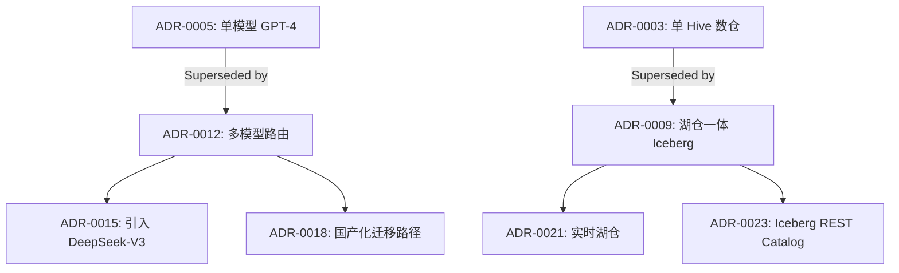

> 本文件是 **01-adr.md** 的子文件（§4. 工程实现）。完整章节请回到 [index](01-adr.md)。

## 4. 工程实现

### 4.1 落地步骤

**Step 1：选择模板**

- 从 Nygard / MADR / Y-statement 中挑一个作为团队 baseline。
- 在 `docs/adr/README.md` 中定义模板与字段。
- 在 repo 根目录放置 `.github/adr-template.md` 或 `.adr-template.md`。

**Step 2：建立 ADR 仓库结构**

```
docs/
  adr/
    README.md            # ADR Index（按编号 / 主题）
    0001-use-kafka-for-event-bus.md
    0002-adopt-iceberg-as-lake-format.md
    0003-multi-model-routing-strategy.md
    templates/
      adr-template.md    # 团队标准模板
      lightweight.md
      madr-full.md
```

**Step 3：定义生命周期**

- Status：`Proposed → Accepted → Deprecated / Superseded`。
- 每条 ADR 写明 Date、Deciders、Reviewers。
- 引入「Supersede 检测」——每条新 ADR 必须扫描 `docs/adr/` 是否与现有 ADR 冲突。

**Step 4：PR 化 ADR 评审**

- 把 ADR 当成 PR 提交。
- 至少 2 名 Reviewer（含 1 名架构师 / 资深工程师）。
- Review Checklist：上下文是否完整？选项是否齐全？后果是否双面？可逆性是否标注？

**Step 5：建立 ADR Index**

在 `docs/adr/README.md` 维护一张表：

| 编号 | 标题 | 状态 | 日期 | Owner | 影响范围 |
| --- | --- | --- | --- | --- | --- |
| ADR-0001 | 使用 Kafka 作为事件总线 | Accepted | 2025-01-15 | @张三 | 数据平台 |

**Step 7：与代码 / 文档双向链接**

- 代码注释中引用 ADR：`// See ADR-0007 for why we use Cassandra instead of HBase.`
- README / 架构图引用 ADR：` — see ADR-0001, ADR-0005.`

**Step 8：定期复盘**

- 每季度对 Accepted 超过 6 个月的 ADR 做一次「复盘会」。
- 检查 Consequences 是否符合预期。
- 对决策错误 / 过时的 ADR 写 supersede。

### 4.2 关键技术点

1. **模板引擎**：Jinja2 / Handlebars 生成 ADR 草稿——避免每次重复字段。
2. **ADR Lint**：用 markdownlint + 自定义规则检查 ADR 是否完整（如必须有 Status / Decision / Consequences）。
4. **ADR 校验 CI——每次 ADR PR 触发「完整性 + 一致性」校验。
5. **Supersede 检测**：基于向量相似度 / KG 关联，自动提示「本 ADR 是否 supersede 现有 ADR」。
6. **Decision Matrix 表格化**：用 markdown 表格 / CSV 维护选项打分。
7. **可视化决策图谱**：用 KG / Graphviz / Mermaid 把 ADR 之间的 supersede 关系画出来。
8. **版本控制友好**：文件名带编号（`0007-xxx.md`），git log 可追溯。
9. **跨仓库聚合**：组织级 ADR 库聚合各团队 ADR（用 Git Submodule / Repo 索引）。
10. **决策检索**：全文检索 + 标签检索（status / topic / impact）。

### 4.3 工具链与平台（含 2024-2025 新工具）

**模板与编辑器**：

- **MADR**：3.0+（2024）—— Markdown-first 模板工具集。
- **adr-tools**（Nygard 风格 CLI）—— shell 命令 `adr new`、`adr list`、`adr link`。
- **log4brains**（2022+）—— ADR 静态站点生成器（基于 Markdown + Material for MkDocs）。
- **mkdocs-adr-viewer**——把 ADR 渲染成网页。
- **Backstage ADR Plugin**（2024）—— Spotify Backstage 集成 ADR 视图。
- **VSCode ADR Snippets**——一键生成 ADR 草稿。

**AI 辅助（2024-2025）**：

- **GitHub Copilot**（2024）——自动补全 ADR 字段（Status、Date 等）。
- **Claude / GPT-4 ADR Assistant**——基于历史 ADR 起草新决策。
- **AdrGPT**（2024）——专门用于 ADR 起草与评审的 LLM 工具。
- **Decider.ai**（2025）——AI 决策助手，支持 ADR 模板对话式填写。
- **Decision Intelligence Platforms**（2024+）——组织级决策图谱 + AI 助手。
- **NotebookLM + ADR**（2025）——把 ADR 库作为语料，自动生成决策摘要 / FAQ。

**协作平台**：

- **GitHub / GitLab PR**——ADR 评审主流方式。
- **Confluence + Markdown Plugin**——传统企业的折中方案。
- **Notion Database**——ADR 作为数据库表，便于筛选。
- **Linear / Jira**——ADR 与 Issue 关联（每条 Issue 引用 ADR）。

**治理与可视化**：

- **log4brains** + Material 主题——漂亮静态站点。
- **ADR-as-Code**（2024）——把 ADR 用 DSL 表达（ADR 编译器 → 多格式输出）。
- **Mermaid / Graphviz**——画决策图谱。
- **Neo4j / NebulaGraph**——把 ADR 当成 KG 节点，构建 Decision Graph。

**检索与发现**：

- **Algolia DocSearch**——ADR 全文检索。
- **GitHub Code Search**——直接在 repo 内搜索 ADR 编号。
- **专用 ADR 搜索引擎**（如 `adrsearch.dev`，2024）——跨仓库 ADR 检索。

### 4.4 代码 / 示例

**示例 1：Nygard 经典 ADR**

```markdown
# 7. 使用 Apache Iceberg 作为湖仓表格式

## Status
Accepted

## Context
公司原有 Hive + ORC 栈在以下场景失效：
1. 写时模式（schema-on-write）导致 schema 演进成本高；
2. 缺乏 ACID 事务，UPSERT / DELETE 性能差；
3. 跨引擎（Spark / Flink / Hive）数据不一致；
5. 元数据不可扩展，元数据查询慢。

我们正在选型新的湖仓表格式，用于支撑数据湖、数据仓库、流批一体三层需求。

## Decision
采用 Apache Iceberg 作为湖仓表格式。

理由：
1. **Schema 演进**：列增删 / 重命名 / 类型提升 / 嵌套列重排均为原子操作；
2. **ACID 事务**：基于快照隔离的乐观并发控制，支持 Flink / Spark 跨引擎一致性；
3. **Hidden Partitioning**：分区对用户透明，避免人为分区错误；
4. **元数据可扩展**：元数据按 manifest list 分层，支持 PB 级；
5. **生态丰富**：Spark / Flink / Trino / Hive / Presto / Dremio / Impala 原生支持；
6. **社区治理**：Apache 顶级项目，社区活跃。

## Consequences

### Positive
- Schema 演进成本降低 80%；
- 跨引擎一致性提升（snapshot ID 统一）；
- 数据治理能力增强（time travel、rollback）；
- 工具链成熟（Iceberg REST Catalog、 Nessie / Polaris）。

### Negative
- 学习曲线较陡（snapshot / manifest 概念）；
- 小文件问题（需配套 rewrite 策略）；
- 与 Hive 兼容性需测试（尤其是 legacy UDF）。

### Neutral
- 选 Hudi / Delta Lake 也能解决 80% 问题——本决策选 Iceberg 是基于「生态 + 治理 + 长期演进」。
```

**示例 2：MADR 完整版**

```markdown
# 12. 智能体平台采用 Claude + GPT-4 双模型路由策略

- Status: Accepted
- Date: 2025-09-12
- Deciders: @王架构（首席架构师）、@李总监（数据平台负责人）
- Consulted: @张博士（AI 科学家）、@赵组长（应用组代表）
- Informed: 全平台工程团队

## Context and Problem Statement

公司智能体平台当前面临以下问题：
1. 单模型依赖（OpenAI GPT-4）带来供应商锁定与可用性风险；
2. 不同业务场景对模型能力差异巨大（中文、推理、长上下文、合规）；
3. 模型成本占总运营预算 35% 且持续增长；
4. 业务方对模型响应延迟 / 质量 SLA 要求差异大。

我们需要决定：**是否采用多模型路由策略？如果是，用哪些模型？怎么路由？**

## Decision Drivers
- **能力覆盖**：必须覆盖中文（国内业务）、英文（海外业务）、长上下文（法律文档）、推理（数学 / 代码）；
- **可用性 SLA**：核心场景 P99 < 2s，可用性 ≥ 99.9%；
- **成本控制**：单次调用成本下降 ≥ 20%；
- **合规要求**：国内业务优先国产大模型（如文心 / 通义 / DeepSeek）；
- **工程成本**：引入复杂度可控，团队 1 个月内能落地。

## Considered Options
1. **保持单一 GPT-4**——不变，保留所有风险；
2. **采用 Claude + GPT-4 双模型**——按任务类型路由；
3. **采用 Claude + GPT-4 + 文心 / 通义三模型**——按地域 + 任务路由；
4. **自研模型路由层 + 全部模型接入**——最灵活但工程成本高。

**Chosen option: 选项 3**，因为它在「能力覆盖 + 合规 + 成本」三角上达到最优。

## Decision Outcome

采用 **Claude 3.5 Sonnet + GPT-4o + 通义千问 Qwen-Max** 三模型组合，基于**任务类型 + 数据敏感度 + 地域**三维路由：

| 路由维度 | 规则 | 默认模型 |
| --- | --- | --- |
| 任务类型 | 推理 / 代码 / 长文档 | Claude 3.5 Sonnet |
| 任务类型 | 创意写作 / 多语言 / 通用 | GPT-4o |
| 数据敏感度 | 含 PII / 客户数据 | 通义千问（私有化） |
| 地域 | 国内业务 | 通义千问 / 文心一言 |
| 地域 | 海外业务 | GPT-4o / Claude |

### Consequences
- Good: 供应商风险下降 70%；成本下降 25%；合规达标；中文能力提升。
- Bad: 路由逻辑复杂度增加；多模型评测成本上升；Prompt 需多版本维护。
- Neutral: 团队需学习多模型差异。

### Confirmation
- 30 天后做评估：成本 / SLA / 业务满意度；
- 季度复盘：路由规则是否需要调整；
- 半年后做 supersede 评估（是否引入更多模型 / 减少模型）。
```

**示例 3：Y-statement**

```
In the context of 智能体平台多模型接入,
facing 供应商锁定 + 合规 + 成本压力,
we decided for Claude + GPT-4o + 通义千问三模型路由,
to achieve 风险分散 + 合规达标 + 成本下降 25%,
accepting 路由复杂度 + 多 Prompt 维护成本.
```

**示例 5：用 Mermaid 画 ADR 决策图谱**



**示例 4：CLI 工具（adr-tools）使用**

```bash
# 安装
npm install -g adr-tools

# 初始化
adr init docs/adr

# 新建 ADR
adr new "采用 Apache Iceberg 作为湖仓表格式"
# 自动生成 0007-采用-apache-iceberg-作为湖仓表格式.md

# 建立 ADR 链接（supersede 关系）
adr link 7 "Superseded by" 12

# 列出所有 ADR
adr list

# 生成 Index 表格
adr generate-index > docs/adr/README.md
```

**示例 6：AI 辅助 ADR 起草（Python / Claude API）**

```python
import anthropic
import os

client = anthropic.Anthropic(api_key=os.environ["ANTHROPIC_API_KEY"])

def draft_adr(context: str, options: list[str], recommendation: str) -> str:
    """基于上下文 + 选项 + 推荐意见，让 Claude 起草 MADR 模板。"""
    prompt = f"""你是一名资深数据架构师，请基于以下信息起草一份 MADR（Markdown Any Decision Records）格式的 ADR：

## 上下文
{context}

## 候选选项
{chr(10).join(f"- {opt}" for opt in options)}

## 推荐意见
{recommendation}

请按 MADR 模板输出，包含字段：Status, Date, Deciders, Context and Problem Statement,
Decision Drivers, Considered Options, Decision Outcome, Confirmation。
输出纯 Markdown，不要解释。"""

    msg = client.messages.create(
        model="claude-3-5-sonnet-20241022",
        max_tokens=4000,
        messages=[{"role": "user", "content": prompt}],
    )
    return msg.content[0].text

# 使用
adr = draft_adr(
    context="公司数仓实时性差，夜间批处理延迟 12 小时，业务方要求分钟级延迟。",
    options=["Flink + Kafka", "Spark Structured Streaming", "Materialize / RisingWave"],
    recommendation="Flink + Kafka，团队有 Flink 经验，生态成熟。",
)
print(adr)
```

---
